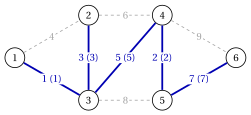

# 2.5 Algoritmo di Kruskal { #sez-sec-mst-kruskal }

**Parte 2 · Alberi e cammini · Capitolo 2** · [:material-book-open-variant: Capitolo 2: Alberi ricoprenti](index.md) · [:material-file-pdf-box: Dispensa, volume 2 (PDF)](../../pdf/dispensa-2-alberi-e-cammini.pdf) · [:material-presentation: Slide](../../pdf/slide-minimum-spanning-trees.pdf) · [:material-pencil: Esercizi: Alberi ricoprenti](../../esercizi/minimum-spanning-trees.md) · [:material-gesture-tap: App: Alberi ricoprenti minimi: Kruskal e Prim](../../laboratorio/albero-ricoprente-minimo-kruskal-prim.md)

!!! algoritmo "Algoritmo: Algoritmo di Kruskal"

    

<strong>Input:</strong> un grafo non orientato connesso \(G=(V,E)\) con pesi \(w_e\)

<strong>Output:</strong> un albero ricoprente di costo minimo \(F\)

1<strong>Passo 0 (inizializzazione).</strong> Ordinare gli spigoli per peso non decrescente, \(w_{e_1} \le w_{e_2} \le \dots \le w_{e_m}\), e porre \(F:=\emptyset\).

2<strong>Passo 1 (scansione).</strong> Per \(k=1,2,\dots,m\): se gli estremi di \(e_k\) stanno in componenti diverse di \((V,F)\), porre
    \(F:=F \cup \{e_k\}\); altrimenti rifiutare \(e_k\).

3  Se \(|F|=n-1\), <code>STOP</code>.

- Uno spigolo è <strong>accettato</strong> se unisce due componenti diverse di $(V,F)$, e <strong>rifiutato</strong> se chiuderebbe un ciclo. Le componenti di $(V,F)$ partono come gli $n$ vertici isolati e si fondono a ogni accettazione.

- In questo modulo, gli spigoli di peso uguale si esaminano in ordine lessicografico di $\{u,v\}$, con $u<v$.

!!! teorema "Teorema 2.10: correttezza dell'algoritmo di Kruskal"

    L'algoritmo di Kruskal si ferma con $|F|=n-1$, e $F$ è un albero ricoprente di costo minimo.

??? dimostrazione "Dimostrazione"

    Mostriamo che ogni spigolo accettato $e_k=\{u,v\}$ è una scelta del Passo 2 dell'algoritmo greedy generico. Sia $S$ la componente di $(V,F)$ che contiene $u$, subito prima che $e_k$ sia accettato: $v \notin S$, e nessuno spigolo di $F$ attraversa $\delta(S)$.

    1. Sia $e_h \in \delta(S)$ con $h<k$. Quando $e_h$ è stato esaminato non è stato accettato, perché $F \cap \delta(S)=\emptyset$; quindi i suoi estremi stavano allora nella stessa componente, e ci stanno ancora, perché le componenti si fondono soltanto. Questo contraddice $e_h \in \delta(S)$.

    2. Quindi ogni spigolo di $\delta(S)$ è un $e_h$ con $h \ge k$, e $w_{e_h} \ge w_{e_k}$: $e_k$ ha peso minimo in $\delta(S)$.

    3. Se la scansione terminasse con $|F|<n-1$, la foresta $(V,F)$ avrebbe due componenti unite da uno spigolo di $G$, e quello spigolo sarebbe stato accettato quando è stato esaminato, per l'argomento del punto 1.

    Per il [Teorema 2.9](l-algoritmo-greedy-generico.md#box-15-mst-th-greedy), $F$ è un albero ricoprente di costo minimo. □

## 2.5.1 Implementazione e tempo di esecuzione

- Le componenti di $(V,F)$ sono mantenute in una struttura <strong>union–find</strong>: ogni vertice $v$ memorizza l'etichetta $\mathit{comp}(v)$ della sua componente, e ogni componente memorizza la lista dei suoi vertici e la sua dimensione.

- Verificare se $u$ e $v$ stanno in componenti diverse è il confronto $\mathit{comp}(u) \neq \mathit{comp}(v)$, in tempo $O(1)$. Fondere due componenti rietichetta i vertici della <em>più piccola</em> (<strong>unione per dimensione</strong>).

!!! teorema "Teorema 2.11: tempo di esecuzione dell'algoritmo di Kruskal"

    Con la struttura union–find per etichette e l'unione per dimensione, l'algoritmo di Kruskal richiede tempo $O(m\log n)$.

??? dimostrazione "Dimostrazione"

    1. Ordinare gli spigoli richiede tempo $O(m\log m)$; poiché $m \le n^2$, $\log m \le 2\log n$ e questo è $O(m\log n)$.

    2. La scansione esegue $m$ test, ciascuno in tempo $O(1)$.

    3. Quando un vertice viene rietichettato, la sua componente si fonde con una almeno altrettanto grande, quindi la dimensione della sua componente almeno raddoppia. La dimensione non supera mai $n$, quindi ogni vertice viene rietichettato al più $\log_2 n$ volte: tutte le fusioni richiedono tempo $O(n\log n)$.

    $G$ è connesso, quindi $n-1 \le m$, e il totale è $O(m\log n+n\log n)=O(m\log n)$. □

- Il tempo di esecuzione è dominato dall'ordinamento. Con la struttura union–find ad alberi, con unione per rango e compressione dei cammini, la scansione richiede un tempo quasi lineare; il limite resta $O(m\log n)$ a causa dell'ordinamento.

- L'algoritmo usa solo confronti fra pesi: ogni trasformazione crescente dei pesi dà lo stesso albero.

## 2.5.2 Algoritmo di Kruskal sul grafo di riferimento

!!! esempio "Esempio 2.7: algoritmo di Kruskal"

    Eseguiamo l'algoritmo di Kruskal sul grafo di riferimento pesato. Gli spigoli in ordine di peso sono $\{1,3\},\{4,5\},\{2,3\},\{1,2\},\{3,4\},\{2,4\},\{5,6\},\{3,5\},\{4,6\}$. Ogni riga è uno spigolo esaminato, con le componenti di $(V,F)$ dopo il passo:

    
<table>
    <tr>
    <th>\(k\)</th>
    <th>spigolo \(e_k\)</th>
    <th>\(w_{e_k}\)</th>
    <th>decisione e componenti di \((V,F)\)</th>
    </tr>
    <tr>
    <td>\(1\)</td>
    <td>\(\{1,3\}\)</td>
    <td>\(1\)</td>
    <td>accetta: \(\{1,3\},\{2\},\{4\},\{5\},\{6\}\)</td>
    </tr>
    <tr>
    <td>\(2\)</td>
    <td>\(\{4,5\}\)</td>
    <td>\(2\)</td>
    <td>accetta: \(\{1,3\},\{2\},\{4,5\},\{6\}\)</td>
    </tr>
    <tr>
    <td>\(3\)</td>
    <td>\(\{2,3\}\)</td>
    <td>\(3\)</td>
    <td>accetta: \(\{1,2,3\},\{4,5\},\{6\}\)</td>
    </tr>
    <tr>
    <td>\(4\)</td>
    <td>\(\{1,2\}\)</td>
    <td>\(4\)</td>
    <td>rifiuta (\(1\) e \(2\) stanno entrambi in \(\{1,2,3\}\))</td>
    </tr>
    <tr>
    <td>\(5\)</td>
    <td>\(\{3,4\}\)</td>
    <td>\(5\)</td>
    <td>accetta: \(\{1,2,3,4,5\},\{6\}\)</td>
    </tr>
    <tr>
    <td>\(6\)</td>
    <td>\(\{2,4\}\)</td>
    <td>\(6\)</td>
    <td>rifiuta (\(2\) e \(4\) stanno entrambi in \(\{1,2,3,4,5\}\))</td>
    </tr>
    <tr>
    <td>\(7\)</td>
    <td>\(\{5,6\}\)</td>
    <td>\(7\)</td>
    <td>accetta: \(\{1,2,3,4,5,6\}\); \(|F|=5\), <code>STOP</code></td>
    </tr>
    </table>

    L'algoritmo si ferma dopo $7$ dei $9$ spigoli, con $F=\{\{1,3\},\{4,5\},\{2,3\},\{3,4\},\{5,6\}\}$ di peso $18$: l'albero $\tilde{F}$ dell'[Esempio 2.2](il-problema-dell-albero-ricoprente-di-costo-minimo.md#box-3-mst-ex-opt). La figura mostra, su ogni spigolo dell'albero, il suo peso e fra parentesi il passo $k$ in cui è stato accettato.

    { .fig loading=lazy  }

- Gli spigoli rifiutati $\{1,2\}$ e $\{2,4\}$ sono gli spigoli più pesanti dei cicli $1,2,3$ e $2,3,4$, come prevede la proprietà del ciclo; gli spigoli $\{3,5\}$ e $\{4,6\}$ non vengono mai esaminati.

!!! chiave ""

    L'algoritmo di Kruskal esamina gli spigoli per peso non decrescente e accetta quelli che uniscono due componenti; con union–find richiede tempo $O(m\log n)$, dominato dall'ordinamento.

---

**Avanti:** [2.6 Algoritmo di Prim](algoritmo-di-prim.md)
