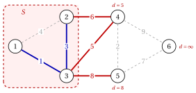

# 2.6 Algoritmo di Prim { #sez-sec-mst-prim }

**Parte 2 · Alberi e cammini · Capitolo 2** · [:material-book-open-variant: Capitolo 2: Alberi ricoprenti](index.md) · [:material-file-pdf-box: Dispensa, volume 2 (PDF)](../../pdf/dispensa-2-alberi-e-cammini.pdf) · [:material-pencil: Esercizi: Alberi ricoprenti](../../esercizi/minimum-spanning-trees.md) · [:material-gesture-tap: App: Alberi ricoprenti minimi: Kruskal e Prim](../../laboratorio/albero-ricoprente-minimo-kruskal-prim.md)

- L'algoritmo di Prim fa crescere un singolo albero a partire da un vertice iniziale $s$: l'insieme $S$ dei vertici dell'albero definisce il taglio $\delta(S)$ del passaggio 2 e il lato più leggero del taglio viene trovato attraverso un <strong>label</strong> $d(v)$ per ogni vertice $v \notin S$.

!!! algoritmo "Algoritmo: Algoritmo di Prim"

    

<strong>Input:</strong> un grafo connesso non orientato \(G=(V,E)\) con pesi \(w_e\), dati dalle sue liste di adiacenza; un vertice iniziale
    \(s \in V\)

<strong>Output:</strong> un albero ricoprente minimo \(F\)

1<strong>Passaggio 0 (inizializzazione).</strong> Imposta \(S:=\{s\}\) e \(F:=\emptyset\). Per ogni \(v \neq s\): se \(\{s,v\} \in E\), impostare
    \(d(v):=w_{sv}\) e \(\mathit{pred}(v):=s\); altrimenti impostare \(d(v):=+\infty\).

2<strong>Passaggio 1 (selezione).</strong> Se \(S=V\), <code>STOP</code>. Altrimenti selezionare \(v \notin S\) con minimo \(d(v)\), e impostare
    \(S:=S \cup \{v\}\), \(F:=F \cup \{\{\mathit{pred}(v),v\}\}\).

3<strong>Passaggio 2 (aggiornamento).</strong> Per ogni \(u \notin S\) adiacente a \(v\) con \(w_{vu}<d(u)\), impostare \(d(u):=w_{vu}\) e
    \(\mathit{pred}(u):=v\). Vai al passaggio 1.

- In questo modulo il vertice iniziale è $s=1$ e le legature di valore nel passaggio 1 sono interrotte dall'indice più piccolo.

!!! teorema "Lemma 2.12: significato delle etichette"

    Ad ogni esecuzione del passo 1 dell'algoritmo di Prim, per ogni $v \notin S$,

    $$
    d(v)=\min\big\{\, w_{uv} : u \in S,~ \{u,v\} \in E \,\big\}
    $$

    ($+\infty$ se $v$ non ha vicini in $S$) e quando $d(v)<+\infty$ il minimo viene raggiunto da $u=\mathit{pred}(v)$.

??? dimostrazione "Dimostrazione"

    Per induzione. Alla prima esecuzione $S=\{s\}$, e il passo 0 imposta esattamente $d(v)=w_{sv}$, oppure $+\infty$. Assumere l'affermazione prima dell'inserimento di un vertice $v$ in $S$. Per $u \notin S \cup \{v\}$, il nuovo set $S \cup \{v\}$ aggiunge il candidato $w_{vu}$ quando $\{v,u\} \in E$ e il passo 2 sostituisce $d(u)$ e $\mathit{pred}(u)$ esattamente quando questo candidato è più piccolo. Le altre etichette e predecessori rimangono invariate. □

!!! teorema "Teorema 2.13: correttezza dell'algoritmo di Prim"

    L'algoritmo di Prim si ferma con $|F|=n-1$ e $F$ è uno albero ricoprente minimo.

??? dimostrazione "Dimostrazione"

    Tutti i lati di $F$ hanno entrambi i punti finali in $S$, quindi $F \cap \delta(S)=\emptyset$.

    1. Per [Lemma 2.12](#box-19-mst-lem-labels), $\min_{v \notin S} d(v)$ è il peso minimo di un lato di $\delta(S)$, ottenuto da $\{\mathit{pred}(v),v\}$ per il $v$ selezionato; è finito perché $G$ è connesso.

    2. Quindi ogni iterazione è una scelta del Passo 2 dell'algoritmo greedy generico, con il taglio $\delta(S)$.

    3. Ogni iterazione aggiunge un vertice a $S$ e un lato a $F$, quindi l'algoritmo si interrompe dopo le iterazioni $n-1$ con $|F|=n-1$; [Teorema 2.9](l-algoritmo-greedy-generico.md#box-15-mst-th-greedy) conclude. □

!!! teorema "Teorema 2.14: tempo di esecuzione dell'algoritmo di Prim"

    Con le etichette memorizzate in un array, l'algoritmo di Prim viene eseguito in tempo $O(n^2)$.

??? dimostrazione "Dimostrazione"

    Sono disponibili selezioni $n-1$ e ciascuna scansiona le etichette al massimo dei vertici $n$: $O(n^2)$ in totale. L'aggiornamento dopo l'inserimento di $v$ esegue la scansione dell'elenco di adiacenze di $v$ nel tempo $O(\deg(v))$ e $\sum_{v \in V} \deg(v)=2m$. Il totale è $O(n^2+m)=O(n^2)$, poiché $m \le n^2$. □

- Sui grafi densi, con $m$ dell'ordine di $n^2$, il limite $O(n^2)$ è lineare nella dimensione del grafo.

- Con le etichette in un heap binario, ogni selezione e ogni aggiornamento impiegano tempo $O(\log n)$, per $O(m\log n)$ in totale: migliore su grafi sparsi.

## 2.6.1 Algoritmo di Prim sul grafo di riferimento

!!! esempio "Esempio 2.8: Algoritmo di Prim dal vertice $1$"

    Eseguiamo l'algoritmo di Prim sul grafo di riferimento ponderato di $s=1$. Ogni riga mostra il vertice selezionato, il lato aggiunte a $F$ e alle etichette $d(v)$ dei vertici esterni a $S$ dopo l'aggiornamento, con $\mathit{pred}(v)$ tra parentesi; un trattino segna i vertici già in $S$.

    
<table>
    <tr>
    <th>iterazione</th>
    <th>lato selezionato e aggiunto</th>
    <th>\(d(2)\)</th>
    <th>\(d(3)\)</th>
    <th>\(d(4)\)</th>
    <th>\(d(5)\)</th>
    <th>\(d(6)\)</th>
    </tr>
    <tr>
    <td>\(0\)</td>
    <td>\(1\)</td>
    <td>–</td>
    <td>\(4~(1)\)</td>
    <td>\(1~(1)\)</td>
    <td>\(\infty\)</td>
    <td>\(\infty\)</td>
    <td>\(\infty\)</td>
    </tr>
    <tr>
    <td>\(1\)</td>
    <td>\(3\)</td>
    <td>\(\{1,3\}\)</td>
    <td>\(3~(3)\)</td>
    <td>–</td>
    <td>\(5~(3)\)</td>
    <td>\(8~(3)\)</td>
    <td>\(\infty\)</td>
    </tr>
    <tr>
    <td>\(2\)</td>
    <td>\(2\)</td>
    <td>\(\{2,3\}\)</td>
    <td>–</td>
    <td>–</td>
    <td>\(5~(3)\)</td>
    <td>\(8~(3)\)</td>
    <td>\(\infty\)</td>
    </tr>
    <tr>
    <td>\(3\)</td>
    <td>\(4\)</td>
    <td>\(\{3,4\}\)</td>
    <td>–</td>
    <td>–</td>
    <td>–</td>
    <td>\(2~(4)\)</td>
    <td>\(9~(4)\)</td>
    </tr>
    <tr>
    <td>\(4\)</td>
    <td>\(5\)</td>
    <td>\(\{4,5\}\)</td>
    <td>–</td>
    <td>–</td>
    <td>–</td>
    <td>–</td>
    <td>\(7~(5)\)</td>
    </tr>
    <tr>
    <td>\(5\)</td>
    <td>\(6\)</td>
    <td>\(\{5,6\}\)</td>
    <td>–</td>
    <td>–</td>
    <td>–</td>
    <td>–</td>
    <td>–</td>
    </tr>
    </table>

    All'iterazione $1$ l'etichetta di $2$ scende da $4$ a $3$, perché $w_{32}=3<4$; all'iterazione $3$ l'etichetta di $5$ scende da $8$ a $2$. La figura mostra lo stato dopo l'iterazione $2$: il taglio $\delta(\{1,2,3\})$ è attraversato da $\{2,4\}$, $\{3,4\}$, $\{3,5\}$ e il lato successivo è $\{3,4\}$, con $d(4)=5$.

    { .fig loading=lazy  }

    L'albero finale è $\{1,3\},\{2,3\},\{3,4\},\{4,5\},\{5,6\}$, di peso $18$: lo stesso albero dell'algoritmo di Kruskal, con i lati aggiunti in un ordine diverso.

- L'algoritmo di Kruskal aggiunge $\{4,5\}$ per secondo, mentre l'algoritmo di Prim lo aggiunge per quarto: Kruskal fa crescere una foresta, Prim un singolo albero contenente $s$.

!!! chiave ""

    L'algoritmo di Prim fa crescere un albero da $s$ e aggiunge il lato più leggero lasciandolo; le etichette $d(v)$ danno quel vantaggio Tempo $O(n)$, per $O(n^2)$ in totale.

---

**Avanti:** [2.7 Unicità dell'albero di copertura minimo](unicita-dell-albero-di-copertura-minimo.md)
