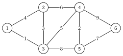
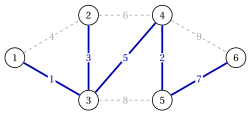

# 2.1 Il problema dell'albero di copertura minimo { #sez-sec-mst-problem }

**Parte 2 · Alberi e cammini · Capitolo 2** · [:material-book-open-variant: Capitolo 2: Alberi ricoprenti](index.md) · [:material-file-pdf-box: Dispensa, volume 2 (PDF)](../../pdf/dispensa-2-alberi-e-cammini.pdf) · [:material-pencil: Esercizi: Alberi ricoprenti](../../esercizi/minimum-spanning-trees.md) · [:material-gesture-tap: App: Alberi ricoprenti minimi: Kruskal e Prim](../../laboratorio/albero-ricoprente-minimo-kruskal-prim.md)

!!! definizione "Definizione 2.1: problema dell'albero ricoprente minimo"

    Sia $G=(V,E)$ un grafo connesso non orientato con vertici $n=|V|$ e archi $m=|E|$, e sia ogni arco $e \in E$ hanno un <strong>peso</strong> $w_e \in \R$. Il <strong>peso</strong> di una serie di lati $F \subseteq E$ è

    $$
    w(F)=\sum_{e \in F} w_e .
    $$

    Il <strong>problema dell’albero ricoprente minimo</strong> (MST) richiede uno albero ricoprente $\tilde{T}=(V,\tilde{F})$ di $G$ di minimo peso:

    $$
    w(\tilde{F}) \le w(F) \qquad \text{per ogni albero ricoprente } (V,F) \text{ of } G .
    $$

    Uno albero ricoprente di peso minimo è uno <strong>albero ricoprente minimo</strong>. Scriviamo $w_{uv}$ per il peso del lato $\{u,v\}$ e identifichiamo uno albero ricoprente con il suo insieme di lati.

- Un grafo connesso ha uno albero ricoprente e ne ha un numero finito: uno albero ricoprente minimo è sempre esiste. Ogni albero ricoprente ha lati $n-1$.

- I pesi possono essere negativi. Aggiungendo la stessa costante a ogni peso si aggiunge $(n-1)$ volte quella costante a peso di ogni albero ricoprente, quindi gli albero ricoprente minimi non cambiano.

- Uno <strong>maximum albero ricoprente</strong> è un albero ricoprente minimo per i pesi $-w_e$.

!!! esempio "Esempio 2.1: il grafo di riferimento ponderato"

    Prendiamo il grafo non orientato sottostante del grafo di riferimento del capitolo [«Grafi»](../../grafi/graphs/index.md), con vertici $n=6$, lati $m=9$ e i pesi

    
<table>
    <tr>
    <th>lato</th>
    <th>\(\{1,2\}\)</th>
    <th>\(\{1,3\}\)</th>
    <th>\(\{2,3\}\)</th>
    <th>\(\{2,4\}\)</th>
    <th>\(\{3,4\}\)</th>
    <th>\(\{3,5\}\)</th>
    <th>\(\{4,5\}\)</th>
    <th>\(\{4,6\}\)</th>
    <th>\(\{5,6\}\)</th>
    </tr>
    <tr>
    <td>\(w_e\)</td>
    <td>\(4\)</td>
    <td>\(1\)</td>
    <td>\(3\)</td>
    <td>\(6\)</td>
    <td>\(5\)</td>
    <td>\(8\)</td>
    <td>\(2\)</td>
    <td>\(9\)</td>
    <td>\(7\)</td>
    </tr>
    </table>

    { .fig loading=lazy  }

    Chiameremo questo grafo <strong>grafo di riferimento pesato</strong>: tutti gli esempi del capitolo lo utilizzano. I pesi sono gli interi distinti $1,2,\dots,9$.

!!! esempio "Esempio 2.2: l'albero di copertura minimo del grafo di riferimento"

    Il grafo di riferimento ponderato ha albero ricoprente $55$. Enumerandoli tutti, il peso minimo è $18$, raggiunto solo vicino all'albero (blu nella figura)

    $$
    \tilde{F}=\big\{\{1,3\},\{2,3\},\{3,4\},\{4,5\},\{5,6\}\big\}, \qquad w(\tilde{F})=1+3+5+2+7=18 .
    $$

    { .fig loading=lazy  }

    Lo albero ricoprente $\{1,2\},\{1,3\},\{2,4\},\{3,5\},\{4,6\}$ trovato con la ricerca in ampiezza nel capitolo «Graphs» pesa $4+1+6+8+9=28$ e uno albero ricoprente massimo pesa $34$.

- Enumerare gli albero ricoprente è pratico solo su grafi piccoli: il grafo di riferimento, con vertici $6$ e Lati $9$, dispone già di $55$. Gli algoritmi di questo capitolo trovano un albero di copertura minimo in tempo polinomiale.

## 2.1.1 Applicazioni

- <strong>Progettazione della rete.</strong> I vertici sono siti (uffici, case, stabilimenti) e $w_{uv}$ è il costo di un collegamento diretto collegamento (un cavo, un tubo, una strada); la rete più economica che collega tutti i siti è uno albero ricoprente minimo.

- <strong>Clustering.</strong> La rimozione dei lati più pesanti $k-1$ di uno albero ricoprente minimo divide i vertici in $k$ gruppi di punti vicini (clustering a collegamento singolo).

- <strong>Sottoproblem.</strong> Gli alberi di copertura minimi forniscono limiti inferiori per il problema del commesso viaggiatore e un punto di partenza per algoritmi euristici per la progettazione di reti.

!!! chiave ""

    Un albero di copertura minimo collega tutti i vertici di un grafo pesato connesso con lati $n-1$ di totale minimo peso; sul grafo di riferimento ponderato è unico e pesa $18$.

---

**Avanti:** [2.2 Tagli e cicli](tagli-e-cicli.md)
