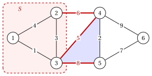

# 2.2 Tagli e cicli { #sez-sec-mst-cuts }

**Parte 2 · Alberi e cammini · Capitolo 2** · [:material-book-open-variant: Capitolo 2: Alberi ricoprenti](index.md) · [:material-file-pdf-box: Dispensa, volume 2 (PDF)](../../pdf/dispensa-2-alberi-e-cammini.pdf) · [:material-pencil: Esercizi: Alberi ricoprenti](../../esercizi/minimum-spanning-trees.md) · [:material-gesture-tap: App: Alberi ricoprenti minimi: Kruskal e Prim](../../laboratorio/albero-ricoprente-minimo-kruskal-prim.md)

!!! definizione "Definizione 2.2: cut"

    Sia $G=(V,E)$ un grafo non orientato e $S \subseteq V$ con $\emptyset \neq S \neq V$. Il <strong>cut</strong> definito da $S$ è l'insieme dei lati con esattamente un punto finale in $S$:

    $$
    \delta(S)=\big\{\, \{u,v\} \in E : u \in S,~ v \notin S \,\big\}.
    $$

    Un lato di $\delta(S)$ <strong>attraversa</strong> il taglio. Per un singolo vertice, $\delta(\{v\})=\delta(v)$ è l'insieme dei lati incidente a $v$.

- Un grafo è connesso se e solo se ogni taglio $\delta(S)$ non è vuoto: un taglio vuoto separa $S$ da $V \setminus S$ e un percorso da $u \in S$ a $v \notin S$ deve utilizzare un lato di $\delta(S)$.

- Nel grafo di riferimento ponderato, $\delta(\{1,2,3\})=\{\{2,4\},\{3,4\},\{3,5\}\}$ e $\delta(\{6\})=\{\{4,6\},\{5,6\}\}$.

!!! teorema "Lemma 2.3: un ciclo attraversa un taglio un numero pari di volte"

    Sia $C$ un ciclo di $G$ e $\delta(S)$ un taglio. Allora $|C \cap \delta(S)|$ è pari. In particolare, se un ciclo contiene un lato di $\delta(S)$, contiene almeno un altro lato di $\delta(S)$.

??? dimostrazione "Dimostrazione"

    Lascia che il ciclo visiti $v_0,v_1,\dots,v_k=v_0$. Il lato $\{v_{t-1},v_t\}$ attraversa il taglio se e solo se $v_{t-1}$ e $v_t$ giacciono su lati diversi. Percorrendo la ciclabile il versante cambia ad ogni incrocio e solo lì; il la passeggiata termina a $v_0$, sul lato da cui è iniziata, quindi il numero di cambi è pari. □

!!! definizione "Definizione 2.4: taglio fondamentale"

    Sia $T$ uno albero ricoprente di un grafo connesso $G=(V,E)$ e $e=\{u,v\} \in T$. Il grafo $T \setminus \{e\}$ ne ha due componenti collegati; lascia che $S_e$ sia quello che contiene $u$. Il <strong>taglio fondamentale</strong> di $e$ è $\delta(S_e)$.

- $T \setminus \{e\}$ ha lati $n-2$ e nessun ciclo, quindi ha componenti $n-(n-2)=2$ ([Corollario «lati e componenti»](../../grafi/graphs/alberi-e-foreste.md)); $v$ non è in $S_e$, altrimenti il percorso da $u$ a $v$ in $T$ non sarebbe univoco.

- L'unico lato di $T$ nel taglio fondamentale di $e$ è $e$ stesso: ogni altro lato di $T$ si trova all'interno di uno dei le due componenti.

!!! teorema "Lemma 2.5: scambio"

    Sia $T$ un albero ricoprente di un grafo connesso $G=(V,E)$.

    1. Se $e \notin T$ e $f$ è un arco del ciclo fondamentale $C(T,e)$, allora $T \cup \{e\} \setminus \{f\}$ è un albero di copertura.

    2. Se $f \in T$ e $e \notin T$ attraversano il taglio fondamentale di $f$, allora $f \in C(T,e)$ e $T \cup \{e\} \setminus \{f\}$ è uno albero ricoprente.

??? dimostrazione "Dimostrazione"

    1. Il resto di $C(T,e)$ si unisce agli endpoint di $f$, quindi rimuovendo $f$ dal grafo connesso $T \cup \{e\}$ lascia si è connesso. Il risultato è connesso con gli lati $n-1$: è uno albero ricoprente tramite il [caratterizzazioni di a albero](../../grafi/graphs/alberi-e-foreste.md), (b).

    2. I punti finali di $e$ si trovano su lati diversi del taglio fondamentale $\delta(S_f)$. Il percorso tra di loro in $T$ fa parte di $C(T,e)$ e deve attraversare $\delta(S_f)$ con un lato di $T$; l'unico è $f$. La parte 1 si conclude. □

!!! esempio "Esempio 2.3: tagli e cicli del grafo di riferimento"

    In figura è mostrato il taglio $\delta(\{1,2,3\})$ (lati rossi) e il ciclo $3,4,5$ (ombreggiato in blu): il ciclo utilizza il lati $\{3,4\}$ e $\{3,5\}$ del taglio, un numero pari.

    { .fig loading=lazy  }

    Per l'albero di copertura minimo $\tilde{F}$ di [Esempio 2.2](il-problema-dell-albero-di-copertura-minimo.md#box-3-mst-ex-opt), il taglio fondamentale di $\{3,4\}$ è $\delta(\{1,2,3\})$ e il ciclo fondamentale di $\{3,5\}$ è $C(\tilde{F},\{3,5\})=3,4,5,3$.

!!! chiave ""

    Un ciclo attraversa ogni taglio un numero pari di volte. Aggiunta di un lato a uno albero ricoprente e rimozione di qualsiasi lato del file il ciclo si chiude dà un altro albero ricoprente.

---

**Avanti:** [2.3 La proprietà di taglio e la proprietà di ciclo](la-proprieta-di-taglio-e-la-proprieta-di-ciclo.md)
