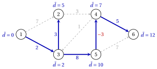
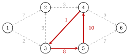

# 3.5 L'algoritmo Bellman–Ford { #sez-sec-sp-bf }

**Parte 2 · Alberi e cammini · Capitolo 3** · [:material-book-open-variant: Capitolo 3: Cammini minimi](index.md) · [:material-file-pdf-box: Dispensa, volume 2 (PDF)](../../pdf/dispensa-2-alberi-e-cammini.pdf) · [:material-pencil: Esercizi: Cammini minimi](../../esercizi/shortest-paths.md) · [:material-gesture-tap: App: Cammini minimi: Dijkstra, Bellman–Ford, grafi aciclici](../../laboratorio/cammini-minimi-dijkstra-bellman-ford.md)

!!! definizione "Definizione 3.16: etichette con al massimo $k$ archi"

    Per $k \ge 0$ e $j \in N$, $d^k(j)$ è la lunghezza minima di un percorso da $s$ a $j$ con al massimo $k$ archi e $d^k(j)=+\infty$ se non ce n'è.

!!! teorema "Lemma 3.17: ricorsione delle etichette"

    $d^0(s)=0$, $d^0(j)=+\infty$ per $j \neq s$ e per ogni $k \ge 1$

    $$
    d^k(j)=\min\Big\{\, d^{k-1}(j),\; \min_{(i,j) \in \delta^-(j)} \big( d^{k-1}(i)+d_{ij} \big) \Big\},
    \qquad \forall j \in N .
    $$

??? dimostrazione "Dimostrazione"

    L'unica cammino con archi $0$ è la cammino $s$. Per $k \ge 1$, una cammino verso $j$ con al massimo archi $k$ ha al massimo Archi $k-1$, con lunghezza minima $d^{k-1}(j)$, oppure ha esattamente archi $k$ e ultimo arco $(i,j)$: è una passeggiata fino a $i$ con $k-1$ archi seguiti da $(i,j)$ e la sua lunghezza minima è $\min_{(i,j)}\big(d^{k-1}(i)+d_{ij}\big)$. □

!!! algoritmo "Algoritmo: Algoritmo Bellman–Ford"

    

<strong>Input:</strong> un grafo diretto \(G=(N,A)\) con lunghezze \(d_{ij}\) di qualsiasi segno, una sorgente \(s \in N\)

<strong>Output:</strong> le distanze \(\tilde{d}(j)\) e i predecessori, oppure un ciclo negativo raggiungibile da \(s\)

1<strong>Passaggio 0 (inizializzazione).</strong> Imposta \(d^0(s):=0\), \(d^0(j):=+\infty\) per \(j \neq s\) e \(k:=1\).

2<strong>Passaggio 1 (passa \(k\)).</strong> Calcola \(d^k(j)\) per ogni \(j \in N\) con la ricorsione di
    [Lemma 3.17](#box-23-sp-lem-recursion);

3  se \(d^k(j)<d^{k-1}(j)\), imposta \(\mathit{pred}(j)\) alla coda \(i\) dell'arco che raggiunge il minimo.

4<strong>Passaggio 2 (test).</strong> Se \(d^k=d^{k-1}\), <code>STOP</code>: \(\tilde{d}=d^k\).

5  Se \(k=n\), <code>STOP</code>: un ciclo negativo è raggiungibile da \(s\). Altrimenti imposta \(k:=k+1\) e vai al passo 1.

- Ogni passaggio dipende solo dalle etichette del passaggio precedente: se $d^k=d^{k-1}$, tutti i passaggi successivi si ripetono le stesse etichette e l'algoritmo può fermarsi.

- Negli esempi, i pari merito nel minimo vengono interrotti dalla coda più piccola $i$ e il predecessore cambia solo quando l'etichetta diminuisce rigorosamente.

!!! teorema "Teorema 3.18: correttezza di Bellman–Ford"

    Se non è raggiungibile alcun ciclo negativo da $s$, allora $d^{n-1}(j)=\tilde{d}(j)$ per ogni $j \in N$ e l'algoritmo si ferma al passaggio $k \le n$ con $d^k=d^{k-1}=\tilde{d}$.

??? dimostrazione "Dimostrazione"

    Un percorso ha al massimo $n-1$ archi, quindi $d^{n-1}(j) \le \tilde{d}(j)$. Di [Lemma 3.3](problemi-del-percorso-piu-breve.md#box-4-sp-lem-walk) (che necessita solo dei cicli raggiungibili da $s$) ogni cammino da $s$ a $j$ contiene un percorso non più lungo, quindi $d^k(j) \ge \tilde{d}(j)$ per ogni $k$.

    - Quindi $d^{n-1}=d^{n}=\tilde{d}$.

    - Le etichette non aumentano mai e l'algoritmo si ferma al primo passaggio $k$ con $d^k=d^{k-1}$, che è al massimo $n$; da quel passaggio in poi le etichette non cambiano più, quindi $d^k=d^{n-1}=\tilde{d}$.

    
□

!!! teorema "Teorema 3.19: rilevamento di un ciclo negativo"

    Un ciclo negativo è raggiungibile da $s$ se e solo se $d^n \neq d^{n-1}$. In tal caso, lascia che $d^n(j)<d^{n-1}(j)$; leggendo i predecessori all'indietro da $j$, una riga per passaggio, partendo dalla riga $n$ della tabella, dà una passeggiata da $s$ a $j$ con archi $n$ che contengono un ciclo negativo.

??? dimostrazione "Dimostrazione"

    Se non è possibile raggiungere alcun ciclo negativo da $s$, allora $d^n=d^{n-1}$ mediante [Teorema 3.18](#box-24-sp-th-bf). Al contrario, lascia che $d^n(j)<d^{n-1}(j)$.

    1. Ogni cammino verso $j$ di lunghezza $d^n(j)$ con al massimo $n$ archi ha esattamente $n$ archi, altrimenti $d^{n-1}(j) \le d^n(j)$.

    2. Lascia che $i$ sia il predecessore di $j$ nella riga $n$, quindi $d^n(j)=d^{n-1}(i)+d_{ij}$. Una passeggiata realizzando $d^{n-1}(i)$ seguito da $(i,j)$ realizza $d^n(j)$, quindi ha esattamente archi $n-1$: $d^{n-1}(i)<d^{n-2}(i)$, e $i$ ha un predecessore nella riga $n-1$.

    3. Ripetendo l'argomento fino alla riga $1$, il cui predecessore è $s$, si ottiene una passeggiata $W$ da $s$ a $j$ con $n$ archi e $d(W)=d^n(j)$.

    4. $W$ ha nodi $n+1$, quindi ripete un nodo e contiene un ciclo $C$. L'eliminazione di $C$ dà una passeggiata a $j$ con meno rispetto agli archi $n$, di lunghezza $d(W)-d(C) \ge d^{n-1}(j)>d^n(j)=d(W)$. Pertanto $d(C)<0$ e $C$ sono raggiungibili da $s$ lungo $W$. □

!!! teorema "Proposizione 3.20: l'albero predecessore di Bellman–Ford"

    Se nessun ciclo negativo è raggiungibile da $s$, alla fermata gli archi $(\mathit{pred}(j),j)$, per i nodi $j \neq s$ con finito etichetta, forma un albero dei percorsi più brevi dei nodi raggiungibili.

??? dimostrazione "Dimostrazione"

    Sia $d=\tilde{d}$ l'etichetta finale, e sia $t(j)$ l'ultimo passaggio in cui l'etichetta di $j$ è diminuita; $t(s)=0$, da $d^k(s)=0$ per tutti gli $k$. Lascia che $p=\mathit{pred}(j)$.

    1. Nel passaggio $t(j)$, $d(j)=d^{t(j)-1}(p)+d_{pj} \ge d(p)+d_{pj}$, poiché le etichette non aumentano mai.

    2. Di [Teorema 3.5](problemi-del-percorso-piu-breve.md#box-7-sp-th-bellman), $d(j) \le d(p)+d_{pj}$. Quindi $d(j)=d(p)+d_{pj}$ e $d(p)=d^{t(j)-1}(p)$: l'etichetta di $p$ non è cambiata dopo il passaggio $t(j)-1$, quindi $t(p)<t(j)$.

    3. Passando al predecessore $t$ diminuisce rigorosamente, quindi la sequenza termina in $s$, lungo archi stretti: il percorso dell'albero da $s$ a $j$ ha lunghezza $d(j)$. □

!!! teorema "Teorema 3.21: tempo di esecuzione di Bellman–Ford"

    L'algoritmo Bellman–Ford viene eseguito nel tempo $O(n\,m)$.

??? dimostrazione "Dimostrazione"

    Un passaggio calcola $d^k(j)$ per ogni $j$ scansionando la stella all'indietro $\delta^-(j)$, quindi scansiona ogni arco una volta: $O(n+m)$ tempo. Sono disponibili al massimo $n$ passaggi e il totale è $O(n(n+m))$, che è $O(n\,m)$ quando $m \ge n-1$, come sotto (A1). □

## 3.5.1 Bellman–Ford sul grafo di riferimento

!!! esempio "Esempio 3.7: Bellman–Ford con un arco negativo"

    Utilizziamo le lunghezze $d'$ di [Esempio 3.1](problemi-del-percorso-piu-breve.md#box-2-sp-ex-ref) con $d'_{54}=-3$ al posto di $2$. I due cicli hanno lunghezze $7$ e $8-3+1=6$, quindi non esiste un ciclo negativo. Ogni riga è un passaggio $k$; accanto a un'etichetta diminuita, tra parentesi il nuovo predecessore:

    $$
    \begin{array}{c|cccccc}
    \hline {k} & {d^k(1)} & {d^k(2)} & {d^k(3)} & {d^k(4)} & {d^k(5)} & {d^k(6)} \\
    \hline {0} & {0} & {\infty} & {\infty} & {\infty} & {\infty} & {\infty} \\
    {1} & {0} & {7} ({1}) & {2} ({1}) & {\infty} & {\infty} & {\infty} \\
    {2} & {0} & {5} ({3}) & {2} & {10} ({2}) & {10} ({3}) & {\infty} \\
    {3} & {0} & {5} & {2} & {7} ({5}) & {10} & {15} ({4}) \\
    {4} & {0} & {5} & {2} & {7} & {10} & {12} ({4}) \\
    {5} & {0} & {5} & {2} & {7} & {10} & {12} \\
    \hline
    \end{array}
    $$

    - In passaggio $3$, $d^3(4)=\min\{10,\; d^2(2)+3,\; d^2(5)-3\}=\min\{10,8,7\}=7$, con il predecessore $5$.

    - Passaggio $5$ ripete le etichette del passaggio $4$: l'algoritmo si ferma con $\tilde{d}=(0,5,2,7,10,12)$, dopo $5$ passaggi consentiti invece dello $n=6$.

    - L'albero del percorso più breve ha gli archi $(1,3)$, $(3,2)$, $(3,5)$, $(5,4)$, $(4,6)$ e il percorso più breve per $6$ è $1,3,5,4,6$, di lunghezza $2+8-3+5=12$.

    { .fig loading=lazy  }

!!! esempio "Esempio 3.8: Bellman–Ford rileva un ciclo negativo"

    Con le lunghezze $d''$ di [Esempio 3.2](problemi-del-percorso-piu-breve.md#box-5-sp-ex-negcycle) ($d''_{54}=-10$) l'algoritmo esegue tutti i $n=6$ passa:

    $$
    \begin{array}{c|cccccc}
    \hline {k} & {d^k(1)} & {d^k(2)} & {d^k(3)} & {d^k(4)} & {d^k(5)} & {d^k(6)} \\
    \hline {0} & {0} & {\infty} & {\infty} & {\infty} & {\infty} & {\infty} \\
    {1} & {0} & {7} ({1}) & {\mathbf{2}} ({\mathbf{1}}) & {\infty} & {\infty} & {\infty} \\
    {2} & {0} & {5} ({3}) & {2} & {10} ({2}) & {\mathbf{10}} ({\mathbf{3}}) & {\infty} \\
    {3} & {0} & {5} & {2} & {\mathbf{0}} ({\mathbf{5}}) & {10} & {15} ({4}) \\
    {4} & {0} & {5} & {\mathbf{1}} ({\mathbf{4}}) & {0} & {10} & {5} ({4}) \\
    {5} & {0} & {4} ({3}) & {1} & {0} & {\mathbf{9}} ({\mathbf{3}}) & {5} \\
    {6} & {0} & {4} & {1} & {\mathbf{-1}} ({\mathbf{5}}) & {9} & {5} \\
    \hline
    \end{array}
    $$

    - Nel passaggio $6$ l'etichetta del nodo $4$ diminuisce da $0$ a $-1$: $d^6 \neq d^5$ e viene generato un ciclo negativo raggiungibile da $1$.

    - Lettura all'indietro dal nodo $4$ (voci in grassetto): la riga $6$ restituisce $\mathit{pred}=5$, la riga $5$ per il nodo $5$ restituisce $3$, la riga $4$ per il nodo $3$ restituisce $4$, quindi $5$, $3$, $1$. La passeggiata è

        $$
        1,\;3,\;5,\;4,\;3,\;5,\;4, \qquad\text{di lunghezza } 2+8-10+1+8-10=-1=d^6(4).
        $$

    - Nodo $3$ ripete: la passeggiata contiene il ciclo $3,5,4,3$, di lunghezza $-1$ (rosso).

    { .fig loading=lazy  }

!!! chiave ""

    L'algoritmo Bellman–Ford calcola $d^k$, i percorsi più brevi con al massimo archi $k$, nel tempo $O(n\,m)$. Senza cicli negativi raggiungibili da $s$ si ferma entro $n$ passa con le distanze; un cambiamento nel passaggio $n$ rivela a ciclo negativo, trovato leggendo i predecessori all’indietro.

---

**Avanti:** [3.6 Algoritmo di Dijkstra](algoritmo-di-dijkstra.md)
