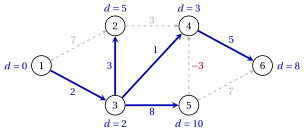

# 3.4 Percorsi più brevi nei grafici aciclici { #sez-sec-sp-dag }

**Parte 2 · Alberi e cammini · Capitolo 3** · [:material-book-open-variant: Capitolo 3: Cammini minimi](index.md) · [:material-file-pdf-box: Dispensa, volume 2 (PDF)](../../pdf/dispensa-2-alberi-e-cammini.pdf) · [:material-pencil: Esercizi: Cammini minimi](../../esercizi/shortest-paths.md) · [:material-gesture-tap: App: Cammini minimi: Dijkstra, Bellman–Ford, grafi aciclici](../../laboratorio/cammini-minimi-dijkstra-bellman-ford.md)

!!! definizione "Definizione 3.13: grafo aciclico e ordine topologico"

    Un grafo diretto senza cicli diretti è un <strong>grafo aciclico diretto</strong> (DAG). Un <strong>ordine topologico</strong> di $G=(N,A)$ è un ordinamento $v_1,v_2,\dots,v_n$ dei suoi nodi tale che ogni arco vada avanti:

    $$
    (v_a,v_b) \in A \quad \Longrightarrow \quad a<b .
    $$

!!! teorema "Proposizione 3.14: ordini topologici"

    Un grafo diretto ha un ordine topologico se e solo se è aciclico.

??? dimostrazione "Dimostrazione"

    Se $G$ avesse un ordine topologico, un ciclo $i_0,i_1,\dots,i_k=i_0$ andrebbe avanti su ogni arco e ritornerebbe al suo primo nodo: impossibile. Viceversa, sia $G$ aciclico; discutiamo per induzione su $n$.

    1. $G$ ha un nodo senza arco entrante: altrimenti, camminare all'indietro lungo archi entranti da qualsiasi nodo, dopo $n$ passi che un nodo ripete e il cammino contiene un ciclo.

    2. Metti prima un nodo di questo tipo $v_1$. Il grafo senza $v_1$ è aciclico e per induzione ha un ordine topologico $v_2,\dots,v_n$; nessun arco entra in $v_1$, quindi $v_1,v_2,\dots,v_n$ è un ordine topologico di $G$. □

!!! algoritmo "Algoritmo: Percorsi più brevi in un grafo aciclico"

    

<strong>Input:</strong> un grafo aciclico \(G=(N,A)\) con lunghezze \(d_{ij}\) di qualsiasi segno, una sorgente \(s \in N\)

<strong>Output:</strong> le distanze \(d(j)=\tilde{d}(j)\) e i predecessori \(\mathit{pred}(j)\)

1<strong>Passaggio 0 (ordine).</strong> Trova un ordine topologico: rimuovi ripetutamente un nodo senza inserire archi (il più piccolo
    indice, se più di uno).

2  Imposta \(d(s):=0\) e \(d(j):=+\infty\) per \(j \neq s\).

3<strong>Passaggio 1 (etichette).</strong> Per ciascun nodo \(i\) in ordine topologico con \(d(i)<+\infty\) e ciascun arco \((i,j) \in \delta^+(i)\):

4  se \(d(i)+d_{ij}<d(j)\), impostare \(d(j):=d(i)+d_{ij}\) e \(\mathit{pred}(j):=i\).

5  <code>STOP</code>.

!!! teorema "Teorema 3.15: correttezza e tempo di esecuzione su grafi aciclici"

    Su un grafo aciclico con lunghezze di qualsiasi segno, l'algoritmo «Percorsi più brevi in un grafo aciclico» termina con $d(j)=\tilde{d}(j)$ per ogni $j \in N$ e viene eseguito in tempo $O(n+m)$.

??? dimostrazione "Dimostrazione"

    Un grafo aciclico non ha alcun ciclo, quindi vale la (A2). Ogni etichetta finita è la lunghezza di una passeggiata da $s$, quindi $d(j) \ge \tilde{d}(j)$ di [Lemma 3.3](problemi-del-percorso-piu-breve.md#box-4-sp-lem-walk); le etichette diminuiscono solo.

    1. Lascia che $j$ sia raggiungibile e $s=i_0,i_1,\dots,i_k=j$ un percorso più breve; i suoi nodi appaiono in questo ordine nel file ordine topologico, poiché ogni arco va avanti.

    2. Per induzione su $t$, dopo l'elaborazione di $i_t$ $d(i_t) \le \tilde{d}(i_t)$: il percorso verso $i_{t-1}$ è il più breve ([Lemma 3.4](problemi-del-percorso-piu-breve.md#box-6-sp-lem-subpath)), e l'elaborazione $i_{t-1}$ restituisce $d(i_t) \le \tilde{d}(i_{t-1})+d_{i_{t-1}i_t}=\tilde{d}(i_t)$.

    3. I nodi non raggiungibili da $s$ mantengono $d(j)=+\infty=\tilde{d}(j)$.

    <em>Tempo.</em> L'ordine topologico impiega $O(n+m)$ tempo con un contatore degli archi entranti di ogni nodo, decrementato quando viene rimossa una coda; Il passaggio 1 esegue la scansione di ogni arco una volta. □

- La regola dell'indice più piccolo fissa un ordine per gli esempi; qualsiasi nodo senza inserire archi può essere rimosso.

- Con le lunghezze $-d_{ij}$ l'algoritmo calcola <strong>percorsi più lunghi</strong>, poiché un grafo aciclico non ha ciclo ripetere. I percorsi più lunghi nei grafi aciclici sono il nucleo di [Capitolo 9 «Progetto gestione»](../../gestione-dei-progetti/project-management/index.md).

!!! esempio "Esempio 3.6: un'istanza aciclica"

    Invertendo l'arco $(4,3)$ del grafo di riferimento in $(3,4)$, con $d_{34}=1$, si ottiene un grafo aciclico. Lo diamo le lunghezze di [Esempio 3.1](problemi-del-percorso-piu-breve.md#box-2-sp-ex-ref) tranne $d_{54}=-3$ (rosso).

    { .fig loading=lazy  }

    Il passo 0 fornisce l'ordine topologico $1,3,2,5,4,6$: dopo $1$, solo $3$ non ha arco entrante; allora $2$ e $5$ lo sono gratuito e $2$ inizia per primo. Ogni riga della tabella elabora un nodo e mostra le etichette dopo di esso:

    
<table>
    <tr>
    <th>gradino e nodo \(i\)</th>
    <th>\(d(1)\)</th>
    <th>\(d(2)\)</th>
    <th>\(d(3)\)</th>
    <th>\(d(4)\)</th>
    <th>\(d(5)\)</th>
    <th>\(d(6)\)</th>
    </tr>
    <tr>
    <td>\(1\)</td>
    <td>\(1\)</td>
    <td>\(0\)</td>
    <td>\(7\)</td>
    <td>\(2\)</td>
    <td>\(\infty\)</td>
    <td>\(\infty\)</td>
    <td>\(\infty\)</td>
    </tr>
    <tr>
    <td>\(2\)</td>
    <td>\(3\)</td>
    <td>\(0\)</td>
    <td>\(5\)</td>
    <td>\(2\)</td>
    <td>\(3\)</td>
    <td>\(10\)</td>
    <td>\(\infty\)</td>
    </tr>
    <tr>
    <td>\(3\)</td>
    <td>\(2\)</td>
    <td>\(0\)</td>
    <td>\(5\)</td>
    <td>\(2\)</td>
    <td>\(3\)</td>
    <td>\(10\)</td>
    <td>\(\infty\)</td>
    </tr>
    <tr>
    <td>\(4\)</td>
    <td>\(5\)</td>
    <td>\(0\)</td>
    <td>\(5\)</td>
    <td>\(2\)</td>
    <td>\(3\)</td>
    <td>\(10\)</td>
    <td>\(17\)</td>
    </tr>
    <tr>
    <td>\(5\)</td>
    <td>\(4\)</td>
    <td>\(0\)</td>
    <td>\(5\)</td>
    <td>\(2\)</td>
    <td>\(3\)</td>
    <td>\(10\)</td>
    <td>\(8\)</td>
    </tr>
    <tr>
    <td>\(6\)</td>
    <td>\(6\)</td>
    <td>\(0\)</td>
    <td>\(5\)</td>
    <td>\(2\)</td>
    <td>\(3\)</td>
    <td>\(10\)</td>
    <td>\(8\)</td>
    </tr>
    </table>

    I predecessori danno l'albero $(1,3)$, $(3,2)$, $(3,4)$, $(3,5)$, $(4,6)$ (blu). L'arco negativo $(5,4)$ non lo è utilizzato: $d(5)-3=7>3=d(4)$. Con le lunghezze $-d_{ij}$ le lunghezze del percorso più lunghe da $1$ sono $(0,7,2,10,10,17)$.

!!! chiave ""

    Un grafo è aciclico se e solo se ha un ordine topologico. Scansionando i nodi in quest'ordine, ogni etichetta è definitiva quando il suo nodo viene elaborato: percorsi più brevi nel tempo $O(n+m)$, con lunghezze di qualsiasi segno.

---

**Avanti:** [3.5 L'algoritmo Bellman–Ford](l-algoritmo-bellmanford.md)
