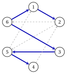
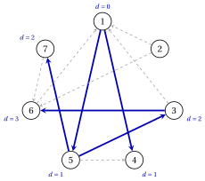

# Esercizi · Grafi

**Esercizi · Capitolo 1** · ogni soluzione si apre con un clic · [:material-book-open-variant: Capitolo 1: Grafi](../grafi/graphs/index.md) · [:material-file-pdf-box: Eserciziario, volume 1 (PDF)](../pdf/esercizi-1-grafi.pdf)

!!! formula "Regole usate in questi esercizi"

    Le definizioni e gli algoritmi del capitolo [«Grafi»](../grafi/graphs/index.md), per un grafo orientato $G=(N,A)$ con $n=|N|$ e $m=|A|$.

    - **(G1)** <strong>Matrice di incidenza.</strong> Gli archi sono numerati $a_1,a_2,\dots,a_m$ in ordine lessicografico, e

        $$
        b_{ik}=\begin{cases} +1 & \text{se $i$ è la coda di } a_k,\\ -1 & \text{se $i$ è la testa di } a_k,\\ 0 & \text{altrimenti.} \end{cases}
        $$

    - **(G2)** <strong>Liste.</strong> La lista di adiacenza $L(i)$ contiene i successori di $i$, per indice crescente.

    - **(G3)** <strong>Componenti.</strong> $R(i)$ è l'insieme dei nodi raggiungibili da $i$, $R'(i)$ lo stesso insieme nel grafo invertito, e la componente fortemente connessa di $i$ è $S(i)=R(i)\cap R'(i)$.

    - **(G4)** <strong>Alberi e rango.</strong> $n-1$ archi formano un albero ricoprente se e solo se sono aciclici (oppure connettono tutti i nodi); con $k$ componenti connesse, $\rank(\mat{B})=n-k$.

    - **(G5)** <strong>Visita.</strong> Un nodo è etichettato quando entra in $\mathit{LIST}$. La BFS seleziona il primo nodo di $\mathit{LIST}$, la DFS l'ultimo; il nodo selezionato $i$ etichetta il primo nodo non etichettato $j$ di $L(i)$, con $\mathit{pred}(j)=i$, oppure esce da $\mathit{LIST}$ se non ce n'è nessuno.

!!! esercizio "Esercizio 1.1: Rappresentazioni di un grafo"

    !!! esercizio "Esercizio"

        Consideriamo il grafo orientato $G=(N,A)$ con $N=\{1,2,\dots,5\}$ e i $7$ archi

        $$
        A=\{(1,2),(1,3),(2,3),(2,4),(5,1),(5,3),(5,4)\},
        $$

        disegnato qui sotto.

        { .fig loading=lazy  }

    **Domande**

    1. Numerare gli archi come in (G1) e scrivere la matrice di incidenza nodo–arco $\mat{B}$.

    2. Scrivere le liste di adiacenza e la lista degli archi di $G$.

    3. Calcolare il grado uscente e il grado entrante di ogni nodo, e il vettore $\mat{B}\vet{x}$ per $x_{ij}=1$ su ogni arco.

    4. Quanti elementi memorizzano la matrice di adiacenza, la matrice di incidenza, la lista degli archi e le liste di adiacenza?

??? soluzione "Soluzione"

    Usiamo le regole (G1)–(G5) del riquadro all'inizio di questi esercizi.

    1. Gli archi in ordine lessicografico sono $a_{1}=(1,2)$, $a_{2}=(1,3)$, $a_{3}=(2,3)$, $a_{4}=(2,4)$, $a_{5}=(5,1)$, $a_{6}=(5,3)$, $a_{7}=(5,4)$. Ogni colonna ha $+1$ nella riga della coda e $-1$ nella riga della testa:

        $$
        \begin{array}{c|rrrrrrr}
        & a_{1} & a_{2} & a_{3} & a_{4} & a_{5} & a_{6} & a_{7}\\ \hline
        1 & 1 & 1 & 0 & 0 & -1 & 0 & 0\\
        2 & -1 & 0 & 1 & 1 & 0 & 0 & 0\\
        3 & 0 & -1 & -1 & 0 & 0 & -1 & 0\\
        4 & 0 & 0 & 0 & -1 & 0 & 0 & -1\\
        5 & 0 & 0 & 0 & 0 & 1 & 1 & 1\\
        \end{array}
        $$

    2. Le liste di adiacenza e la lista degli archi sono:

        
<table>
        <tr>
        <th>\(i\)</th>
        <th>\(L(i)\)</th>
        </tr>
        <tr>
        <td>\(1\)</td>
        <td>\(2,~3\)</td>
        </tr>
        <tr>
        <td>\(2\)</td>
        <td>\(3,~4\)</td>
        </tr>
        <tr>
        <td>\(3\)</td>
        <td>(vuota)</td>
        </tr>
        <tr>
        <td>\(4\)</td>
        <td>(vuota)</td>
        </tr>
        <tr>
        <td>\(5\)</td>
        <td>\(1,~3,~4\)</td>
        </tr>
        </table>

        
<table>
        <tr>
        <th>arco</th>
        <th>\(a_{1}\)</th>
        <th>\(a_{2}\)</th>
        <th>\(a_{3}\)</th>
        <th>\(a_{4}\)</th>
        <th>\(a_{5}\)</th>
        <th>\(a_{6}\)</th>
        <th>\(a_{7}\)</th>
        </tr>
        <tr>
        <td>coda</td>
        <td>\(1\)</td>
        <td>\(1\)</td>
        <td>\(2\)</td>
        <td>\(2\)</td>
        <td>\(5\)</td>
        <td>\(5\)</td>
        <td>\(5\)</td>
        </tr>
        <tr>
        <td>testa</td>
        <td>\(2\)</td>
        <td>\(3\)</td>
        <td>\(3\)</td>
        <td>\(4\)</td>
        <td>\(1\)</td>
        <td>\(3\)</td>
        <td>\(4\)</td>
        </tr>
        </table>

    3. I gradi sono i numeri di $+1$ e di $-1$ in ogni riga di $\mat{B}$:

        
<table>
        <tr>
        <th>nodo \(i\)</th>
        <th>\(1\)</th>
        <th>\(2\)</th>
        <th>\(3\)</th>
        <th>\(4\)</th>
        <th>\(5\)</th>
        </tr>
        <tr>
        <td>\(\deg^+(i)\)</td>
        <td>\(2\)</td>
        <td>\(2\)</td>
        <td>\(0\)</td>
        <td>\(0\)</td>
        <td>\(3\)</td>
        </tr>
        <tr>
        <td>\(\deg^-(i)\)</td>
        <td>\(1\)</td>
        <td>\(1\)</td>
        <td>\(3\)</td>
        <td>\(2\)</td>
        <td>\(0\)</td>
        </tr>
        </table>

        La somma di ciascuna delle due righe è $m=7$. La riga $i$ di $\mat{B}\vet{x}$ è $\deg^+(i)-\deg^-(i)$:

        $$
        \mat{B}\vet{x}=(1,\,1,\,-3,\,-2,\,3)' .
        $$

        Il nodo $5$ non ha archi entranti, e i nodi $3,4$ non hanno archi uscenti.

    4. La matrice di adiacenza memorizza $n^2=25$ elementi, la matrice di incidenza $n\,m=35$, la lista degli archi $2\,m=14$ e le liste di adiacenza $n+m=12$.

    !!! chiave ""

        Ogni colonna di $\mat{B}$ ha un $+1$ e un $-1$, quindi la somma delle sue righe è nulla; le liste di adiacenza sono la rappresentazione più compatta, con $12$ elementi.

!!! esercizio "Esercizio 1.2: Componenti connesse e fortemente connesse"

    !!! esercizio "Esercizio"

        Consideriamo il grafo orientato $G=(N,A)$ con $N=\{1,2,\dots,8\}$ e gli $11$ archi

        $$
        A=\{(1,7),(2,3),(2,7),(3,1),(3,6),(4,5),(6,2),(6,7),(6,8),(7,8),(8,1)\},
        $$

        disegnato qui sotto.

        { .fig loading=lazy  }

    **Domande**

    1. Trovare le componenti connesse di $G$ (del suo grafo non orientato sottostante). $G$ è debolmente connesso?

    2. Calcolare $R(1)$ e $R'(1)$, e la componente fortemente connessa $S(1)$.

    3. Trovare tutte le componenti fortemente connesse di $G$. $G$ è fortemente connesso?

??? soluzione "Soluzione"

    Usiamo le regole (G1)–(G5) del riquadro all'inizio di questi esercizi.

    1. Ignorando l'orientamento, i vertici si dividono nelle componenti $\{1,2,3,6,7,8\}$, $\{4,5\}$: nessuno spigolo ne unisce due. $G$ ha $k=2$ componenti, quindi non è debolmente connesso.

    2. Seguendo gli archi da $1$ otteniamo $R(1)=\{1,7,8\}$; seguendoli all'indietro (nel grafo invertito) otteniamo $R'(1)=\{1,2,3,6,7,8\}$. Quindi

        $$
        S(1)=R(1)\cap R'(1)=\{1,7,8\}.
        $$

    3. Per un nodo $h$ di ogni componente (il più piccolo non ancora assegnato), per (G3):

        $$
        \begin{array}{cccc}
        \hline {h} & {R(h)} & {R'(h)} & {S(h)} \\
        \hline {1} & {\{1,7,8\}} & {\{1,2,3,6,7,8\}} & {\{1,7,8\}} \\
        {2} & {\{1,2,3,6,7,8\}} & {\{2,3,6\}} & {\{2,3,6\}} \\
        {4} & {\{4,5\}} & {\{4\}} & {\{4\}} \\
        {5} & {\{5\}} & {\{4,5\}} & {\{5\}} \\
        \hline
        \end{array}
        $$

        Le $4$ componenti fortemente connesse sono $\{1,7,8\}$, $\{2,3,6\}$, $\{4\}$, $\{5\}$. Ce n'è più di una, quindi $G$ non è fortemente connesso.

    !!! chiave ""

        $G$ ha $2$ componenti connesse e $4$ componenti fortemente connesse; ogni componente fortemente connessa è contenuta in una componente connessa.

!!! esercizio "Esercizio 1.3: Alberi e rango della matrice di incidenza"

    !!! esercizio "Esercizio"

        Consideriamo il grafo orientato $G=(N,A)$ con $N=\{1,2,\dots,6\}$ e i $9$ archi

        $$
        A=\{(1,2),(2,5),(2,6),(3,5),(4,2),(5,1),(5,4),(6,1),(6,3)\},
        $$

        disegnato qui sotto, e i due insiemi di $5$ archi

        $$
        F_1=\{(1,2),(3,5),(5,4),(6,1),(6,3)\}, \qquad F_2=\{(2,5),(2,6),(3,5),(4,2),(6,3)\}.
        $$

        { .fig loading=lazy  }

    **Domande**

    1. Calcolare il rango della matrice di incidenza nodo–arco $\mat{B}$ di $G$, senza scrivere la matrice.

    2. Stabilire se $F_1$ e $F_2$ sono alberi ricoprenti di $G$.

    3. Per l'insieme che non è un albero ricoprente, trovare un ciclo e una combinazione lineare delle sue colonne di $\mat{B}$ uguale a $\vet{0}$.

    4. Trovare il ciclo fondamentale dell'arco $(2,5)$ rispetto all'albero ricoprente $F_1$, e i suoi archi all'indietro.

    5. Rimuovere da $G$ tutti gli archi incidenti al nodo $6$. Qual è il rango della nuova matrice di incidenza?

??? soluzione "Soluzione"

    Usiamo le regole (G1)–(G5) del riquadro all'inizio di questi esercizi.

    1. Il grafo non orientato sottostante è connesso ($k=1$): per (G4), $\rank(\mat{B})=6-1=5$.

    2. $F_1$ ha $5$ archi e nessun ciclo, quindi è un albero ricoprente per (G4); i suoi spigoli connettono tutti i nodi.

        { .fig loading=lazy  }

        $F_2$ ha $5$ archi, ma i suoi spigoli hanno le componenti $\{1\}$, $\{2,3,4,5,6\}$: non connette tutti i nodi, quindi contiene un ciclo e non è un albero ricoprente.

    3. Gli archi di $F_2$ contengono il ciclo $2,5,3,6,2$. Percorrendolo, gli archi $(2,5)$ in avanti, $(3,5)$ all'indietro, $(6,3)$ all'indietro, $(2,6)$ all'indietro danno, con $+1$ per gli archi in avanti e $-1$ per quelli all'indietro,

        $$
        \mat{B}_{a_{2}} -\mat{B}_{a_{4}} -\mat{B}_{a_{9}} -\mat{B}_{a_{3}}=\vet{0},
        $$

        con gli archi numerati come in (G1). Le colonne di $F_2$ sono linearmente dipendenti.

    4. Nell'albero $F_1$ il cammino da $5$ a $2$ è $5,3,6,1,2$. Il ciclo fondamentale, scritto a partire dalla coda di $(2,5)$, è $2,5,3,6,1,2$; i suoi archi all'indietro sono $(3,5)$, $(6,3)$.

    5. Senza gli archi incidenti a $6$, il nodo $6$ è isolato e il grafo ha $k=2$ componenti $\{1,2,3,4,5\}$, $\{6\}$; quindi il rango è $6-2=4$.

    !!! chiave ""

        $\rank(\mat{B})=5$; $F_1$ è un albero ricoprente, $F_2$ no, e le sue colonne soddisfano una relazione lineare data dal suo ciclo.

!!! esercizio "Esercizio 1.4: Visita in ampiezza"

    !!! esercizio "Esercizio"

        Consideriamo il grafo orientato $G=(N,A)$ con $N=\{1,2,\dots,7\}$ e gli $11$ archi

        $$
        A=\{(1,4),(1,5),(2,1),(2,6),(3,1),(3,6),(5,3),(5,4),(5,7),(6,1),(7,6)\},
        $$

        disegnato qui sotto.

        { .fig loading=lazy  }

    **Domande**

    1. Scrivere le liste di adiacenza di $G$.

    2. Eseguire la visita in ampiezza da $s=1$: riportare $\mathit{LIST}$ dopo ogni iterazione e l'ordine di etichettatura.

    3. Disegnare l'albero dei predecessori e riportare, per ogni nodo etichettato $j$, il numero $d(j)$ di archi del cammino dell'albero da $1$ a $j$.

    4. Quali nodi non sono raggiungibili da $1$? Trovare un cammino orientato da $1$ a $6$ con il numero minimo di archi.

??? soluzione "Soluzione"

    Usiamo le regole (G1)–(G5) del riquadro all'inizio di questi esercizi.

    1. I successori di ogni nodo, per indice crescente:

        
<table>
        <tr>
        <th>\(i\)</th>
        <th>\(L(i)\)</th>
        </tr>
        <tr>
        <td>\(1\)</td>
        <td>\(4,~5\)</td>
        </tr>
        <tr>
        <td>\(2\)</td>
        <td>\(1,~6\)</td>
        </tr>
        <tr>
        <td>\(3\)</td>
        <td>\(1,~6\)</td>
        </tr>
        <tr>
        <td>\(4\)</td>
        <td>(vuota)</td>
        </tr>
        <tr>
        <td>\(5\)</td>
        <td>\(3,~4,~7\)</td>
        </tr>
        <tr>
        <td>\(6\)</td>
        <td>\(1\)</td>
        </tr>
        <tr>
        <td>\(7\)</td>
        <td>\(6\)</td>
        </tr>
        </table>

    2. La visita seleziona il primo nodo di $\mathit{LIST}$:

        
<table>
        <tr>
        <th>iterazione</th>
        <th>\(i\) selezionato</th>
        <th>azione</th>
        <th>\(\mathit{LIST}\)</th>
        </tr>
        <tr>
        <td>\(1\)</td>
        <td>\(1\)</td>
        <td>etichetta \(4\), \(\mathit{pred}(4)=1\)</td>
        <td>\(1,4\)</td>
        </tr>
        <tr>
        <td>\(2\)</td>
        <td>\(1\)</td>
        <td>etichetta \(5\), \(\mathit{pred}(5)=1\) (\(4\) è etichettato)</td>
        <td>\(1,4,5\)</td>
        </tr>
        <tr>
        <td>\(3\)</td>
        <td>\(1\)</td>
        <td>rimuovi \(1\) (\(4\), \(5\) sono etichettati)</td>
        <td>\(4,5\)</td>
        </tr>
        <tr>
        <td>\(4\)</td>
        <td>\(4\)</td>
        <td>rimuovi \(4\)</td>
        <td>\(5\)</td>
        </tr>
        <tr>
        <td>\(5\)</td>
        <td>\(5\)</td>
        <td>etichetta \(3\), \(\mathit{pred}(3)=5\)</td>
        <td>\(5,3\)</td>
        </tr>
        <tr>
        <td>\(6\)</td>
        <td>\(5\)</td>
        <td>etichetta \(7\), \(\mathit{pred}(7)=5\) (\(3\), \(4\) sono etichettati)</td>
        <td>\(5,3,7\)</td>
        </tr>
        <tr>
        <td>\(7\)</td>
        <td>\(5\)</td>
        <td>rimuovi \(5\) (\(3\), \(4\), \(7\) sono etichettati)</td>
        <td>\(3,7\)</td>
        </tr>
        <tr>
        <td>\(8\)</td>
        <td>\(3\)</td>
        <td>etichetta \(6\), \(\mathit{pred}(6)=3\) (\(1\) è etichettato)</td>
        <td>\(3,7,6\)</td>
        </tr>
        <tr>
        <td>\(9\)</td>
        <td>\(3\)</td>
        <td>rimuovi \(3\) (\(1\), \(6\) sono etichettati)</td>
        <td>\(7,6\)</td>
        </tr>
        <tr>
        <td>\(10\)</td>
        <td>\(7\)</td>
        <td>rimuovi \(7\) (\(6\) è etichettato)</td>
        <td>\(6\)</td>
        </tr>
        <tr>
        <td>\(11\)</td>
        <td>\(6\)</td>
        <td>rimuovi \(6\) (\(1\) è etichettato)</td>
        <td>(vuota)</td>
        </tr>
        </table>

        L'ordine di etichettatura è $1,4,5,3,7,6$.

    3. Gli archi $(\mathit{pred}(j),j)$ sono $(1,4)$, $(1,5)$, $(5,3)$, $(5,7)$, $(3,6)$ (in blu); accanto a ogni nodo il valore $d(j)$:

        { .fig loading=lazy  }

    4. Il nodo $2$ non è etichettato, quindi non è raggiungibile da $1$ per la correttezza della visita. La BFS dà i numeri minimi di archi: il cammino dell'albero $1,5,3,6$ ha $d(6)=3$ archi, e nessun cammino orientato da $1$ a $6$ è più corto.

    !!! chiave ""

        La BFS etichetta i nodi nell'ordine $1,4,5,3,7,6$, in ordine non decrescente di $d$; $R(1)=\{1,3,4,5,6,7\}$.

!!! esercizio "Esercizio 1.5: Visita in profondità"

    !!! esercizio "Esercizio"

        Consideriamo il grafo orientato $G=(N,A)$ con $N=\{1,2,\dots,7\}$ e gli $11$ archi

        $$
        A=\{(1,2),(1,5),(2,3),(2,7),(3,6),(3,7),(4,1),(4,3),(6,1),(6,2),(7,5)\},
        $$

        disegnato qui sotto.

        { .fig loading=lazy  }

    **Domande**

    1. Eseguire la visita in profondità da $s=1$: riportare $\mathit{LIST}$ dopo ogni iterazione e l'ordine di etichettatura.

    2. Disegnare l'albero dei predecessori della DFS.

    3. Confrontare il cammino da $1$ a $5$ nell'albero della DFS con il numero minimo di archi da $1$ a $5$.

??? soluzione "Soluzione"

    Usiamo le regole (G1)–(G5) del riquadro all'inizio di questi esercizi.

    1. Le liste di adiacenza sono $L(1)=\{2,5\}$, $L(2)=\{3,7\}$, $L(3)=\{6,7\}$, $L(4)=\{1,3\}$, $L(5)=\emptyset$, $L(6)=\{1,2\}$, $L(7)=\{5\}$. La visita seleziona l'ultimo nodo di $\mathit{LIST}$:

        
<table>
        <tr>
        <th>iterazione</th>
        <th>\(i\) selezionato</th>
        <th>azione</th>
        <th>\(\mathit{LIST}\)</th>
        </tr>
        <tr>
        <td>\(1\)</td>
        <td>\(1\)</td>
        <td>etichetta \(2\), \(\mathit{pred}(2)=1\)</td>
        <td>\(1,2\)</td>
        </tr>
        <tr>
        <td>\(2\)</td>
        <td>\(2\)</td>
        <td>etichetta \(3\), \(\mathit{pred}(3)=2\)</td>
        <td>\(1,2,3\)</td>
        </tr>
        <tr>
        <td>\(3\)</td>
        <td>\(3\)</td>
        <td>etichetta \(6\), \(\mathit{pred}(6)=3\)</td>
        <td>\(1,2,3,6\)</td>
        </tr>
        <tr>
        <td>\(4\)</td>
        <td>\(6\)</td>
        <td>rimuovi \(6\) (\(1\), \(2\) sono etichettati)</td>
        <td>\(1,2,3\)</td>
        </tr>
        <tr>
        <td>\(5\)</td>
        <td>\(3\)</td>
        <td>etichetta \(7\), \(\mathit{pred}(7)=3\) (\(6\) è etichettato)</td>
        <td>\(1,2,3,7\)</td>
        </tr>
        <tr>
        <td>\(6\)</td>
        <td>\(7\)</td>
        <td>etichetta \(5\), \(\mathit{pred}(5)=7\)</td>
        <td>\(1,2,3,7,5\)</td>
        </tr>
        <tr>
        <td>\(7\)</td>
        <td>\(5\)</td>
        <td>rimuovi \(5\)</td>
        <td>\(1,2,3,7\)</td>
        </tr>
        <tr>
        <td>\(8\)</td>
        <td>\(7\)</td>
        <td>rimuovi \(7\) (\(5\) è etichettato)</td>
        <td>\(1,2,3\)</td>
        </tr>
        <tr>
        <td>\(9\)</td>
        <td>\(3\)</td>
        <td>rimuovi \(3\) (\(6\), \(7\) sono etichettati)</td>
        <td>\(1,2\)</td>
        </tr>
        <tr>
        <td>\(10\)</td>
        <td>\(2\)</td>
        <td>rimuovi \(2\) (\(3\), \(7\) sono etichettati)</td>
        <td>\(1\)</td>
        </tr>
        <tr>
        <td>\(11\)</td>
        <td>\(1\)</td>
        <td>rimuovi \(1\) (\(2\), \(5\) sono etichettati)</td>
        <td>(vuota)</td>
        </tr>
        </table>

        L'ordine di etichettatura è $1,2,3,6,7,5$.

    2. Gli archi $(\mathit{pred}(j),j)$ sono $(1,2)$, $(2,3)$, $(3,6)$, $(3,7)$, $(7,5)$ (in blu); accanto a ogni nodo la sua posizione $o(j)$ nell'ordine di etichettatura:

        { .fig loading=lazy  }

    3. L'albero della DFS raggiunge $5$ lungo $1,2,3,7,5$, con $4$ archi, mentre la BFS da $1$ dà $d(5)=1$: l'albero della DFS non dà cammini con il numero minimo di archi.

    !!! chiave ""

        La DFS etichetta gli stessi nodi della BFS, $R(1)=\{1,2,3,5,6,7\}$, ma nell'ordine $1,2,3,6,7,5$ e con un albero dei predecessori diverso.
