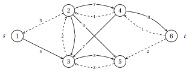
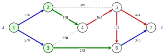
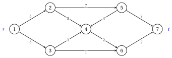
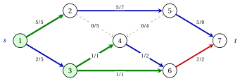
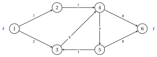
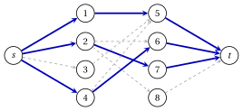

# Esercizi · Flusso massimo

**Esercizi · Capitolo 5** · ogni soluzione si apre con un clic · [:material-book-open-variant: Capitolo 5: Flusso massimo](../flussi/maximum-flow/index.md) · [:material-file-pdf-box: Eserciziario, volume 3 (PDF)](../pdf/esercizi-3-flussi.pdf)

!!! formula "Regole usate in questi esercizi"

    Le definizioni e gli algoritmi del capitolo [«Flusso massimo»](../flussi/maximum-flow/index.md), per un grafo orientato $G=(N,A)$ senza archi opposti, con capacità $u_{ij}$, una sorgente $s$ e un pozzo $t$.

    - **(M1)** <strong>Flussi e tagli.</strong> Un flusso ammissibile ha $0 \le x_{ij} \le u_{ij}$ e la conservazione in ogni nodo diverso da $s$ e $t$; il suo valore $v$ è il deflusso netto di $s$. Per ogni taglio $s$–$t$ $(S,N \setminus S)$,

        $$
        v=x(\delta^+(S))-x(\delta^-(S)) \le u(S,N \setminus S)=\sum_{(i,j) \in \delta^+(S)} u_{ij} ,
        $$

        con l'uguaglianza se e solo se gli archi in avanti del taglio sono saturi e i suoi archi all'indietro vuoti.

    - **(M2)** <strong>Rete residua.</strong> Per $(i,j) \in A$: l'arco in avanti $(i,j)$ con $r_{ij}=u_{ij}-x_{ij}$ se $x_{ij}<u_{ij}$, l'arco all'indietro $(j,i)$ con $r_{ji}=x_{ij}$ se $x_{ij}>0$. Lungo un cammino aumentante $P$ il collo di bottiglia è $\delta=\min_{(i,j) \in P} r_{ij}$: $x_{ij}$ cresce di $\delta$ sugli archi in avanti di $P$ e diminuisce di $\delta$ sugli archi di $G$ il cui arco all'indietro è in $P$.

    - **(M3)** <strong>Visita.</strong> La visita di $G(\vet{x})$ da $s$ esamina gli archi residui che escono da ogni nodo per indice crescente della testa, e si ferma appena $t$ è etichettato; il cammino aumentante è il cammino dei predecessori. Ford–Fulkerson usa la visita in profondità ($\mathit{LIST}$ è una pila), Edmonds–Karp la visita in ampiezza ($\mathit{LIST}$ è una coda).

    - **(M4)** <strong>Arresto.</strong> Se la visita non etichetta $t$, il flusso è massimo, e l'insieme $S$ dei nodi etichettati dà un taglio minimo, con $v=u(S,N \setminus S)$.

    - **(M5)** <strong>Edmonds–Karp.</strong> Le distanze $d_{\vet{x}}(i)$ (minor numero di archi da $s$ in $G(\vet{x})$) non diminuiscono mai; un arco di $P$ con $r_{ij}=\delta$ è critico; al più $n\,m$ aumenti.

    - **(M6)** <strong>Applicazioni.</strong> Accoppiamento: archi $(s,i)$, $(i,j)$, $(j,t)$ con capacità $1$; gli spigoli con flusso $1$ formano un accoppiamento massimo. Con tutte le capacità $1$, il valore massimo è il numero massimo di cammini arco-disgiunti da $s$ a $t$, e il numero minimo di archi la cui rimozione non lascia alcun cammino di questo tipo.

!!! esercizio "Esercizio 5.1: La rete residua"

    !!! esercizio "Esercizio"

        Consideriamo la rete $G=(N,A)$ con $N=\{1,2,\dots,6\}$, sorgente $s=1$, pozzo $t=6$, i $9$ archi

        $$
        A=\{(1,2),(1,3),(2,3),(2,4),(2,5),(3,5),(4,3),(4,6),(5,6)\},
        $$

        e le capacità $u_{ij}$ della tabella. Un metodo che si limita ad aumentare i flussi si è fermato al flusso $\bar{\vet{x}}$ della tabella, disegnato con $\bar{x}_{ij}/u_{ij}$ sugli archi.

        
<table>
        <tr>
        <th>arco</th>
        <th>\((1,2)\)</th>
        <th>\((1,3)\)</th>
        <th>\((2,3)\)</th>
        <th>\((2,4)\)</th>
        <th>\((2,5)\)</th>
        <th>\((3,5)\)</th>
        <th>\((4,3)\)</th>
        <th>\((4,6)\)</th>
        <th>\((5,6)\)</th>
        </tr>
        <tr>
        <td>\(u_{ij}\)</td>
        <td>\(3\)</td>
        <td>\(4\)</td>
        <td>\(5\)</td>
        <td>\(8\)</td>
        <td>\(3\)</td>
        <td>\(5\)</td>
        <td>\(7\)</td>
        <td>\(9\)</td>
        <td>\(2\)</td>
        </tr>
        <tr>
        <td>\(\bar{x}_{ij}\)</td>
        <td>\(3\)</td>
        <td>\(0\)</td>
        <td>\(2\)</td>
        <td>\(1\)</td>
        <td>\(0\)</td>
        <td>\(2\)</td>
        <td>\(0\)</td>
        <td>\(1\)</td>
        <td>\(2\)</td>
        </tr>
        </table>

        { .fig loading=lazy  }

    **Domande**

    1. Verificare che $\bar{\vet{x}}$ è un flusso ammissibile e calcolarne il valore.

    2. Disegnare la rete residua $G(\bar{\vet{x}})$, con le capacità residue.

    3. Trovare il cammino aumentante dato dalla visita in profondità di (M3), il suo collo di bottiglia, e il flusso dopo l'aumento.

    4. Dimostrare che il nuovo flusso è massimo.

??? soluzione "Soluzione"

    Usiamo le regole (M1)–(M6) del riquadro all'inizio di questi esercizi.

    1. Tutti i flussi sono compresi fra $0$ e la capacità. Nei nodi $2,\dots,5$ l'afflusso è uguale al deflusso: nodo $2$: $3=2+1+0$, nodo $3$: $0+2+0=2$, nodo $4$: $1=0+1$, nodo $5$: $0+2=2$. Il valore è il deflusso netto di $s=1$:

        $$
        v=\bar{x}_{12}+\bar{x}_{13}=3+0=3.
        $$

    2. Ogni arco con $\bar{x}_{ij}<u_{ij}$ dà un arco in avanti con $r_{ij}=u_{ij}-\bar{x}_{ij}$, ogni arco con $\bar{x}_{ij}>0$ un arco all'indietro $(j,i)$ con $r_{ji}=\bar{x}_{ij}$. La rete residua ha $13$ archi; quelli all'indietro, tratteggiati, sono $(2,1)$, $(3,2)$, $(4,2)$, $(5,3)$, $(6,4)$, $(6,5)$.

        { .fig loading=lazy  }

    3. La visita in profondità etichetta $1,3,2,4,6$, in questo ordine, e trova

        $$
        P=1,3,2,4,6, \qquad \delta=\min\{4,2,7,8\}=2,
        $$

        attraverso l'arco all'indietro $(3,2)$: il flusso su $(2,3)$ diminuisce. Il nuovo flusso è

        
<table>
        <tr>
        <th>arco</th>
        <th>\((1,2)\)</th>
        <th>\((1,3)\)</th>
        <th>\((2,3)\)</th>
        <th>\((2,4)\)</th>
        <th>\((2,5)\)</th>
        <th>\((3,5)\)</th>
        <th>\((4,3)\)</th>
        <th>\((4,6)\)</th>
        <th>\((5,6)\)</th>
        </tr>
        <tr>
        <td>\(\tilde{x}_{ij}\)</td>
        <td>\(3\)</td>
        <td>\(2\)</td>
        <td>\(0\)</td>
        <td>\(3\)</td>
        <td>\(0\)</td>
        <td>\(2\)</td>
        <td>\(0\)</td>
        <td>\(3\)</td>
        <td>\(2\)</td>
        </tr>
        </table>

        con valore $3+2=5$.

    4. In $G(\tilde{\vet{x}})$ la visita da $1$ etichetta solo i nodi di $S=\{1,3,5\}$, quindi non esiste alcun cammino aumentante. Per $S=\{1,3,5\}$ gli archi in avanti $(1,2)$, $(5,6)$ sono saturi, e gli archi all'indietro $(2,3)$, $(2,5)$, $(4,3)$ sono vuoti. Quindi

        $$
        u(S,N \setminus S)=3+2=5=v,
        $$

        e per (M1) nessun flusso ha valore maggiore: $\tilde{\vet{x}}$ è massimo (gli archi in avanti del taglio sono verdi, i nodi di $S$ ombreggiati).

        { .fig loading=lazy  }

    !!! chiave ""

        Il flusso $\bar{\vet{x}}$ di valore $3$ non si può migliorare con i soli archi in avanti; un aumento attraverso l'arco all'indietro $(3,2)$ raggiunge il valore massimo $5$, certificato dal taglio $S=\{1,3,5\}$.

!!! esercizio "Esercizio 5.2: L'algoritmo di Ford--Fulkerson"

    !!! esercizio "Esercizio"

        Consideriamo la rete $G=(N,A)$ con $N=\{1,2,\dots,7\}$, sorgente $s=1$, pozzo $t=7$, i $10$ archi

        $$
        A=\{(1,2),(1,3),(2,4),(3,6),(4,3),(4,5),(5,2),(5,6),(5,7),(6,7)\},
        $$

        e le capacità della tabella, riportate anche accanto agli archi nella figura.

        
<table>
        <tr>
        <th>arco</th>
        <th>\((1,2)\)</th>
        <th>\((1,3)\)</th>
        <th>\((2,4)\)</th>
        <th>\((3,6)\)</th>
        <th>\((4,3)\)</th>
        <th>\((4,5)\)</th>
        <th>\((5,2)\)</th>
        <th>\((5,6)\)</th>
        <th>\((5,7)\)</th>
        <th>\((6,7)\)</th>
        </tr>
        <tr>
        <td>\(u_{ij}\)</td>
        <td>\(6\)</td>
        <td>\(9\)</td>
        <td>\(5\)</td>
        <td>\(2\)</td>
        <td>\(8\)</td>
        <td>\(5\)</td>
        <td>\(9\)</td>
        <td>\(1\)</td>
        <td>\(4\)</td>
        <td>\(5\)</td>
        </tr>
        </table>

        { .fig loading=lazy  }

    **Domande**

    1. Eseguire l'algoritmo di Ford–Fulkerson a partire dal flusso nullo, con la visita in profondità di (M3): per ogni iterazione dare il cammino aumentante, le sue capacità residue, $\delta$ e il nuovo valore.

    2. Dare il flusso massimo e un taglio minimo, e verificare che il valore è uguale alla capacità del taglio.

    3. Quale iterazione usa un arco all'indietro, e quale flusso di $G$ diminuisce?

??? soluzione "Soluzione"

    Usiamo le regole (M1)–(M6) del riquadro all'inizio di questi esercizi.

    1. <strong>Iterazione 1</strong>  La visita etichetta i nodi $1,2,4,3,6,7$, in questo ordine. Il cammino aumentante è $P=1,2,4,3,6,7$; le sue capacità residue sono $6,5,8,2,5$, quindi $\delta=2$. Nuovi flussi: $x_{12}=0+2=2$, $x_{24}=0+2=2$, $x_{43}=0+2=2$, $x_{36}=0+2=2$, $x_{67}=0+2=2$; il valore diventa $v=2$.

        <strong>Iterazione 2</strong>  La visita etichetta i nodi $1,2,4,3,5,6,7$, in questo ordine. Il cammino aumentante è $P=1,2,4,5,6,7$; le sue capacità residue sono $4,3,5,1,3$, quindi $\delta=1$. Nuovi flussi: $x_{12}=2+1=3$, $x_{24}=2+1=3$, $x_{45}=0+1=1$, $x_{56}=0+1=1$, $x_{67}=2+1=3$; il valore diventa $v=3$.

        <strong>Iterazione 3</strong>  La visita etichetta i nodi $1,2,4,3,5,7$, in questo ordine. Il cammino aumentante è $P=1,2,4,5,7$; le sue capacità residue sono $3,2,4,4$, quindi $\delta=2$. Nuovi flussi: $x_{12}=3+2=5$, $x_{24}=3+2=5$, $x_{45}=1+2=3$, $x_{57}=0+2=2$; il valore diventa $v=5$.

        <strong>Iterazione 4</strong>  La visita etichetta i nodi $1,2,3,4,5,7$, in questo ordine. Il cammino aumentante è $P=1,3,4,5,7$; le sue capacità residue sono $9,2,2,2$, quindi $\delta=2$. Usa l'arco all'indietro $(3,4)$. Nuovi flussi: $x_{13}=0+2=2$, $x_{43}=2-2=0$, $x_{45}=3+2=5$, $x_{57}=2+2=4$; il valore diventa $v=7$.

        <strong>Iterazione 5</strong>  La visita etichetta solo i nodi di $S=\{1,2,3\}$: $t$ non è etichettato, e l'algoritmo si ferma con $v=7$.

        In sintesi:

        
<table>
        <tr>
        <th>iterazione</th>
        <th>cammino aumentante</th>
        <th>\(r_{ij}\) su \(P\)</th>
        <th>archi all'indietro</th>
        <th>\(\delta\)</th>
        <th>\(v\)</th>
        </tr>
        <tr>
        <td>\(1\)</td>
        <td>\(1,2,4,3,6,7\)</td>
        <td>\(6,5,8,2,5\)</td>
        <td>–</td>
        <td>\(2\)</td>
        <td>\(2\)</td>
        </tr>
        <tr>
        <td>\(2\)</td>
        <td>\(1,2,4,5,6,7\)</td>
        <td>\(4,3,5,1,3\)</td>
        <td>–</td>
        <td>\(1\)</td>
        <td>\(3\)</td>
        </tr>
        <tr>
        <td>\(3\)</td>
        <td>\(1,2,4,5,7\)</td>
        <td>\(3,2,4,4\)</td>
        <td>–</td>
        <td>\(2\)</td>
        <td>\(5\)</td>
        </tr>
        <tr>
        <td>\(4\)</td>
        <td>\(1,3,4,5,7\)</td>
        <td>\(9,2,2,2\)</td>
        <td>\((3,4)\)</td>
        <td>\(2\)</td>
        <td>\(7\)</td>
        </tr>
        </table>

    2. Il flusso massimo è

        
<table>
        <tr>
        <th>arco</th>
        <th>\((1,2)\)</th>
        <th>\((1,3)\)</th>
        <th>\((2,4)\)</th>
        <th>\((3,6)\)</th>
        <th>\((4,3)\)</th>
        <th>\((4,5)\)</th>
        <th>\((5,2)\)</th>
        <th>\((5,6)\)</th>
        <th>\((5,7)\)</th>
        <th>\((6,7)\)</th>
        </tr>
        <tr>
        <td>\(\tilde{x}_{ij}\)</td>
        <td>\(5\)</td>
        <td>\(2\)</td>
        <td>\(5\)</td>
        <td>\(2\)</td>
        <td>\(0\)</td>
        <td>\(5\)</td>
        <td>\(0\)</td>
        <td>\(1\)</td>
        <td>\(4\)</td>
        <td>\(3\)</td>
        </tr>
        <tr>
        <td>\(u_{ij}\)</td>
        <td>\(6\)</td>
        <td>\(9\)</td>
        <td>\(5\)</td>
        <td>\(2\)</td>
        <td>\(8\)</td>
        <td>\(5\)</td>
        <td>\(9\)</td>
        <td>\(1\)</td>
        <td>\(4\)</td>
        <td>\(5\)</td>
        </tr>
        </table>

        con valore $\tilde{v}=7$. L'ultima visita etichetta $S=\{1,2,3\}$. Per $S=\{1,2,3\}$ gli archi in avanti $(2,4)$, $(3,6)$ sono saturi, e gli archi all'indietro $(4,3)$, $(5,2)$ sono vuoti. Quindi

        $$
        u(S,N \setminus S)=5+2=7=v,
        $$

        dunque il flusso è massimo e il taglio è minimo. Nella figura gli archi in avanti del taglio sono verdi e i nodi di $S$ ombreggiati.

        { .fig loading=lazy  }

        <strong>Unicità.</strong> I tagli minimi, di capacità $7$, sono $S=\{1,2,3\}$, $S=\{1,2,3,4\}$, $S=\{1,2,3,4,5\}$. Per (M1) ogni flusso massimo satura i loro archi in avanti e svuota i loro archi all'indietro: $x_{24}=5$, $x_{36}=2$, $x_{43}=0$, $x_{45}=5$, $x_{52}=0$, $x_{56}=1$, $x_{57}=4$. La conservazione fissa allora gli altri archi: nel nodo $2$, $x_{12}=5$; nel nodo $3$, $x_{13}=2$; nel nodo $6$, $x_{67}=3$. Quindi $\tilde{\vet{x}}$ è l'unico flusso massimo.

    3. L'iterazione $4$ usa l'arco all'indietro $(3,4)$: il flusso su $(4,3)$ diminuisce di $\delta=2$, e annulla in parte una scelta precedente della visita in profondità.

    !!! chiave ""

        Ford–Fulkerson esegue $4$ aumenti e raggiunge $\tilde{v}=7$; l'ultima visita dà il taglio minimo $S=\{1,2,3\}$ di capacità $7$.

!!! esercizio "Esercizio 5.3: L'algoritmo di Edmonds--Karp"

    !!! esercizio "Esercizio"

        Consideriamo la rete $G=(N,A)$ con $N=\{1,2,\dots,7\}$, sorgente $s=1$, pozzo $t=7$, i $10$ archi

        $$
        A=\{(1,2),(1,3),(2,4),(2,5),(3,4),(3,6),(4,6),(5,4),(5,7),(6,7)\},
        $$

        e le capacità della tabella, riportate anche accanto agli archi nella figura.

        
<table>
        <tr>
        <th>arco</th>
        <th>\((1,2)\)</th>
        <th>\((1,3)\)</th>
        <th>\((2,4)\)</th>
        <th>\((2,5)\)</th>
        <th>\((3,4)\)</th>
        <th>\((3,6)\)</th>
        <th>\((4,6)\)</th>
        <th>\((5,4)\)</th>
        <th>\((5,7)\)</th>
        <th>\((6,7)\)</th>
        </tr>
        <tr>
        <td>\(u_{ij}\)</td>
        <td>\(5\)</td>
        <td>\(5\)</td>
        <td>\(5\)</td>
        <td>\(7\)</td>
        <td>\(1\)</td>
        <td>\(1\)</td>
        <td>\(2\)</td>
        <td>\(4\)</td>
        <td>\(9\)</td>
        <td>\(2\)</td>
        </tr>
        </table>

        { .fig loading=lazy  }

    **Domande**

    1. Eseguire l'algoritmo di Edmonds–Karp a partire dal flusso nullo: per ogni iterazione dare il cammino aumentante, il suo numero di archi, le sue capacità residue, $\delta$ e il nuovo valore.

    2. Dare le distanze $d_{\vet{x}}(i)$ di tutti i nodi nella rete residua prima di ogni visita, verificare che non diminuiscono mai, ed elencare gli archi critici di ogni aumento.

    3. Dare il flusso massimo e un taglio minimo. Su questa rete l'algoritmo di Ford–Fulkerson con la visita in profondità esegue $4$ aumenti: confrontare.

??? soluzione "Soluzione"

    Usiamo le regole (M1)–(M6) del riquadro all'inizio di questi esercizi.

    1. <strong>Iterazione 1</strong>  La visita etichetta i nodi $1,2,3,4,5,6,7$, in questo ordine. Il cammino aumentante è $P=1,2,5,7$, con $3$ archi; le sue capacità residue sono $5,7,9$, quindi $\delta=5$. Nuovi flussi: $x_{12}=0+5=5$, $x_{25}=0+5=5$, $x_{57}=0+5=5$; il valore diventa $v=5$.

        <strong>Iterazione 2</strong>  La visita etichetta i nodi $1,3,4,6,7$, in questo ordine. Il cammino aumentante è $P=1,3,6,7$, con $3$ archi; le sue capacità residue sono $5,1,2$, quindi $\delta=1$. Nuovi flussi: $x_{13}=0+1=1$, $x_{36}=0+1=1$, $x_{67}=0+1=1$; il valore diventa $v=6$.

        <strong>Iterazione 3</strong>  La visita etichetta i nodi $1,3,4,6,7$, in questo ordine. Il cammino aumentante è $P=1,3,4,6,7$, con $4$ archi; le sue capacità residue sono $4,1,2,1$, quindi $\delta=1$. Nuovi flussi: $x_{13}=1+1=2$, $x_{34}=0+1=1$, $x_{46}=0+1=1$, $x_{67}=1+1=2$; il valore diventa $v=7$.

        <strong>Iterazione 4</strong>  La visita etichetta solo i nodi di $S=\{1,3\}$: $t$ non è etichettato, e l'algoritmo si ferma con $v=7$.

    2. Le distanze si calcolano con una visita in ampiezza completa della rete residua:

        
<table>
        <tr>
        <th>prima della visita</th>
        <th>\(d(1)\)</th>
        <th>\(d(2)\)</th>
        <th>\(d(3)\)</th>
        <th>\(d(4)\)</th>
        <th>\(d(5)\)</th>
        <th>\(d(6)\)</th>
        <th>\(d(7)\)</th>
        </tr>
        <tr>
        <td>iterazione \(1\)</td>
        <td>\(0\)</td>
        <td>\(1\)</td>
        <td>\(1\)</td>
        <td>\(2\)</td>
        <td>\(2\)</td>
        <td>\(2\)</td>
        <td>\(3\)</td>
        </tr>
        <tr>
        <td>iterazione \(2\)</td>
        <td>\(0\)</td>
        <td>\(5\)</td>
        <td>\(1\)</td>
        <td>\(2\)</td>
        <td>\(4\)</td>
        <td>\(2\)</td>
        <td>\(3\)</td>
        </tr>
        <tr>
        <td>iterazione \(3\)</td>
        <td>\(0\)</td>
        <td>\(6\)</td>
        <td>\(1\)</td>
        <td>\(2\)</td>
        <td>\(5\)</td>
        <td>\(3\)</td>
        <td>\(4\)</td>
        </tr>
        <tr>
        <td>arresto</td>
        <td>\(0\)</td>
        <td>\(\infty\)</td>
        <td>\(1\)</td>
        <td>\(\infty\)</td>
        <td>\(\infty\)</td>
        <td>\(\infty\)</td>
        <td>\(\infty\)</td>
        </tr>
        </table>

        Ogni colonna è non decrescente, come afferma (M5). Gli archi critici, con $r_{ij}=\delta$, sono: iterazione $1$: $(1,2)$; iterazione $2$: $(3,6)$; iterazione $3$: $(3,4)$, $(6,7)$.

    3. Il flusso massimo è

        
<table>
        <tr>
        <th>arco</th>
        <th>\((1,2)\)</th>
        <th>\((1,3)\)</th>
        <th>\((2,4)\)</th>
        <th>\((2,5)\)</th>
        <th>\((3,4)\)</th>
        <th>\((3,6)\)</th>
        <th>\((4,6)\)</th>
        <th>\((5,4)\)</th>
        <th>\((5,7)\)</th>
        <th>\((6,7)\)</th>
        </tr>
        <tr>
        <td>\(\tilde{x}_{ij}\)</td>
        <td>\(5\)</td>
        <td>\(2\)</td>
        <td>\(0\)</td>
        <td>\(5\)</td>
        <td>\(1\)</td>
        <td>\(1\)</td>
        <td>\(1\)</td>
        <td>\(0\)</td>
        <td>\(5\)</td>
        <td>\(2\)</td>
        </tr>
        <tr>
        <td>\(u_{ij}\)</td>
        <td>\(5\)</td>
        <td>\(5\)</td>
        <td>\(5\)</td>
        <td>\(7\)</td>
        <td>\(1\)</td>
        <td>\(1\)</td>
        <td>\(2\)</td>
        <td>\(4\)</td>
        <td>\(9\)</td>
        <td>\(2\)</td>
        </tr>
        </table>

        con valore $\tilde{v}=7$. L'ultima visita etichetta $S=\{1,3\}$. Per $S=\{1,3\}$ gli archi in avanti $(1,2)$, $(3,4)$, $(3,6)$ sono saturi, e non ci sono archi all'indietro. Quindi

        $$
        u(S,N \setminus S)=5+1+1=7=v,
        $$

        dunque il taglio è minimo (archi in avanti in verde, nodi di $S$ ombreggiati).

        { .fig loading=lazy  }

        Edmonds–Karp richiede $3$ aumenti, contro i $4$ di Ford–Fulkerson; entrambi sono molto sotto il limite $n\,m=70$ di (M5).

        <strong>Unicità.</strong> I tagli minimi, di capacità $7$, sono $S=\{1,3\}$, $S=\{1,3,4,6\}$. Per (M1) ogni flusso massimo satura i loro archi in avanti e svuota i loro archi all'indietro: $x_{12}=5$, $x_{24}=0$, $x_{34}=1$, $x_{36}=1$, $x_{54}=0$, $x_{67}=2$. La conservazione fissa allora gli altri archi: nel nodo $1$, $x_{13}=2$; nel nodo $2$, $x_{25}=5$; nel nodo $4$, $x_{46}=1$; nel nodo $5$, $x_{57}=5$. Quindi $\tilde{\vet{x}}$ è l'unico flusso massimo.

    !!! chiave ""

        Edmonds–Karp raggiunge $\tilde{v}=7$ in $3$ aumenti, lungo cammini con $3,3,4$ archi; le distanze non diminuiscono mai, e il taglio $S=\{1,3\}$ è minimo.

!!! esercizio "Esercizio 5.4: Tagli minimi"

    !!! esercizio "Esercizio"

        Consideriamo la rete $G=(N,A)$ con $N=\{1,2,\dots,6\}$, sorgente $s=1$, pozzo $t=6$, gli $8$ archi

        $$
        A=\{(1,2),(1,3),(2,4),(3,4),(4,5),(4,6),(5,3),(5,6)\},
        $$

        e le capacità intere della tabella, riportate anche accanto agli archi nella figura.

        
<table>
        <tr>
        <th>arco</th>
        <th>\((1,2)\)</th>
        <th>\((1,3)\)</th>
        <th>\((2,4)\)</th>
        <th>\((3,4)\)</th>
        <th>\((4,5)\)</th>
        <th>\((4,6)\)</th>
        <th>\((5,3)\)</th>
        <th>\((5,6)\)</th>
        </tr>
        <tr>
        <td>\(u_{ij}\)</td>
        <td>\(7\)</td>
        <td>\(2\)</td>
        <td>\(7\)</td>
        <td>\(9\)</td>
        <td>\(4\)</td>
        <td>\(8\)</td>
        <td>\(1\)</td>
        <td>\(8\)</td>
        </tr>
        </table>

        { .fig loading=lazy  }

    **Domande**

    1. Elencare i tagli $s$–$t$ con le loro capacità, e trovare tutti i tagli minimi.

    2. Verificare che il flusso $\vet{x}$ qui sotto è massimo.

        
<table>
        <tr>
        <th>arco</th>
        <th>\((1,2)\)</th>
        <th>\((1,3)\)</th>
        <th>\((2,4)\)</th>
        <th>\((3,4)\)</th>
        <th>\((4,5)\)</th>
        <th>\((4,6)\)</th>
        <th>\((5,3)\)</th>
        <th>\((5,6)\)</th>
        </tr>
        <tr>
        <td>\(x_{ij}\)</td>
        <td>\(7\)</td>
        <td>\(2\)</td>
        <td>\(7\)</td>
        <td>\(2\)</td>
        <td>\(1\)</td>
        <td>\(8\)</td>
        <td>\(0\)</td>
        <td>\(1\)</td>
        </tr>
        </table>

    3. Dimostrare che, con capacità intere, aumentare $u_{ij}$ di un'unità aumenta il valore massimo se e solo se $(i,j)$ è un arco in avanti di ogni taglio minimo.

    4. Per quali archi di questa rete aumentare la capacità di un'unità aumenta il valore massimo?

??? soluzione "Soluzione"

    Usiamo le regole (M1)–(M6) del riquadro all'inizio di questi esercizi.

    1. I tagli sono $2^{4}=16$; accanto a ogni insieme $S$, la sua capacità:

        $$
        \begin{array}{cc|cc|cc|cc}
        \hline {S} & {u} & {S} & {u} & {S} & {u} & {S} & {u} \\
        \hline {\{1\}} & {9} & {\{1,2\}} & {9} & {\{1,3\}} & {16} & {\{1,4\}} & {21} \\
        {\{1,5\}} & {18} & {\{1,2,3\}} & {16} & {\{1,2,4\}} & {14} & {\{1,2,5\}} & {18} \\
        {\{1,3,4\}} & {19} & {\{1,3,5\}} & {24} & {\{1,4,5\}} & {26} & {\{1,2,3,4\}} & {12} \\
        {\{1,2,3,5\}} & {24} & {\{1,2,4,5\}} & {19} & {\{1,3,4,5\}} & {23} & {\{1,2,3,4,5\}} & {16} \\
        \hline
        \end{array}
        $$

        La capacità minima è $9$, raggiunta dai $2$ tagli $S=\{1\}$, $S=\{1,2\}$.

    2. Il flusso è ammissibile: ogni arco porta un flusso compreso fra $0$ e la sua capacità, e in ogni nodo diverso da $1$ e $6$ l'afflusso è uguale al deflusso. Il suo valore è $9$, uguale alla capacità minima di un taglio: per (M1) nessun flusso è migliore. Per esempio, per $S=\{1\}$ gli archi in avanti $(1,2)$, $(1,3)$ sono saturi e non ci sono archi all'indietro.

    3. Siano $\tilde{v}$ il valore massimo e $\vet{u}'$ le capacità con $u'_{ij}=u_{ij}+1$. La capacità di un taglio cresce di $1$ se $(i,j)$ è uno dei suoi archi in avanti, e altrimenti non cambia.

        - Se $(i,j)$ è un arco in avanti di ogni taglio minimo, ogni taglio minimo passa a capacità $\tilde{v}+1$. Ogni altro taglio aveva una capacità intera maggiore di $\tilde{v}$, quindi almeno $\tilde{v}+1$, e la sua capacità non diminuisce. La nuova capacità minima di un taglio è $\tilde{v}+1$, e per il teorema flusso massimo-taglio minimo lo è anche il nuovo valore massimo.

        - Se un taglio minimo $(S,N \setminus S)$ non ha $(i,j)$ fra i suoi archi in avanti, la sua capacità resta $\tilde{v}$, e per (M1) ogni flusso con le capacità $\vet{u}'$ ha valore al più $\tilde{v}$. Il vecchio flusso massimo è ancora ammissibile, quindi il valore massimo resta $\tilde{v}$.

        Con capacità frazionarie la prima parte non vale: un taglio non minimo può superare $\tilde{v}$ di meno di un'unità.

    4. Per la domanda 3, cerchiamo gli archi che sono archi in avanti di tutti i tagli minimi:

        
<table>
        <tr>
        <th>arco</th>
        <th>arco in avanti di</th>
        <th>valore massimo con \(u_{ij}+1\)</th>
        </tr>
        <tr>
        <td>\((1,2)\)</td>
        <td>\(S=\{1\}\)</td>
        <td>\(9\)</td>
        </tr>
        <tr>
        <td>\((1,3)\)</td>
        <td>ogni taglio minimo</td>
        <td>\(10\)</td>
        </tr>
        <tr>
        <td>\((2,4)\)</td>
        <td>\(S=\{1,2\}\)</td>
        <td>\(9\)</td>
        </tr>
        <tr>
        <td>\((3,4)\)</td>
        <td>nessun taglio minimo</td>
        <td>\(9\)</td>
        </tr>
        <tr>
        <td>\((4,5)\)</td>
        <td>nessun taglio minimo</td>
        <td>\(9\)</td>
        </tr>
        <tr>
        <td>\((4,6)\)</td>
        <td>nessun taglio minimo</td>
        <td>\(9\)</td>
        </tr>
        <tr>
        <td>\((5,3)\)</td>
        <td>nessun taglio minimo</td>
        <td>\(9\)</td>
        </tr>
        <tr>
        <td>\((5,6)\)</td>
        <td>nessun taglio minimo</td>
        <td>\(9\)</td>
        </tr>
        </table>

        Il valore massimo cresce solo per l'arco $(1,3)$, da $9$ a $10$. Gli archi $(1,2)$, $(2,4)$ appartengono ad alcuni tagli minimi ma non a tutti, e aumentarne la capacità non cambia nulla.

    !!! chiave ""

        Il valore massimo è $9$, con $2$ tagli minimi; solo l'arco $(1,3)$ appartiene a entrambi, e solo aumentando la sua capacità aumenta il valore massimo.

!!! esercizio "Esercizio 5.5: Accoppiamento massimo"

    !!! esercizio "Esercizio"

        Quattro lavoratori $V_1=\{1,2,3,4\}$ e quattro lavori $V_2=\{5,6,7,8\}$ formano il grafo bipartito $H=(V_1 \cup V_2,E)$, con uno spigolo $\{i,j\}$ quando il lavoratore $i$ può svolgere il lavoro $j$:

        $$
        E=\big\{\{1,5\},\{2,6\},\{2,7\},\{2,8\},\{3,5\},\{4,5\},\{4,6\}\big\}.
        $$

        { .fig loading=lazy  }

    **Domande**

    1. Costruire la rete di $H$ (M6), con i nodi nell'ordine $s,1,2,\dots,8,t$.

    2. Eseguire su questa rete l'algoritmo di Edmonds–Karp a partire dal flusso nullo.

    3. Dare un accoppiamento massimo e il taglio minimo trovato all'arresto.

    4. Sia $S$ l'insieme etichettato dall'ultima visita, e sia $C=(V_1 \setminus S) \cup (V_2 \cap S)$. Verificare che ogni spigolo ha un estremo in $C$, e dedurne di nuovo che nessun accoppiamento ha più spigoli di quello trovato.

??? soluzione "Soluzione"

    Usiamo le regole (M1)–(M6) del riquadro all'inizio di questi esercizi.

    1. La rete ha gli archi $(s,i)$ per $i \in V_1$, gli archi $(i,j)$ per i $7$ spigoli, e gli archi $(j,t)$ per $j \in V_2$, tutti con capacità $1$: $15$ archi in tutto.

    2. <strong>Iterazione 1</strong>  La visita etichetta i nodi $s,1,2,3,4,5,6,7,8,t$, in questo ordine. Il cammino aumentante è $P=s,1,5,t$, con $3$ archi; le sue capacità residue sono $1,1,1$, quindi $\delta=1$. Nuovi flussi: $x_{s1}=0+1=1$, $x_{15}=0+1=1$, $x_{5t}=0+1=1$; il valore diventa $v=1$.

        <strong>Iterazione 2</strong>  La visita etichetta i nodi $s,2,3,4,6,7,8,5,t$, in questo ordine. Il cammino aumentante è $P=s,2,6,t$, con $3$ archi; le sue capacità residue sono $1,1,1$, quindi $\delta=1$. Nuovi flussi: $x_{s2}=0+1=1$, $x_{26}=0+1=1$, $x_{6t}=0+1=1$; il valore diventa $v=2$.

        <strong>Iterazione 3</strong>  La visita etichetta i nodi $s,3,4,5,6,1,2,7,8,t$, in questo ordine. Il cammino aumentante è $P=s,4,6,2,7,t$, con $5$ archi; le sue capacità residue sono $1,1,1,1,1$, quindi $\delta=1$. Usa l'arco all'indietro $(6,2)$. Nuovi flussi: $x_{s4}=0+1=1$, $x_{46}=0+1=1$, $x_{26}=1-1=0$, $x_{27}=0+1=1$, $x_{7t}=0+1=1$; il valore diventa $v=3$.

        <strong>Iterazione 4</strong>  La visita etichetta solo i nodi di $S=\{s,1,3,5\}$: $t$ non è etichettato, e l'algoritmo si ferma con $v=3$.

    3. Gli spigoli con flusso $1$ danno l'accoppiamento $M=\{\{1,5\},\{2,7\},\{4,6\}\}$, con $3$ spigoli; non è l'unico accoppiamento massimo (ce ne sono $4$). L'iterazione $3$ riassegna i lavori attraverso l'arco all'indietro $(6,2)$. L'ultima visita etichetta $S=\{s,1,3,5\}$; gli archi in avanti del taglio sono $(s,2)$, $(s,4)$, $(5,t)$, con capacità $3=|M|$, quindi l'accoppiamento è massimo.

        { .fig loading=lazy  }

    4. Qui $C=\{2,4,5\}$, con $3$ nodi. Ogni spigolo $\{i,j\}$ ha $i \in C$ o $j \in C$: $\{1,5\}$ grazie a $5$, $\{2,6\}$ grazie a $2$, $\{2,7\}$ grazie a $2$, $\{2,8\}$ grazie a $2$, $\{3,5\}$ grazie a $5$, $\{4,5\}$ grazie a $4$, $\{4,6\}$ grazie a $4$. Gli spigoli di un accoppiamento non hanno estremi in comune, quindi ciascuno di essi usa un nodo diverso di $C$: nessun accoppiamento ha più di $|C|=3$ spigoli.

    !!! chiave ""

        L'accoppiamento massimo ha $3$ spigoli, e un lavoro resta libero; il taglio dell'ultima visita e i $3$ nodi di $C$ certificano che non esiste un accoppiamento più grande.

!!! esercizio "Esercizio 5.6: Cammini arco-disgiunti"

    !!! esercizio "Esercizio"

        Consideriamo il grafo orientato $G=(N,A)$ con $N=\{1,2,\dots,8\}$ e i $12$ archi

        $$
        A=\{(1,2),(1,3),(1,4),(2,5),(3,7),(4,3),(4,7),(5,6),(5,8),(6,4),(6,8),(7,8)\}.
        $$

        Cerchiamo cammini da $s=1$ a $t=8$ senza archi in comune.

        { .fig loading=lazy  }

    **Domande**

    1. Dare a ogni arco capacità $1$ ed eseguire l'algoritmo di Edmonds–Karp a partire dal flusso nullo.

    2. Decomporre il flusso massimo in cammini arco-disgiunti da $1$ a $8$.

    3. Trovare un insieme minimo di archi la cui rimozione non lascia alcun cammino da $1$ a $8$. L'insieme degli archi che escono dal nodo $1$ è un insieme minimo di questo tipo?

??? soluzione "Soluzione"

    Usiamo le regole (M1)–(M6) del riquadro all'inizio di questi esercizi.

    1. <strong>Iterazione 1</strong>  La visita etichetta i nodi $1,2,3,4,5,7,6,8$, in questo ordine. Il cammino aumentante è $P=1,2,5,8$, con $3$ archi; le sue capacità residue sono $1,1,1$, quindi $\delta=1$. Nuovi flussi: $x_{12}=0+1=1$, $x_{25}=0+1=1$, $x_{58}=0+1=1$; il valore diventa $v=1$.

        <strong>Iterazione 2</strong>  La visita etichetta i nodi $1,3,4,7,8$, in questo ordine. Il cammino aumentante è $P=1,3,7,8$, con $3$ archi; le sue capacità residue sono $1,1,1$, quindi $\delta=1$. Nuovi flussi: $x_{13}=0+1=1$, $x_{37}=0+1=1$, $x_{78}=0+1=1$; il valore diventa $v=2$.

        <strong>Iterazione 3</strong>  La visita etichetta solo i nodi di $S=\{1,3,4,7\}$: $t$ non è etichettato, e l'algoritmo si ferma con $v=2$.

    2. Gli archi con flusso $1$ sono $(1,2)$, $(1,3)$, $(2,5)$, $(3,7)$, $(5,8)$, $(7,8)$. Seguendoli a partire da $1$, ciascun arco una volta, si ottengono i cammini

        $$
        1,2,5,8, \qquad 1,3,7,8,
        $$

        senza archi in comune. Per (M6) nessuna famiglia di cammini arco-disgiunti ha più di $2$ cammini.

    3. L'ultima visita etichetta $S=\{1,3,4,7\}$, e gli archi in avanti del taglio sono $(1,2)$, $(7,8)$: rimuovendo questi $2$ archi non resta alcun cammino da $1$ a $8$, perché ogni cammino di questo tipo esce da $S$ attraverso uno di essi. Meno archi non bastano, perché ciascuno dei $2$ cammini arco-disgiunti richiede un proprio arco rimosso. Anche i $3$ archi che escono dal nodo $1$ separano $1$ da $8$, ma non sono un insieme minimo: il taglio $S=\{1\}$ ha capacità $3>2$. I tagli minimi sono $S=\{1,3,4,7\}$, $S=\{1,2,3,4,7\}$.

    !!! chiave ""

        Al più $2$ cammini arco-disgiunti vanno da $1$ a $8$, e i $2$ archi del taglio $S=\{1,3,4,7\}$ li interrompono tutti.
