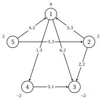
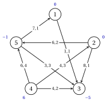
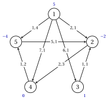
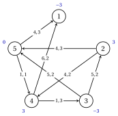
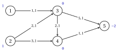

# Esercizi · Flusso di costo minimo

**Esercizi · Capitolo 6** · ogni soluzione si apre con un clic · [:material-book-open-variant: Capitolo 6: Flusso di costo minimo](../flussi/min-cost-flow/index.md) · [:material-file-pdf-box: Eserciziario, volume 3 (PDF)](../pdf/esercizi-3-flussi.pdf)

!!! formula "Regole utilizzate in questi esercizi"

    Le definizioni e gli algoritmi del capitolo [«Flusso di costo minimo»](../flussi/min-cost-flow/index.md), per un equilibrato rete $G=(N,A)$ con limiti inferiori pari a zero, capacità $u_{ij}$ e costi $c_{ij}$; gli archi sono in ordine lessicografo.

    - **(M1)** <strong>Rete residua.</strong> Per $(i,j) \in A$: l'arco in avanti $(i,j)$ con $r_{ij}=u_{ij}-x_{ij}$ e costo $c_{ij}$ se $x_{ij}<u_{ij}$; l'arco all'indietro $(j,i)$ con $r_{ji}=x_{ij}$ e costo $-c_{ij}$ se $x_{ij}>0$. Un ciclo $W$ di $G(\vet{x})$ ha un costo $c(W)$, la somma dei costi, e capacità residua $r(W)$, il minimo di $r$; aumentando di $\theta \le r(W)$ cambia il costo di $\theta\,c(W)$.

    - **(M2)** <strong>Ottimalità.</strong> Un flusso ammissibile è ottimale se e solo se $G(\vet{x})$ non ha ciclo negativo, se e solo se qualche $\vet{\pi}$ dà $c^x_{ij}-\pi_i+\pi_j \ge 0$ su ogni arco di $G(\vet{x})$, cioè $\bar{c}_{ij}=c_{ij}-\pi_i+\pi_j>0 \Rightarrow x_{ij}=0$ e $\bar{c}_{ij}<0 \Rightarrow x_{ij}=u_{ij}$.

    - **(M3)** <strong>Bellman–Ford su $G(\vet{x})$.</strong> $d^0(j)=0$ per ogni $j$ e

        $$
        d^k(j)=\min\Big\{ d^{k-1}(j),\ \min_{(i,j) \in A(\vet{x})} \big(d^{k-1}(i)+c^x_{ij}\big)\Big\};
        $$

        i pareggi vanno alla coda più piccola e il predecessore cambia solo in stretta diminuzione. Se $d^k=d^{k-1}$, arresto: no ciclo negativo e $\pi_i=-d^k(i)$, spostato in modo che $\pi_n=0$. Se $d^n \neq d^{n-1}$: $j$ è il nodo più piccolo con $d^n(j)<d^{n-1}(j)$, il cammino viene letta all'indietro dalla riga $n$ alla riga $1$ e il ciclo è il pezzo tra i due le occorrenze del primo nodo si sono incontrate due volte, leggendo il cammino dal suo primo nodo.

    - **(M4)** <strong>Annullamento del ciclo.</strong> Aumentare lungo il ciclo di (M3) di $\theta=r(W)$, finché (M3) non trova alcun negativo ciclo.

    - **(M5)** <strong>Primo flusso e scomposizione fattibile.</strong> Archi $(s,i)$ con capacità $b_i$ per $b_i>0$, archi $(i,t)$ con capacità $-b_i$ per $b_i<0$; l'algoritmo Edmonds–Karp: ricerca in ampiezza da $s$, gli archi che lasciano un nodo scansionato aumentando la testa ($s$ per primo, $t$ per ultimo). Una circolazione viene scomposta a partire dal suo primo arco con $y>0$ in ordine lessicografo e lasciando ogni nodo lungo il suo arco con $y>0$ di testa più piccola.

    - **(M6)** <strong>Percorsi più brevi successivi.</strong> Inizia con $\vet{x}=\vet{0}$, $\vet{\pi}=\vet{0}$, $\vet{e}=\vet{b}$; $s$ è il nodo dell'indice più piccolo con $e_s>0$; Dijkstra da $s$ con lunghezze $c^x_{ij}-\pi_i+\pi_j$ (indice più piccolo sui pareggi); $t$ è il nodo con $e_t<0$ di distanza minore (indice più piccolo sui pari merito); $\pi_i:=\pi_i-\min\{d(i),d(t)\}$ e $\delta=\min\{e_s,-e_t,r(P)\}$.

!!! esercizio "Esercizio 6.1: La rete residua"

    !!! esercizio "Esercizio"

        Consideriamo la rete $G=(N,A)$ con $N=\{1,2,\dots,5\}$, gli archi $7$

        $$
        A=\{(1,3),(1,4),(2,1),(2,3),(4,3),(5,1),(5,2)\},
        $$

        limiti inferiori dello zero e i saldi $b_1=0$, $b_2=2$, $b_3=-2$, $b_4=-2$, $b_5=2$. Costi e capacità sono riportati in tabella e, come $c_{ij},u_{ij}$, in figura; i saldi sono accanto ai nodi. La tabella riporta anche un flusso ammissibile $\bar{\vet{x}}$.

        
<table>
        <tr>
        <th>arco \((i,j)\)</th>
        <th>\((1,3)\)</th>
        <th>\((1,4)\)</th>
        <th>\((2,1)\)</th>
        <th>\((2,3)\)</th>
        <th>\((4,3)\)</th>
        <th>\((5,1)\)</th>
        <th>\((5,2)\)</th>
        </tr>
        <tr>
        <td>\(c_{ij}\)</td>
        <td>\(6\)</td>
        <td>\(1\)</td>
        <td>\(3\)</td>
        <td>\(2\)</td>
        <td>\(5\)</td>
        <td>\(4\)</td>
        <td>\(3\)</td>
        </tr>
        <tr>
        <td>\(u_{ij}\)</td>
        <td>\(2\)</td>
        <td>\(3\)</td>
        <td>\(3\)</td>
        <td>\(2\)</td>
        <td>\(1\)</td>
        <td>\(2\)</td>
        <td>\(3\)</td>
        </tr>
        <tr>
        <td>\(\bar{x}_{ij}\)</td>
        <td>\(0\)</td>
        <td>\(3\)</td>
        <td>\(2\)</td>
        <td>\(1\)</td>
        <td>\(1\)</td>
        <td>\(1\)</td>
        <td>\(1\)</td>
        </tr>
        </table>

        { .fig loading=lazy  }

        Le sequenze $W_1=1,2,3,4,1$ e $W_2=1,3,2,1$ sono cicli della rete residua $G(\bar{\vet{x}})$.

    **Domande**

    1. Costruisci $G(\bar{\vet{x}})$: per ogni arco di $A$ fornisci i suoi archi avanti e indietro, con capacità residua e costo.

    2. Calcolare il costo $c(W)$ e la capacità residua $r(W)$ di $W_1$ e di $W_2$. Quale dei due cicli può abbassare il costo di $\bar{\vet{x}}$?

    3. Aumenta $\bar{\vet{x}}$ lungo quel ciclo di $\theta=r(W)$. Fornire il nuovo flusso, verificare che sia fattibile e calcolarne il costo in due modi.

??? soluzione "Soluzione"

    Usiamo le regole (M1)–(M6) del riquadro all'inizio di questi esercizi.

    1. Da (M1) l'arco $(i,j)$ dà l'arco avanti se $\bar{x}_{ij}<u_{ij}$ e l'arco indietro $(j,i)$ se $\bar{x}_{ij}>0$; ogni voce è $r,c$:

        
<table>
        <tr>
        <th>arco \((i,j)\)</th>
        <th>\((1,3)\)</th>
        <th>\((1,4)\)</th>
        <th>\((2,1)\)</th>
        <th>\((2,3)\)</th>
        <th>\((4,3)\)</th>
        <th>\((5,1)\)</th>
        <th>\((5,2)\)</th>
        </tr>
        <tr>
        <td>\(\bar{x}_{ij}\)</td>
        <td>\(0\)</td>
        <td>\(3\)</td>
        <td>\(2\)</td>
        <td>\(1\)</td>
        <td>\(1\)</td>
        <td>\(1\)</td>
        <td>\(1\)</td>
        </tr>
        <tr>
        <td>avanti \((i,j)\): \(r,c\)</td>
        <td>\(2,6\)</td>
        <td>–</td>
        <td>\(1,3\)</td>
        <td>\(1,2\)</td>
        <td>–</td>
        <td>\(1,4\)</td>
        <td>\(2,3\)</td>
        </tr>
        <tr>
        <td>indietro \((j,i)\): \(r,c\)</td>
        <td>–</td>
        <td>\(3,-1\)</td>
        <td>\(2,-3\)</td>
        <td>\(1,-2\)</td>
        <td>\(1,-5\)</td>
        <td>\(1,-4\)</td>
        <td>\(1,-3\)</td>
        </tr>
        </table>

        $G(\bar{\vet{x}})$ ha archi $11$.

    2. Il ciclo $W_1=1,2,3,4,1$ utilizza gli archi $(1,2)$ indietro di $(2,1)$, $(2,3)$ avanti, $(3,4)$ indietro di $(4,3)$, $(4,1)$ indietro di $(1,4)$:

        $$
        c(W)=-3+2-5-1=-7, \qquad r(W)=\min\{2,1,1,3\}=1.
        $$

        Il ciclo $W_2=1,3,2,1$ utilizza gli archi $(1,3)$ avanti, $(3,2)$ indietro di $(2,3)$, $(2,1)$ avanti:

        $$
        c(W)=6-2+3=7, \qquad r(W)=\min\{2,1,1\}=1.
        $$

        Solo il ciclo negativo $W_1$ abbassa il costo: aumentandolo di $\theta$ cambia il costo di $\theta\,c(W)<0$, mentre $W_2$ lo aumenterebbe.

    3. Con $\theta=1$, $x_{ij}$ cresce di $1$ sugli archi di andata del ciclo e diminuisce di $1$ sugli archi il cui arco di ritorno è nel ciclo:

        
<table>
        <tr>
        <th>arco \((i,j)\)</th>
        <th>\((1,3)\)</th>
        <th>\((1,4)\)</th>
        <th>\((2,1)\)</th>
        <th>\((2,3)\)</th>
        <th>\((4,3)\)</th>
        <th>\((5,1)\)</th>
        <th>\((5,2)\)</th>
        </tr>
        <tr>
        <td>\(\bar{x}_{ij}\)</td>
        <td>\(0\)</td>
        <td>\(3\)</td>
        <td>\(2\)</td>
        <td>\(1\)</td>
        <td>\(1\)</td>
        <td>\(1\)</td>
        <td>\(1\)</td>
        </tr>
        <tr>
        <td>\(x'_{ij}\)</td>
        <td>\(0\)</td>
        <td>\(2\)</td>
        <td>\(1\)</td>
        <td>\(2\)</td>
        <td>\(0\)</td>
        <td>\(1\)</td>
        <td>\(1\)</td>
        </tr>
        </table>

        I limiti valgono e ogni nodo mantiene il suo deflusso meno l'afflusso, pari a $b_i$: $\vet{x}'$ è fattibile. Direttamente, $\vet{c}'\vet{x}'=6\cdot 0+1\cdot 2+3\cdot 1+2\cdot 2+5\cdot 0+4\cdot 1+3\cdot 1=16$; con (M1), $\vet{c}'\bar{\vet{x}}+\theta\,c(W)=23+1\cdot(-7)=16$. Gli archi che cambiano sono $(1,4)$, $(2,1)$, $(2,3)$, $(4,3)$.

    !!! chiave ""

        $G(\bar{\vet{x}})$ ha archi $11$; il ciclo $1,2,3,4,1$ costa $-7$ con capacità residua $1$ e aumentandolo si riduce il costo da $23$ a $16$: $\bar{\vet{x}}$ non è ottimale.

!!! esercizio "Esercizio 6.2: Condizioni di ottimalità"

    !!! esercizio "Esercizio"

        Consideriamo la rete $G=(N,A)$ con $N=\{1,2,\dots,5\}$, gli archi $8$

        $$
        A=\{(1,3),(2,3),(2,5),(4,2),(4,3),(4,5),(5,1),(5,3)\},
        $$

        limiti inferiori dello zero e i saldi $b_1=0$, $b_2=0$, $b_3=-5$, $b_4=6$, $b_5=-1$. Costi e capacità sono riportati in tabella e, come $c_{ij},u_{ij}$, in figura; i saldi sono accanto ai nodi. La tabella riporta anche un flusso ammissibile $\tilde{\vet{x}}$, ritenuto ottimale.

        
<table>
        <tr>
        <th>arco \((i,j)\)</th>
        <th>\((1,3)\)</th>
        <th>\((2,3)\)</th>
        <th>\((2,5)\)</th>
        <th>\((4,2)\)</th>
        <th>\((4,3)\)</th>
        <th>\((4,5)\)</th>
        <th>\((5,1)\)</th>
        <th>\((5,3)\)</th>
        </tr>
        <tr>
        <td>\(c_{ij}\)</td>
        <td>\(1\)</td>
        <td>\(8\)</td>
        <td>\(6\)</td>
        <td>\(4\)</td>
        <td>\(4\)</td>
        <td>\(6\)</td>
        <td>\(7\)</td>
        <td>\(3\)</td>
        </tr>
        <tr>
        <td>\(u_{ij}\)</td>
        <td>\(1\)</td>
        <td>\(1\)</td>
        <td>\(2\)</td>
        <td>\(3\)</td>
        <td>\(2\)</td>
        <td>\(4\)</td>
        <td>\(1\)</td>
        <td>\(3\)</td>
        </tr>
        <tr>
        <td>\(\tilde{x}_{ij}\)</td>
        <td>\(0\)</td>
        <td>\(0\)</td>
        <td>\(0\)</td>
        <td>\(0\)</td>
        <td>\(2\)</td>
        <td>\(4\)</td>
        <td>\(0\)</td>
        <td>\(3\)</td>
        </tr>
        </table>

        { .fig loading=lazy  }

    **Domande**

    1. Costruisci la rete residua $G(\tilde{\vet{x}})$.

    2. Eseguire Bellman–Ford su $G(\tilde{\vet{x}})$ da $d^0=\vet{0}$, come in (M3). Cosa concludi?

    3. Fornire i potenziali $\vet{\pi}$ di (M3), calcolare i costi ridotti $\bar{c}_{ij}$ degli archi di $A$ e verificare le condizioni di (M2) arco per arco.

??? soluzione "Soluzione"

    Usiamo le regole (M1)–(M6) del riquadro all'inizio di questi esercizi.

    1. Ciascuna voce è $r,c$ dell'arco residuo:

        
<table>
        <tr>
        <th>arco \((i,j)\)</th>
        <th>\((1,3)\)</th>
        <th>\((2,3)\)</th>
        <th>\((2,5)\)</th>
        <th>\((4,2)\)</th>
        <th>\((4,3)\)</th>
        <th>\((4,5)\)</th>
        <th>\((5,1)\)</th>
        <th>\((5,3)\)</th>
        </tr>
        <tr>
        <td>\(\tilde{x}_{ij}\)</td>
        <td>\(0\)</td>
        <td>\(0\)</td>
        <td>\(0\)</td>
        <td>\(0\)</td>
        <td>\(2\)</td>
        <td>\(4\)</td>
        <td>\(0\)</td>
        <td>\(3\)</td>
        </tr>
        <tr>
        <td>avanti \((i,j)\): \(r,c\)</td>
        <td>\(1,1\)</td>
        <td>\(1,8\)</td>
        <td>\(2,6\)</td>
        <td>\(3,4\)</td>
        <td>–</td>
        <td>–</td>
        <td>\(1,7\)</td>
        <td>–</td>
        </tr>
        <tr>
        <td>indietro \((j,i)\): \(r,c\)</td>
        <td>–</td>
        <td>–</td>
        <td>–</td>
        <td>–</td>
        <td>\(2,-4\)</td>
        <td>\(4,-6\)</td>
        <td>–</td>
        <td>\(3,-3\)</td>
        </tr>
        </table>

        $G(\tilde{\vet{x}})$ ha archi $8$.

    2. Ogni riga è un passaggio; accanto ad un'etichetta diminuita, il suo nuovo predecessore:

        $$
        \begin{array}{c|ccccc}
        \hline {k} & {d^k(1)} & {d^k(2)} & {d^k(3)} & {d^k(4)} & {d^k(5)} \\
        \hline {0} & {0} & {0} & {0} & {0} & {0} \\
        {1} & {0} & {0} & {0} & {-6} ({5}) & {-3} ({3}) \\
        {2} & {0} & {-2} ({4}) & {0} & {-9} ({5}) & {-3} \\
        {3} & {0} & {-5} ({4}) & {0} & {-9} & {-3} \\
        {4} & {0} & {-5} & {0} & {-9} & {-3} \\
        \hline
        \end{array}
        $$

        Il passaggio $4$ ripete le etichette del passaggio $3$: $G(\tilde{\vet{x}})$ non ha ciclo negativo, e per (M2) $\tilde{\vet{x}}$ è ottimale, di costo $41$ (Gurobi lo conferma).

    3. Con $\pi_i=-d^4(i)$, spostato in modo che $\pi_5=0$: $\vet{\pi}=(-3,\,2,\,-3,\,6,\,0)$. I costi ridotti sono

        
<table>
        <tr>
        <th>arco \((i,j)\)</th>
        <th>\((1,3)\)</th>
        <th>\((2,3)\)</th>
        <th>\((2,5)\)</th>
        <th>\((4,2)\)</th>
        <th>\((4,3)\)</th>
        <th>\((4,5)\)</th>
        <th>\((5,1)\)</th>
        <th>\((5,3)\)</th>
        </tr>
        <tr>
        <td>\(\tilde{x}_{ij}\)</td>
        <td>\(0\)</td>
        <td>\(0\)</td>
        <td>\(0\)</td>
        <td>\(0\)</td>
        <td>\(2\)</td>
        <td>\(4\)</td>
        <td>\(0\)</td>
        <td>\(3\)</td>
        </tr>
        <tr>
        <td>\(u_{ij}\)</td>
        <td>\(1\)</td>
        <td>\(1\)</td>
        <td>\(2\)</td>
        <td>\(3\)</td>
        <td>\(2\)</td>
        <td>\(4\)</td>
        <td>\(1\)</td>
        <td>\(3\)</td>
        </tr>
        <tr>
        <td>\(\bar{c}_{ij}\)</td>
        <td>\(1\)</td>
        <td>\(3\)</td>
        <td>\(4\)</td>
        <td>\(0\)</td>
        <td>\(-5\)</td>
        <td>\(0\)</td>
        <td>\(4\)</td>
        <td>\(0\)</td>
        </tr>
        </table>

        - gli archi con $\bar{c}_{ij}>0$, $(1,3)$, $(2,3)$, $(2,5)$, $(5,1)$, sono vuoti;

        - gli archi con $\bar{c}_{ij}<0$, $(4,3)$, sono saturati;

        - nessun arco è strettamente compreso tra i suoi limiti.

        Su ogni arco valgono le condizioni di (M2): $\vet{\pi}$ certifica l'ottimalità di $\tilde{\vet{x}}$.

    !!! chiave ""

        Bellman–Ford su $G(\tilde{\vet{x}})$ si ferma dopo il passaggio di $4$ senza cicli negativi; $\vet{\pi}=(-3,\,2,\,-3,\,6,\,0)$ offre costi ridotti che soddisfano (M2) e $\tilde{\vet{x}}$ è ottimale con il costo $41$.

!!! esercizio "Esercizio 6.3: L'algoritmo di annullamento del ciclo"

    !!! esercizio "Esercizio"

        Consideriamo la rete $G=(N,A)$ con $N=\{1,2,\dots,5\}$, gli archi $8$

        $$
        A=\{(1,2),(1,3),(1,4),(1,5),(2,4),(3,2),(4,5),(5,2)\},
        $$

        limiti inferiori dello zero e i saldi $b_1=5$, $b_2=-2$, $b_3=1$, $b_4=0$, $b_5=-4$. Costi e capacità sono riportati in tabella e, come $c_{ij},u_{ij}$, in figura; i saldi sono accanto ai nodi. La tabella riporta anche un flusso ammissibile $\vet{x}^0$.

        
<table>
        <tr>
        <th>arco \((i,j)\)</th>
        <th>\((1,2)\)</th>
        <th>\((1,3)\)</th>
        <th>\((1,4)\)</th>
        <th>\((1,5)\)</th>
        <th>\((2,4)\)</th>
        <th>\((3,2)\)</th>
        <th>\((4,5)\)</th>
        <th>\((5,2)\)</th>
        </tr>
        <tr>
        <td>\(c_{ij}\)</td>
        <td>\(2\)</td>
        <td>\(6\)</td>
        <td>\(7\)</td>
        <td>\(1\)</td>
        <td>\(2\)</td>
        <td>\(1\)</td>
        <td>\(1\)</td>
        <td>\(5\)</td>
        </tr>
        <tr>
        <td>\(u_{ij}\)</td>
        <td>\(1\)</td>
        <td>\(1\)</td>
        <td>\(1\)</td>
        <td>\(4\)</td>
        <td>\(3\)</td>
        <td>\(1\)</td>
        <td>\(2\)</td>
        <td>\(1\)</td>
        </tr>
        <tr>
        <td>\(x^0_{ij}\)</td>
        <td>\(1\)</td>
        <td>\(0\)</td>
        <td>\(1\)</td>
        <td>\(3\)</td>
        <td>\(1\)</td>
        <td>\(1\)</td>
        <td>\(2\)</td>
        <td>\(1\)</td>
        </tr>
        </table>

        { .fig loading=lazy  }

    **Domande**

    1. Eseguire l'algoritmo di annullamento del ciclo da $\vet{x}^0$ con le regole (M3) e (M4). Per ogni iterazione fornire la rete residua, la tabella di Bellman–Ford, il ciclo e il nuovo flusso.

    2. Riporta il flusso ottimale, il suo costo e i potenziali che lo certificano.

    3. Quante iterazioni consente il $\vet{c}'\vet{x}^0-z(\mathrm{MCF})$ associato?

??? soluzione "Soluzione"

    Usiamo le regole (M1)–(M6) del riquadro all'inizio di questi esercizi.

    1. <strong>Iterazione 1</strong>  Il flusso costa $22$ e $G(\vet{x}^0)$ è

        
<table>
        <tr>
        <th>arco \((i,j)\)</th>
        <th>\((1,2)\)</th>
        <th>\((1,3)\)</th>
        <th>\((1,4)\)</th>
        <th>\((1,5)\)</th>
        <th>\((2,4)\)</th>
        <th>\((3,2)\)</th>
        <th>\((4,5)\)</th>
        <th>\((5,2)\)</th>
        </tr>
        <tr>
        <td>\(x^0_{ij}\)</td>
        <td>\(1\)</td>
        <td>\(0\)</td>
        <td>\(1\)</td>
        <td>\(3\)</td>
        <td>\(1\)</td>
        <td>\(1\)</td>
        <td>\(2\)</td>
        <td>\(1\)</td>
        </tr>
        <tr>
        <td>avanti \((i,j)\): \(r,c\)</td>
        <td>–</td>
        <td>\(1,6\)</td>
        <td>–</td>
        <td>\(1,1\)</td>
        <td>\(2,2\)</td>
        <td>–</td>
        <td>–</td>
        <td>–</td>
        </tr>
        <tr>
        <td>indietro \((j,i)\): \(r,c\)</td>
        <td>\(1,-2\)</td>
        <td>–</td>
        <td>\(1,-7\)</td>
        <td>\(3,-1\)</td>
        <td>\(1,-2\)</td>
        <td>\(1,-1\)</td>
        <td>\(2,-1\)</td>
        <td>\(1,-5\)</td>
        </tr>
        </table>

        Bellman–Ford fornisce (in grassetto le voci lette al contrario):

        $$
        \begin{array}{c|ccccc}
        \hline {k} & {d^k(1)} & {d^k(2)} & {d^k(3)} & {d^k(4)} & {d^k(5)} \\
        \hline {0} & {0} & {0} & {0} & {0} & {0} \\
        {1}\text{ e }{-7} ({4}\text{) e }{-2} ({4}\text{) e }{-1} ({2}\text{) e }{\mathbf{-1}} ({\mathbf{5}}\text{) e }{-5} ({2}) \\
        {2}\text{ e }{-8} ({4}\text{) e }{\mathbf{-3}} ({\mathbf{4}}\text{) e }{-3} ({2}\text{) e }{-6} ({5}\text{) e }{-7} ({2}) \\
        {3}\text{ e }{-13} ({4}\text{) e }{-8} ({4}\text{) e }{-4} ({2}\text{) e }{-8} ({5}\text{) e }{\mathbf{-8}} ({\mathbf{2}}) \\
        {4}\text{ e }{-15} ({4}\text{) e }{-10} ({4}\text{) e }{-9} ({2}\text{) e }{\mathbf{-9}} ({\mathbf{5}}) & {-13} ({2}) \\
        {5}\text{ e }{\mathbf{-16}} ({\mathbf{4}}\text{) e }{-11} ({4}\text{) e }{-11} ({2}\text{) e }{-14} ({5}) & {-15} ({2}) \\
        \hline
        \end{array}
        $$

        Nel passaggio $5$ il nodo più piccolo la cui etichetta decresce è $j=1$; il cammino è $5,4,2,5,4,1$ e il ciclo è $W=5,4,2,5$, con gli archi $(5,4)$ indietro di $(4,5)$, $(4,2)$ indietro di $(2,4)$, $(2,5)$ indietro di $(5,2)$:

        $$
        c(W)=-1-2-5=-8, \qquad r(W)=\min\{2,1,1\}=1.
        $$

        L'aumento di $\theta=1$ fornisce il flusso $\vet{x}^1$ di costo $22+1\cdot(-8)=14$.

        <strong>Iterazione 2</strong>  Il flusso costa $14$ e $G(\vet{x}^1)$ è

        
<table>
        <tr>
        <th>arco \((i,j)\)</th>
        <th>\((1,2)\)</th>
        <th>\((1,3)\)</th>
        <th>\((1,4)\)</th>
        <th>\((1,5)\)</th>
        <th>\((2,4)\)</th>
        <th>\((3,2)\)</th>
        <th>\((4,5)\)</th>
        <th>\((5,2)\)</th>
        </tr>
        <tr>
        <td>\(x^1_{ij}\)</td>
        <td>\(1\)</td>
        <td>\(0\)</td>
        <td>\(1\)</td>
        <td>\(3\)</td>
        <td>\(0\)</td>
        <td>\(1\)</td>
        <td>\(1\)</td>
        <td>\(0\)</td>
        </tr>
        <tr>
        <td>avanti \((i,j)\): \(r,c\)</td>
        <td>–</td>
        <td>\(1,6\)</td>
        <td>–</td>
        <td>\(1,1\)</td>
        <td>\(3,2\)</td>
        <td>–</td>
        <td>\(1,1\)</td>
        <td>\(1,5\)</td>
        </tr>
        <tr>
        <td>indietro \((j,i)\): \(r,c\)</td>
        <td>\(1,-2\)</td>
        <td>–</td>
        <td>\(1,-7\)</td>
        <td>\(3,-1\)</td>
        <td>–</td>
        <td>\(1,-1\)</td>
        <td>\(1,-1\)</td>
        <td>–</td>
        </tr>
        </table>

        Bellman–Ford fornisce (in grassetto le voci lette al contrario):

        $$
        \begin{array}{c|ccccc}
        \hline {k} & {d^k(1)} & {d^k(2)} & {d^k(3)} & {d^k(4)} & {d^k(5)} \\
        \hline {0} & {0} & {0} & {0} & {0} & {0} \\
        {1} & {-7} ({4}) & {0} & {-1} ({2}) & {\mathbf{-1}} ({\mathbf{5}}) & {0} \\
        {2} & {\mathbf{-8}} ({\mathbf{4}}) & {0} & {-1} & {-1} & {-6} ({1}) \\
        {3}\text{ e }{-8}\text{ e }{-1} ({5}\text{) e }{-2} ({1}\text{) e }{-7} ({5}\text{) e }{\mathbf{-7}} ({\mathbf{1}}) \\
        {4} & {-14} ({4}) & {-2} ({5}) & {-2} & {\mathbf{-8}} ({\mathbf{5}}) & {-7} \\
        {5}\text{ e }{\mathbf{-15}} ({\mathbf{4}}\text{) e }{-2}\text{ e }{-8} ({1}\text{) e }{-8}\text{ e }{-13} ({1}) \\
        \hline
        \end{array}
        $$

        Nel passaggio $5$ il nodo più piccolo la cui etichetta diminuisce è $j=1$; il cammino è $5,4,1,5,4,1$ e il ciclo è $W=5,4,1,5$, con gli archi $(5,4)$ indietro di $(4,5)$, $(4,1)$ indietro di $(1,4)$, $(1,5)$ avanti:

        $$
        c(W)=-1-7+1=-7, \qquad r(W)=\min\{1,1,1\}=1.
        $$

        L'aumento di $\theta=1$ fornisce il flusso $\vet{x}^2$ di costo $14+1\cdot(-7)=7$.

        <strong>Iterazione 3</strong>  $G(\vet{x}^2)$ è

        
<table>
        <tr>
        <th>arco \((i,j)\)</th>
        <th>\((1,2)\)</th>
        <th>\((1,3)\)</th>
        <th>\((1,4)\)</th>
        <th>\((1,5)\)</th>
        <th>\((2,4)\)</th>
        <th>\((3,2)\)</th>
        <th>\((4,5)\)</th>
        <th>\((5,2)\)</th>
        </tr>
        <tr>
        <td>\(x^2_{ij}\)</td>
        <td>\(1\)</td>
        <td>\(0\)</td>
        <td>\(0\)</td>
        <td>\(4\)</td>
        <td>\(0\)</td>
        <td>\(1\)</td>
        <td>\(0\)</td>
        <td>\(0\)</td>
        </tr>
        <tr>
        <td>avanti \((i,j)\): \(r,c\)</td>
        <td>–</td>
        <td>\(1,6\)</td>
        <td>\(1,7\)</td>
        <td>–</td>
        <td>\(3,2\)</td>
        <td>–</td>
        <td>\(2,1\)</td>
        <td>\(1,5\)</td>
        </tr>
        <tr>
        <td>indietro \((j,i)\): \(r,c\)</td>
        <td>\(1,-2\)</td>
        <td>–</td>
        <td>–</td>
        <td>\(4,-1\)</td>
        <td>–</td>
        <td>\(1,-1\)</td>
        <td>–</td>
        <td>–</td>
        </tr>
        </table>

        e Bellman: Ford dà

        $$
        \begin{array}{c|ccccc}
        \hline {k} & {d^k(1)} & {d^k(2)} & {d^k(3)} & {d^k(4)} & {d^k(5)} \\
        \hline {0} & {0} & {0} & {0} & {0} & {0} \\
        {1} & {-2} ({2}) & {0} & {-1} ({2}) & {0} & {0} \\
        {2} & {-2} & {0} & {-1} & {0} & {0} \\
        \hline
        \end{array}
        $$

        Passa $2$ ripete le etichette: nessun ciclo negativo, <code>STOP</code>.

    2. L'ultimo flusso è ottimale:

        
<table>
        <tr>
        <th>arco \((i,j)\)</th>
        <th>\((1,2)\)</th>
        <th>\((1,3)\)</th>
        <th>\((1,4)\)</th>
        <th>\((1,5)\)</th>
        <th>\((2,4)\)</th>
        <th>\((3,2)\)</th>
        <th>\((4,5)\)</th>
        <th>\((5,2)\)</th>
        </tr>
        <tr>
        <td>\(\tilde{x}_{ij}\)</td>
        <td>\(1\)</td>
        <td>\(0\)</td>
        <td>\(0\)</td>
        <td>\(4\)</td>
        <td>\(0\)</td>
        <td>\(1\)</td>
        <td>\(0\)</td>
        <td>\(0\)</td>
        </tr>
        </table>

        con costo $z(\mathrm{MCF})=7$ (lo conferma Gurobi). Le etichette dell'ultima tabella riportano, spostate in modo che $\pi_5=0$, i potenziali $\vet{\pi}=(2,\,0,\,1,\,0,\,0)$; i costi ridotti degli archi dell'ultima rete residua sono tutti non negativi, come richiede (M2).

    3. Il costo va da $22$ a $7$ e ogni iterazione lo abbassa di almeno $1$: al massimo $22-7=15$ iterazioni. L'algoritmo necessita di $2$, riducendo il costo di $8$ e $7$.

    !!! chiave ""

        Vengono annullati due cicli, $5,4,2,5$ e $5,4,1,5$; il costo va da $22$ a $14$ e $7$, il valore ottimale, certificato da $\vet{\pi}=(2,\,0,\,1,\,0,\,0)$.

!!! esercizio "Esercizio 6.4: L'algoritmo del cammino minimo successivo"

    !!! esercizio "Esercizio"

        Consideriamo la rete $G=(N,A)$ con $N=\{1,2,\dots,5\}$, gli archi $8$

        $$
        A=\{(2,4),(2,5),(3,2),(3,5),(4,1),(4,3),(5,1),(5,4)\},
        $$

        limiti inferiori dello zero e i saldi $b_1=-3$, $b_2=3$, $b_3=-3$, $b_4=3$, $b_5=0$. Costi e capacità sono riportati in tabella e, come $c_{ij},u_{ij}$, in figura; i saldi sono accanto ai nodi.

        
<table>
        <tr>
        <th>arco \((i,j)\)</th>
        <th>\((2,4)\)</th>
        <th>\((2,5)\)</th>
        <th>\((3,2)\)</th>
        <th>\((3,5)\)</th>
        <th>\((4,1)\)</th>
        <th>\((4,3)\)</th>
        <th>\((5,1)\)</th>
        <th>\((5,4)\)</th>
        </tr>
        <tr>
        <td>\(c_{ij}\)</td>
        <td>\(4\)</td>
        <td>\(4\)</td>
        <td>\(5\)</td>
        <td>\(5\)</td>
        <td>\(6\)</td>
        <td>\(1\)</td>
        <td>\(4\)</td>
        <td>\(1\)</td>
        </tr>
        <tr>
        <td>\(u_{ij}\)</td>
        <td>\(2\)</td>
        <td>\(3\)</td>
        <td>\(2\)</td>
        <td>\(2\)</td>
        <td>\(2\)</td>
        <td>\(3\)</td>
        <td>\(3\)</td>
        <td>\(1\)</td>
        </tr>
        </table>

        { .fig loading=lazy  }

    **Domande**

    1. Eseguire l'algoritmo del percorso più breve successivo con le regole (M6). Per ogni iterazione fornire $s$, i costi ridotti, le distanze dell'algoritmo di Dijkstra, $t$, il percorso $P$, $\delta$ e i nuovi potenziali.

    2. Fornire il flusso ottimale e il relativo costo e verificarne l'ottimalità con i potenziali finali.

    3. Confronta il numero di iterazioni con il $D=\sum_{i: b_i>0} b_i$ associato.

??? soluzione "Soluzione"

    Usiamo le regole (M1)–(M6) del riquadro all'inizio di questi esercizi.

    1. Partiamo da $\vet{x}=\vet{0}$ e $\vet{\pi}=\vet{0}$.

        <strong>Iterazione 1</strong>  $s=2$, con $\vet{\pi}=(0,\,0,\,0,\,0,\,0)$ e $\vet{e}=(-3,\,3,\,-3,\,3,\,0)$. I costi ridotti degli archi di $A$ (arco avanti: $\bar{c}_{ij}$ se $x_{ij}<u_{ij}$; arco indietro: $-\bar{c}_{ij}$ se $x_{ij}>0$) sono

        
<table>
        <tr>
        <th>arco \((i,j)\)</th>
        <th>\((2,4)\)</th>
        <th>\((2,5)\)</th>
        <th>\((3,2)\)</th>
        <th>\((3,5)\)</th>
        <th>\((4,1)\)</th>
        <th>\((4,3)\)</th>
        <th>\((5,1)\)</th>
        <th>\((5,4)\)</th>
        </tr>
        <tr>
        <td>\(x_{ij}\)</td>
        <td>\(0\)</td>
        <td>\(0\)</td>
        <td>\(0\)</td>
        <td>\(0\)</td>
        <td>\(0\)</td>
        <td>\(0\)</td>
        <td>\(0\)</td>
        <td>\(0\)</td>
        </tr>
        <tr>
        <td>\(\bar{c}_{ij}\)</td>
        <td>\(4\)</td>
        <td>\(4\)</td>
        <td>\(5\)</td>
        <td>\(5\)</td>
        <td>\(6\)</td>
        <td>\(1\)</td>
        <td>\(4\)</td>
        <td>\(1\)</td>
        </tr>
        </table>

        Dijkstra di $s$ rende permanenti i nodi nell'ordine 2,4,5,3,1, con distanze $d=(8,\,0,\,5,\,4,\,4)$. I nodi deficitari sono $1$, $3$: $t=3$, con percorso $P=2,4,3$ di costo ridotto $5$ e costo $c(P)=5$. Quindi $\delta=\min\{3,3,2,3\}=2$, i nuovi potenziali sono $\vet{\pi}=(-5,\,0,\,-5,\,-4,\,-4)$ e il costo diventa $10$.

        <strong>Iterazione 2</strong>  $s=2$, con $\vet{\pi}=(-5,\,0,\,-5,\,-4,\,-4)$ e $\vet{e}=(-3,\,1,\,-1,\,3,\,0)$. I costi ridotti degli archi di $A$ (arco avanti: $\bar{c}_{ij}$ se $x_{ij}<u_{ij}$; arco indietro: $-\bar{c}_{ij}$ se $x_{ij}>0$) sono

        
<table>
        <tr>
        <th>arco \((i,j)\)</th>
        <th>\((2,4)\)</th>
        <th>\((2,5)\)</th>
        <th>\((3,2)\)</th>
        <th>\((3,5)\)</th>
        <th>\((4,1)\)</th>
        <th>\((4,3)\)</th>
        <th>\((5,1)\)</th>
        <th>\((5,4)\)</th>
        </tr>
        <tr>
        <td>\(x_{ij}\)</td>
        <td>\(2\)</td>
        <td>\(0\)</td>
        <td>\(0\)</td>
        <td>\(0\)</td>
        <td>\(0\)</td>
        <td>\(2\)</td>
        <td>\(0\)</td>
        <td>\(0\)</td>
        </tr>
        <tr>
        <td>\(\bar{c}_{ij}\)</td>
        <td>\(0\)</td>
        <td>\(0\)</td>
        <td>\(10\)</td>
        <td>\(6\)</td>
        <td>\(5\)</td>
        <td>\(0\)</td>
        <td>\(3\)</td>
        <td>\(1\)</td>
        </tr>
        </table>

        Dijkstra di $s$ rende permanenti i nodi nell'ordine 2,5,4,3,1, con distanze $d=(3,\,0,\,1,\,1,\,0)$. I nodi deficitari sono $1$, $3$: $t=3$, con percorso $P=2,5,4,3$ di costo ridotto $1$ e costo $c(P)=6$. Quindi $\delta=\min\{1,1,3,1,1\}=1$, i nuovi potenziali sono $\vet{\pi}=(-6,\,0,\,-6,\,-5,\,-4)$ e il costo diventa $16$.

        <strong>Iterazione 3</strong>  $s=4$, con $\vet{\pi}=(-6,\,0,\,-6,\,-5,\,-4)$ e $\vet{e}=(-3,\,0,\,0,\,3,\,0)$. I costi ridotti degli archi di $A$ (arco avanti: $\bar{c}_{ij}$ se $x_{ij}<u_{ij}$; arco indietro: $-\bar{c}_{ij}$ se $x_{ij}>0$) sono

        
<table>
        <tr>
        <th>arco \((i,j)\)</th>
        <th>\((2,4)\)</th>
        <th>\((2,5)\)</th>
        <th>\((3,2)\)</th>
        <th>\((3,5)\)</th>
        <th>\((4,1)\)</th>
        <th>\((4,3)\)</th>
        <th>\((5,1)\)</th>
        <th>\((5,4)\)</th>
        </tr>
        <tr>
        <td>\(x_{ij}\)</td>
        <td>\(2\)</td>
        <td>\(1\)</td>
        <td>\(0\)</td>
        <td>\(0\)</td>
        <td>\(0\)</td>
        <td>\(3\)</td>
        <td>\(0\)</td>
        <td>\(1\)</td>
        </tr>
        <tr>
        <td>\(\bar{c}_{ij}\)</td>
        <td>\(-1\)</td>
        <td>\(0\)</td>
        <td>\(11\)</td>
        <td>\(7\)</td>
        <td>\(5\)</td>
        <td>\(0\)</td>
        <td>\(2\)</td>
        <td>\(0\)</td>
        </tr>
        </table>

        Dijkstra di $s$ rende permanenti i nodi nell'ordine 4,5,2,1, con distanze $d=(2,\,0,\,+\infty,\,0,\,0)$. Il nodo deficitario è $1$: $t=1$, con percorso $P=4,5,1$ di costo ridotto $2$ e costo $c(P)=3$. Quindi $\delta=\min\{3,3,1,3\}=1$, i nuovi potenziali sono $\vet{\pi}=(-8,\,0,\,-8,\,-5,\,-4)$ e il costo diventa $19$.

        <strong>Iterazione 4</strong>  $s=4$, con $\vet{\pi}=(-8,\,0,\,-8,\,-5,\,-4)$ e $\vet{e}=(-2,\,0,\,0,\,2,\,0)$. I costi ridotti degli archi di $A$ (arco avanti: $\bar{c}_{ij}$ se $x_{ij}<u_{ij}$; arco indietro: $-\bar{c}_{ij}$ se $x_{ij}>0$) sono

        
<table>
        <tr>
        <th>arco \((i,j)\)</th>
        <th>\((2,4)\)</th>
        <th>\((2,5)\)</th>
        <th>\((3,2)\)</th>
        <th>\((3,5)\)</th>
        <th>\((4,1)\)</th>
        <th>\((4,3)\)</th>
        <th>\((5,1)\)</th>
        <th>\((5,4)\)</th>
        </tr>
        <tr>
        <td>\(x_{ij}\)</td>
        <td>\(2\)</td>
        <td>\(1\)</td>
        <td>\(0\)</td>
        <td>\(0\)</td>
        <td>\(0\)</td>
        <td>\(3\)</td>
        <td>\(1\)</td>
        <td>\(0\)</td>
        </tr>
        <tr>
        <td>\(\bar{c}_{ij}\)</td>
        <td>\(-1\)</td>
        <td>\(0\)</td>
        <td>\(13\)</td>
        <td>\(9\)</td>
        <td>\(3\)</td>
        <td>\(-2\)</td>
        <td>\(0\)</td>
        <td>\(0\)</td>
        </tr>
        </table>

        Dijkstra di $s$ rende permanenti i nodi nell'ordine 4,2,5,1, con distanze $d=(1,\,1,\,+\infty,\,0,\,1)$. Il nodo deficitario è $1$: $t=1$, con percorso $P=4,2,5,1$ di costo ridotto $1$ e costo $c(P)=4$. Quindi $\delta=\min\{2,2,2,2,2\}=2$, i nuovi potenziali sono $\vet{\pi}=(-9,\,-1,\,-9,\,-5,\,-5)$ e il costo diventa $27$.

        Ora $\vet{e}=\vet{0}$: <code>STOP</code>.

    2. Il flusso finale è

        
<table>
        <tr>
        <th>arco \((i,j)\)</th>
        <th>\((2,4)\)</th>
        <th>\((2,5)\)</th>
        <th>\((3,2)\)</th>
        <th>\((3,5)\)</th>
        <th>\((4,1)\)</th>
        <th>\((4,3)\)</th>
        <th>\((5,1)\)</th>
        <th>\((5,4)\)</th>
        </tr>
        <tr>
        <td>\(\tilde{x}_{ij}\)</td>
        <td>\(0\)</td>
        <td>\(3\)</td>
        <td>\(0\)</td>
        <td>\(0\)</td>
        <td>\(0\)</td>
        <td>\(3\)</td>
        <td>\(3\)</td>
        <td>\(0\)</td>
        </tr>
        </table>

        con costo $27$ (lo conferma Gurobi). Spostato in modo che $\pi_5=0$, i potenziali finali siano $\vet{\pi}=(-4,\,4,\,-4,\,0,\,0)$, con costi ridotti

        
<table>
        <tr>
        <th>arco \((i,j)\)</th>
        <th>\((2,4)\)</th>
        <th>\((2,5)\)</th>
        <th>\((3,2)\)</th>
        <th>\((3,5)\)</th>
        <th>\((4,1)\)</th>
        <th>\((4,3)\)</th>
        <th>\((5,1)\)</th>
        <th>\((5,4)\)</th>
        </tr>
        <tr>
        <td>\(\bar{c}_{ij}\)</td>
        <td>\(0\)</td>
        <td>\(0\)</td>
        <td>\(13\)</td>
        <td>\(9\)</td>
        <td>\(2\)</td>
        <td>\(-3\)</td>
        <td>\(0\)</td>
        <td>\(1\)</td>
        </tr>
        </table>

        Ogni arco con $\bar{c}_{ij}>0$ è vuoto e ogni arco con $\bar{c}_{ij}<0$ è saturo: (M2) vale.

    3. La fornitura totale è $D=6$ e l'algoritmo necessita di iterazioni $4$, poiché gli importi $\delta$ sono $2$, $1$, $1$, $2$, che si sommano a $6$.

    !!! chiave ""

        L'algoritmo del percorso più breve successivo invia le unità $6$ lungo i percorsi $4$, di costo $5$, $6$, $3$, $4$; il costo ottimale è $27$.

!!! esercizio "Esercizio 6.5: Un primo flusso ammissibile e la scomposizione"

    !!! esercizio "Esercizio"

        Consideriamo la rete $G=(N,A)$ con $N=\{1,2,\dots,5\}$, gli archi $8$

        $$
        A=\{(1,3),(2,1),(2,4),(3,2),(3,4),(4,1),(5,2),(5,4)\},
        $$

        limiti inferiori dello zero e i saldi $b_1=-4$, $b_2=-3$, $b_3=4$, $b_4=-1$, $b_5=4$. Costi e capacità sono riportati in tabella e, come $c_{ij},u_{ij}$, in figura; i saldi sono accanto ai nodi. La tabella fornisce anche il flusso ottimale $\tilde{\vet{x}}$, calcolato con un solutore LP.

        
<table>
        <tr>
        <th>arco \((i,j)\)</th>
        <th>\((1,3)\)</th>
        <th>\((2,1)\)</th>
        <th>\((2,4)\)</th>
        <th>\((3,2)\)</th>
        <th>\((3,4)\)</th>
        <th>\((4,1)\)</th>
        <th>\((5,2)\)</th>
        <th>\((5,4)\)</th>
        </tr>
        <tr>
        <td>\(c_{ij}\)</td>
        <td>\(6\)</td>
        <td>\(6\)</td>
        <td>\(2\)</td>
        <td>\(1\)</td>
        <td>\(7\)</td>
        <td>\(1\)</td>
        <td>\(3\)</td>
        <td>\(4\)</td>
        </tr>
        <tr>
        <td>\(u_{ij}\)</td>
        <td>\(1\)</td>
        <td>\(3\)</td>
        <td>\(1\)</td>
        <td>\(4\)</td>
        <td>\(2\)</td>
        <td>\(4\)</td>
        <td>\(3\)</td>
        <td>\(4\)</td>
        </tr>
        <tr>
        <td>\(\tilde{x}_{ij}\)</td>
        <td>\(0\)</td>
        <td>\(0\)</td>
        <td>\(1\)</td>
        <td>\(4\)</td>
        <td>\(0\)</td>
        <td>\(4\)</td>
        <td>\(0\)</td>
        <td>\(4\)</td>
        </tr>
        </table>

        { .fig loading=lazy  }

    **Domande**

    1. Costruisci la rete ausiliaria di (M5) e calcola un flusso massimo con l'algoritmo Edmonds–Karp. La rete ha un flusso fattibile? Indicare il flusso $\vet{x}^0$ sugli archi di $A$ e il relativo costo.

    2. Scrivi la circolazione $\vet{y}$ su $G(\vet{x}^0)$ tale che $\tilde{\vet{x}}$ sia $\vet{x}^0$ aumentata da $\vet{y}$, e scomponila in cicli con la regola di (M5).

    3. Controllare che $\sum_h \theta_h\,c(W_h)=\vet{c}'\tilde{\vet{x}}-\vet{c}'\vet{x}^0$. Perché una scomposizione di $\tilde{\vet{x}}-\vet{x}$ contiene un ciclo negativo ogni volta che un flusso fattibile $\vet{x}$ non è ottimale?

??? soluzione "Soluzione"

    Usiamo le regole (M1)–(M6) del riquadro all'inizio di questi esercizi.

    1. I nuovi archi sono $(s,3)$ con capacità $4$, $(s,5)$ con capacità $4$, $(1,t)$ con capacità $4$, $(2,t)$ con capacità $3$, $(4,t)$ con capacità $1$ e $D=8$. I cammini aumentanti dell'algoritmo Edmonds–Karp sono

        
<table>
        <tr>
        <th>percorso</th>
        <th>nodi</th>
        <th>unità</th>
        </tr>
        <tr>
        <td>\(1\)</td>
        <td>\(s,3,2,t\)</td>
        <td>\(3\)</td>
        </tr>
        <tr>
        <td>\(2\)</td>
        <td>\(s,3,4,t\)</td>
        <td>\(1\)</td>
        </tr>
        <tr>
        <td>\(3\)</td>
        <td>\(s,5,2,1,t\)</td>
        <td>\(3\)</td>
        </tr>
        <tr>
        <td>\(4\)</td>
        <td>\(s,5,4,1,t\)</td>
        <td>\(1\)</td>
        </tr>
        </table>

        Il valore è $8=D$: la rete ha un flusso fattibile, la restrizione a $A$

        
<table>
        <tr>
        <th>arco \((i,j)\)</th>
        <th>\((1,3)\)</th>
        <th>\((2,1)\)</th>
        <th>\((2,4)\)</th>
        <th>\((3,2)\)</th>
        <th>\((3,4)\)</th>
        <th>\((4,1)\)</th>
        <th>\((5,2)\)</th>
        <th>\((5,4)\)</th>
        </tr>
        <tr>
        <td>\(x^0_{ij}\)</td>
        <td>\(0\)</td>
        <td>\(3\)</td>
        <td>\(0\)</td>
        <td>\(3\)</td>
        <td>\(1\)</td>
        <td>\(1\)</td>
        <td>\(3\)</td>
        <td>\(1\)</td>
        </tr>
        </table>

        con costo $42$.

    2. Per il lemma sulla differenza di due flussi ammissibili, $\vet{y}$ è positivo sull'arco avanti $(i,j)$ con $y_{ij}=\tilde{x}_{ij}-x^0_{ij}$ quando $\tilde{x}_{ij}>x^0_{ij}$, e sull'arco indietro $(j,i)$ con $y_{ji}=x^0_{ij}-\tilde{x}_{ij}$ quando $\tilde{x}_{ij}<x^0_{ij}$:

        $$
        y_{12}=3,\qquad y_{24}=1,\qquad y_{25}=3,\qquad y_{32}=1,\qquad y_{41}=3,\qquad y_{43}=1,\qquad y_{54}=3.
        $$

        Partendo dal primo arco con $y>0$ e lasciando ogni nodo lungo il suo arco con $y>0$ della testa più piccola:

        
<table>
        <tr>
        <th>\(h\)</th>
        <th>ciclo \(W_h\)</th>
        <th>\(\theta_h\)</th>
        <th>\(c(W_h)\)</th>
        </tr>
        <tr>
        <td>\(1\)</td>
        <td>\(1,2,4,1\)</td>
        <td>\(1\)</td>
        <td>\(-6+2+1=-3\)</td>
        </tr>
        <tr>
        <td>\(2\)</td>
        <td>\(1,2,5,4,1\)</td>
        <td>\(2\)</td>
        <td>\(-6-3+4+1=-4\)</td>
        </tr>
        <tr>
        <td>\(3\)</td>
        <td>\(2,5,4,3,2\)</td>
        <td>\(1\)</td>
        <td>\(-3+4-7+1=-5\)</td>
        </tr>
        </table>

    3. Infatti

        $$
        \sum_h \theta_h\,c(W_h)=1\cdot(-3)+2\cdot(-4)+1\cdot(-5)=-16=26-42.
        $$

        Se $\vet{x}$ non è ottimale, $\vet{c}'\tilde{\vet{x}}-\vet{c}'\vet{x}<0$: una somma dei termini $\theta_h\,c(W_h)$ con $\theta_h>0$ è negativa solo se alcuni $c(W_h)$ sono negativi. Questo è l’argomento alla base delle condizioni di ottimalità del ciclo negativo.

    !!! chiave ""

        La portata massima ha valore $8$ e fornisce una portata ammissibile di costo $42$; la differenza con il flusso ottimale, di costo $26$, si divide in $3$ cicli di $G(\vet{x}^0)$ i cui costi sommati danno $-16$.

!!! esercizio "Esercizio 6.6: Un controesempio e una dimostrazione"

    !!! esercizio "Esercizio"

        Consideriamo la rete $G=(N,A)$ con $N=\{1,2,\dots,5\}$, gli archi $6$

        $$
        A=\{(1,3),(2,3),(2,4),(3,4),(3,5),(4,5)\},
        $$

        limiti inferiori dello zero e i saldi $b_1=1$, $b_2=1$, $b_3=0$, $b_4=0$, $b_5=-2$. Costi e capacità sono riportati in tabella e, come $c_{ij},u_{ij}$, in figura; i saldi sono accanto ai nodi.

        
<table>
        <tr>
        <th>arco \((i,j)\)</th>
        <th>\((1,3)\)</th>
        <th>\((2,3)\)</th>
        <th>\((2,4)\)</th>
        <th>\((3,4)\)</th>
        <th>\((3,5)\)</th>
        <th>\((4,5)\)</th>
        </tr>
        <tr>
        <td>\(c_{ij}\)</td>
        <td>\(1\)</td>
        <td>\(2\)</td>
        <td>\(3\)</td>
        <td>\(2\)</td>
        <td>\(5\)</td>
        <td>\(1\)</td>
        </tr>
        <tr>
        <td>\(u_{ij}\)</td>
        <td>\(1\)</td>
        <td>\(1\)</td>
        <td>\(1\)</td>
        <td>\(1\)</td>
        <td>\(1\)</td>
        <td>\(1\)</td>
        </tr>
        </table>

        { .fig loading=lazy  }

        Nell'algoritmo del percorso più breve successivo, uno studente esegue l'algoritmo di Dijkstra con i costi $c^x_{ij}$ della rete residua come lunghezze, invece dei costi ridotti.

    **Domande**

    1. Esegue la prima iterazione dell'algoritmo del percorso più breve successivo con le regole (M6).

    2. Nella seconda iterazione, esegui l'algoritmo di Dijkstra da $s$ con le lunghezze $c^x_{ij}$, come fa lo studente. Confronta le sue etichette con i costi minimi reali dei percorsi di $s$ e fornisci il flusso che lo studente ottiene e il suo costo.

    3. Completa la seconda iterazione con costi ridotti e fornisci il flusso ottimale.

    4. Dimostrare: se $\tilde{\vet{x}}$ è un flusso ottimale e ogni ciclo di $G(\tilde{\vet{x}})$ ha un costo positivo, allora $\tilde{\vet{x}}$ è l'unico flusso ottimale.

??? soluzione "Soluzione"

    Usiamo le regole (M1)–(M6) del riquadro all'inizio di questi esercizi.

    1. Partiamo da $\vet{x}=\vet{0}$ e $\vet{\pi}=\vet{0}$.

        <strong>Iterazione 1</strong>  $s=1$, con $\vet{\pi}=(0,\,0,\,0,\,0,\,0)$ e $\vet{e}=(1,\,1,\,0,\,0,\,-2)$. I costi ridotti degli archi di $A$ (arco avanti: $\bar{c}_{ij}$ se $x_{ij}<u_{ij}$; arco indietro: $-\bar{c}_{ij}$ se $x_{ij}>0$) sono

        
<table>
        <tr>
        <th>arco \((i,j)\)</th>
        <th>\((1,3)\)</th>
        <th>\((2,3)\)</th>
        <th>\((2,4)\)</th>
        <th>\((3,4)\)</th>
        <th>\((3,5)\)</th>
        <th>\((4,5)\)</th>
        </tr>
        <tr>
        <td>\(x_{ij}\)</td>
        <td>\(0\)</td>
        <td>\(0\)</td>
        <td>\(0\)</td>
        <td>\(0\)</td>
        <td>\(0\)</td>
        <td>\(0\)</td>
        </tr>
        <tr>
        <td>\(\bar{c}_{ij}\)</td>
        <td>\(1\)</td>
        <td>\(2\)</td>
        <td>\(3\)</td>
        <td>\(2\)</td>
        <td>\(5\)</td>
        <td>\(1\)</td>
        </tr>
        </table>

        Dijkstra di $s$ rende permanenti i nodi nell'ordine 1,3,4,5, con distanze $d=(0,\,+\infty,\,1,\,3,\,4)$. Il nodo deficitario è $5$: $t=5$, con percorso $P=1,3,4,5$ di costo ridotto $4$ e costo $c(P)=4$. Quindi $\delta=\min\{1,2,1,1,1\}=1$, i nuovi potenziali sono $\vet{\pi}=(0,\,-4,\,-1,\,-3,\,-4)$ e il costo diventa $4$.

        Il nodo $1$ ha inviato la sua unità; ora $e_2>0$, quindi la seconda iterazione inizia da $s=2$.

    2. Dopo la prima iterazione la rete residua è

        
<table>
        <tr>
        <th>arco \((i,j)\)</th>
        <th>\((1,3)\)</th>
        <th>\((2,3)\)</th>
        <th>\((2,4)\)</th>
        <th>\((3,4)\)</th>
        <th>\((3,5)\)</th>
        <th>\((4,5)\)</th>
        </tr>
        <tr>
        <td>\(x^1_{ij}\)</td>
        <td>\(1\)</td>
        <td>\(0\)</td>
        <td>\(0\)</td>
        <td>\(1\)</td>
        <td>\(0\)</td>
        <td>\(1\)</td>
        </tr>
        <tr>
        <td>avanti \((i,j)\): \(r,c\)</td>
        <td>–</td>
        <td>\(1,2\)</td>
        <td>\(1,3\)</td>
        <td>–</td>
        <td>\(1,5\)</td>
        <td>–</td>
        </tr>
        <tr>
        <td>indietro \((j,i)\): \(r,c\)</td>
        <td>\(1,-1\)</td>
        <td>–</td>
        <td>–</td>
        <td>\(1,-2\)</td>
        <td>–</td>
        <td>\(1,-1\)</td>
        </tr>
        </table>

        e i relativi archi $(3,1)$, $(4,3)$, $(5,4)$ hanno un costo negativo. Dijkstra con queste lunghezze rende permanenti i nodi nell'ordine $2,3,1,4,5$ e assegna le etichette $(1,\,0,\,2,\,3,\,7)$. I costi minimi reali di $2$, calcolati con Bellman–Ford ($G(\vet{x}^1)$ non ha ciclo negativo), sono $(0,\,0,\,1,\,3,\,6)$.

        - Il nodo $3$ diventa permanente con etichetta $2$; successivamente il nodo $4$, con etichetta $3$, offre $3-2=1$ lungo l'arco negativo $(4,3)$, ma il nodo $3$ è già permanente e non viene aggiornato.

        - Quindi l'etichetta di $t=5$ è $7$, attraverso il percorso $2,3,5$, invece di $6$, il costo di $2,4,3,5$.

        Aumentando lungo $2,3,5$ con $\delta=1$ lo studente ottiene il flusso fattibile

        
<table>
        <tr>
        <th>arco \((i,j)\)</th>
        <th>\((1,3)\)</th>
        <th>\((2,3)\)</th>
        <th>\((2,4)\)</th>
        <th>\((3,4)\)</th>
        <th>\((3,5)\)</th>
        <th>\((4,5)\)</th>
        </tr>
        <tr>
        <td>\(x_{ij}\)</td>
        <td>\(1\)</td>
        <td>\(1\)</td>
        <td>\(0\)</td>
        <td>\(1\)</td>
        <td>\(1\)</td>
        <td>\(1\)</td>
        </tr>
        </table>

        di costo $11$, che non è ottimale.

    3. Con i costi ridotti tutte le lunghezze sono non negative:

        <strong>Iterazione 2</strong>  $s=2$, con $\vet{\pi}=(0,\,-4,\,-1,\,-3,\,-4)$ e $\vet{e}=(0,\,1,\,0,\,0,\,-1)$. I costi ridotti degli archi di $A$ (arco avanti: $\bar{c}_{ij}$ se $x_{ij}<u_{ij}$; arco indietro: $-\bar{c}_{ij}$ se $x_{ij}>0$) sono

        
<table>
        <tr>
        <th>arco \((i,j)\)</th>
        <th>\((1,3)\)</th>
        <th>\((2,3)\)</th>
        <th>\((2,4)\)</th>
        <th>\((3,4)\)</th>
        <th>\((3,5)\)</th>
        <th>\((4,5)\)</th>
        </tr>
        <tr>
        <td>\(x_{ij}\)</td>
        <td>\(1\)</td>
        <td>\(0\)</td>
        <td>\(0\)</td>
        <td>\(1\)</td>
        <td>\(0\)</td>
        <td>\(1\)</td>
        </tr>
        <tr>
        <td>\(\bar{c}_{ij}\)</td>
        <td>\(0\)</td>
        <td>\(5\)</td>
        <td>\(4\)</td>
        <td>\(0\)</td>
        <td>\(2\)</td>
        <td>\(0\)</td>
        </tr>
        </table>

        Dijkstra di $s$ rende permanenti i nodi nell'ordine 2,4,3,1,5, con distanze $d=(4,\,0,\,4,\,4,\,6)$. Il nodo deficitario è $5$: $t=5$, con percorso $P=2,4,3,5$ di costo ridotto $6$ e costo $c(P)=6$. Quindi $\delta=\min\{1,1,1,1,1\}=1$, i nuovi potenziali sono $\vet{\pi}=(-4,\,-4,\,-5,\,-7,\,-10)$ e il costo diventa $10$.

        Ora $\vet{e}=\vet{0}$ e il flusso ottimale è

        
<table>
        <tr>
        <th>arco \((i,j)\)</th>
        <th>\((1,3)\)</th>
        <th>\((2,3)\)</th>
        <th>\((2,4)\)</th>
        <th>\((3,4)\)</th>
        <th>\((3,5)\)</th>
        <th>\((4,5)\)</th>
        </tr>
        <tr>
        <td>\(\tilde{x}_{ij}\)</td>
        <td>\(1\)</td>
        <td>\(0\)</td>
        <td>\(1\)</td>
        <td>\(0\)</td>
        <td>\(1\)</td>
        <td>\(1\)</td>
        </tr>
        </table>

        di costo $10$ (lo conferma Gurobi). Il percorso della seconda iterazione costa $c(P)=6$, il vero costo minimo.

    4. Sia $\vet{x}'$ un flusso ottimale. Per il lemma sulla differenza di due flussi ammissibili, $\vet{c}'\vet{x}'-\vet{c}'\tilde{\vet{x}}=\sum_{h=1}^{k}\theta_h\,c(W_h)$ per una scomposizione della circolazione $\vet{y}$ in cicli $W_h$ di $G(\tilde{\vet{x}})$ con $\theta_h>0$. Il lato sinistro è $0$, poiché entrambi i flussi sono ottimali e ogni termine a destra è positivo per ipotesi. Quindi la somma non ha termini: $\vet{y}=\vet{0}$ e $\vet{x}'=\tilde{\vet{x}}$.

    !!! chiave ""

        Con i costi $c^x_{ij}$, l'algoritmo di Dijkstra assegna al nodo $5$ l'etichetta $7$ invece di $6$ e lo studente termina con il costo $11$; i costi ridotti rendono le lunghezze non negative e l'algoritmo termina con il costo ottimale $10$.
