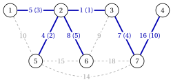
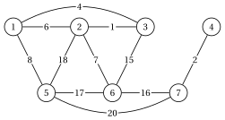
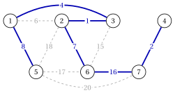
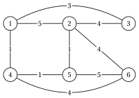
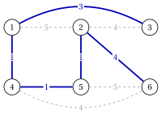
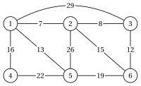
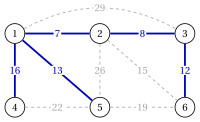

# Esercizi · Alberi ricoprenti di costo minimo

**Esercizi · Capitolo 2** · ogni soluzione si apre con un clic · [:material-book-open-variant: Capitolo 2: Alberi ricoprenti](../alberi-e-cammini/minimum-spanning-trees/index.md) · [:material-file-pdf-box: Eserciziario, volume 2 (PDF)](../pdf/esercizi-2-alberi-e-cammini.pdf)

!!! formula "Regole utilizzate in questi esercizi"

    Le definizioni e gli algoritmi del capitolo [«Minimum albero ricoprente»](../alberi-e-cammini/minimum-spanning-trees/index.md), per un grafo non orientato connesso $G=(V,E)$ con $n=|V|$, $m=|E|$ e pesi $w_e$.

    - **(M1)** <strong>Proprietà di taglio.</strong> Se nessun lato di $F$ attraversa $\delta(S)$ e $F$ è contenuto in un'estensione minima albero, aggiungendo un lato più leggero di $\delta(S)$ si mantiene questa proprietà; un lato più leggero unico di $\delta(S)$ è in ogni albero di copertura minimo.

    - **(M2)** <strong>Proprietà del ciclo.</strong> Il lato più pesante di un ciclo può essere tralasciato; un lato rigorosamente più pesante del gli altri lati di un ciclo non si trovano in un albero di copertura minimo.

    - **(M3)** <strong>Ottimalità.</strong> Uno albero ricoprente $T$ è ottimale se e solo se $w_e \ge w_f$ per ogni $e \notin T$ e ogni $f$ del suo ciclo fondamentale $C(T,e)$; è l'unico ottimo se e solo se tutte queste disuguaglianze esistono rigoroso.

    - **(M4)** <strong>Kruskal.</strong> I lati sono scanditi con peso non decrescente, legature di valore in ordine lessicografo di $\{u,v\}$, $u<v$; un lato è accettato se i suoi punti finali si trovano in componenti diversi di $(V,F)$.

    - **(M5)** <strong>Prim.</strong> Da $s=1$: selezionare $v \notin S$ con il minimo $d(v)$, legare per l'indice più piccolo, aggiungere $\{\mathit{pred}(v),v\}$; quindi $d(u):=w_{vu}$, $\mathit{pred}(u):=v$ per ogni $u \notin S$ adiacente a $v$ con $w_{vu}<d(u)$.

!!! esercizio "Esercizio 2.1: Algoritmo di Kruskal"

    !!! esercizio "Esercizio"

        Consideriamo il grafo non orientato $G=(V,E)$ con $V=\{1,2,\dots,7\}$ e gli archi $11$ con i pesi

        
<table>
        <tr>
        <th>lato</th>
        <th>\(\{1,2\}\)</th>
        <th>\(\{1,5\}\)</th>
        <th>\(\{2,3\}\)</th>
        <th>\(\{2,5\}\)</th>
        <th>\(\{2,6\}\)</th>
        <th>\(\{3,6\}\)</th>
        </tr>
        <tr>
        <td>\(w_e\)</td>
        <td>\(5\)</td>
        <td>\(10\)</td>
        <td>\(1\)</td>
        <td>\(4\)</td>
        <td>\(8\)</td>
        <td>\(9\)</td>
        </tr>
        <tr>
        <td>lato</td>
        <td>\(\{3,7\}\)</td>
        <td>\(\{4,7\}\)</td>
        <td>\(\{5,6\}\)</td>
        <td>\(\{5,7\}\)</td>
        <td>\(\{6,7\}\)</td>
        </tr>
        <tr>
        <td>\(w_e\)</td>
        <td>\(7\)</td>
        <td>\(16\)</td>
        <td>\(15\)</td>
        <td>\(14\)</td>
        <td>\(18\)</td>
        </tr>
        </table>

        disegnato qui sotto.

        { .fig loading=lazy  }

    **Domande**

    1. Ordinare i lati come in (M4).

    2. Esegui l'algoritmo di Kruskal: per ogni lato scansionato, indica se è accettato o rifiutato e fornisci i componenti di $(V,F)$.

    3. Disegna l'albero di copertura minimo e indica il suo peso.

    4. Per ogni lato scartato, dare un ciclo di cui è il lato più pesante.

??? soluzione "Soluzione"

    Usiamo le regole (M1)–(M5) del riquadro all'inizio di questi esercizi.

    1. Con peso non decrescente: $\{2,3\},~\{2,5\},~\{1,2\},~\{3,7\},~\{2,6\},~\{3,6\},~\{1,5\},~\{5,7\},~\{5,6\},~\{4,7\},~\{6,7\}$, con pesi $1,4,5,7,8,9,10,14,15,16,18$.

    2. Ogni riga rappresenta un lato scansionato:

        
<table>
        <tr>
        <th>\(k\)</th>
        <th>lato \(e_k\)</th>
        <th>\(w_{e_k}\)</th>
        <th>decisione e componenti di \((V,F)\)</th>
        </tr>
        <tr>
        <td>\(1\)</td>
        <td>\(\{2,3\}\)</td>
        <td>\(1\)</td>
        <td>accetta: \(\{1\},\{2,3\},\{4\},\{5\},\{6\},\{7\}\)</td>
        </tr>
        <tr>
        <td>\(2\)</td>
        <td>\(\{2,5\}\)</td>
        <td>\(4\)</td>
        <td>accetta: \(\{1\},\{2,3,5\},\{4\},\{6\},\{7\}\)</td>
        </tr>
        <tr>
        <td>\(3\)</td>
        <td>\(\{1,2\}\)</td>
        <td>\(5\)</td>
        <td>accetta: \(\{1,2,3,5\},\{4\},\{6\},\{7\}\)</td>
        </tr>
        <tr>
        <td>\(4\)</td>
        <td>\(\{3,7\}\)</td>
        <td>\(7\)</td>
        <td>accetta: \(\{1,2,3,5,7\},\{4\},\{6\}\)</td>
        </tr>
        <tr>
        <td>\(5\)</td>
        <td>\(\{2,6\}\)</td>
        <td>\(8\)</td>
        <td>accetta: \(\{1,2,3,5,6,7\},\{4\}\)</td>
        </tr>
        <tr>
        <td>\(6\)</td>
        <td>\(\{3,6\}\)</td>
        <td>\(9\)</td>
        <td>rifiuta (\(3\) e \(6\) sono entrambi in \(\{1,2,3,5,6,7\}\))</td>
        </tr>
        <tr>
        <td>\(7\)</td>
        <td>\(\{1,5\}\)</td>
        <td>\(10\)</td>
        <td>rifiuta (\(1\) e \(5\) sono entrambi in \(\{1,2,3,5,6,7\}\))</td>
        </tr>
        <tr>
        <td>\(8\)</td>
        <td>\(\{5,7\}\)</td>
        <td>\(14\)</td>
        <td>rifiuta (\(5\) e \(7\) sono entrambi in \(\{1,2,3,5,6,7\}\))</td>
        </tr>
        <tr>
        <td>\(9\)</td>
        <td>\(\{5,6\}\)</td>
        <td>\(15\)</td>
        <td>rifiuta (\(5\) e \(6\) sono entrambi in \(\{1,2,3,5,6,7\}\))</td>
        </tr>
        <tr>
        <td>\(10\)</td>
        <td>\(\{4,7\}\)</td>
        <td>\(16\)</td>
        <td>accetta: \(\{1,2,3,4,5,6,7\}\)</td>
        </tr>
        </table>

        L'algoritmo si ferma dopo $10$ dei lati $11$, quando $|F|=6$. I lati $\{6,7\}$ non vengono mai scansionati.

    3. L'albero è $F=\{\{1,2\},\allowbreak \{2,3\},\allowbreak \{2,5\},\allowbreak \{2,6\},\allowbreak \{3,7\},\allowbreak \{4,7\}\}$, di peso $5+1+4+8+7+16=41$; su ciascun lato dell'albero, il peso e tra parentesi il passo della sua accettazione:

        { .fig loading=lazy  }

    4. Un lato rifiutato unisce due vertici già collegati da $F$, e il percorso di $F$ tra di loro utilizza solo lati scansionati prima di esso, quindi più leggeri: $\{3,6\}$, di peso $9$, chiude il ciclo $3,2,6,3$ con alberi di lati di pesi $1,~8$; $\{1,5\}$, di peso $10$, chiude il ciclo $1,2,5,1$ con lati ad albero di pesi $5,~4$; $\{5,7\}$, di peso $14$, chiude il ciclo $5,2,3,7,5$ con lati ad albero di pesi $4,~1,~7$; $\{5,6\}$, di peso $15$, chiude il ciclo $5,2,6,5$ con lati ad albero di pesi $4,~8$. Per (M2) nessuno di questi archi si trova in un albero di copertura minimo.

    !!! chiave ""

        L'algoritmo di Kruskal accetta $\{2,3\},\allowbreak \{2,5\},\allowbreak \{1,2\},\allowbreak \{3,7\},\allowbreak \{2,6\},\allowbreak \{4,7\}$ in questo ordine e trova l'albero di copertura minimo di peso $41$; è unico, poiché i pesi sono distinti.

!!! esercizio "Esercizio 2.2: Algoritmo di Prim"

    !!! esercizio "Esercizio"

        Consideriamo il grafo non orientato $G=(V,E)$ con $V=\{1,2,\dots,7\}$ e gli archi $11$ con i pesi

        
<table>
        <tr>
        <th>lato</th>
        <th>\(\{1,2\}\)</th>
        <th>\(\{1,3\}\)</th>
        <th>\(\{1,5\}\)</th>
        <th>\(\{2,3\}\)</th>
        <th>\(\{2,5\}\)</th>
        <th>\(\{2,6\}\)</th>
        </tr>
        <tr>
        <td>\(w_e\)</td>
        <td>\(6\)</td>
        <td>\(4\)</td>
        <td>\(8\)</td>
        <td>\(1\)</td>
        <td>\(18\)</td>
        <td>\(7\)</td>
        </tr>
        <tr>
        <td>lato</td>
        <td>\(\{3,6\}\)</td>
        <td>\(\{4,7\}\)</td>
        <td>\(\{5,6\}\)</td>
        <td>\(\{5,7\}\)</td>
        <td>\(\{6,7\}\)</td>
        </tr>
        <tr>
        <td>\(w_e\)</td>
        <td>\(15\)</td>
        <td>\(2\)</td>
        <td>\(17\)</td>
        <td>\(20\)</td>
        <td>\(16\)</td>
        </tr>
        </table>

        disegnato qui sotto.

        { .fig loading=lazy  }

    **Domande**

    1. Esegui l'algoritmo di Prim da $s=1$: dopo ogni iterazione, fornisci il vertice selezionato, il lato aggiunto e le etichette $d(v)$ e $\mathit{pred}(v)$ dei vertici esterni a $S$.

    2. Quali etichette diminuiscono durante l'esecuzione e perché?

    3. Disegna l'albero di copertura minimo e indica il suo peso.

    4. In quale ordine l'algoritmo di Kruskal accetta gli stessi lati?

??? soluzione "Soluzione"

    Usiamo le regole (M1)–(M5) del riquadro all'inizio di questi esercizi.

    1. Ogni riga mostra $d(v)$ dopo l'aggiornamento, con $\mathit{pred}(v)$ tra parentesi; un trattino segna i vertici in $S$:

        
<table>
        <tr>
        <th>esso.</th>
        <th>lato selezionato e aggiunto</th>
        <th>\(d(2)\)</th>
        <th>\(d(3)\)</th>
        <th>\(d(4)\)</th>
        <th>\(d(5)\)</th>
        <th>\(d(6)\)</th>
        <th>\(d(7)\)</th>
        </tr>
        <tr>
        <td>\(0\)</td>
        <td>\(1\)</td>
        <td>–</td>
        <td>\(6~(1)\)</td>
        <td>\(4~(1)\)</td>
        <td>\(\infty\)</td>
        <td>\(8~(1)\)</td>
        <td>\(\infty\)</td>
        <td>\(\infty\)</td>
        </tr>
        <tr>
        <td>\(1\)</td>
        <td>\(3\)</td>
        <td>\(\{1,3\}\)</td>
        <td>\(1~(3)\)</td>
        <td>–</td>
        <td>\(\infty\)</td>
        <td>\(8~(1)\)</td>
        <td>\(15~(3)\)</td>
        <td>\(\infty\)</td>
        </tr>
        <tr>
        <td>\(2\)</td>
        <td>\(2\)</td>
        <td>\(\{2,3\}\)</td>
        <td>–</td>
        <td>–</td>
        <td>\(\infty\)</td>
        <td>\(8~(1)\)</td>
        <td>\(7~(2)\)</td>
        <td>\(\infty\)</td>
        </tr>
        <tr>
        <td>\(3\)</td>
        <td>\(6\)</td>
        <td>\(\{2,6\}\)</td>
        <td>–</td>
        <td>–</td>
        <td>\(\infty\)</td>
        <td>\(8~(1)\)</td>
        <td>–</td>
        <td>\(16~(6)\)</td>
        </tr>
        <tr>
        <td>\(4\)</td>
        <td>\(5\)</td>
        <td>\(\{1,5\}\)</td>
        <td>–</td>
        <td>–</td>
        <td>\(\infty\)</td>
        <td>–</td>
        <td>–</td>
        <td>\(16~(6)\)</td>
        </tr>
        <tr>
        <td>\(5\)</td>
        <td>\(7\)</td>
        <td>\(\{6,7\}\)</td>
        <td>–</td>
        <td>–</td>
        <td>\(2~(7)\)</td>
        <td>–</td>
        <td>–</td>
        <td>–</td>
        </tr>
        <tr>
        <td>\(6\)</td>
        <td>\(4\)</td>
        <td>\(\{4,7\}\)</td>
        <td>–</td>
        <td>–</td>
        <td>–</td>
        <td>–</td>
        <td>–</td>
        <td>–</td>
        </tr>
        </table>

        I vertici entrano in $S$ nell'ordine $1,3,2,6,5,7,4$.

    2. Un'etichetta diminuisce quando il vertice appena inserito ha un lato più chiaro verso $u$: all'iterazione $1$, $d(2)$ scende da $6$ a $1$ (lato $\{2,3\}$); all'iterazione $1$, $d(6)$ scende da $\infty$ a $15$ (lato $\{3,6\}$); all'iterazione $2$, $d(6)$ scende da $15$ a $7$ (lato $\{2,6\}$); all'iterazione $3$, $d(7)$ scende da $\infty$ a $16$ (lato $\{6,7\}$); all'iterazione $5$, $d(4)$ scende da $\infty$ a $2$ (lato $\{4,7\}$).

    3. L'albero è $F=\{\{1,3\},\allowbreak \{1,5\},\allowbreak \{2,3\},\allowbreak \{2,6\},\allowbreak \{4,7\},\allowbreak \{6,7\}\}$, di peso $38$:

        { .fig loading=lazy  }

    4. L'algoritmo di Kruskal accetta i lati con peso non decrescente: $\{2,3\},\allowbreak \{4,7\},\allowbreak \{1,3\},\allowbreak \{2,6\},\allowbreak \{1,5\},\allowbreak \{6,7\}$. L'albero è lo stesso, perché i pesi sono distinti e l'albero di copertura minimo è unico; cambia solo l'ordine.

    !!! chiave ""

        L'algoritmo di Prim da $1$ aggiunge $\{1,3\},\allowbreak \{2,3\},\allowbreak \{2,6\},\allowbreak \{1,5\},\allowbreak \{6,7\},\allowbreak \{4,7\}$; l'albero di copertura minimo pesa $38$, come rilevato dall'algoritmo di Kruskal.

!!! esercizio "Esercizio 2.3: Proprietà di taglio e ciclo"

    !!! esercizio "Esercizio"

        Consideriamo il grafo non orientato $G=(V,E)$ con $V=\{1,2,\dots,6\}$ e gli archi $10$ con i pesi

        
<table>
        <tr>
        <th>lato</th>
        <th>\(\{1,2\}\)</th>
        <th>\(\{1,3\}\)</th>
        <th>\(\{1,4\}\)</th>
        <th>\(\{1,5\}\)</th>
        <th>\(\{2,3\}\)</th>
        <th>\(\{2,5\}\)</th>
        </tr>
        <tr>
        <td>\(w_e\)</td>
        <td>\(6\)</td>
        <td>\(14\)</td>
        <td>\(1\)</td>
        <td>\(5\)</td>
        <td>\(9\)</td>
        <td>\(8\)</td>
        </tr>
        <tr>
        <td>lato</td>
        <td>\(\{2,6\}\)</td>
        <td>\(\{3,6\}\)</td>
        <td>\(\{4,5\}\)</td>
        <td>\(\{4,6\}\)</td>
        </tr>
        <tr>
        <td>\(w_e\)</td>
        <td>\(11\)</td>
        <td>\(15\)</td>
        <td>\(4\)</td>
        <td>\(13\)</td>
        </tr>
        </table>

        disegnato qui sotto. Consideriamo anche lo albero ricoprente $T_0=\{\{1,2\},\allowbreak \{1,3\},\allowbreak \{1,4\},\allowbreak \{1,5\},\allowbreak \{3,6\}\}$.

        { .fig loading=lazy  }

    **Domande**

    1. Trova il taglio $\delta(\{1,2\})$. Quale dei suoi archi appartiene ad ogni albero di copertura minimo?

    2. Trova un ciclo che contiene il lato $\{2,5\}$ e usalo per mostrare che $\{2,5\}$ non si trova in alcun albero di copertura minimo.

    3. $T_0$ è un albero ricoprente minimo? Elenca le coppie $(e,f)$, $e \notin T_0$, $f \in C(T_0,e)$, che violano la condizione del ciclo (M3).

    4. Migliora $T_0$ con lo scambio della coppia violante con la differenza maggiore $w_f-w_e$ e assegna il nuovo peso. Qual è il peso di un albero di copertura minimo?

??? soluzione "Soluzione"

    Usiamo le regole (M1)–(M5) del riquadro all'inizio di questi esercizi.

    1. $\delta(\{1,2\})=\{\{1,3\},\allowbreak \{1,4\},\allowbreak \{1,5\},\allowbreak \{2,3\},\allowbreak \{2,5\},\allowbreak \{2,6\}\}$, con pesi $14,1,5,9,8,11$. Il lato $\{1,4\}$ è l'unico più leggero, quindi appartiene ad ogni albero di copertura minimo di (M1).

    2. Il ciclo $2,1,4,5,2$ utilizza i lati $\{1,2\},\allowbreak \{1,4\},\allowbreak \{4,5\},\allowbreak \{2,5\}$, con pesi $6,1,4,8$. Il lato $\{2,5\}$, di peso $8$, è rigorosamente il più pesante, quindi non ha un albero di copertura minimo di (M2).

    3. $T_0$ pesa $41$. Per ogni lato $e$ esterno a $T_0$ confrontiamo $w_e$ con i lati del suo ciclo fondamentale; le coppie violanti, con $w_f>w_e$, sono $(\{2,3\},\{1,3\})$, $(\{2,6\},\{1,3\})$, $(\{2,6\},\{3,6\})$, $(\{4,5\},\{1,5\})$, $(\{4,6\},\{1,3\})$, $(\{4,6\},\{3,6\})$. Per (M3), $T_0$ non è ottimale.

    4. La differenza più grande è data da $e=\{2,3\}$ e $f=\{1,3\}$, con $w_f-w_e=14-9=5$: il lato $f$ giace su $C(T_0,e)$, i cui lati sono $\{1,2\},\allowbreak \{1,3\},\allowbreak \{2,3\}$. Lo scambio fornisce lo albero ricoprente $\{\{1,2\},\allowbreak \{1,4\},\allowbreak \{1,5\},\allowbreak \{2,3\},\allowbreak \{3,6\}\}$ di peso $41-5=36$. L'algoritmo di Kruskal fornisce l'albero di copertura minimo $\{\{1,2\},\allowbreak \{1,4\},\allowbreak \{2,3\},\allowbreak \{2,6\},\allowbreak \{4,5\}\}$, di peso $31$:

        { .fig loading=lazy  }

    !!! chiave ""

        $\{1,4\}$ viene forzato da un taglio, $\{2,5\}$ viene escluso da un ciclo; $T_0$ (peso $41$) viola la condizione del ciclo e il peso ottimale $31$.

!!! esercizio "Esercizio 2.4: Unicità e legami"

    !!! esercizio "Esercizio"

        Consideriamo il grafo non orientato $G=(V,E)$ con $V=\{1,2,\dots,6\}$ e gli archi $9$ con i pesi

        
<table>
        <tr>
        <th>lato</th>
        <th>\(\{1,2\}\)</th>
        <th>\(\{1,3\}\)</th>
        <th>\(\{1,4\}\)</th>
        <th>\(\{2,3\}\)</th>
        <th>\(\{2,5\}\)</th>
        <th>\(\{2,6\}\)</th>
        </tr>
        <tr>
        <td>\(w_e\)</td>
        <td>\(5\)</td>
        <td>\(3\)</td>
        <td>\(1\)</td>
        <td>\(4\)</td>
        <td>\(1\)</td>
        <td>\(4\)</td>
        </tr>
        <tr>
        <td>lato</td>
        <td>\(\{4,5\}\)</td>
        <td>\(\{4,6\}\)</td>
        <td>\(\{5,6\}\)</td>
        </tr>
        <tr>
        <td>\(w_e\)</td>
        <td>\(1\)</td>
        <td>\(4\)</td>
        <td>\(5\)</td>
        </tr>
        </table>

        disegnato qui sotto.

        { .fig loading=lazy  }

    **Domande**

    1. Trova un albero di copertura minimo $T$ con l'algoritmo di Kruskal e il suo peso.

    2. Utilizzando i tagli fondamentali di $T$, trova gli lati che appartengono a ogni albero di copertura minimo.

    3. Utilizzando i cicli fondamentali di $T$, trovare gli archi che non appartengono ad alcun albero di copertura minimo.

    4. L'albero ricoprente minimo è unico? Fornirne un altro, se esiste, e il numero minimo di albero ricoprente.

??? soluzione "Soluzione"

    Usiamo le regole (M1)–(M5) del riquadro all'inizio di questi esercizi.

    1. Algoritmo di Kruskal, con legature di valore in ordine lessicografo:

        
<table>
        <tr>
        <th>\(k\)</th>
        <th>lato \(e_k\)</th>
        <th>\(w_{e_k}\)</th>
        <th>decisione e componenti di \((V,F)\)</th>
        </tr>
        <tr>
        <td>\(1\)</td>
        <td>\(\{1,4\}\)</td>
        <td>\(1\)</td>
        <td>accetta: \(\{1,4\},\{2\},\{3\},\{5\},\{6\}\)</td>
        </tr>
        <tr>
        <td>\(2\)</td>
        <td>\(\{2,5\}\)</td>
        <td>\(1\)</td>
        <td>accetta: \(\{1,4\},\{2,5\},\{3\},\{6\}\)</td>
        </tr>
        <tr>
        <td>\(3\)</td>
        <td>\(\{4,5\}\)</td>
        <td>\(1\)</td>
        <td>accetta: \(\{1,2,4,5\},\{3\},\{6\}\)</td>
        </tr>
        <tr>
        <td>\(4\)</td>
        <td>\(\{1,3\}\)</td>
        <td>\(3\)</td>
        <td>accetta: \(\{1,2,3,4,5\},\{6\}\)</td>
        </tr>
        <tr>
        <td>\(5\)</td>
        <td>\(\{2,3\}\)</td>
        <td>\(4\)</td>
        <td>rifiuta (\(2\) e \(3\) sono entrambi in \(\{1,2,3,4,5\}\))</td>
        </tr>
        <tr>
        <td>\(6\)</td>
        <td>\(\{2,6\}\)</td>
        <td>\(4\)</td>
        <td>accetta: \(\{1,2,3,4,5,6\}\)</td>
        </tr>
        </table>

        $T=\{\{1,3\},\allowbreak \{1,4\},\allowbreak \{2,5\},\allowbreak \{2,6\},\allowbreak \{4,5\}\}$, di peso $10$.

        { .fig loading=lazy  }

    2. Un lato di $T$ si trova in ogni albero di copertura minimo se e solo se è strettamente il più leggero del suo taglio fondamentale (il componente $S_e$ di $T\setminus\{e\}$ con il punto finale più piccolo):

        
<table>
        <tr>
        <th>\(e \in T\)</th>
        <th>\(w_e\)</th>
        <th>\(S_e\)</th>
        <th>pesi degli altri lati di \(\delta(S_e)\)</th>
        <th>rigorosamente più leggeri?</th>
        </tr>
        <tr>
        <td>\(\{1,3\}\)</td>
        <td>\(3\)</td>
        <td>\(\{1,2,4,5,6\}\)</td>
        <td>\(4\)</td>
        <td>sì</td>
        </tr>
        <tr>
        <td>\(\{1,4\}\)</td>
        <td>\(1\)</td>
        <td>\(\{1,3\}\)</td>
        <td>\(5\), \(4\)</td>
        <td>sì</td>
        </tr>
        <tr>
        <td>\(\{2,5\}\)</td>
        <td>\(1\)</td>
        <td>\(\{2,6\}\)</td>
        <td>\(5\), \(4\), \(4\), \(5\)</td>
        <td>sì</td>
        </tr>
        <tr>
        <td>\(\{2,6\}\)</td>
        <td>\(4\)</td>
        <td>\(\{1,2,3,4,5\}\)</td>
        <td>\(4\), \(5\) e n.: \(\{4,6\}\)</td>
        </tr>
        <tr>
        <td>\(\{4,5\}\)</td>
        <td>\(1\)</td>
        <td>\(\{1,3,4\}\)</td>
        <td>\(5\), \(4\), \(4\)</td>
        <td>sì</td>
        </tr>
        </table>

        I lati in ogni albero di copertura minimo sono $\{1,3\},\allowbreak \{1,4\},\allowbreak \{2,5\},\allowbreak \{4,5\}$.

    3. Un arco esterno a $T$ non è in alcun albero di copertura minimo se e solo se è strettamente il più pesante del suo ciclo fondamentale:

        
<table>
        <tr>
        <th>\(e \notin T\) e \(w_e\) e lati degli alberi di \(C(T,e)\) e i loro pesi e rigorosamente più pesanti?</th>
        </tr>
        <tr>
        <td>\(\{1,2\}\)</td>
        <td>\(5\)</td>
        <td>\(\{1,4\},\allowbreak \{4,5\},\allowbreak \{2,5\}\)</td>
        <td>\(1\), \(1\), \(1\)</td>
        <td>sì</td>
        </tr>
        <tr>
        <td>\(\{2,3\}\)</td>
        <td>\(4\)</td>
        <td>\(\{2,5\},\allowbreak \{4,5\},\allowbreak \{1,4\},\allowbreak \{1,3\}\)</td>
        <td>\(1\), \(1\), \(1\), \(3\)</td>
        <td>sì</td>
        </tr>
        <tr>
        <td>\(\{4,6\}\)</td>
        <td>\(4\)</td>
        <td>\(\{4,5\},\allowbreak \{2,5\},\allowbreak \{2,6\}\)</td>
        <td>\(1\), \(1\), \(4\) e n.: \(\{2,6\}\)</td>
        </tr>
        <tr>
        <td>\(\{5,6\}\)</td>
        <td>\(5\)</td>
        <td>\(\{2,5\},\allowbreak \{2,6\}\)</td>
        <td>\(1\), \(4\)</td>
        <td>sì</td>
        </tr>
        </table>

        I lati nell'albero senza copertura minima sono $\{1,2\},\allowbreak \{2,3\},\allowbreak \{5,6\}$.

    4. Alcune disuguaglianze non sono strette, quindi per (M3) l'ottimo non è unico. Ad esempio $\{\{1,3\},\allowbreak \{1,4\},\allowbreak \{2,5\},\allowbreak \{4,5\},\allowbreak \{4,6\}\}$ pesa anche $10$. Enumerando gli albero ricoprente $64$, esattamente $2$ hanno peso $10$.

    !!! chiave ""

        Il peso minimo è $10$, raggiunto dagli albero ricoprente $2$; i legami nei tagli e nei cicli fondamentali di un albero ottimale indicano quali lati sono forzati e quali sono esclusi.

!!! esercizio "Esercizio 2.5: Modellazione con alberi di copertura minimi"

    !!! esercizio "Esercizio"

        Un'azienda desidera collegare i propri edifici $6$ $1,2,\dots,6$ con una rete in fibra. È possibile creare un collegamento diretto tra le coppie seguenti, e $w_e$ è il suo costo (in migliaia di euro):

        
<table>
        <tr>
        <th>lato</th>
        <th>\(\{1,2\}\)</th>
        <th>\(\{1,3\}\)</th>
        <th>\(\{1,4\}\)</th>
        <th>\(\{1,5\}\)</th>
        <th>\(\{2,3\}\)</th>
        <th>\(\{2,5\}\)</th>
        </tr>
        <tr>
        <td>\(w_e\)</td>
        <td>\(7\)</td>
        <td>\(29\)</td>
        <td>\(16\)</td>
        <td>\(13\)</td>
        <td>\(8\)</td>
        <td>\(26\)</td>
        </tr>
        <tr>
        <td>lato</td>
        <td>\(\{2,6\}\)</td>
        <td>\(\{3,6\}\)</td>
        <td>\(\{4,5\}\)</td>
        <td>\(\{5,6\}\)</td>
        </tr>
        <tr>
        <td>\(w_e\)</td>
        <td>\(15\)</td>
        <td>\(12\)</td>
        <td>\(22\)</td>
        <td>\(19\)</td>
        </tr>
        </table>

        Ogni edificio deve poter raggiungere tutti gli altri, possibilmente attraverso altri edifici.

        { .fig loading=lazy  }

        Ogni collegamento $e$ funziona anche con probabilità $p_e$, indipendentemente dagli altri:

        
<table>
        <tr>
        <th>collegamento</th>
        <th>\(\{1,2\}\)</th>
        <th>\(\{1,3\}\)</th>
        <th>\(\{1,4\}\)</th>
        <th>\(\{1,5\}\)</th>
        <th>\(\{2,3\}\)</th>
        </tr>
        <tr>
        <td>\(p_e\)</td>
        <td>\(0.97\)</td>
        <td>\(0.90\)</td>
        <td>\(0.91\)</td>
        <td>\(0.84\)</td>
        <td>\(0.94\)</td>
        </tr>
        <tr>
        <td>collegamento</td>
        <td>\(\{2,5\}\)</td>
        <td>\(\{2,6\}\)</td>
        <td>\(\{3,6\}\)</td>
        <td>\(\{4,5\}\)</td>
        <td>\(\{5,6\}\)</td>
        </tr>
        <tr>
        <td>\(p_e\)</td>
        <td>\(0.96\)</td>
        <td>\(0.93\)</td>
        <td>\(0.85\)</td>
        <td>\(0.81\)</td>
        <td>\(0.98\)</td>
        </tr>
        </table>

    **Domande**

    1. Modella la rete più economica come un problema grafo e risolvilo.

    2. Per motivi di sicurezza, gli edifici $2$ e $6$ devono essere collegati direttamente. Come trovi la rete più economica e quanto costa?

    3. Una rete con collegamenti $n-1$ funziona se tutti i suoi collegamenti funzionano. Modella la rete più affidabile come un problema di albero di copertura minimo, risolvilo e fornisci la sua probabilità di funzionamento.

??? soluzione "Soluzione"

    Usiamo le regole (M1)–(M5) del riquadro all'inizio di questi esercizi.

    1. Gli edifici sono i vertici e gli eventuali collegamenti i lati di $G$, con pesi $w_e$. Una rete più economica è connessa e non ha ciclo: la rimozione di un lato di un ciclo la mantiene connessa e riduce il costo, poiché i costi sono positivi. Quindi è un albero di copertura minimo. L'algoritmo di Kruskal dà

        $$
        T=\{\{1,2\},\allowbreak \{1,4\},\allowbreak \{1,5\},\allowbreak \{2,3\},\allowbreak \{3,6\}\}, \qquad w(T)=56.
        $$

        { .fig loading=lazy  }

    2. Ogni albero ricoprente che contiene $\{2,6\}$ cambia il suo peso della stessa quantità se cambia $w_{26}$. Impostando $w_{26}=0$, al di sotto di ogni altro peso, l'algoritmo di Kruskal accetta prima $\{2,6\}$ e restituisce l'albero più economico che lo contiene: $\{\{1,2\},\allowbreak \{1,4\},\allowbreak \{1,5\},\allowbreak \{2,3\},\allowbreak \{2,6\}\}$, con i costi originali $w=59$, cioè $3$ maggiore di $T$.

    3. La rete funziona con probabilità $\prod_{e \in T} p_e$. Massimizzarlo equivale a minimizzare $\sum_{e \in T} (-\log p_e)$, un problema di albero di copertura minimo con pesi $-\log p_e$. Questi pesi hanno l'ordine di $-p_e$, e l'algoritmo di Kruskal utilizza solo l'ordine: analizza i collegamenti con affidabilità non crescente e fornisce

        $$
        \{\{1,2\},\allowbreak \{1,4\},\allowbreak \{2,3\},\allowbreak \{2,5\},\allowbreak \{5,6\}\}, \qquad \prod_{e} p_e=0.97 \cdot 0.91 \cdot 0.94 \cdot 0.96 \cdot 0.98 \approx 0.7806.
        $$

    !!! chiave ""

        Rete più economica: uno albero ricoprente minimo di costo $56$; con il collegamento forzato $\{2,6\}$ costa $59$; la rete più affidabile è uno albero ricoprente massimo per $p_e$.
