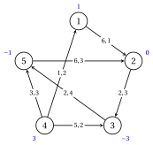
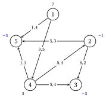
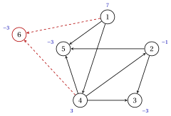

# Esercizi · Modelli di flusso su reti

**Esercizi · Capitolo 4** · ogni soluzione si apre con un clic · [:material-book-open-variant: Capitolo 4: Modelli di flusso](../flussi/network-flow-models/index.md) · [:material-file-pdf-box: Eserciziario, volume 3 (PDF)](../pdf/esercizi-3-flussi.pdf)

!!! formula "Regole usate in questi esercizi"

    Le definizioni e i risultati del capitolo [«Modelli di flusso su reti»](../flussi/network-flow-models/index.md), per una rete $G=(N,A)$ con bilanci $b_i$, limiti inferiori $l_{ij}$, capacità $u_{ij}$ e costi $c_{ij}$.

    - **(F1)** <strong>Modello.</strong> Gli archi sono numerati $a_1,a_2,\dots,a_m$ in ordine lessicografico; $\mat{B}$ ha $+1$ nella coda e $-1$ nella testa di ogni arco, e il modello $\mathrm{MCF}$ è

        $$
        \min\{\vet{c}'\vet{x} : \mat{B}\vet{x}=\vet{b},~\vet{l} \le \vet{x} \le \vet{u}\},
        $$

        dove la riga $i$ di $\mat{B}\vet{x}$ è il flusso uscente meno il flusso entrante del nodo $i$.

    - **(F2)** <strong>Ammissibilità.</strong> Una rete con un flusso ammissibile ha $\sum_{i \in N} b_i=0$ e, per ogni $S \subseteq N$, $\sum_{i \in S} b_i \le u(\delta^+(S))-l(\delta^-(S))$.

    - **(F3)** <strong>Limiti inferiori.</strong> Con $\vet{x}=\vet{l}+\vet{x}'$: $\vet{b}'=\vet{b}-\mat{B}\vet{l}$, $\vet{u}'=\vet{u}-\vet{l}$, e $\vet{c}'\vet{x}=\vet{c}'\vet{x}'+\vet{c}'\vet{l}$.

    - **(F4)** <strong>Nodo fittizio.</strong> Se $e=\sum_{i \in N} b_i>0$, si aggiungono un nodo fittizio $d$ con $b_d=-e$ e archi $(i,d)$ dai nodi di offerta, con costo $0$ e capacità $+\infty$; il flusso su $(i,d)$ è l'offerta non usata di $i$.

    - **(F5)** <strong>Totale unimodularità.</strong> Ogni sottomatrice quadrata di $\mat{B}$ ha determinante $0$ o $\pm 1$: una colonna nulla dà $0$, una colonna con un solo elemento non nullo si sviluppa, colonne con $+1$ e $-1$ danno $0$. Con $\vet{b}$, $\vet{l}$, $\vet{u}$ interi ogni vertice di $\{\mat{B}\vet{x}=\vet{b},~\vet{l} \le \vet{x} \le \vet{u}\}$ è intero.

!!! esercizio "Esercizio 4.1: Il modello di flusso di costo minimo"

    !!! esercizio "Esercizio"

        Consideriamo la rete $G=(N,A)$ con $N=\{1,2,\dots,5\}$, i $7$ archi

        $$
        A=\{(1,2),(2,3),(3,5),(4,1),(4,3),(4,5),(5,2)\},
        $$

        limiti inferiori nulli e i bilanci $b_1=1$, $b_2=0$, $b_3=-3$, $b_4=3$, $b_5=-1$. I costi e le capacità sono dati nella tabella e, come $c_{ij},u_{ij}$, nella figura; i bilanci sono accanto ai nodi.

        
<table>
        <tr>
        <th>arco</th>
        <th>\((1,2)\)</th>
        <th>\((2,3)\)</th>
        <th>\((3,5)\)</th>
        <th>\((4,1)\)</th>
        <th>\((4,3)\)</th>
        <th>\((4,5)\)</th>
        <th>\((5,2)\)</th>
        </tr>
        <tr>
        <td>\(c_{ij}\)</td>
        <td>\(6\)</td>
        <td>\(2\)</td>
        <td>\(2\)</td>
        <td>\(1\)</td>
        <td>\(5\)</td>
        <td>\(3\)</td>
        <td>\(6\)</td>
        </tr>
        <tr>
        <td>\(u_{ij}\)</td>
        <td>\(1\)</td>
        <td>\(3\)</td>
        <td>\(4\)</td>
        <td>\(2\)</td>
        <td>\(2\)</td>
        <td>\(3\)</td>
        <td>\(3\)</td>
        </tr>
        </table>

        { .fig loading=lazy  }

        Sono proposti due flussi:

        
<table>
        <tr>
        <th>arco</th>
        <th>\((1,2)\)</th>
        <th>\((2,3)\)</th>
        <th>\((3,5)\)</th>
        <th>\((4,1)\)</th>
        <th>\((4,3)\)</th>
        <th>\((4,5)\)</th>
        <th>\((5,2)\)</th>
        </tr>
        <tr>
        <td>\(\bar{x}_{ij}\)</td>
        <td>\(1\)</td>
        <td>\(3\)</td>
        <td>\(2\)</td>
        <td>\(0\)</td>
        <td>\(2\)</td>
        <td>\(1\)</td>
        <td>\(2\)</td>
        </tr>
        <tr>
        <td>\(\hat{x}_{ij}\)</td>
        <td>\(1\)</td>
        <td>\(3\)</td>
        <td>\(3\)</td>
        <td>\(0\)</td>
        <td>\(2\)</td>
        <td>\(1\)</td>
        <td>\(2\)</td>
        </tr>
        </table>

    **Domande**

    1. Classificare i nodi in nodi di offerta, di domanda e di trasbordo, e verificare che la rete sia bilanciata.

    2. Numerare gli archi come in (F1), e scrivere esplicitamente la matrice di incidenza $\mat{B}$ e il modello $\mathrm{MCF}$.

    3. Stabilire se $\bar{\vet{x}}$ e $\hat{\vet{x}}$ sono flussi ammissibili, e calcolare il costo di quello ammissibile.

??? soluzione "Soluzione"

    Usiamo le regole (F1)–(F5) del riquadro all'inizio di questi esercizi.

    1. Dal segno dei bilanci: i nodi $1,4$ sono nodi di offerta; i nodi $3,5$ sono nodi di domanda; il nodo $2$ è un nodo di trasbordo. L'offerta totale è $4$, uguale alla domanda totale, quindi $\sum_{i \in N} b_i=0$.

    2. Gli archi in ordine lessicografico sono $a_{1}=(1,2)$, $a_{2}=(2,3)$, $a_{3}=(3,5)$, $a_{4}=(4,1)$, $a_{5}=(4,3)$, $a_{6}=(4,5)$, $a_{7}=(5,2)$. La matrice di incidenza è

        $$
        \begin{array}{c|rrrrrrr}
        & a_{1} & a_{2} & a_{3} & a_{4} & a_{5} & a_{6} & a_{7}\\ \hline
        1 & 1 & 0 & 0 & -1 & 0 & 0 & 0\\
        2 & -1 & 1 & 0 & 0 & 0 & 0 & -1\\
        3 & 0 & -1 & 1 & 0 & -1 & 0 & 0\\
        4 & 0 & 0 & 0 & 1 & 1 & 1 & 0\\
        5 & 0 & 0 & -1 & 0 & 0 & -1 & 1\\
        \end{array}
        $$

        e il modello $\mathrm{MCF}$ ha un'equazione per nodo (una riga di $\mat{B}$):

        $\begin{array}{rrrrrrrrcr} \min & 6x_{12} & +2x_{23} & +2x_{35} & +x_{41} & +5x_{43} & +3x_{45} & +6x_{52} & & \\[1ex] \text{soggetto a} & x_{12} &  &  & -x_{41} &  &  &  & = & 1\\ & -x_{12} & +x_{23} &  &  &  &  & -x_{52} & = & 0\\ &  & -x_{23} & +x_{35} &  & -x_{43} &  &  & = & -3\\ &  &  &  & x_{41} & +x_{43} & +x_{45} &  & = & 3\\ &  &  & -x_{35} &  &  & -x_{45} & +x_{52} & = & -1\\ \end{array}$

        insieme a $0 \le x_{12} \le 1$, $0 \le x_{23} \le 3$, $0 \le x_{35} \le 4$, $0 \le x_{41} \le 2$, $0 \le x_{43} \le 2$, $0 \le x_{45} \le 3$, $0 \le x_{52} \le 3$.

    3. Calcoliamo il flusso uscente meno il flusso entrante di ogni nodo, e lo confrontiamo con $\vet{b}$:

        $$
        \mat{B}\bar{\vet{x}}=(1,\,0,\,-3,\,3,\,-1)', \qquad \mat{B}\hat{\vet{x}}=(1,\,0,\,-2,\,3,\,-2)', \qquad \vet{b}=(1,\,0,\,-3,\,3,\,-1)'.
        $$

        Entrambi i flussi rispettano i limiti. Il flusso $\bar{\vet{x}}$ è ammissibile; $\hat{\vet{x}}$ non lo è, perché invia un'unità in più su $(3,5)$ e la conservazione non vale nei nodi $3$ e $5$. Il costo di $\bar{\vet{x}}$ è

        $$
        6\cdot 1+2\cdot 3+2\cdot 2+1\cdot 0+5\cdot 2+3\cdot 1+6\cdot 2=41,
        $$

        e gli archi $(1,2)$, $(2,3)$, $(4,3)$ sono saturi.

    !!! chiave ""

        Il modello $\mathrm{MCF}$ ha $7$ variabili e $5$ equazioni con matrice $\mat{B}$; $\bar{\vet{x}}$ è ammissibile con costo $41$, mentre $\hat{\vet{x}}$ viola la conservazione nei nodi $3$ e $5$.

!!! esercizio "Esercizio 4.2: Condizioni di ammissibilità"

    !!! esercizio "Esercizio"

        Consideriamo la rete $G=(N,A)$ con $N=\{1,2,\dots,6\}$, i $9$ archi

        $$
        A=\{(1,5),(2,1),(2,3),(2,6),(3,1),(3,4),(3,5),(5,2),(5,6)\},
        $$

        limiti inferiori nulli, le capacità $u_{ij}$ della tabella (accanto agli archi nella figura) e i bilanci

        $$
        b_1=1,\qquad b_2=3,\qquad b_3=3,\qquad b_4=-5,\qquad b_5=3,\qquad b_6=-5.
        $$

        
<table>
        <tr>
        <th>arco</th>
        <th>\((1,5)\)</th>
        <th>\((2,1)\)</th>
        <th>\((2,3)\)</th>
        <th>\((2,6)\)</th>
        <th>\((3,1)\)</th>
        <th>\((3,4)\)</th>
        <th>\((3,5)\)</th>
        <th>\((5,2)\)</th>
        <th>\((5,6)\)</th>
        </tr>
        <tr>
        <td>\(u_{ij}\)</td>
        <td>\(4\)</td>
        <td>\(1\)</td>
        <td>\(2\)</td>
        <td>\(4\)</td>
        <td>\(1\)</td>
        <td>\(3\)</td>
        <td>\(2\)</td>
        <td>\(2\)</td>
        <td>\(5\)</td>
        </tr>
        </table>

        { .fig loading=lazy  }

    **Domande**

    1. Stabilire se la rete è bilanciata.

    2. Per $S=\{1,2,3,5,6\}$ calcolare $\delta^+(S)$, $\delta^-(S)$ e verificare la condizione di taglio di (F2), traendone le conclusioni.

    3. Determinare di quanto si deve aumentare la capacità dell'arco $(3,4)$ perché la condizione di taglio valga per $S$, e verificare la condizione per $S$ con la nuova capacità.

??? soluzione "Soluzione"

    Usiamo le regole (F1)–(F5) del riquadro all'inizio di questi esercizi.

    1. La somma dei bilanci è $1+3+3+(-5)+3+(-5)=0$: la rete è bilanciata.

    2. Gli archi uscenti da $S$ sono $\delta^+(S)=\{(3,4)\}$ e gli archi entranti in $S$ sono $\delta^-(S)=\emptyset$. Quindi

        $$
        \sum_{i \in S} b_i=1+3+3+3+(-5)=5, \qquad u(\delta^+(S))=3=3,
        $$

        e i limiti inferiori di $\delta^-(S)$ sono nulli. Poiché $5>3$, la condizione di taglio non vale: i nodi di $S$ hanno $5$ unità da inviare e gli archi uscenti da $S$ ne trasportano al più $3$. La rete è bilanciata ma non ha flussi ammissibili.

    3. La capacità mancante è $5-3=2$, quindi $u_{34}$ deve passare da $3$ a $5$. Allora $u(\delta^+(S))=5=5$ e la condizione vale per $S$ con l'uguaglianza: ogni arco uscente da $S$ deve essere saturo. Con questa capacità valgono tutte le condizioni di taglio e la rete ha un flusso ammissibile.

    !!! chiave ""

        $\sum_i b_i=0$ non basta: l'insieme $S=\{1,2,3,5,6\}$ viola la condizione di taglio di $2$ unità, e portare $u_{34}$ a $5$ ripara la rete.

!!! esercizio "Esercizio 4.3: Rimozione dei limiti inferiori"

    !!! esercizio "Esercizio"

        Consideriamo la rete $G=(N,A)$ con $N=\{1,2,\dots,5\}$, i $7$ archi

        $$
        A=\{(1,2),(1,3),(1,4),(3,4),(4,2),(4,5),(5,2)\},
        $$

        i bilanci

        $$
        b_1=3,\qquad b_2=-6,\qquad b_3=1,\qquad b_4=0,\qquad b_5=2,
        $$

        e i limiti inferiori, le capacità e i costi della tabella (nella figura, $l_{ij},u_{ij}$ accanto agli archi).

        
<table>
        <tr>
        <th>arco</th>
        <th>\((1,2)\)</th>
        <th>\((1,3)\)</th>
        <th>\((1,4)\)</th>
        <th>\((3,4)\)</th>
        <th>\((4,2)\)</th>
        <th>\((4,5)\)</th>
        <th>\((5,2)\)</th>
        </tr>
        <tr>
        <td>\(l_{ij}\)</td>
        <td>\(0\)</td>
        <td>\(0\)</td>
        <td>\(0\)</td>
        <td>\(1\)</td>
        <td>\(0\)</td>
        <td>\(1\)</td>
        <td>\(2\)</td>
        </tr>
        <tr>
        <td>\(u_{ij}\)</td>
        <td>\(3\)</td>
        <td>\(3\)</td>
        <td>\(3\)</td>
        <td>\(4\)</td>
        <td>\(3\)</td>
        <td>\(3\)</td>
        <td>\(5\)</td>
        </tr>
        <tr>
        <td>\(c_{ij}\)</td>
        <td>\(5\)</td>
        <td>\(4\)</td>
        <td>\(6\)</td>
        <td>\(2\)</td>
        <td>\(6\)</td>
        <td>\(4\)</td>
        <td>\(5\)</td>
        </tr>
        </table>

        { .fig loading=lazy  }

    **Domande**

    1. Rimuovere i limiti inferiori con la sostituzione $\vet{x}=\vet{l}+\vet{x}'$: calcolare $\mat{B}\vet{l}$, i nuovi bilanci $\vet{b}'$ e le nuove capacità $\vet{u}'$.

    2. Determinare la costante che va aggiunta al costo di un flusso della rete sostituita.

    3. Il flusso $\vet{x}'$ qui sotto è ammissibile per la rete sostituita. Determinare il flusso $\vet{x}$ corrispondente della rete originale e il suo costo.

        
<table>
        <tr>
        <th>arco</th>
        <th>\((1,2)\)</th>
        <th>\((1,3)\)</th>
        <th>\((1,4)\)</th>
        <th>\((3,4)\)</th>
        <th>\((4,2)\)</th>
        <th>\((4,5)\)</th>
        <th>\((5,2)\)</th>
        </tr>
        <tr>
        <td>\(x'_{ij}\)</td>
        <td>\(1\)</td>
        <td>\(1\)</td>
        <td>\(1\)</td>
        <td>\(1\)</td>
        <td>\(2\)</td>
        <td>\(0\)</td>
        <td>\(1\)</td>
        </tr>
        </table>

??? soluzione "Soluzione"

    Usiamo le regole (F1)–(F5) del riquadro all'inizio di questi esercizi.

    1. Ogni arco con $l_{ij}>0$ toglie $l_{ij}$ unità alla sua coda e le dà alla sua testa: $(3,4)$ con $l_{34}=1$, $(4,5)$ con $l_{45}=1$, $(5,2)$ con $l_{52}=2$. Quindi

        $$
        \mat{B}\vet{l}=(0,\,-2,\,1,\,0,\,1)', \qquad \vet{b}'=\vet{b}-\mat{B}\vet{l}=(3,\,-4,\,0,\,0,\,1)',
        $$

        e le capacità diminuiscono dei limiti inferiori:

        
<table>
        <tr>
        <th>arco</th>
        <th>\((1,2)\)</th>
        <th>\((1,3)\)</th>
        <th>\((1,4)\)</th>
        <th>\((3,4)\)</th>
        <th>\((4,2)\)</th>
        <th>\((4,5)\)</th>
        <th>\((5,2)\)</th>
        </tr>
        <tr>
        <td>\(u'_{ij}\)</td>
        <td>\(3\)</td>
        <td>\(3\)</td>
        <td>\(3\)</td>
        <td>\(3\)</td>
        <td>\(3\)</td>
        <td>\(2\)</td>
        <td>\(3\)</td>
        </tr>
        </table>

        La somma dei nuovi bilanci è ancora $0$.

    2. La costante è $\vet{c}'\vet{l}=2\cdot 1+4\cdot 1+5\cdot 2=16$.

    3. Aggiungiamo di nuovo i limiti inferiori, $x_{ij}=l_{ij}+x'_{ij}$:

        
<table>
        <tr>
        <th>arco</th>
        <th>\((1,2)\)</th>
        <th>\((1,3)\)</th>
        <th>\((1,4)\)</th>
        <th>\((3,4)\)</th>
        <th>\((4,2)\)</th>
        <th>\((4,5)\)</th>
        <th>\((5,2)\)</th>
        </tr>
        <tr>
        <td>\(x_{ij}\)</td>
        <td>\(1\)</td>
        <td>\(1\)</td>
        <td>\(1\)</td>
        <td>\(2\)</td>
        <td>\(2\)</td>
        <td>\(1\)</td>
        <td>\(3\)</td>
        </tr>
        </table>

        Il costo di $\vet{x}'$ è $34$, quindi il costo di $\vet{x}$ è $34+16=50$; il calcolo diretto di $\vet{c}'\vet{x}$ dà lo stesso valore.

    !!! chiave ""

        $\vet{b}'=(3,\,-4,\,0,\,0,\,1)'$, $\vet{u}'=\vet{u}-\vet{l}$, e i costi delle due reti differiscono di $\vet{c}'\vet{l}=16$.

!!! esercizio "Esercizio 4.4: Totale unimodularità"

    !!! esercizio "Esercizio"

        Consideriamo il grafo orientato $G=(N,A)$ con $N=\{1,2,\dots,5\}$ e i $7$ archi

        $$
        A=\{(1,4),(1,5),(2,1),(2,5),(3,4),(4,5),(5,3)\},
        $$

        numerati $a_1,a_2,\dots,a_{7}$ in ordine lessicografico, e il grafo non orientato $H$ con vertici $1,2,3,4$ e spigoli $e_1=\{1,2\}$, $e_2=\{1,3\}$, $e_3=\{2,3\}$, $e_4=\{3,4\}$.

        { .fig loading=lazy  }

    **Domande**

    1. Scrivere la matrice di incidenza nodo–arco $\mat{B}$ di $G$.

    2. Calcolare il determinante della sottomatrice di $\mat{B}$ con righe $1,2,5$ e colonne $a_{2},a_{4},a_{6}$, seguendo i casi di (F5).

    3. Calcolare il determinante della sottomatrice con righe $1,2,5$ e colonne $a_{2},a_{3},a_{4}$, e individuare la struttura del grafo che spiega il valore.

    4. Scrivere la matrice di incidenza vertici–spigoli $\mat{K}$ di $H$ e mostrare che non è totalmente unimodulare.

    5. Siano $\vet{b} \in \Z^{5}$ e $\vet{u} \in \Z_{\ge 0}^{7}$. Stabilire se il poliedro $\{\vet{x} : \mat{B}\vet{x}=\vet{b},~\vet{0} \le \vet{x} \le \vet{u}\}$ può avere un vertice frazionario.

??? soluzione "Soluzione"

    Usiamo le regole (F1)–(F5) del riquadro all'inizio di questi esercizi.

    1. Ogni colonna ha $+1$ nella coda e $-1$ nella testa:

        $$
        \begin{array}{c|rrrrrrr}
        & a_{1} & a_{2} & a_{3} & a_{4} & a_{5} & a_{6} & a_{7}\\ \hline
        1 & 1 & 1 & -1 & 0 & 0 & 0 & 0\\
        2 & 0 & 0 & 1 & 1 & 0 & 0 & 0\\
        3 & 0 & 0 & 0 & 0 & 1 & 0 & -1\\
        4 & -1 & 0 & 0 & 0 & -1 & 1 & 0\\
        5 & 0 & -1 & 0 & -1 & 0 & -1 & 1\\
        \end{array}
        $$

    2. La sottomatrice è

        $$
        \begin{array}{c|rrr}
        & a_{2} & a_{4} & a_{6}\\ \hline
        1 & 1 & 0 & 0\\
        2 & 0 & 1 & 0\\
        5 & -1 & -1 & -1\\
        \end{array}
        $$

        - la colonna di $a_{6}$ ha il solo elemento non nullo $-1$ nella riga $5$: lo sviluppo dà un fattore $-1$ ed elimina la riga $5$ e la colonna;

        - la colonna di $a_{2}$ ha il solo elemento non nullo $1$ nella riga $1$: lo sviluppo dà un fattore $1$ ed elimina la riga $1$ e la colonna;

        L'elemento $1 \times 1$ rimasto è $1$; moltiplicandolo per i fattori, il determinante vale $-1$.

    3. La sottomatrice è

        $$
        \begin{array}{c|rrr}
        & a_{2} & a_{3} & a_{4}\\ \hline
        1 & 1 & -1 & 0\\
        2 & 0 & 1 & 1\\
        5 & -1 & 0 & -1\\
        \end{array}
        $$

        Qui ogni colonna ha un $+1$ e un $-1$: le righe sommano a zero e il determinante vale $0$. I tre archi $(1,5)$, $(2,1)$, $(2,5)$ hanno entrambi gli estremi fra i nodi $1,2,5$: formano un ciclo del grafo non orientato sottostante.

    4. Le righe sono i vertici e le colonne gli spigoli $e_1,e_2,e_3,e_4$:

        $$
        \begin{array}{c|rrrr}
        & e_1 & e_2 & e_3 & e_4\\ \hline
        1 & 1 & 1 & 0 & 0\\
        2 & 1 & 0 & 1 & 0\\
        3 & 0 & 1 & 1 & 1\\
        4 & 0 & 0 & 0 & 1\\
        \end{array}
        $$

        La sottomatrice delle righe $1,2,3$ e delle colonne $e_1,e_2,e_3$ (il triangolo) ha determinante $-2$${0, 1}$, quindi$K$non è totalmente unimodulare. Con questa sottomatrice$T$, il sistema$Ty=1$ha l'unica soluzione$(12,12,12)$.

    5. No: $\mat{B}$ è totalmente unimodulare, e con $\vet{b}$ e $\vet{u}$ interi ogni vertice è intero per (F5). Il calcolo di tutte le $791$ sottomatrici quadrate di $\mat{B}$ conferma che i loro determinanti valgono $-1$, $0$ o $1$.

    !!! chiave ""

        Le due sottomatrici di $\mat{B}$ hanno determinante $-1$ e $0$; la matrice di incidenza del grafo non orientato $H$ ha una sottomatrice con determinante $-2$ e non è totalmente unimodulare.

!!! esercizio "Esercizio 4.5: Istanze non bilanciate e nodo fittizio"

    !!! esercizio "Esercizio"

        Consideriamo la rete $G=(N,A)$ con $N=\{1,2,\dots,5\}$, i $7$ archi

        $$
        A=\{(1,4),(1,5),(2,3),(2,5),(4,2),(4,3),(4,5)\},
        $$

        limiti inferiori nulli, i costi e le capacità della tabella ($c_{ij},u_{ij}$ nella figura) e i bilanci $b_1=7$, $b_2=-1$, $b_3=-3$, $b_4=3$, $b_5=-3$. Ogni domanda deve essere soddisfatta, e ogni nodo di offerta invia al più la sua offerta.

        
<table>
        <tr>
        <th>arco</th>
        <th>\((1,4)\)</th>
        <th>\((1,5)\)</th>
        <th>\((2,3)\)</th>
        <th>\((2,5)\)</th>
        <th>\((4,2)\)</th>
        <th>\((4,3)\)</th>
        <th>\((4,5)\)</th>
        </tr>
        <tr>
        <td>\(c_{ij}\)</td>
        <td>\(3\)</td>
        <td>\(1\)</td>
        <td>\(6\)</td>
        <td>\(5\)</td>
        <td>\(5\)</td>
        <td>\(5\)</td>
        <td>\(1\)</td>
        </tr>
        <tr>
        <td>\(u_{ij}\)</td>
        <td>\(5\)</td>
        <td>\(4\)</td>
        <td>\(2\)</td>
        <td>\(3\)</td>
        <td>\(4\)</td>
        <td>\(4\)</td>
        <td>\(1\)</td>
        </tr>
        </table>

        { .fig loading=lazy  }

    **Domande**

    1. Calcolare l'offerta totale, la domanda totale e l'eccesso $e$, e stabilire se esiste un flusso ammissibile con vincoli di uguaglianza.

    2. Costruire la rete bilanciata con un nodo fittizio come in (F4): nuovo nodo, bilancio, archi, costi e capacità.

    3. Scrivere i vincoli di conservazione del nodo fittizio e dei nodi di offerta nella rete bilanciata.

    4. Qui sotto è dato un flusso ottimo della rete bilanciata, calcolato con un solutore LP. Determinare quanta offerta lascia inutilizzata ogni nodo di offerta, e il costo ottimo.

        
<table>
        <tr>
        <th>arco</th>
        <th>\((1,4)\)</th>
        <th>\((1,5)\)</th>
        <th>\((2,3)\)</th>
        <th>\((2,5)\)</th>
        <th>\((4,2)\)</th>
        <th>\((4,3)\)</th>
        <th>\((4,5)\)</th>
        <th>\((1,6)\)</th>
        <th>\((4,6)\)</th>
        </tr>
        <tr>
        <td>\(\tilde{x}_{ij}\)</td>
        <td>\(1\)</td>
        <td>\(3\)</td>
        <td>\(0\)</td>
        <td>\(0\)</td>
        <td>\(1\)</td>
        <td>\(3\)</td>
        <td>\(0\)</td>
        <td>\(3\)</td>
        <td>\(0\)</td>
        </tr>
        </table>

??? soluzione "Soluzione"

    Usiamo le regole (F1)–(F5) del riquadro all'inizio di questi esercizi.

    1. L'offerta totale è $7+3=10$ e la domanda totale è $7$, quindi $e=10-7=3>0$. La somma dei bilanci non è zero, e per (F2) nessun flusso soddisfa tutte le equazioni di conservazione.

    2. Aggiungiamo il nodo $6$ con $b_{6}=-3$ e gli archi $(1,6)$, $(4,6)$ con costo $0$ e capacità $+\infty$ (tratteggiati):

        { .fig loading=lazy  }

        Ora la somma dei bilanci è zero.

    3. Il nodo fittizio riceve soltanto flusso, e ogni nodo di offerta ha un arco uscente in più:

        $$
        \begin{aligned}
        -x_{16}-x_{46}&=-3,\\
        x_{14}+x_{15}+x_{16}&=7,\\
        x_{42}+x_{43}+x_{45}+x_{46}-x_{14}&=3.
        \end{aligned}
        $$

        Il flusso sull'arco fittizio è l'offerta che il nodo $i$ non invia.

    4. I flussi sugli archi fittizi sono $\tilde{x}_{16}=3$, $\tilde{x}_{46}=0$: il nodo $1$ invia $4$ delle sue $7$ unità e ne lascia $3$ inutilizzate; il nodo $4$ invia $3$ delle sue $3$ unità e ne lascia $0$ inutilizzate. Gli archi fittizi costano zero, quindi il costo ottimo è quello degli archi originali, $26$.

    !!! chiave ""

        L'eccesso $e=3$ va al nodo fittizio $6$ attraverso archi a costo zero; il flusso ottimo lascia $3$ unità nel nodo $1$ e $0$ unità nel nodo $4$, con costo $26$.
