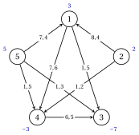
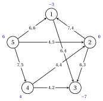
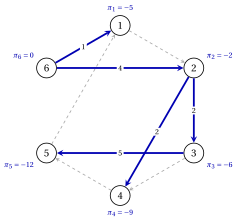
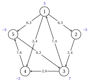
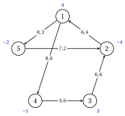

# Esercizi · Il simplesso su reti

**Esercizi · Capitolo 8** · ogni soluzione si apre con un clic · [:material-book-open-variant: Capitolo 8: Simplesso su reti](../simplesso-su-reti/network-simplex/index.md) · [:material-file-pdf-box: Eserciziario, volume 4 (PDF)](../pdf/esercizi-4-simplesso-su-reti.pdf)

!!! formula "Regole usate in questi esercizi"

    Le definizioni e i risultati del capitolo [«Il simplesso su reti»](../simplesso-su-reti/network-simplex/index.md), per una rete connessa $G=(N,A)$ con bilanci $b_i$, $\sum_{i \in N}b_i=0$, limiti inferiori nulli, capacità $u_{ij}$ e costi $c_{ij}$; gli archi sono in ordine lessicografico e la radice di ogni albero è l'ultimo nodo $n$.

    - **(N1)** <strong>Soluzione ad albero.</strong> $x_{ij}=0$ su $L$, $x_{ij}=u_{ij}$ su $U$; con i bilanci residui $\hat{b}_i=b_i-\sum_{(i,j) \in U}u_{ij}+\sum_{(j,i) \in U}u_{ji}$, prendere la foglia $\ell \neq n$ di indice minimo, con arco dell'albero $a$ e vicino $j$: $x_a=\hat{b}_\ell$ se $a=(\ell,j)$, $x_a=-\hat{b}_\ell$ se $a=(j,\ell)$, poi $\hat{b}_j:=\hat{b}_j+\hat{b}_\ell$; eliminare $\ell$ e ripetere.

    - **(N2)** <strong>Potenziali.</strong> $\pi_n=0$ e $\bar{c}_{ij}=c_{ij}-\pi_i+\pi_j=0$ sugli archi dell'albero: $\pi_j=\pi_i-c_{ij}$ oppure $\pi_i=\pi_j+c_{ij}$. Il costo ridotto di un arco fuori base è il costo del suo ciclo fondamentale, percorso nella sua direzione.

    - **(N3)** <strong>Ottimalità.</strong> $\bar{c}_{ij} \ge 0$ su $L$ e $\bar{c}_{ij} \le 0$ su $U$: la soluzione ad albero è ottima, ed è l'unico ottimo se le disuguaglianze sono strette.

    - **(N4)** <strong>Pivot.</strong> Arco entrante: tra gli archi di $L$ con $\bar{c}_{ij}<0$ e di $U$ con $\bar{c}_{ij}>0$, quello con il massimo $|\bar{c}_{ij}|$ (il primo in ordine lessicografico se sono più di uno). Il ciclo $C$ va come l'arco entrante se questo è in $L$, contro di esso se è in $U$; capacità residua $u_{ij}-x_{ij}$ su un arco in avanti, $x_{ij}$ su un arco all'indietro; $\theta$ è il minimo. L'apice è il primo nodo comune ai cammini nell'albero dagli estremi dell'arco entrante alla radice; l'arco uscente è l'ultimo arco bloccante a partire dall'apice lungo $C$, e va in $U$ se è in avanti, in $L$ se è all'indietro. Il costo diminuisce di $\theta|\bar{c}_{kl}|$; i potenziali del sottoalbero $S$ staccato dall'arco uscente cambiano di $-\bar{c}_{kl}$ se $l \in S$, di $+\bar{c}_{kl}$ se $k \in S$.

    - **(N5)** <strong>Forte ammissibilità.</strong> Ogni arco dell'albero con $x_{ij}=0$ punta verso la radice, e ogni arco dell'albero con $x_{ij}=u_{ij}$ punta in senso opposto alla radice.

    - **(N6)** <strong>Fase 0.</strong> Nodo artificiale $r=n+1$, arco $(i,r)$ se $b_i \ge 0$ e $(r,i)$ se $b_i<0$, capacità $+\infty$, costo $1$ (costo $0$ su $A$), radice $r$. $G$ è ammissibile se e solo se $z_0=0$; in tal caso il simplesso su reti prosegue con i costi $c_{ij}$ ($0$ sugli archi artificiali), e possono entrare solo gli archi con $\bar{c}^0_{ij}=0$.

!!! esercizio "Esercizio 8.1: Basi e soluzioni ad albero"

    !!! esercizio "Esercizio"

        Consideriamo la rete $G=(N,A)$ con $N=\{1,2,\dots,5\}$, gli $8$ archi

        $$
        A=\{(1,3),(1,4),(2,1),(2,4),(4,3),(5,1),(5,3),(5,4)\},
        $$

        i bilanci $b_1=3$, $b_2=2$, $b_3=-7$, $b_4=-3$, $b_5=5$, limiti inferiori nulli e i costi e le capacità della tabella; nella figura su ogni arco sono indicati $c_{ij},u_{ij}$ e accanto a ogni nodo il suo bilancio.

        
<table>
        <tr>
        <th>arco</th>
        <th>\((1,3)\)</th>
        <th>\((1,4)\)</th>
        <th>\((2,1)\)</th>
        <th>\((2,4)\)</th>
        <th>\((4,3)\)</th>
        <th>\((5,1)\)</th>
        <th>\((5,3)\)</th>
        <th>\((5,4)\)</th>
        </tr>
        <tr>
        <td>\(c_{ij}\)</td>
        <td>\(1\)</td>
        <td>\(7\)</td>
        <td>\(8\)</td>
        <td>\(1\)</td>
        <td>\(6\)</td>
        <td>\(7\)</td>
        <td>\(1\)</td>
        <td>\(1\)</td>
        </tr>
        <tr>
        <td>\(u_{ij}\)</td>
        <td>\(5\)</td>
        <td>\(6\)</td>
        <td>\(4\)</td>
        <td>\(2\)</td>
        <td>\(5\)</td>
        <td>\(4\)</td>
        <td>\(3\)</td>
        <td>\(5\)</td>
        </tr>
        </table>

        { .fig loading=lazy  }

        Consideriamo l'albero ricoprente $T=\{(1,3),(1,4),(2,4),(5,4)\}$, gli insiemi $U=\{(4,3),(5,1)\}$ e $L=\{(2,1),(5,3)\}$, e l'insieme di archi $F=\{(1,4),(2,1),(2,4),(5,3)\}$.

    **Domande**

    1. Dimostrare che $F$ non è una base: trovare un ciclo di $F$ e una combinazione lineare delle sue colonne di $\mat{B}$ uguale a zero. Perché $T$ è una base?

    2. Calcolare i bilanci residui e la soluzione ad albero di $(T,L,U)$ dalle foglie, come in (N1).

    3. La struttura ad albero è ammissibile? È degenere? Calcolarne il costo.

    4. La struttura ad albero è fortemente ammissibile, con radice $5$?

??? soluzione "Soluzione"

    Usiamo le regole (N1)–(N6) del riquadro all'inizio di questi esercizi.

    1. Gli archi di $F$ contengono il ciclo $1,4,2,1$, che percorre $(1,4)$ in avanti, $(2,4)$ all'indietro, $(2,1)$ in avanti. Con $+1$ per gli archi in avanti e $-1$ per quelli all'indietro,

        $$
        \mat{B}_{(1,4)} -\mat{B}_{(2,4)} +\mat{B}_{(2,1)}=\vet{0},
        $$

        quindi le colonne di $F$ sono linearmente dipendenti, in $\mat{B}$ e nella matrice senza la riga del nodo $5$: $F$ non è una base. L'insieme $T$ ha $4$ archi e collega tutti i nodi, quindi è un albero ricoprente, e gli alberi ricoprenti sono le basi.

    2. I bilanci residui portano al termine noto i flussi di $U$:

        $$
        \hat{\vet{b}}=(7,2,-2,-8,1) .
        $$

        Le foglie vengono eliminate nell'ordine $2,3,1,4$:

        
<table>
        <tr>
        <th>foglia \(\ell\)</th>
        <th>arco dell'albero</th>
        <th>flusso</th>
        <th>bilancio residuo del vicino</th>
        </tr>
        <tr>
        <td>\(2\)</td>
        <td>\((2,4)\)</td>
        <td>\(x_{24}=\hat{b}_{2}=2\)</td>
        <td>\(\hat{b}_{4}=-8+2=-6\)</td>
        </tr>
        <tr>
        <td>\(3\)</td>
        <td>\((1,3)\)</td>
        <td>\(x_{13}=-\hat{b}_{3}=2\)</td>
        <td>\(\hat{b}_{1}=7-2=5\)</td>
        </tr>
        <tr>
        <td>\(1\)</td>
        <td>\((1,4)\)</td>
        <td>\(x_{14}=\hat{b}_{1}=5\)</td>
        <td>\(\hat{b}_{4}=-6+5=-1\)</td>
        </tr>
        <tr>
        <td>\(4\)</td>
        <td>\((5,4)\)</td>
        <td>\(x_{54}=-\hat{b}_{4}=1\)</td>
        <td>\(\hat{b}_{5}=1-1=0\)</td>
        </tr>
        </table>

        Con $x_{ij}=0$ su $L$ e $x_{ij}=u_{ij}$ su $U$, la soluzione ad albero è

        
<table>
        <tr>
        <th>arco</th>
        <th>\((1,3)\)</th>
        <th>\((1,4)\)</th>
        <th>\((2,1)\)</th>
        <th>\((2,4)\)</th>
        <th>\((4,3)\)</th>
        <th>\((5,1)\)</th>
        <th>\((5,3)\)</th>
        <th>\((5,4)\)</th>
        </tr>
        <tr>
        <td>\(x_{ij}\)</td>
        <td>\(2\)</td>
        <td>\(5\)</td>
        <td>\(0\)</td>
        <td>\(2\)</td>
        <td>\(5\)</td>
        <td>\(4\)</td>
        <td>\(0\)</td>
        <td>\(1\)</td>
        </tr>
        <tr>
        <td>\(u_{ij}\)</td>
        <td>\(5\)</td>
        <td>\(6\)</td>
        <td>\(4\)</td>
        <td>\(2\)</td>
        <td>\(5\)</td>
        <td>\(4\)</td>
        <td>\(3\)</td>
        <td>\(5\)</td>
        </tr>
        </table>

    3. Ogni arco dell'albero ha $0 \le x_{ij} \le u_{ij}$, quindi la struttura ad albero è ammissibile. L'arco $(2,4)$ dell'albero ha $x_{24}=2$, a un limite: la struttura ad albero è degenere. Il suo costo è

        $$
        1 \cdot 2+7 \cdot 5+1 \cdot 2+6 \cdot 5+7 \cdot 4+1 \cdot 1=98 .
        $$

    4. No. L'arco $(2,4)$ dell'albero è alla sua capacità e punta verso la radice: sul cammino nell'albero da $2$ alla radice non si può inviare altro flusso in avanti lungo di esso. Per (N5) la struttura ad albero non è fortemente ammissibile.

        { .fig loading=lazy  }

    !!! chiave ""

        $F$ contiene un ciclo e non è una base; $(T,L,U)$ è ammissibile e degenere, con costo $98$, e non è fortemente ammissibile a causa dell'arco $(2,4)$.

!!! esercizio "Esercizio 8.2: Potenziali e certificato di ottimalità"

    !!! esercizio "Esercizio"

        Consideriamo la rete $G=(N,A)$ con $N=\{1,2,\dots,5\}$, gli $8$ archi

        $$
        A=\{(1,3),(2,1),(2,3),(4,2),(4,3),(5,1),(5,2),(5,4)\},
        $$

        i bilanci $b_1=-3$, $b_2=0$, $b_3=-7$, $b_4=4$, $b_5=6$, limiti inferiori nulli e i costi e le capacità della tabella; nella figura su ogni arco sono indicati $c_{ij},u_{ij}$ e accanto a ogni nodo il suo bilancio.

        
<table>
        <tr>
        <th>arco</th>
        <th>\((1,3)\)</th>
        <th>\((2,1)\)</th>
        <th>\((2,3)\)</th>
        <th>\((4,2)\)</th>
        <th>\((4,3)\)</th>
        <th>\((5,1)\)</th>
        <th>\((5,2)\)</th>
        <th>\((5,4)\)</th>
        </tr>
        <tr>
        <td>\(c_{ij}\)</td>
        <td>\(6\)</td>
        <td>\(7\)</td>
        <td>\(6\)</td>
        <td>\(4\)</td>
        <td>\(4\)</td>
        <td>\(6\)</td>
        <td>\(4\)</td>
        <td>\(7\)</td>
        </tr>
        <tr>
        <td>\(u_{ij}\)</td>
        <td>\(4\)</td>
        <td>\(4\)</td>
        <td>\(3\)</td>
        <td>\(4\)</td>
        <td>\(2\)</td>
        <td>\(6\)</td>
        <td>\(5\)</td>
        <td>\(5\)</td>
        </tr>
        </table>

        { .fig loading=lazy  }

        Consideriamo la struttura ad albero con $T=\{(1,3),(4,2),(5,1),(5,2)\}$, $U=\{(2,3),(4,3)\}$ e $L=\{(2,1),(5,4)\}$, la cui soluzione ad albero è

        
<table>
        <tr>
        <th>arco</th>
        <th>\((1,3)\)</th>
        <th>\((2,1)\)</th>
        <th>\((2,3)\)</th>
        <th>\((4,2)\)</th>
        <th>\((4,3)\)</th>
        <th>\((5,1)\)</th>
        <th>\((5,2)\)</th>
        <th>\((5,4)\)</th>
        </tr>
        <tr>
        <td>\(x_{ij}\)</td>
        <td>\(2\)</td>
        <td>\(0\)</td>
        <td>\(3\)</td>
        <td>\(2\)</td>
        <td>\(2\)</td>
        <td>\(5\)</td>
        <td>\(1\)</td>
        <td>\(0\)</td>
        </tr>
        </table>

    **Domande**

    1. Calcolare i potenziali di $T$ con radice $5$ ($\pi_5=0$), come in (N2).

    2. Calcolare i costi ridotti degli archi fuori base. La soluzione ad albero è ottima? È l'unico ottimo?

    3. Scrivere il ciclo fondamentale di $(4,3)$, percorso nella sua direzione, e verificare che il suo costo è uguale a $\bar{c}_{43}$.

    4. Dare una soluzione ottima $(\vet{\pi},\vet{\alpha})$ del modello duale del [Capitolo 4 «Modelli di flusso su reti»](../flussi/network-flow-models/index.md), con $\alpha_{ij}=\max\{0,-\bar{c}_{ij}\}$, e verificare che il valore duale è uguale al costo del flusso.

??? soluzione "Soluzione"

    Usiamo le regole (N1)–(N6) del riquadro all'inizio di questi esercizi.

    1. Scendendo lungo l'albero dalla radice $5$:

        $$
        \begin{gathered}
        \pi_{1}=\pi_{5}-c_{51}=-6, \qquad \pi_{2}=\pi_{5}-c_{52}=-4, \qquad \pi_{3}=\pi_{1}-c_{13}=-12\\
        \pi_{4}=\pi_{2}+c_{42}=0 .
        \end{gathered}
        $$

        Quindi $\vet{\pi}=(-6,-4,-12,0,0)$.

    2. I costi ridotti $\bar{c}_{ij}=c_{ij}-\pi_i+\pi_j$ sono

        
<table>
        <tr>
        <th>arco</th>
        <th>\((1,3)\)</th>
        <th>\((2,1)\)</th>
        <th>\((2,3)\)</th>
        <th>\((4,2)\)</th>
        <th>\((4,3)\)</th>
        <th>\((5,1)\)</th>
        <th>\((5,2)\)</th>
        <th>\((5,4)\)</th>
        </tr>
        <tr>
        <td>stato</td>
        <td>\(\mathrm{T}\)</td>
        <td>\(\mathrm{L}\)</td>
        <td>\(\mathrm{U}\)</td>
        <td>\(\mathrm{T}\)</td>
        <td>\(\mathrm{U}\)</td>
        <td>\(\mathrm{T}\)</td>
        <td>\(\mathrm{T}\)</td>
        <td>\(\mathrm{L}\)</td>
        </tr>
        <tr>
        <td>\(x_{ij}\)</td>
        <td>\(2\)</td>
        <td>\(0\)</td>
        <td>\(3\)</td>
        <td>\(2\)</td>
        <td>\(2\)</td>
        <td>\(5\)</td>
        <td>\(1\)</td>
        <td>\(0\)</td>
        </tr>
        <tr>
        <td>\(\bar{c}_{ij}\)</td>
        <td>\(0\)</td>
        <td>\(5\)</td>
        <td>\(-2\)</td>
        <td>\(0\)</td>
        <td>\(-8\)</td>
        <td>\(0\)</td>
        <td>\(0\)</td>
        <td>\(7\)</td>
        </tr>
        </table>

        Gli archi di $L$ hanno $\bar{c}_{21}=5, \bar{c}_{54}=7$, tutti positivi, e gli archi di $U$ hanno $\bar{c}_{23}=-2, \bar{c}_{43}=-8$, tutti negativi. Per (N3) la soluzione ad albero è ottima, con costo $80$, ed è l'unico ottimo perché le disuguaglianze sono strette (Gurobi conferma il valore).

        { .fig loading=lazy  }

    3. Il ciclo è $4,3,1,5,2,4$: $(4,3)$ in avanti, $(1,3)$ all'indietro, $(5,1)$ all'indietro, $(5,2)$ in avanti, $(4,2)$ all'indietro. Il suo costo è

        $$
        c_{43}-c_{13}-c_{51}+c_{52}-c_{42}=4-6-6+4-4=-8=\bar{c}_{43} .
        $$

    4. Con $\alpha_{ij}=\max\{0,-\bar{c}_{ij}\}$ valgono i vincoli duali $\pi_i-\pi_j-\alpha_{ij} \le c_{ij}$, e $\alpha_{ij}>0$ solo sugli archi di $U$: $\alpha_{23}=2$, $\alpha_{43}=8$. Il valore duale è

        $$
        \sum_{i \in N} b_i\pi_i-\sum_{(i,j) \in A} u_{ij}\alpha_{ij}=102-22=80,
        $$

        uguale al costo: entrambe le soluzioni sono ottime.

    !!! chiave ""

        I potenziali $\vet{\pi}=(-6,-4,-12,0,0)$ danno $\bar{c}>0$ su $L$ e $\bar{c}<0$ su $U$: la soluzione ad albero è l'unico ottimo, con costo $80$ pari al valore duale.

!!! esercizio "Esercizio 8.3: Il simplesso su reti senza capacità"

    !!! esercizio "Esercizio"

        Consideriamo la rete $G=(N,A)$ con $N=\{1,2,\dots,6\}$, i $9$ archi

        $$
        A=\{(1,2),(2,3),(2,4),(3,4),(3,5),(4,5),(5,1),(6,1),(6,2)\},
        $$

        i bilanci $b_1=-1$, $b_2=0$, $b_3=3$, $b_4=-2$, $b_5=-5$, $b_6=5$, limiti inferiori nulli e i costi della tabella (nessuna capacità: $u_{ij}=+\infty$); nella figura su ogni arco è indicato $c_{ij}$ e accanto a ogni nodo il suo bilancio.

        
<table>
        <tr>
        <th>arco</th>
        <th>\((1,2)\)</th>
        <th>\((2,3)\)</th>
        <th>\((2,4)\)</th>
        <th>\((3,4)\)</th>
        <th>\((3,5)\)</th>
        <th>\((4,5)\)</th>
        <th>\((5,1)\)</th>
        <th>\((6,1)\)</th>
        <th>\((6,2)\)</th>
        </tr>
        <tr>
        <td>\(c_{ij}\)</td>
        <td>\(1\)</td>
        <td>\(4\)</td>
        <td>\(7\)</td>
        <td>\(4\)</td>
        <td>\(6\)</td>
        <td>\(7\)</td>
        <td>\(6\)</td>
        <td>\(5\)</td>
        <td>\(2\)</td>
        </tr>
        </table>

        { .fig loading=lazy  }

        La struttura ad albero iniziale ha $T=\{(1,2),(2,3),(3,4),(3,5),(6,1)\}$, $L=\{(2,4),(4,5),(5,1),(6,2)\}$ e $U=\emptyset$.

    **Domande**

    1. Calcolare la soluzione ad albero della struttura ad albero iniziale, il suo costo e i suoi potenziali. È non degenere?

    2. Risolvere il problema con l'algoritmo del simplesso su reti, con le regole (N1)–(N4): per ogni iterazione dare i flussi, i potenziali, i costi ridotti, l'arco entrante, il ciclo con il suo apice, il passo e l'arco uscente.

    3. Dare il flusso ottimo e il suo costo, e spiegare perché è l'unico ottimo.

??? soluzione "Soluzione"

    Usiamo le regole (N1)–(N6) del riquadro all'inizio di questi esercizi.

    1. Dalle foglie, come in (N1):

        
<table>
        <tr>
        <th>arco</th>
        <th>\((1,2)\)</th>
        <th>\((2,3)\)</th>
        <th>\((2,4)\)</th>
        <th>\((3,4)\)</th>
        <th>\((3,5)\)</th>
        <th>\((4,5)\)</th>
        <th>\((5,1)\)</th>
        <th>\((6,1)\)</th>
        <th>\((6,2)\)</th>
        </tr>
        <tr>
        <td>\(x_{ij}\)</td>
        <td>\(4\)</td>
        <td>\(4\)</td>
        <td>\(0\)</td>
        <td>\(2\)</td>
        <td>\(5\)</td>
        <td>\(0\)</td>
        <td>\(0\)</td>
        <td>\(5\)</td>
        <td>\(0\)</td>
        </tr>
        </table>

        Ogni arco dell'albero ha un flusso positivo, quindi la soluzione ad albero è non degenere; il suo costo è $83$. Dalla radice $6$, $\vet{\pi}=(-5,-6,-10,-14,-16,0)$.

    2. <strong>Iterazione 1</strong>  I potenziali sono $\vet{\pi}=(-5,-6,-10,-14,-16,0)$ e il costo è $83$.

        
<table>
        <tr>
        <th>arco</th>
        <th>\((1,2)\)</th>
        <th>\((2,3)\)</th>
        <th>\((2,4)\)</th>
        <th>\((3,4)\)</th>
        <th>\((3,5)\)</th>
        <th>\((4,5)\)</th>
        <th>\((5,1)\)</th>
        <th>\((6,1)\)</th>
        <th>\((6,2)\)</th>
        </tr>
        <tr>
        <td>stato</td>
        <td>\(\mathrm{T}\)</td>
        <td>\(\mathrm{T}\)</td>
        <td>\(\mathrm{L}\)</td>
        <td>\(\mathrm{T}\)</td>
        <td>\(\mathrm{T}\)</td>
        <td>\(\mathrm{L}\)</td>
        <td>\(\mathrm{L}\)</td>
        <td>\(\mathrm{T}\)</td>
        <td>\(\mathrm{L}\)</td>
        </tr>
        <tr>
        <td>\(x_{ij}\)</td>
        <td>\(4\)</td>
        <td>\(4\)</td>
        <td>\(0\)</td>
        <td>\(2\)</td>
        <td>\(5\)</td>
        <td>\(0\)</td>
        <td>\(0\)</td>
        <td>\(5\)</td>
        <td>\(0\)</td>
        </tr>
        <tr>
        <td>\(\bar{c}_{ij}\)</td>
        <td>\(0\)</td>
        <td>\(0\)</td>
        <td>\(-1\)</td>
        <td>\(0\)</td>
        <td>\(0\)</td>
        <td>\(5\)</td>
        <td>\(17\)</td>
        <td>\(0\)</td>
        <td>\(-4\)</td>
        </tr>
        </table>

        - Gli archi ammissibili per l'ingresso sono $(2,4)$ e $(6,2)$; l'arco entrante è $e=(6,2)$, con $\bar{c}_{62}=-4$, in $L$: $C$ lo segue.

        - I cammini nell'albero fino alla radice sono $6$ e $2,1,6$: l'apice è $w=6$, e $C$ è $6,2,1,6$.

            
<table>
            <tr>
            <td>arco di \(C\)</td>
            <td>\((6,2)\)</td>
            <td>\((1,2)\)</td>
            <td>\((6,1)\)</td>
            </tr>
            <tr>
            <td>direzione</td>
            <td>\(+\)</td>
            <td>\(-\)</td>
            <td>\(-\)</td>
            </tr>
            <tr>
            <td>residuo</td>
            <td>\(+\infty\)</td>
            <td>\(4\)</td>
            <td>\(5\)</td>
            </tr>
            </table>

        - $\theta=4$: l'unico arco bloccante è $(1,2)$; esce dall'albero e va in $L$. Il costo diventa $83-4 \cdot 4=67$.

        - Togliendo $(1,2)$ si stacca $S=\{2,3,4,5\}$, che contiene $l=2$: questi potenziali cambiano di $-\bar{c}_{62}=4$.

        <strong>Iterazione 2</strong>  I potenziali sono $\vet{\pi}=(-5,-2,-6,-10,-12,0)$ e il costo è $67$.

        
<table>
        <tr>
        <th>arco</th>
        <th>\((1,2)\)</th>
        <th>\((2,3)\)</th>
        <th>\((2,4)\)</th>
        <th>\((3,4)\)</th>
        <th>\((3,5)\)</th>
        <th>\((4,5)\)</th>
        <th>\((5,1)\)</th>
        <th>\((6,1)\)</th>
        <th>\((6,2)\)</th>
        </tr>
        <tr>
        <td>stato</td>
        <td>\(\mathrm{L}\)</td>
        <td>\(\mathrm{T}\)</td>
        <td>\(\mathrm{L}\)</td>
        <td>\(\mathrm{T}\)</td>
        <td>\(\mathrm{T}\)</td>
        <td>\(\mathrm{L}\)</td>
        <td>\(\mathrm{L}\)</td>
        <td>\(\mathrm{T}\)</td>
        <td>\(\mathrm{T}\)</td>
        </tr>
        <tr>
        <td>\(x_{ij}\)</td>
        <td>\(0\)</td>
        <td>\(4\)</td>
        <td>\(0\)</td>
        <td>\(2\)</td>
        <td>\(5\)</td>
        <td>\(0\)</td>
        <td>\(0\)</td>
        <td>\(1\)</td>
        <td>\(4\)</td>
        </tr>
        <tr>
        <td>\(\bar{c}_{ij}\)</td>
        <td>\(4\)</td>
        <td>\(0\)</td>
        <td>\(-1\)</td>
        <td>\(0\)</td>
        <td>\(0\)</td>
        <td>\(5\)</td>
        <td>\(13\)</td>
        <td>\(0\)</td>
        <td>\(0\)</td>
        </tr>
        </table>

        - L'unico arco ammissibile per l'ingresso è $e=(2,4)$, con $\bar{c}_{24}=-1$, in $L$: $C$ lo segue.

        - I cammini nell'albero fino alla radice sono $2,6$ e $4,3,2,6$: l'apice è $w=2$, e $C$ è $2,4,3,2$.

            
<table>
            <tr>
            <td>arco di \(C\)</td>
            <td>\((2,4)\)</td>
            <td>\((3,4)\)</td>
            <td>\((2,3)\)</td>
            </tr>
            <tr>
            <td>direzione</td>
            <td>\(+\)</td>
            <td>\(-\)</td>
            <td>\(-\)</td>
            </tr>
            <tr>
            <td>residuo</td>
            <td>\(+\infty\)</td>
            <td>\(2\)</td>
            <td>\(4\)</td>
            </tr>
            </table>

        - $\theta=2$: l'unico arco bloccante è $(3,4)$; esce dall'albero e va in $L$. Il costo diventa $67-2 \cdot 1=65$.

        - Togliendo $(3,4)$ si stacca $S=\{4\}$, che contiene $l=4$: questi potenziali cambiano di $-\bar{c}_{24}=1$.

        <strong>Iterazione 3</strong>  I potenziali sono $\vet{\pi}=(-5,-2,-6,-9,-12,0)$ e il costo è $65$.

        
<table>
        <tr>
        <th>arco</th>
        <th>\((1,2)\)</th>
        <th>\((2,3)\)</th>
        <th>\((2,4)\)</th>
        <th>\((3,4)\)</th>
        <th>\((3,5)\)</th>
        <th>\((4,5)\)</th>
        <th>\((5,1)\)</th>
        <th>\((6,1)\)</th>
        <th>\((6,2)\)</th>
        </tr>
        <tr>
        <td>stato</td>
        <td>\(\mathrm{L}\)</td>
        <td>\(\mathrm{T}\)</td>
        <td>\(\mathrm{T}\)</td>
        <td>\(\mathrm{L}\)</td>
        <td>\(\mathrm{T}\)</td>
        <td>\(\mathrm{L}\)</td>
        <td>\(\mathrm{L}\)</td>
        <td>\(\mathrm{T}\)</td>
        <td>\(\mathrm{T}\)</td>
        </tr>
        <tr>
        <td>\(x_{ij}\)</td>
        <td>\(0\)</td>
        <td>\(2\)</td>
        <td>\(2\)</td>
        <td>\(0\)</td>
        <td>\(5\)</td>
        <td>\(0\)</td>
        <td>\(0\)</td>
        <td>\(1\)</td>
        <td>\(4\)</td>
        </tr>
        <tr>
        <td>\(\bar{c}_{ij}\)</td>
        <td>\(4\)</td>
        <td>\(0\)</td>
        <td>\(0\)</td>
        <td>\(1\)</td>
        <td>\(0\)</td>
        <td>\(4\)</td>
        <td>\(13\)</td>
        <td>\(0\)</td>
        <td>\(0\)</td>
        </tr>
        </table>

        Tutti gli archi di $L$ hanno $\bar{c}_{ij} \ge 0$: <code>STOP</code>.

    3. Il flusso ottimo è

        
<table>
        <tr>
        <th>arco</th>
        <th>\((1,2)\)</th>
        <th>\((2,3)\)</th>
        <th>\((2,4)\)</th>
        <th>\((3,4)\)</th>
        <th>\((3,5)\)</th>
        <th>\((4,5)\)</th>
        <th>\((5,1)\)</th>
        <th>\((6,1)\)</th>
        <th>\((6,2)\)</th>
        </tr>
        <tr>
        <td>\(\tilde{x}_{ij}\)</td>
        <td>\(0\)</td>
        <td>\(2\)</td>
        <td>\(2\)</td>
        <td>\(0\)</td>
        <td>\(5\)</td>
        <td>\(0\)</td>
        <td>\(0\)</td>
        <td>\(1\)</td>
        <td>\(4\)</td>
        </tr>
        </table>

        con costo $65$. Tutti gli archi fuori base sono in $L$ con $\bar{c}_{ij}>0$, quindi per (N3) è l'unico ottimo; Gurobi dà lo stesso valore.

        { .fig loading=lazy  }

    !!! chiave ""

        Il simplesso su reti esegue $2$ pivot non degeneri, con costi $83$, $67$, $65$; l'ultimo albero certifica l'unico ottimo, di costo $65$.

!!! esercizio "Esercizio 8.4: Il simplesso su reti con capacità"

    !!! esercizio "Esercizio"

        Consideriamo la rete $G=(N,A)$ con $N=\{1,2,\dots,5\}$, gli $8$ archi

        $$
        A=\{(1,2),(1,4),(1,5),(2,3),(3,1),(3,4),(4,5),(5,3)\},
        $$

        i bilanci $b_1=5$, $b_2=-5$, $b_3=7$, $b_4=-2$, $b_5=-5$, limiti inferiori nulli e i costi e le capacità della tabella; nella figura su ogni arco sono indicati $c_{ij},u_{ij}$ e accanto a ogni nodo il suo bilancio.

        
<table>
        <tr>
        <th>arco</th>
        <th>\((1,2)\)</th>
        <th>\((1,4)\)</th>
        <th>\((1,5)\)</th>
        <th>\((2,3)\)</th>
        <th>\((3,1)\)</th>
        <th>\((3,4)\)</th>
        <th>\((4,5)\)</th>
        <th>\((5,3)\)</th>
        </tr>
        <tr>
        <td>\(c_{ij}\)</td>
        <td>\(6\)</td>
        <td>\(2\)</td>
        <td>\(6\)</td>
        <td>\(2\)</td>
        <td>\(7\)</td>
        <td>\(2\)</td>
        <td>\(7\)</td>
        <td>\(6\)</td>
        </tr>
        <tr>
        <td>\(u_{ij}\)</td>
        <td>\(5\)</td>
        <td>\(4\)</td>
        <td>\(3\)</td>
        <td>\(4\)</td>
        <td>\(4\)</td>
        <td>\(6\)</td>
        <td>\(6\)</td>
        <td>\(2\)</td>
        </tr>
        </table>

        { .fig loading=lazy  }

        La struttura ad albero iniziale ha $T=\{(1,2),(1,4),(3,1),(4,5)\}$, $U=\{(1,5),(3,4),(5,3)\}$ e $L=\{(2,3)\}$.

    **Domande**

    1. Calcolare la soluzione ad albero della struttura ad albero iniziale e il suo costo. Verificare che è fortemente ammissibile, con radice $5$.

    2. Risolvere il problema con l'algoritmo del simplesso su reti, con le regole (N1)–(N4), dando tutti i dettagli di ogni iterazione.

    3. Quale pivot è degenere? Che cosa cambia in quel pivot, e che cosa no?

    4. Dare il flusso ottimo, il suo costo e gli archi alla loro capacità.

??? soluzione "Soluzione"

    Usiamo le regole (N1)–(N6) del riquadro all'inizio di questi esercizi.

    1. Dalle foglie, come in (N1):

        
<table>
        <tr>
        <th>arco</th>
        <th>\((1,2)\)</th>
        <th>\((1,4)\)</th>
        <th>\((1,5)\)</th>
        <th>\((2,3)\)</th>
        <th>\((3,1)\)</th>
        <th>\((3,4)\)</th>
        <th>\((4,5)\)</th>
        <th>\((5,3)\)</th>
        </tr>
        <tr>
        <td>\(x_{ij}\)</td>
        <td>\(5\)</td>
        <td>\(0\)</td>
        <td>\(3\)</td>
        <td>\(0\)</td>
        <td>\(3\)</td>
        <td>\(6\)</td>
        <td>\(4\)</td>
        <td>\(2\)</td>
        </tr>
        <tr>
        <td>\(u_{ij}\)</td>
        <td>\(5\)</td>
        <td>\(4\)</td>
        <td>\(3\)</td>
        <td>\(4\)</td>
        <td>\(4\)</td>
        <td>\(6\)</td>
        <td>\(6\)</td>
        <td>\(2\)</td>
        </tr>
        </table>

        Il suo costo è $121$. Gli archi dell'albero a un limite sono: $(1,4)$, con $x_{14}=0$, che punta verso la radice; $(1,2)$, con $x_{12}=5=u_{12}$, che punta in senso opposto alla radice. Per (N5) la struttura ad albero è fortemente ammissibile.

    2. <strong>Iterazione 1</strong>  I potenziali sono $\vet{\pi}=(9,3,16,7,0)$ e il costo è $121$.

        
<table>
        <tr>
        <th>arco</th>
        <th>\((1,2)\)</th>
        <th>\((1,4)\)</th>
        <th>\((1,5)\)</th>
        <th>\((2,3)\)</th>
        <th>\((3,1)\)</th>
        <th>\((3,4)\)</th>
        <th>\((4,5)\)</th>
        <th>\((5,3)\)</th>
        </tr>
        <tr>
        <td>stato</td>
        <td>\(\mathrm{T}\)</td>
        <td>\(\mathrm{T}\)</td>
        <td>\(\mathrm{U}\)</td>
        <td>\(\mathrm{L}\)</td>
        <td>\(\mathrm{T}\)</td>
        <td>\(\mathrm{U}\)</td>
        <td>\(\mathrm{T}\)</td>
        <td>\(\mathrm{U}\)</td>
        </tr>
        <tr>
        <td>\(x_{ij}\)</td>
        <td>\(5\)</td>
        <td>\(0\)</td>
        <td>\(3\)</td>
        <td>\(0\)</td>
        <td>\(3\)</td>
        <td>\(6\)</td>
        <td>\(4\)</td>
        <td>\(2\)</td>
        </tr>
        <tr>
        <td>\(\bar{c}_{ij}\)</td>
        <td>\(0\)</td>
        <td>\(0\)</td>
        <td>\(-3\)</td>
        <td>\(15\)</td>
        <td>\(0\)</td>
        <td>\(-7\)</td>
        <td>\(0\)</td>
        <td>\(22\)</td>
        </tr>
        </table>

        - L'unico arco ammissibile per l'ingresso è $e=(5,3)$, con $\bar{c}_{53}=22$, in $U$: $C$ è percorso contro di esso.

        - I cammini nell'albero fino alla radice sono $5$ e $3,1,4,5$: l'apice è $w=5$, e $C$ è $5,4,1,3,5$.

            
<table>
            <tr>
            <td>arco di \(C\)</td>
            <td>\((4,5)\)</td>
            <td>\((1,4)\)</td>
            <td>\((3,1)\)</td>
            <td>\((5,3)\)</td>
            </tr>
            <tr>
            <td>direzione</td>
            <td>\(-\)</td>
            <td>\(-\)</td>
            <td>\(-\)</td>
            <td>\(-\)</td>
            </tr>
            <tr>
            <td>residuo</td>
            <td>\(4\)</td>
            <td>\(0\)</td>
            <td>\(3\)</td>
            <td>\(2\)</td>
            </tr>
            </table>

        - $\theta=0$: l'unico arco bloccante è $(1,4)$; esce dall'albero e va in $L$. Il pivot è degenere, e il costo resta $121$.

        - Togliendo $(1,4)$ si stacca $S=\{1,2,3\}$, che contiene $l=3$: questi potenziali cambiano di $-\bar{c}_{53}=-22$.

        <strong>Iterazione 2</strong>  I potenziali sono $\vet{\pi}=(-13,-19,-6,7,0)$ e il costo è $121$.

        
<table>
        <tr>
        <th>arco</th>
        <th>\((1,2)\)</th>
        <th>\((1,4)\)</th>
        <th>\((1,5)\)</th>
        <th>\((2,3)\)</th>
        <th>\((3,1)\)</th>
        <th>\((3,4)\)</th>
        <th>\((4,5)\)</th>
        <th>\((5,3)\)</th>
        </tr>
        <tr>
        <td>stato</td>
        <td>\(\mathrm{T}\)</td>
        <td>\(\mathrm{L}\)</td>
        <td>\(\mathrm{U}\)</td>
        <td>\(\mathrm{L}\)</td>
        <td>\(\mathrm{T}\)</td>
        <td>\(\mathrm{U}\)</td>
        <td>\(\mathrm{T}\)</td>
        <td>\(\mathrm{T}\)</td>
        </tr>
        <tr>
        <td>\(x_{ij}\)</td>
        <td>\(5\)</td>
        <td>\(0\)</td>
        <td>\(3\)</td>
        <td>\(0\)</td>
        <td>\(3\)</td>
        <td>\(6\)</td>
        <td>\(4\)</td>
        <td>\(2\)</td>
        </tr>
        <tr>
        <td>\(\bar{c}_{ij}\)</td>
        <td>\(0\)</td>
        <td>\(22\)</td>
        <td>\(19\)</td>
        <td>\(15\)</td>
        <td>\(0\)</td>
        <td>\(15\)</td>
        <td>\(0\)</td>
        <td>\(0\)</td>
        </tr>
        </table>

        - Gli archi ammissibili per l'ingresso sono $(1,5)$ e $(3,4)$; l'arco entrante è $e=(1,5)$, con $\bar{c}_{15}=19$, in $U$: $C$ è percorso contro di esso.

        - I cammini nell'albero fino alla radice sono $1,3,5$ e $5$: l'apice è $w=5$, e $C$ è $5,1,3,5$.

            
<table>
            <tr>
            <td>arco di \(C\)</td>
            <td>\((1,5)\)</td>
            <td>\((3,1)\)</td>
            <td>\((5,3)\)</td>
            </tr>
            <tr>
            <td>direzione</td>
            <td>\(-\)</td>
            <td>\(-\)</td>
            <td>\(-\)</td>
            </tr>
            <tr>
            <td>residuo</td>
            <td>\(3\)</td>
            <td>\(3\)</td>
            <td>\(2\)</td>
            </tr>
            </table>

        - $\theta=2$: l'unico arco bloccante è $(5,3)$; esce dall'albero e va in $L$. Il costo diventa $121-2 \cdot 19=83$.

        - Togliendo $(5,3)$ si stacca $S=\{1,2,3\}$, che contiene $k=1$: questi potenziali cambiano di $\bar{c}_{15}=19$.

        <strong>Iterazione 3</strong>  I potenziali sono $\vet{\pi}=(6,0,13,7,0)$ e il costo è $83$.

        
<table>
        <tr>
        <th>arco</th>
        <th>\((1,2)\)</th>
        <th>\((1,4)\)</th>
        <th>\((1,5)\)</th>
        <th>\((2,3)\)</th>
        <th>\((3,1)\)</th>
        <th>\((3,4)\)</th>
        <th>\((4,5)\)</th>
        <th>\((5,3)\)</th>
        </tr>
        <tr>
        <td>stato</td>
        <td>\(\mathrm{T}\)</td>
        <td>\(\mathrm{L}\)</td>
        <td>\(\mathrm{T}\)</td>
        <td>\(\mathrm{L}\)</td>
        <td>\(\mathrm{T}\)</td>
        <td>\(\mathrm{U}\)</td>
        <td>\(\mathrm{T}\)</td>
        <td>\(\mathrm{L}\)</td>
        </tr>
        <tr>
        <td>\(x_{ij}\)</td>
        <td>\(5\)</td>
        <td>\(0\)</td>
        <td>\(1\)</td>
        <td>\(0\)</td>
        <td>\(1\)</td>
        <td>\(6\)</td>
        <td>\(4\)</td>
        <td>\(0\)</td>
        </tr>
        <tr>
        <td>\(\bar{c}_{ij}\)</td>
        <td>\(0\)</td>
        <td>\(3\)</td>
        <td>\(0\)</td>
        <td>\(15\)</td>
        <td>\(0\)</td>
        <td>\(-4\)</td>
        <td>\(0\)</td>
        <td>\(19\)</td>
        </tr>
        </table>

        Tutti gli archi di $L$ hanno $\bar{c}_{ij} \ge 0$ e tutti gli archi di $U$ hanno $\bar{c}_{ij} \le 0$: <code>STOP</code>.

    3. L'iterazione $1$ è degenere: $\theta=0$ perché l'arco $(1,4)$ ha capacità residua $0$ lungo $C$. Il flusso e il costo ($121$) non cambiano, ma l'albero sì: $(5,3)$ entra, $(1,4)$ esce e i potenziali di $S=\{1,2,3\}$ cambiano di $-22$.

    4. Il flusso ottimo è

        
<table>
        <tr>
        <th>arco</th>
        <th>\((1,2)\)</th>
        <th>\((1,4)\)</th>
        <th>\((1,5)\)</th>
        <th>\((2,3)\)</th>
        <th>\((3,1)\)</th>
        <th>\((3,4)\)</th>
        <th>\((4,5)\)</th>
        <th>\((5,3)\)</th>
        </tr>
        <tr>
        <td>\(\tilde{x}_{ij}\)</td>
        <td>\(5\)</td>
        <td>\(0\)</td>
        <td>\(1\)</td>
        <td>\(0\)</td>
        <td>\(1\)</td>
        <td>\(6\)</td>
        <td>\(4\)</td>
        <td>\(0\)</td>
        </tr>
        <tr>
        <td>\(u_{ij}\)</td>
        <td>\(5\)</td>
        <td>\(4\)</td>
        <td>\(3\)</td>
        <td>\(4\)</td>
        <td>\(4\)</td>
        <td>\(6\)</td>
        <td>\(6\)</td>
        <td>\(2\)</td>
        </tr>
        </table>

        con costo $83$; gli archi di $U$ alla loro capacità sono $(3,4)$. I costi ridotti sono strettamente positivi su $L$ e strettamente negativi su $U$, quindi l'ottimo è unico (Gurobi dà lo stesso valore).

        { .fig loading=lazy  }

    !!! chiave ""

        Dal costo $121$ l'algoritmo raggiunge l'unico ottimo, di costo $83$, in $2$ pivot, uno dei quali degenere.

!!! esercizio "Esercizio 8.5: Alberi fortemente ammissibili e regola dell'arco uscente"

    !!! esercizio "Esercizio"

        Consideriamo la rete $G=(N,A)$ con $N=\{1,2,\dots,6\}$, i $9$ archi

        $$
        A=\{(1,3),(1,5),(2,3),(4,2),(5,3),(5,4),(5,6),(6,1),(6,2)\},
        $$

        i bilanci $b_1=0$, $b_2=-4$, $b_3=-5$, $b_4=1$, $b_5=3$, $b_6=5$, limiti inferiori nulli e i costi e le capacità della tabella; nella figura su ogni arco sono indicati $c_{ij},u_{ij}$ e accanto a ogni nodo il suo bilancio.

        
<table>
        <tr>
        <th>arco</th>
        <th>\((1,3)\)</th>
        <th>\((1,5)\)</th>
        <th>\((2,3)\)</th>
        <th>\((4,2)\)</th>
        <th>\((5,3)\)</th>
        <th>\((5,4)\)</th>
        <th>\((5,6)\)</th>
        <th>\((6,1)\)</th>
        <th>\((6,2)\)</th>
        </tr>
        <tr>
        <td>\(c_{ij}\)</td>
        <td>\(2\)</td>
        <td>\(8\)</td>
        <td>\(1\)</td>
        <td>\(7\)</td>
        <td>\(8\)</td>
        <td>\(8\)</td>
        <td>\(8\)</td>
        <td>\(7\)</td>
        <td>\(5\)</td>
        </tr>
        <tr>
        <td>\(u_{ij}\)</td>
        <td>\(3\)</td>
        <td>\(4\)</td>
        <td>\(2\)</td>
        <td>\(6\)</td>
        <td>\(2\)</td>
        <td>\(3\)</td>
        <td>\(4\)</td>
        <td>\(5\)</td>
        <td>\(4\)</td>
        </tr>
        </table>

        { .fig loading=lazy  }

        Consideriamo la struttura ad albero con $T=\{(1,3),(1,5),(2,3),(4,2),(6,1)\}$, $U=\{(5,3),(5,4)\}$ e $L=\{(5,6),(6,2)\}$.

    **Domande**

    1. Calcolare la soluzione ad albero e verificare che la struttura ad albero è fortemente ammissibile, con radice $6$.

    2. Calcolare i potenziali e i costi ridotti, e scegliere l'arco entrante con (N4).

    3. Trovare l'apice, il ciclo, il passo e gli archi bloccanti. Quale arco esce dall'albero con la regola di (N4)? Verificare che la nuova struttura ad albero è fortemente ammissibile.

    4. Mostrare che la scelta dell'altro arco bloccante, $(1,3)$, dà una struttura ad albero che non è fortemente ammissibile.

    5. Dimostrare che in un pivot degenere da un albero fortemente ammissibile, eseguito con la regola di (N4), la somma dei potenziali diminuisce strettamente, e verificarlo su questo pivot.

??? soluzione "Soluzione"

    Usiamo le regole (N1)–(N6) del riquadro all'inizio di questi esercizi.

    1. Dalle foglie, come in (N1):

        
<table>
        <tr>
        <th>arco</th>
        <th>\((1,3)\)</th>
        <th>\((1,5)\)</th>
        <th>\((2,3)\)</th>
        <th>\((4,2)\)</th>
        <th>\((5,3)\)</th>
        <th>\((5,4)\)</th>
        <th>\((5,6)\)</th>
        <th>\((6,1)\)</th>
        <th>\((6,2)\)</th>
        </tr>
        <tr>
        <td>\(x_{ij}\)</td>
        <td>\(3\)</td>
        <td>\(2\)</td>
        <td>\(0\)</td>
        <td>\(4\)</td>
        <td>\(2\)</td>
        <td>\(3\)</td>
        <td>\(0\)</td>
        <td>\(5\)</td>
        <td>\(0\)</td>
        </tr>
        <tr>
        <td>\(u_{ij}\)</td>
        <td>\(3\)</td>
        <td>\(4\)</td>
        <td>\(2\)</td>
        <td>\(6\)</td>
        <td>\(2\)</td>
        <td>\(3\)</td>
        <td>\(4\)</td>
        <td>\(5\)</td>
        <td>\(4\)</td>
        </tr>
        </table>

        Gli archi dell'albero a un limite sono: $(6,1)$, con $x_{61}=5=u_{61}$, che punta in senso opposto alla radice; $(2,3)$, con $x_{23}=0$, che punta verso la radice; $(1,3)$, con $x_{13}=3=u_{13}$, che punta in senso opposto alla radice. Per (N5) la struttura ad albero è fortemente ammissibile.

    2. I potenziali sono $\vet{\pi}=(-7,-8,-9,-1,-15,0)$ e il costo è $125$.

        
<table>
        <tr>
        <th>arco</th>
        <th>\((1,3)\)</th>
        <th>\((1,5)\)</th>
        <th>\((2,3)\)</th>
        <th>\((4,2)\)</th>
        <th>\((5,3)\)</th>
        <th>\((5,4)\)</th>
        <th>\((5,6)\)</th>
        <th>\((6,1)\)</th>
        <th>\((6,2)\)</th>
        </tr>
        <tr>
        <td>stato</td>
        <td>\(\mathrm{T}\)</td>
        <td>\(\mathrm{T}\)</td>
        <td>\(\mathrm{T}\)</td>
        <td>\(\mathrm{T}\)</td>
        <td>\(\mathrm{U}\)</td>
        <td>\(\mathrm{U}\)</td>
        <td>\(\mathrm{L}\)</td>
        <td>\(\mathrm{T}\)</td>
        <td>\(\mathrm{L}\)</td>
        </tr>
        <tr>
        <td>\(x_{ij}\)</td>
        <td>\(3\)</td>
        <td>\(2\)</td>
        <td>\(0\)</td>
        <td>\(4\)</td>
        <td>\(2\)</td>
        <td>\(3\)</td>
        <td>\(0\)</td>
        <td>\(5\)</td>
        <td>\(0\)</td>
        </tr>
        <tr>
        <td>\(\bar{c}_{ij}\)</td>
        <td>\(0\)</td>
        <td>\(0\)</td>
        <td>\(0\)</td>
        <td>\(0\)</td>
        <td>\(14\)</td>
        <td>\(22\)</td>
        <td>\(23\)</td>
        <td>\(0\)</td>
        <td>\(-3\)</td>
        </tr>
        </table>

        Gli archi ammissibili per l'ingresso sono $(5,3)$, $(5,4)$ e $(6,2)$; l'arco entrante è $e=(5,4)$, con $\bar{c}_{54}=22$.

    3. I cammini nell'albero fino alla radice sono $5,1,6$ e $4,2,3,1,6$: l'apice è $w=1$, e $C$ è $1,3,2,4,5,1$.

        
<table>
        <tr>
        <td>arco di \(C\)</td>
        <td>\((1,3)\)</td>
        <td>\((2,3)\)</td>
        <td>\((4,2)\)</td>
        <td>\((5,4)\)</td>
        <td>\((1,5)\)</td>
        </tr>
        <tr>
        <td>direzione</td>
        <td>\(+\)</td>
        <td>\(-\)</td>
        <td>\(-\)</td>
        <td>\(-\)</td>
        <td>\(-\)</td>
        </tr>
        <tr>
        <td>residuo</td>
        <td>\(0\)</td>
        <td>\(0\)</td>
        <td>\(4\)</td>
        <td>\(3\)</td>
        <td>\(2\)</td>
        </tr>
        </table>

        Quindi $\theta=0$, e gli archi bloccanti sono $(1,3)$ e $(2,3)$, in questo ordine a partire dall'apice: l'arco uscente è $(2,3)$, e va in $L$. Il flusso non cambia, e il nuovo albero è $T'=\{(1,3),(1,5),(4,2),(5,4),(6,1)\}$. Gli archi dell'albero a un limite sono: $(6,1)$, con $x_{61}=5=u_{61}$, che punta in senso opposto alla radice; $(1,3)$, con $x_{13}=3=u_{13}$, che punta in senso opposto alla radice; $(5,4)$, con $x_{54}=3=u_{54}$, che punta in senso opposto alla radice. Per (N5) la struttura ad albero è fortemente ammissibile.

    4. Con $(1,3)$ uscente, l'albero sarebbe $\{(1,5),(2,3),(4,2),(5,4),(6,1)\}$, e l'arco $(2,3)$ ha flusso nullo e punta in senso opposto alla radice: per (N5) questa struttura ad albero non è fortemente ammissibile.

    5. In un pivot degenere tutti gli archi bloccanti stanno sul cammino nell'albero $P$ dall'apice a $p$, l'estremo da cui $C$ entra in $e$: gli archi del cammino da $q$ all'apice ed $e$ stesso hanno capacità residua positiva, per la forte ammissibilità. Quindi l'arco uscente separa $p$ dalla radice, $p \in S$, e per (N4) i potenziali di $S$ cambiano di $\bar{c}_{kl}<0$ se $p=k$ (arco di $L$) o di $-\bar{c}_{kl}<0$ se $p=l$ (arco di $U$). Qui $p=4$, $S=\{2,4\}$, e i potenziali di $S$ cambiano di $-22$: la somma dei potenziali passa da $-40$ a $-84$.

    !!! chiave ""

        Il pivot di $(5,4)$ è degenere, con due archi bloccanti; la regola sceglie $(2,3)$ e mantiene l'albero fortemente ammissibile, mentre $(1,3)$ non lo farebbe; la somma dei potenziali scende da $-40$ a $-84$.

!!! esercizio "Esercizio 8.6: La Fase 0"

    !!! esercizio "Esercizio"

        Consideriamo la rete $G=(N,A)$ con $N=\{1,2,\dots,5\}$, i $6$ archi

        $$
        A=\{(1,4),(1,5),(2,1),(3,2),(4,3),(5,2)\},
        $$

        i bilanci $b_1=4$, $b_2=-4$, $b_3=3$, $b_4=-1$, $b_5=-2$, limiti inferiori nulli e i costi e le capacità della tabella; nella figura su ogni arco sono indicati $c_{ij},u_{ij}$ e accanto a ogni nodo il suo bilancio.

        
<table>
        <tr>
        <th>arco</th>
        <th>\((1,4)\)</th>
        <th>\((1,5)\)</th>
        <th>\((2,1)\)</th>
        <th>\((3,2)\)</th>
        <th>\((4,3)\)</th>
        <th>\((5,2)\)</th>
        </tr>
        <tr>
        <td>\(c_{ij}\)</td>
        <td>\(8\)</td>
        <td>\(8\)</td>
        <td>\(6\)</td>
        <td>\(6\)</td>
        <td>\(5\)</td>
        <td>\(7\)</td>
        </tr>
        <tr>
        <td>\(u_{ij}\)</td>
        <td>\(6\)</td>
        <td>\(3\)</td>
        <td>\(4\)</td>
        <td>\(6\)</td>
        <td>\(6\)</td>
        <td>\(2\)</td>
        </tr>
        </table>

        { .fig loading=lazy  }

        Non si conosce in anticipo un flusso ammissibile.

    **Domande**

    1. Costruire la rete ausiliaria della Fase 0 come in (N6): nodo artificiale, archi artificiali, costi, albero iniziale, i suoi flussi, il suo costo $z_0$ e i suoi potenziali.

    2. Eseguire la Fase 0 con le regole (N1)–(N4). La rete è ammissibile?

    3. Quali archi sono fissati alla fine della Fase 0? Proseguire con l'algoritmo del simplesso su reti e trovare un flusso ottimo di $G$.

??? soluzione "Soluzione"

    Usiamo le regole (N1)–(N6) del riquadro all'inizio di questi esercizi.

    1. Il nodo artificiale è $6$, con $b_{6}=0$, e gli archi artificiali sono $(1,6)$, $(6,2)$, $(3,6)$, $(6,4)$ e $(6,5)$, con capacità $+\infty$ e costo $1$ (gli archi di $A$ costano $0$). L'albero iniziale è formato dagli archi artificiali, con flussi $x_{16}=4$, $x_{62}=4$, $x_{36}=3$, $x_{64}=1$, $x_{65}=2$, e $z_0=14$. La radice è $6$, e i potenziali sono $\vet{\pi}=(1,-1,1,-1,-1,0)$: $1$ per gli archi $(i,6)$, $-1$ per gli archi $(6,i)$.

        { .fig loading=lazy  }

        Gli archi di $A$, tutti vuoti, non sono disegnati.

    2. <strong>Iterazione 1</strong>  I potenziali sono $\vet{\pi}=(1,-1,1,-1,-1,0)$ e il costo $z_0$ è $14$.

        
<table>
        <tr>
        <th>arco</th>
        <th>\((1,4)\)</th>
        <th>\((1,5)\)</th>
        <th>\((1,6)\)</th>
        <th>\((2,1)\)</th>
        <th>\((3,2)\)</th>
        <th>\((3,6)\)</th>
        <th>\((4,3)\)</th>
        <th>\((5,2)\)</th>
        <th>\((6,2)\)</th>
        <th>\((6,4)\)</th>
        <th>\((6,5)\)</th>
        </tr>
        <tr>
        <td>stato</td>
        <td>\(\mathrm{L}\)</td>
        <td>\(\mathrm{L}\)</td>
        <td>\(\mathrm{T}\)</td>
        <td>\(\mathrm{L}\)</td>
        <td>\(\mathrm{L}\)</td>
        <td>\(\mathrm{T}\)</td>
        <td>\(\mathrm{L}\)</td>
        <td>\(\mathrm{L}\)</td>
        <td>\(\mathrm{T}\)</td>
        <td>\(\mathrm{T}\)</td>
        <td>\(\mathrm{T}\)</td>
        </tr>
        <tr>
        <td>\(x_{ij}\)</td>
        <td>\(0\)</td>
        <td>\(0\)</td>
        <td>\(4\)</td>
        <td>\(0\)</td>
        <td>\(0\)</td>
        <td>\(3\)</td>
        <td>\(0\)</td>
        <td>\(0\)</td>
        <td>\(4\)</td>
        <td>\(1\)</td>
        <td>\(2\)</td>
        </tr>
        <tr>
        <td>\(\bar{c}_{ij}\)</td>
        <td>\(-2\)</td>
        <td>\(-2\)</td>
        <td>\(0\)</td>
        <td>\(2\)</td>
        <td>\(-2\)</td>
        <td>\(0\)</td>
        <td>\(2\)</td>
        <td>\(0\)</td>
        <td>\(0\)</td>
        <td>\(0\)</td>
        <td>\(0\)</td>
        </tr>
        </table>

        - Gli archi ammissibili per l'ingresso sono $(1,4)$, $(1,5)$ e $(3,2)$; l'arco entrante è $e=(1,4)$, con $\bar{c}_{14}=-2$, in $L$: $C$ lo segue.

        - I cammini nell'albero fino alla radice sono $1,6$ e $4,6$: l'apice è $w=6$, e $C$ è $6,1,4,6$.

            
<table>
            <tr>
            <td>arco di \(C\)</td>
            <td>\((1,6)\)</td>
            <td>\((1,4)\)</td>
            <td>\((6,4)\)</td>
            </tr>
            <tr>
            <td>direzione</td>
            <td>\(-\)</td>
            <td>\(+\)</td>
            <td>\(-\)</td>
            </tr>
            <tr>
            <td>residuo</td>
            <td>\(4\)</td>
            <td>\(6\)</td>
            <td>\(1\)</td>
            </tr>
            </table>

        - $\theta=1$: l'unico arco bloccante è $(6,4)$; esce dall'albero e va in $L$. Il costo diventa $14-1 \cdot 2=12$.

        - Togliendo $(6,4)$ si stacca $S=\{4\}$, che contiene $l=4$: questi potenziali cambiano di $-\bar{c}_{14}=2$.

        <strong>Iterazione 2</strong>  I potenziali sono $\vet{\pi}=(1,-1,1,1,-1,0)$ e il costo $z_0$ è $12$.

        
<table>
        <tr>
        <th>arco</th>
        <th>\((1,4)\)</th>
        <th>\((1,5)\)</th>
        <th>\((1,6)\)</th>
        <th>\((2,1)\)</th>
        <th>\((3,2)\)</th>
        <th>\((3,6)\)</th>
        <th>\((4,3)\)</th>
        <th>\((5,2)\)</th>
        <th>\((6,2)\)</th>
        <th>\((6,4)\)</th>
        <th>\((6,5)\)</th>
        </tr>
        <tr>
        <td>stato</td>
        <td>\(\mathrm{T}\)</td>
        <td>\(\mathrm{L}\)</td>
        <td>\(\mathrm{T}\)</td>
        <td>\(\mathrm{L}\)</td>
        <td>\(\mathrm{L}\)</td>
        <td>\(\mathrm{T}\)</td>
        <td>\(\mathrm{L}\)</td>
        <td>\(\mathrm{L}\)</td>
        <td>\(\mathrm{T}\)</td>
        <td>\(\mathrm{L}\)</td>
        <td>\(\mathrm{T}\)</td>
        </tr>
        <tr>
        <td>\(x_{ij}\)</td>
        <td>\(1\)</td>
        <td>\(0\)</td>
        <td>\(3\)</td>
        <td>\(0\)</td>
        <td>\(0\)</td>
        <td>\(3\)</td>
        <td>\(0\)</td>
        <td>\(0\)</td>
        <td>\(4\)</td>
        <td>\(0\)</td>
        <td>\(2\)</td>
        </tr>
        <tr>
        <td>\(\bar{c}_{ij}\)</td>
        <td>\(0\)</td>
        <td>\(-2\)</td>
        <td>\(0\)</td>
        <td>\(2\)</td>
        <td>\(-2\)</td>
        <td>\(0\)</td>
        <td>\(0\)</td>
        <td>\(0\)</td>
        <td>\(0\)</td>
        <td>\(2\)</td>
        <td>\(0\)</td>
        </tr>
        </table>

        - Gli archi ammissibili per l'ingresso sono $(1,5)$ e $(3,2)$; l'arco entrante è $e=(1,5)$, con $\bar{c}_{15}=-2$, in $L$: $C$ lo segue.

        - I cammini nell'albero fino alla radice sono $1,6$ e $5,6$: l'apice è $w=6$, e $C$ è $6,1,5,6$.

            
<table>
            <tr>
            <td>arco di \(C\)</td>
            <td>\((1,6)\)</td>
            <td>\((1,5)\)</td>
            <td>\((6,5)\)</td>
            </tr>
            <tr>
            <td>direzione</td>
            <td>\(-\)</td>
            <td>\(+\)</td>
            <td>\(-\)</td>
            </tr>
            <tr>
            <td>residuo</td>
            <td>\(3\)</td>
            <td>\(3\)</td>
            <td>\(2\)</td>
            </tr>
            </table>

        - $\theta=2$: l'unico arco bloccante è $(6,5)$; esce dall'albero e va in $L$. Il costo diventa $12-2 \cdot 2=8$.

        - Togliendo $(6,5)$ si stacca $S=\{5\}$, che contiene $l=5$: questi potenziali cambiano di $-\bar{c}_{15}=2$.

        <strong>Iterazione 3</strong>  I potenziali sono $\vet{\pi}=(1,-1,1,1,1,0)$ e il costo $z_0$ è $8$.

        
<table>
        <tr>
        <th>arco</th>
        <th>\((1,4)\)</th>
        <th>\((1,5)\)</th>
        <th>\((1,6)\)</th>
        <th>\((2,1)\)</th>
        <th>\((3,2)\)</th>
        <th>\((3,6)\)</th>
        <th>\((4,3)\)</th>
        <th>\((5,2)\)</th>
        <th>\((6,2)\)</th>
        <th>\((6,4)\)</th>
        <th>\((6,5)\)</th>
        </tr>
        <tr>
        <td>stato</td>
        <td>\(\mathrm{T}\)</td>
        <td>\(\mathrm{T}\)</td>
        <td>\(\mathrm{T}\)</td>
        <td>\(\mathrm{L}\)</td>
        <td>\(\mathrm{L}\)</td>
        <td>\(\mathrm{T}\)</td>
        <td>\(\mathrm{L}\)</td>
        <td>\(\mathrm{L}\)</td>
        <td>\(\mathrm{T}\)</td>
        <td>\(\mathrm{L}\)</td>
        <td>\(\mathrm{L}\)</td>
        </tr>
        <tr>
        <td>\(x_{ij}\)</td>
        <td>\(1\)</td>
        <td>\(2\)</td>
        <td>\(1\)</td>
        <td>\(0\)</td>
        <td>\(0\)</td>
        <td>\(3\)</td>
        <td>\(0\)</td>
        <td>\(0\)</td>
        <td>\(4\)</td>
        <td>\(0\)</td>
        <td>\(0\)</td>
        </tr>
        <tr>
        <td>\(\bar{c}_{ij}\)</td>
        <td>\(0\)</td>
        <td>\(0\)</td>
        <td>\(0\)</td>
        <td>\(2\)</td>
        <td>\(-2\)</td>
        <td>\(0\)</td>
        <td>\(0\)</td>
        <td>\(-2\)</td>
        <td>\(0\)</td>
        <td>\(2\)</td>
        <td>\(2\)</td>
        </tr>
        </table>

        - Gli archi ammissibili per l'ingresso sono $(3,2)$ e $(5,2)$; l'arco entrante è $e=(3,2)$, con $\bar{c}_{32}=-2$, in $L$: $C$ lo segue.

        - I cammini nell'albero fino alla radice sono $3,6$ e $2,6$: l'apice è $w=6$, e $C$ è $6,3,2,6$.

            
<table>
            <tr>
            <td>arco di \(C\)</td>
            <td>\((3,6)\)</td>
            <td>\((3,2)\)</td>
            <td>\((6,2)\)</td>
            </tr>
            <tr>
            <td>direzione</td>
            <td>\(-\)</td>
            <td>\(+\)</td>
            <td>\(-\)</td>
            </tr>
            <tr>
            <td>residuo</td>
            <td>\(3\)</td>
            <td>\(6\)</td>
            <td>\(4\)</td>
            </tr>
            </table>

        - $\theta=3$: l'unico arco bloccante è $(3,6)$; esce dall'albero e va in $L$. Il costo diventa $8-3 \cdot 2=2$.

        - Togliendo $(3,6)$ si stacca $S=\{3\}$, che contiene $k=3$: questi potenziali cambiano di $\bar{c}_{32}=-2$.

        <strong>Iterazione 4</strong>  I potenziali sono $\vet{\pi}=(1,-1,-1,1,1,0)$ e il costo $z_0$ è $2$.

        
<table>
        <tr>
        <th>arco</th>
        <th>\((1,4)\)</th>
        <th>\((1,5)\)</th>
        <th>\((1,6)\)</th>
        <th>\((2,1)\)</th>
        <th>\((3,2)\)</th>
        <th>\((3,6)\)</th>
        <th>\((4,3)\)</th>
        <th>\((5,2)\)</th>
        <th>\((6,2)\)</th>
        <th>\((6,4)\)</th>
        <th>\((6,5)\)</th>
        </tr>
        <tr>
        <td>stato</td>
        <td>\(\mathrm{T}\)</td>
        <td>\(\mathrm{T}\)</td>
        <td>\(\mathrm{T}\)</td>
        <td>\(\mathrm{L}\)</td>
        <td>\(\mathrm{T}\)</td>
        <td>\(\mathrm{L}\)</td>
        <td>\(\mathrm{L}\)</td>
        <td>\(\mathrm{L}\)</td>
        <td>\(\mathrm{T}\)</td>
        <td>\(\mathrm{L}\)</td>
        <td>\(\mathrm{L}\)</td>
        </tr>
        <tr>
        <td>\(x_{ij}\)</td>
        <td>\(1\)</td>
        <td>\(2\)</td>
        <td>\(1\)</td>
        <td>\(0\)</td>
        <td>\(3\)</td>
        <td>\(0\)</td>
        <td>\(0\)</td>
        <td>\(0\)</td>
        <td>\(1\)</td>
        <td>\(0\)</td>
        <td>\(0\)</td>
        </tr>
        <tr>
        <td>\(\bar{c}_{ij}\)</td>
        <td>\(0\)</td>
        <td>\(0\)</td>
        <td>\(0\)</td>
        <td>\(2\)</td>
        <td>\(0\)</td>
        <td>\(2\)</td>
        <td>\(-2\)</td>
        <td>\(-2\)</td>
        <td>\(0\)</td>
        <td>\(2\)</td>
        <td>\(2\)</td>
        </tr>
        </table>

        - Gli archi ammissibili per l'ingresso sono $(4,3)$ e $(5,2)$; l'arco entrante è $e=(4,3)$, con $\bar{c}_{43}=-2$, in $L$: $C$ lo segue.

        - I cammini nell'albero fino alla radice sono $4,1,6$ e $3,2,6$: l'apice è $w=6$, e $C$ è $6,1,4,3,2,6$.

            
<table>
            <tr>
            <td>arco di \(C\)</td>
            <td>\((1,6)\)</td>
            <td>\((1,4)\)</td>
            <td>\((4,3)\)</td>
            <td>\((3,2)\)</td>
            <td>\((6,2)\)</td>
            </tr>
            <tr>
            <td>direzione</td>
            <td>\(-\)</td>
            <td>\(+\)</td>
            <td>\(+\)</td>
            <td>\(+\)</td>
            <td>\(-\)</td>
            </tr>
            <tr>
            <td>residuo</td>
            <td>\(1\)</td>
            <td>\(5\)</td>
            <td>\(6\)</td>
            <td>\(3\)</td>
            <td>\(1\)</td>
            </tr>
            </table>

        - $\theta=1$: gli archi bloccanti sono $(1,6)$ e $(6,2)$, e l'ultimo a partire dall'apice è $(6,2)$; esce dall'albero e va in $L$. Il costo diventa $2-1 \cdot 2=0$.

        - Togliendo $(6,2)$ si stacca $S=\{2,3\}$, che contiene $l=3$: questi potenziali cambiano di $-\bar{c}_{43}=2$.

        <strong>Iterazione 5</strong>  I potenziali sono $\vet{\pi}=(1,1,1,1,1,0)$ e il costo $z_0$ è $0$.

        
<table>
        <tr>
        <th>arco</th>
        <th>\((1,4)\)</th>
        <th>\((1,5)\)</th>
        <th>\((1,6)\)</th>
        <th>\((2,1)\)</th>
        <th>\((3,2)\)</th>
        <th>\((3,6)\)</th>
        <th>\((4,3)\)</th>
        <th>\((5,2)\)</th>
        <th>\((6,2)\)</th>
        <th>\((6,4)\)</th>
        <th>\((6,5)\)</th>
        </tr>
        <tr>
        <td>stato</td>
        <td>\(\mathrm{T}\)</td>
        <td>\(\mathrm{T}\)</td>
        <td>\(\mathrm{T}\)</td>
        <td>\(\mathrm{L}\)</td>
        <td>\(\mathrm{T}\)</td>
        <td>\(\mathrm{L}\)</td>
        <td>\(\mathrm{T}\)</td>
        <td>\(\mathrm{L}\)</td>
        <td>\(\mathrm{L}\)</td>
        <td>\(\mathrm{L}\)</td>
        <td>\(\mathrm{L}\)</td>
        </tr>
        <tr>
        <td>\(x_{ij}\)</td>
        <td>\(2\)</td>
        <td>\(2\)</td>
        <td>\(0\)</td>
        <td>\(0\)</td>
        <td>\(4\)</td>
        <td>\(0\)</td>
        <td>\(1\)</td>
        <td>\(0\)</td>
        <td>\(0\)</td>
        <td>\(0\)</td>
        <td>\(0\)</td>
        </tr>
        <tr>
        <td>\(\bar{c}_{ij}\)</td>
        <td>\(0\)</td>
        <td>\(0\)</td>
        <td>\(0\)</td>
        <td>\(0\)</td>
        <td>\(0\)</td>
        <td>\(0\)</td>
        <td>\(0\)</td>
        <td>\(0\)</td>
        <td>\(2\)</td>
        <td>\(2\)</td>
        <td>\(2\)</td>
        </tr>
        </table>

        Tutti gli archi di $L$ hanno $\bar{c}_{ij} \ge 0$: <code>STOP</code>.

        La Fase 0 termina con $z_0=0$: per (N6) la rete è ammissibile.

    3. Gli archi fissati, con $\bar{c}^0_{ij} \neq 0$, sono $(6,2)$ ($\bar{c}^0=2$), $(6,4)$ ($\bar{c}^0=2$), $(6,5)$ ($\bar{c}^0=2$). Con i costi $c_{ij}$ su $A$ e $0$ sugli archi artificiali:  <strong>Iterazione 1</strong>  I potenziali sono $\vet{\pi}=(0,-19,-13,-8,-8,0)$ e il costo è $61$.

        
<table>
        <tr>
        <th>arco</th>
        <th>\((1,4)\)</th>
        <th>\((1,5)\)</th>
        <th>\((1,6)\)</th>
        <th>\((2,1)\)</th>
        <th>\((3,2)\)</th>
        <th>\((3,6)\)</th>
        <th>\((4,3)\)</th>
        <th>\((5,2)\)</th>
        <th>\((6,2)\)</th>
        <th>\((6,4)\)</th>
        <th>\((6,5)\)</th>
        </tr>
        <tr>
        <td>stato</td>
        <td>\(\mathrm{T}\)</td>
        <td>\(\mathrm{T}\)</td>
        <td>\(\mathrm{T}\)</td>
        <td>\(\mathrm{L}\)</td>
        <td>\(\mathrm{T}\)</td>
        <td>\(\mathrm{L}\)</td>
        <td>\(\mathrm{T}\)</td>
        <td>\(\mathrm{L}\)</td>
        <td>\(\mathrm{L}\)</td>
        <td>\(\mathrm{L}\)</td>
        <td>\(\mathrm{L}\)</td>
        </tr>
        <tr>
        <td>\(x_{ij}\)</td>
        <td>\(2\)</td>
        <td>\(2\)</td>
        <td>\(0\)</td>
        <td>\(0\)</td>
        <td>\(4\)</td>
        <td>\(0\)</td>
        <td>\(1\)</td>
        <td>\(0\)</td>
        <td>\(0\)</td>
        <td>\(0\)</td>
        <td>\(0\)</td>
        </tr>
        <tr>
        <td>\(\bar{c}_{ij}\)</td>
        <td>\(0\)</td>
        <td>\(0\)</td>
        <td>\(0\)</td>
        <td>\(25\)</td>
        <td>\(0\)</td>
        <td>\(13\)</td>
        <td>\(0\)</td>
        <td>\(-4\)</td>
        <td>\(-19\)</td>
        <td>\(-8\)</td>
        <td>\(-8\)</td>
        </tr>
        </table>

        Gli archi $(6,2)$, $(6,4)$ e $(6,5)$ violano (N3) ma sono fissati e non possono entrare.

        - L'unico arco ammissibile per l'ingresso è $e=(5,2)$, con $\bar{c}_{52}=-4$, in $L$: $C$ lo segue.

        - I cammini nell'albero fino alla radice sono $5,1,6$ e $2,3,4,1,6$: l'apice è $w=1$, e $C$ è $1,5,2,3,4,1$.

            
<table>
            <tr>
            <td>arco di \(C\)</td>
            <td>\((1,5)\)</td>
            <td>\((5,2)\)</td>
            <td>\((3,2)\)</td>
            <td>\((4,3)\)</td>
            <td>\((1,4)\)</td>
            </tr>
            <tr>
            <td>direzione</td>
            <td>\(+\)</td>
            <td>\(+\)</td>
            <td>\(-\)</td>
            <td>\(-\)</td>
            <td>\(-\)</td>
            </tr>
            <tr>
            <td>residuo</td>
            <td>\(1\)</td>
            <td>\(2\)</td>
            <td>\(4\)</td>
            <td>\(1\)</td>
            <td>\(2\)</td>
            </tr>
            </table>

        - $\theta=1$: gli archi bloccanti sono $(1,5)$ e $(4,3)$, e l'ultimo a partire dall'apice è $(4,3)$; esce dall'albero e va in $L$. Il costo diventa $61-1 \cdot 4=57$.

        - Togliendo $(4,3)$ si stacca $S=\{2,3\}$, che contiene $l=2$: questi potenziali cambiano di $-\bar{c}_{52}=4$.

        <strong>Iterazione 2</strong>  I potenziali sono $\vet{\pi}=(0,-15,-9,-8,-8,0)$ e il costo è $57$.

        
<table>
        <tr>
        <th>arco</th>
        <th>\((1,4)\)</th>
        <th>\((1,5)\)</th>
        <th>\((1,6)\)</th>
        <th>\((2,1)\)</th>
        <th>\((3,2)\)</th>
        <th>\((3,6)\)</th>
        <th>\((4,3)\)</th>
        <th>\((5,2)\)</th>
        <th>\((6,2)\)</th>
        <th>\((6,4)\)</th>
        <th>\((6,5)\)</th>
        </tr>
        <tr>
        <td>stato</td>
        <td>\(\mathrm{T}\)</td>
        <td>\(\mathrm{T}\)</td>
        <td>\(\mathrm{T}\)</td>
        <td>\(\mathrm{L}\)</td>
        <td>\(\mathrm{T}\)</td>
        <td>\(\mathrm{L}\)</td>
        <td>\(\mathrm{L}\)</td>
        <td>\(\mathrm{T}\)</td>
        <td>\(\mathrm{L}\)</td>
        <td>\(\mathrm{L}\)</td>
        <td>\(\mathrm{L}\)</td>
        </tr>
        <tr>
        <td>\(x_{ij}\)</td>
        <td>\(1\)</td>
        <td>\(3\)</td>
        <td>\(0\)</td>
        <td>\(0\)</td>
        <td>\(3\)</td>
        <td>\(0\)</td>
        <td>\(0\)</td>
        <td>\(1\)</td>
        <td>\(0\)</td>
        <td>\(0\)</td>
        <td>\(0\)</td>
        </tr>
        <tr>
        <td>\(\bar{c}_{ij}\)</td>
        <td>\(0\)</td>
        <td>\(0\)</td>
        <td>\(0\)</td>
        <td>\(21\)</td>
        <td>\(0\)</td>
        <td>\(9\)</td>
        <td>\(4\)</td>
        <td>\(0\)</td>
        <td>\(-15\)</td>
        <td>\(-8\)</td>
        <td>\(-8\)</td>
        </tr>
        </table>

        Gli archi $(6,2)$, $(6,4)$ e $(6,5)$ violano (N3) ma sono fissati e non possono entrare. Tutti gli altri archi di $L$ hanno $\bar{c}_{ij} \ge 0$: <code>STOP</code>.

        Ristretto ad $A$, il flusso ottimo è

        
<table>
        <tr>
        <th>arco</th>
        <th>\((1,4)\)</th>
        <th>\((1,5)\)</th>
        <th>\((2,1)\)</th>
        <th>\((3,2)\)</th>
        <th>\((4,3)\)</th>
        <th>\((5,2)\)</th>
        </tr>
        <tr>
        <td>\(\tilde{x}_{ij}\)</td>
        <td>\(1\)</td>
        <td>\(3\)</td>
        <td>\(0\)</td>
        <td>\(3\)</td>
        <td>\(0\)</td>
        <td>\(1\)</td>
        </tr>
        </table>

        con costo $57$ (Gurobi dà lo stesso valore).

    !!! chiave ""

        La Fase 0 porta $z_0$ da $14$ a $0$ in $4$ pivot; il simplesso su reti raggiunge poi il flusso ottimo di $G$, di costo $57$, in $1$ pivot.
