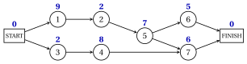
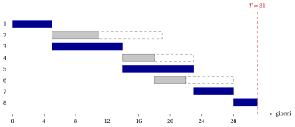
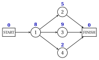

# Esercizi · Gestione dei progetti

**Esercizi · Capitolo 9** · ogni soluzione si apre con un clic · [:material-book-open-variant: Capitolo 9: Gestione dei progetti](../gestione-dei-progetti/project-management/index.md) · [:material-file-pdf-box: Eserciziario, volume 5 (PDF)](../pdf/esercizi-5-gestione-dei-progetti.pdf)

!!! formula "Regole usate in questi esercizi"

    Le definizioni e il metodo del capitolo [«Gestione dei progetti»](../gestione-dei-progetti/project-management/index.md), per un progetto con attività $1,2,\dots,n$, durate $d_j>0$ e predecessori immediati.

    - **(P1)** <strong>Rete delle attività.</strong> Nodi $0$ (START), $1,2,\dots,n$ e $n+1$ (FINISH), con $d_0=d_{n+1}=0$; un arco $(i,j)$ per ogni precedenza, $(0,j)$ per ogni attività senza predecessori immediati, $(j,n+1)$ per ogni attività senza successori. L'arco $(i,j)$ ha lunghezza $d_i$.

    - **(P2)** <strong>Ordine topologico.</strong> Togliere ripetutamente il nodo senza archi entranti di indice minimo; se tutti i nodi rimasti hanno archi entranti, le precedenze contengono un ciclo.

    - **(P3)** <strong>Passata in avanti</strong>, in ordine topologico: $\mathit{ES}_0=0$, $\mathit{ES}_j=\max_{(i,j) \in A} \mathit{EF}_i$, $\mathit{EF}_j=\mathit{ES}_j+d_j$; la durata minima del progetto è $T=\mathit{ES}_{n+1}$.

    - **(P4)** <strong>Passata all'indietro</strong>, in ordine inverso: $\mathit{LF}_{n+1}=T$, $\mathit{LF}_j=\min_{(j,k) \in A} \mathit{LS}_k$, $\mathit{LS}_j=\mathit{LF}_j-d_j$. Scorte $\mathit{TS}_j=\mathit{LS}_j-\mathit{ES}_j$ e $\mathit{FS}_j=\min_{(j,k) \in A} \mathit{ES}_k-\mathit{EF}_j$; l'arco $(i,j)$ è stretto se $\mathit{ES}_j=\mathit{EF}_i$, e i cammini critici sono i cammini da START a FINISH fatti di archi stretti.

    - **(P5)** <strong>Variazioni e LP.</strong> Se $d_j$ cresce di $\delta$, $T'=T+\max\{0,\delta-\mathit{TS}_j\}$; se diminuisce di $\delta$, $T-\delta \le T' \le T$, con $T'=T$ quando un cammino critico evita $j$. Il modello $\mathrm{PD}$ è $\min\{t_{n+1}-t_0 : t_j-t_i \ge d_i,\ (i,j) \in A\}$, e il suo duale invia un'unità di flusso da START a FINISH, massimizzando $\sum d_i x_{ij}$.

!!! esercizio "Esercizio 9.1: La passata in avanti e la passata all'indietro"

    !!! esercizio "Esercizio"

        Un progetto ha $7$ attività, numerate $1,2,\dots,7$, con i predecessori immediati e le durate (in giorni) della tabella.

        
<table>
        <tr>
        <th>attività \(j\)</th>
        <th>predecessori immediati</th>
        <th>\(d_j\)</th>
        </tr>
        <tr>
        <td>\(1\)</td>
        <td>—</td>
        <td>\(9\) giorni</td>
        </tr>
        <tr>
        <td>\(2\)</td>
        <td>\(1\)</td>
        <td>\(2\) giorni</td>
        </tr>
        <tr>
        <td>\(3\)</td>
        <td>—</td>
        <td>\(2\) giorni</td>
        </tr>
        <tr>
        <td>\(4\)</td>
        <td>\(3\)</td>
        <td>\(8\) giorni</td>
        </tr>
        <tr>
        <td>\(5\)</td>
        <td>\(2\)</td>
        <td>\(7\) giorni</td>
        </tr>
        <tr>
        <td>\(6\)</td>
        <td>\(5\)</td>
        <td>\(5\) giorni</td>
        </tr>
        <tr>
        <td>\(7\)</td>
        <td>\(4\), \(5\)</td>
        <td>\(6\) giorni</td>
        </tr>
        </table>

    **Domande**

    1. Disegnare la rete delle attività, con il nodo START $0$ e il nodo FINISH $8$, e scriverne l'ordine topologico (P2).

    2. Eseguire la passata in avanti: dare $\mathit{ES}_j$ ed $\mathit{EF}_j$ per ogni nodo e la durata minima del progetto $T$.

    3. Eseguire la passata all'indietro: dare $\mathit{LF}_j$ e $\mathit{LS}_j$ per ogni nodo.

    4. Trovare il cammino critico e verificare che la sua lunghezza è $T$.

??? soluzione "Soluzione"

    Usiamo le regole (P1)–(P5) del riquadro all'inizio di questi esercizi.

    1. Le attività $1$ e $3$ non hanno predecessori immediati e sono collegate a START; le attività $6$ e $7$ non hanno successori ed entrano in FINISH. Le durate sono scritte sopra i nodi:

        { .fig loading=lazy  }

        Ogni attività ha predecessori immediati di indice minore, quindi l'ordine topologico è $0,1,2,3,4,5,6,7,8$.

    2. Ogni riga elabora un nodo: le fini al più presto dei suoi predecessori immediati (il massimo in grassetto), poi $\mathit{ES}_j$ ed $\mathit{EF}_j$:

        
<table>
        <tr>
        <th>nodo \(j\)</th>
        <th>\(d_j\)</th>
        <th>\(\mathit{EF}_i\) dei predecessori (\(i\))</th>
        <th>\(\mathit{ES}_j\)</th>
        <th>\(\mathit{EF}_j\)</th>
        </tr>
        <tr>
        <td>\(0\)</td>
        <td>\(0\)</td>
        <td>—</td>
        <td>\(0\)</td>
        <td>\(0\)</td>
        </tr>
        <tr>
        <td>\(1\)</td>
        <td>\(9\)</td>
        <td>\(\mathbf{0}\) (\(0\))</td>
        <td>\(0\)</td>
        <td>\(9\)</td>
        </tr>
        <tr>
        <td>\(2\)</td>
        <td>\(2\)</td>
        <td>\(\mathbf{9}\) (\(1\))</td>
        <td>\(9\)</td>
        <td>\(11\)</td>
        </tr>
        <tr>
        <td>\(3\)</td>
        <td>\(2\)</td>
        <td>\(\mathbf{0}\) (\(0\))</td>
        <td>\(0\)</td>
        <td>\(2\)</td>
        </tr>
        <tr>
        <td>\(4\)</td>
        <td>\(8\)</td>
        <td>\(\mathbf{2}\) (\(3\))</td>
        <td>\(2\)</td>
        <td>\(10\)</td>
        </tr>
        <tr>
        <td>\(5\)</td>
        <td>\(7\)</td>
        <td>\(\mathbf{11}\) (\(2\))</td>
        <td>\(11\)</td>
        <td>\(18\)</td>
        </tr>
        <tr>
        <td>\(6\)</td>
        <td>\(5\)</td>
        <td>\(\mathbf{18}\) (\(5\))</td>
        <td>\(18\)</td>
        <td>\(23\)</td>
        </tr>
        <tr>
        <td>\(7\)</td>
        <td>\(6\)</td>
        <td>\(10\) (\(4\)), \(\mathbf{18}\) (\(5\))</td>
        <td>\(18\)</td>
        <td>\(24\)</td>
        </tr>
        <tr>
        <td>\(8\)</td>
        <td>\(0\)</td>
        <td>\(23\) (\(6\)), \(\mathbf{24}\) (\(7\))</td>
        <td>\(24\)</td>
        <td>\(24\)</td>
        </tr>
        </table>

        La durata minima del progetto è $T=\mathit{ES}_{8}=24$ giorni.

    3. Nell'ordine inverso ogni riga riporta gli inizi al più tardi dei successori immediati (il minimo in grassetto), poi $\mathit{LF}_j$ e $\mathit{LS}_j$:

        
<table>
        <tr>
        <th>nodo \(j\)</th>
        <th>\(d_j\)</th>
        <th>\(\mathit{LS}_k\) dei successori (\(k\))</th>
        <th>\(\mathit{LF}_j\)</th>
        <th>\(\mathit{LS}_j\)</th>
        </tr>
        <tr>
        <td>\(8\)</td>
        <td>\(0\)</td>
        <td>—</td>
        <td>\(24\)</td>
        <td>\(24\)</td>
        </tr>
        <tr>
        <td>\(7\)</td>
        <td>\(6\)</td>
        <td>\(\mathbf{24}\) (\(8\))</td>
        <td>\(24\)</td>
        <td>\(18\)</td>
        </tr>
        <tr>
        <td>\(6\)</td>
        <td>\(5\)</td>
        <td>\(\mathbf{24}\) (\(8\))</td>
        <td>\(24\)</td>
        <td>\(19\)</td>
        </tr>
        <tr>
        <td>\(5\)</td>
        <td>\(7\)</td>
        <td>\(19\) (\(6\)), \(\mathbf{18}\) (\(7\))</td>
        <td>\(18\)</td>
        <td>\(11\)</td>
        </tr>
        <tr>
        <td>\(4\)</td>
        <td>\(8\)</td>
        <td>\(\mathbf{18}\) (\(7\))</td>
        <td>\(18\)</td>
        <td>\(10\)</td>
        </tr>
        <tr>
        <td>\(3\)</td>
        <td>\(2\)</td>
        <td>\(\mathbf{10}\) (\(4\))</td>
        <td>\(10\)</td>
        <td>\(8\)</td>
        </tr>
        <tr>
        <td>\(2\)</td>
        <td>\(2\)</td>
        <td>\(\mathbf{11}\) (\(5\))</td>
        <td>\(11\)</td>
        <td>\(9\)</td>
        </tr>
        <tr>
        <td>\(1\)</td>
        <td>\(9\)</td>
        <td>\(\mathbf{9}\) (\(2\))</td>
        <td>\(9\)</td>
        <td>\(0\)</td>
        </tr>
        <tr>
        <td>\(0\)</td>
        <td>\(0\)</td>
        <td>\(\mathbf{0}\) (\(1\)), \(8\) (\(3\))</td>
        <td>\(0\)</td>
        <td>\(0\)</td>
        </tr>
        </table>

        La passata termina con $\mathit{LS}_0=0$.

    4. Gli archi stretti a partire da START arrivano a FINISH lungo un solo cammino, in blu:

        { .fig loading=lazy  }

        Il cammino critico è $\text{START},\allowbreak 1,\allowbreak 2,\allowbreak 5,\allowbreak 7,\allowbreak \text{FINISH}$, di lunghezza $9+2+7+6=24=T$.

    !!! chiave ""

        La passata in avanti dà $T=24$, la passata all'indietro termina con $\mathit{LS}_0=0$, e il cammino critico è $\text{START},\allowbreak 1,\allowbreak 2,\allowbreak 5,\allowbreak 7,\allowbreak \text{FINISH}$.

!!! esercizio "Esercizio 9.2: Scorte e diagramma di Gantt"

    !!! esercizio "Esercizio"

        Un progetto ha $8$ attività, numerate $1,2,\dots,8$, con i predecessori immediati e le durate (in giorni) della tabella.

        
<table>
        <tr>
        <th>attività \(j\)</th>
        <th>predecessori immediati</th>
        <th>\(d_j\)</th>
        </tr>
        <tr>
        <td>\(1\)</td>
        <td>—</td>
        <td>\(5\) giorni</td>
        </tr>
        <tr>
        <td>\(2\)</td>
        <td>\(1\)</td>
        <td>\(6\) giorni</td>
        </tr>
        <tr>
        <td>\(3\)</td>
        <td>\(1\)</td>
        <td>\(9\) giorni</td>
        </tr>
        <tr>
        <td>\(4\)</td>
        <td>\(2\), \(3\)</td>
        <td>\(4\) giorni</td>
        </tr>
        <tr>
        <td>\(5\)</td>
        <td>\(3\)</td>
        <td>\(9\) giorni</td>
        </tr>
        <tr>
        <td>\(6\)</td>
        <td>\(4\)</td>
        <td>\(4\) giorni</td>
        </tr>
        <tr>
        <td>\(7\)</td>
        <td>\(4\), \(5\)</td>
        <td>\(5\) giorni</td>
        </tr>
        <tr>
        <td>\(8\)</td>
        <td>\(6\), \(7\)</td>
        <td>\(3\) giorni</td>
        </tr>
        </table>

    **Domande**

    1. Calcolare i tempi di inizio e di fine al più presto e al più tardi di tutte le attività, e la durata minima del progetto $T$.

    2. Calcolare la scorta totale e la scorta libera di ogni attività. Quali attività sono critiche? Scrivere il cammino critico.

    3. Di quanti giorni si può ritardare l'attività $2$ senza ritardare il progetto? E senza spostare l'inizio al più presto di nessun'altra attività? Quali attività si spostano se la si ritarda di $\mathit{TS}_{2}$ giorni?

    4. Disegnare il diagramma di Gantt del calendario al più presto, con le scorte totali.

??? soluzione "Soluzione"

    Usiamo le regole (P1)–(P5) del riquadro all'inizio di questi esercizi.

    1. La passata in avanti nell'ordine topologico $0,1,2,3,4,5,6,7,8,9$ e la passata all'indietro nell'ordine inverso danno:

        
<table>
        <tr>
        <th>\(j\)</th>
        <th>\(d_j\)</th>
        <th>\(\mathit{ES}_j\)</th>
        <th>\(\mathit{EF}_j\)</th>
        <th>\(\mathit{LS}_j\)</th>
        <th>\(\mathit{LF}_j\)</th>
        <th>\(\mathit{TS}_j\)</th>
        <th>\(\mathit{FS}_j\)</th>
        <th>critica</th>
        </tr>
        <tr>
        <td>\(1\)</td>
        <td>\(5\)</td>
        <td>\(0\)</td>
        <td>\(5\)</td>
        <td>\(0\)</td>
        <td>\(5\)</td>
        <td>\(0\)</td>
        <td>\(0\)</td>
        <td>sì</td>
        </tr>
        <tr>
        <td>\(2\)</td>
        <td>\(6\)</td>
        <td>\(5\)</td>
        <td>\(11\)</td>
        <td>\(13\)</td>
        <td>\(19\)</td>
        <td>\(8\)</td>
        <td>\(3\)</td>
        <td></td>
        </tr>
        <tr>
        <td>\(3\)</td>
        <td>\(9\)</td>
        <td>\(5\)</td>
        <td>\(14\)</td>
        <td>\(5\)</td>
        <td>\(14\)</td>
        <td>\(0\)</td>
        <td>\(0\)</td>
        <td>sì</td>
        </tr>
        <tr>
        <td>\(4\)</td>
        <td>\(4\)</td>
        <td>\(14\)</td>
        <td>\(18\)</td>
        <td>\(19\)</td>
        <td>\(23\)</td>
        <td>\(5\)</td>
        <td>\(0\)</td>
        <td></td>
        </tr>
        <tr>
        <td>\(5\)</td>
        <td>\(9\)</td>
        <td>\(14\)</td>
        <td>\(23\)</td>
        <td>\(14\)</td>
        <td>\(23\)</td>
        <td>\(0\)</td>
        <td>\(0\)</td>
        <td>sì</td>
        </tr>
        <tr>
        <td>\(6\)</td>
        <td>\(4\)</td>
        <td>\(18\)</td>
        <td>\(22\)</td>
        <td>\(24\)</td>
        <td>\(28\)</td>
        <td>\(6\)</td>
        <td>\(6\)</td>
        <td></td>
        </tr>
        <tr>
        <td>\(7\)</td>
        <td>\(5\)</td>
        <td>\(23\)</td>
        <td>\(28\)</td>
        <td>\(23\)</td>
        <td>\(28\)</td>
        <td>\(0\)</td>
        <td>\(0\)</td>
        <td>sì</td>
        </tr>
        <tr>
        <td>\(8\)</td>
        <td>\(3\)</td>
        <td>\(28\)</td>
        <td>\(31\)</td>
        <td>\(28\)</td>
        <td>\(31\)</td>
        <td>\(0\)</td>
        <td>\(0\)</td>
        <td>sì</td>
        </tr>
        </table>

        e $T=\mathit{ES}_{9}=31$ giorni.

    2. Le due colonne delle scorte nella tabella sono $\mathit{TS}_j=\mathit{LS}_j-\mathit{ES}_j$ e $\mathit{FS}_j=\min \mathit{ES}_k-\mathit{EF}_j$. Le attività critiche, con $\mathit{TS}_j=0$, sono $1$, $3$, $5$, $7$ e $8$, e gli archi stretti a partire da START arrivano a FINISH solo lungo $\text{START},\allowbreak 1,\allowbreak 3,\allowbreak 5,\allowbreak 7,\allowbreak 8,\allowbreak \text{FINISH}$, il cammino critico.

    3. L'attività $2$ ha $\mathit{TS}_{2}=8$ e $\mathit{FS}_{2}=3$. Può iniziare con $8$ giorni di ritardo senza ritardare il progetto, ma solo con $3$ giorni di ritardo senza spostare nessun'altra attività. Con un ritardo di $8$ giorni gli inizi al più presto delle attività $4$ e $6$ si spostano di $5$ giorni, e FINISH resta a $T=31$.

    4. Barre da $\mathit{ES}_j$ a $\mathit{EF}_j$ (attività critiche in blu), riquadri tratteggiati da $\mathit{EF}_j$ a $\mathit{LF}_j$:

        { .fig loading=lazy  }

        Le barre blu si susseguono senza interruzioni dal giorno $0$ al giorno $31$.

    !!! chiave ""

        $T=31$; il cammino critico è $\text{START},\allowbreak 1,\allowbreak 3,\allowbreak 5,\allowbreak 7,\allowbreak 8,\allowbreak \text{FINISH}$. L'attività $2$ può assorbire $8$ giorni di ritardo, ma solo $3$ senza spostare altre attività.

!!! esercizio "Esercizio 9.3: Ordine topologico e precedenze incoerenti"

    !!! esercizio "Esercizio"

        Un progetto ha $7$ attività, numerate $1,2,\dots,7$, con i predecessori immediati e le durate (in giorni) della tabella.

        
<table>
        <tr>
        <th>attività \(j\)</th>
        <th>predecessori immediati</th>
        <th>\(d_j\)</th>
        </tr>
        <tr>
        <td>\(1\)</td>
        <td>\(6\), \(7\)</td>
        <td>\(2\) giorni</td>
        </tr>
        <tr>
        <td>\(2\)</td>
        <td>\(1\), \(4\)</td>
        <td>\(6\) giorni</td>
        </tr>
        <tr>
        <td>\(3\)</td>
        <td>—</td>
        <td>\(4\) giorni</td>
        </tr>
        <tr>
        <td>\(4\)</td>
        <td>\(6\)</td>
        <td>\(8\) giorni</td>
        </tr>
        <tr>
        <td>\(5\)</td>
        <td>—</td>
        <td>\(7\) giorni</td>
        </tr>
        <tr>
        <td>\(6\)</td>
        <td>\(5\)</td>
        <td>\(8\) giorni</td>
        </tr>
        <tr>
        <td>\(7\)</td>
        <td>\(3\), \(5\)</td>
        <td>\(5\) giorni</td>
        </tr>
        </table>

    **Domande**

    1. Trovare l'ordine topologico della rete delle attività con (P2), indicando a ogni passo i nodi senza archi entranti.

    2. Eseguire la passata in avanti e dare la durata minima del progetto $T$ e il cammino critico.

    3. Chi pianifica aggiunge la precedenza «l'attività $2$ deve terminare prima che inizi l'attività $3$». Eseguire (P2) sulla nuova rete, trovare un ciclo orientato e dimostrare che il nuovo progetto non ha alcun calendario.

??? soluzione "Soluzione"

    Usiamo le regole (P1)–(P5) del riquadro all'inizio di questi esercizi.

    1. La rete delle attività, con le durate sopra i nodi:

        { .fig loading=lazy  }

        A ogni passo si toglie il nodo di indice minimo fra i nodi senza archi entranti:

        
<table>
        <tr>
        <th>passo</th>
        <th>nodi senza archi entranti</th>
        <th>tolto</th>
        </tr>
        <tr>
        <td>\(1\)</td>
        <td>\(0\)</td>
        <td>\(0\)</td>
        </tr>
        <tr>
        <td>\(2\)</td>
        <td>\(3\), \(5\)</td>
        <td>\(3\)</td>
        </tr>
        <tr>
        <td>\(3\)</td>
        <td>\(5\)</td>
        <td>\(5\)</td>
        </tr>
        <tr>
        <td>\(4\)</td>
        <td>\(6\), \(7\)</td>
        <td>\(6\)</td>
        </tr>
        <tr>
        <td>\(5\)</td>
        <td>\(4\), \(7\)</td>
        <td>\(4\)</td>
        </tr>
        <tr>
        <td>\(6\)</td>
        <td>\(7\)</td>
        <td>\(7\)</td>
        </tr>
        <tr>
        <td>\(7\)</td>
        <td>\(1\)</td>
        <td>\(1\)</td>
        </tr>
        <tr>
        <td>\(8\)</td>
        <td>\(2\)</td>
        <td>\(2\)</td>
        </tr>
        <tr>
        <td>\(9\)</td>
        <td>\(8\)</td>
        <td>\(8\)</td>
        </tr>
        </table>

        L'ordine topologico è $0,3,5,6,4,7,1,2,8$: le attività non sono numerate in quest'ordine.

    2. Ogni riga elabora un nodo, in ordine topologico:

        
<table>
        <tr>
        <th>nodo \(j\)</th>
        <th>\(d_j\)</th>
        <th>\(\mathit{EF}_i\) dei predecessori (\(i\))</th>
        <th>\(\mathit{ES}_j\)</th>
        <th>\(\mathit{EF}_j\)</th>
        </tr>
        <tr>
        <td>\(0\)</td>
        <td>\(0\)</td>
        <td>—</td>
        <td>\(0\)</td>
        <td>\(0\)</td>
        </tr>
        <tr>
        <td>\(3\)</td>
        <td>\(4\)</td>
        <td>\(\mathbf{0}\) (\(0\))</td>
        <td>\(0\)</td>
        <td>\(4\)</td>
        </tr>
        <tr>
        <td>\(5\)</td>
        <td>\(7\)</td>
        <td>\(\mathbf{0}\) (\(0\))</td>
        <td>\(0\)</td>
        <td>\(7\)</td>
        </tr>
        <tr>
        <td>\(6\)</td>
        <td>\(8\)</td>
        <td>\(\mathbf{7}\) (\(5\))</td>
        <td>\(7\)</td>
        <td>\(15\)</td>
        </tr>
        <tr>
        <td>\(4\)</td>
        <td>\(8\)</td>
        <td>\(\mathbf{15}\) (\(6\))</td>
        <td>\(15\)</td>
        <td>\(23\)</td>
        </tr>
        <tr>
        <td>\(7\)</td>
        <td>\(5\)</td>
        <td>\(4\) (\(3\)), \(\mathbf{7}\) (\(5\))</td>
        <td>\(7\)</td>
        <td>\(12\)</td>
        </tr>
        <tr>
        <td>\(1\)</td>
        <td>\(2\)</td>
        <td>\(\mathbf{15}\) (\(6\)), \(12\) (\(7\))</td>
        <td>\(15\)</td>
        <td>\(17\)</td>
        </tr>
        <tr>
        <td>\(2\)</td>
        <td>\(6\)</td>
        <td>\(17\) (\(1\)), \(\mathbf{23}\) (\(4\))</td>
        <td>\(23\)</td>
        <td>\(29\)</td>
        </tr>
        <tr>
        <td>\(8\)</td>
        <td>\(0\)</td>
        <td>\(\mathbf{29}\) (\(2\))</td>
        <td>\(29\)</td>
        <td>\(29\)</td>
        </tr>
        </table>

        Quindi $T=\mathit{ES}_{8}=29$ giorni, e gli archi stretti danno il cammino critico $\text{START},\allowbreak 5,\allowbreak 6,\allowbreak 4,\allowbreak 2,\allowbreak \text{FINISH}$.

    3. Con il nuovo arco $(2,3)$ la regola (P2) procede così:

        
<table>
        <tr>
        <th>passo</th>
        <th>nodi senza archi entranti</th>
        <th>tolto</th>
        </tr>
        <tr>
        <td>\(1\)</td>
        <td>\(0\), \(8\)</td>
        <td>\(0\)</td>
        </tr>
        <tr>
        <td>\(2\)</td>
        <td>\(5\), \(8\)</td>
        <td>\(5\)</td>
        </tr>
        <tr>
        <td>\(3\)</td>
        <td>\(6\), \(8\)</td>
        <td>\(6\)</td>
        </tr>
        <tr>
        <td>\(4\)</td>
        <td>\(4\), \(8\)</td>
        <td>\(4\)</td>
        </tr>
        <tr>
        <td>\(5\)</td>
        <td>\(8\)</td>
        <td>\(8\)</td>
        </tr>
        <tr>
        <td>\(6\)</td>
        <td>nessuno</td>
        <td>—</td>
        </tr>
        </table>

        Si ferma con i nodi $1$, $2$, $3$ e $7$ rimasti, tutti con archi entranti. Risalendo all'indietro gli archi entranti a partire dal nodo $1$ troviamo il ciclo $1,2,3,7,1$. Sommando i vincoli $t_j \ge t_i+d_i$ dei suoi archi, i tempi di inizio si elidono:

        $$
        0 \ge d_{1}+d_{2}+d_{3}+d_{7}=2+6+4+5=17,
        $$

        una contraddizione: le nuove precedenze non ammettono alcun calendario, e il piano va corretto.

    !!! chiave ""

        L'ordine topologico $0,3,5,6,4,7,1,2,8$ dà $T=29$. La precedenza $(2,3)$ chiude il ciclo $1,2,3,7,1$, e non esiste alcun calendario.

!!! esercizio "Esercizio 9.4: Due cammini critici e variazioni delle durate"

    !!! esercizio "Esercizio"

        Un progetto ha $8$ attività, numerate $1,2,\dots,8$, con i predecessori immediati e le durate (in giorni) della tabella.

        
<table>
        <tr>
        <th>attività \(j\)</th>
        <th>predecessori immediati</th>
        <th>\(d_j\)</th>
        </tr>
        <tr>
        <td>\(1\)</td>
        <td>—</td>
        <td>\(4\) giorni</td>
        </tr>
        <tr>
        <td>\(2\)</td>
        <td>\(1\)</td>
        <td>\(7\) giorni</td>
        </tr>
        <tr>
        <td>\(3\)</td>
        <td>—</td>
        <td>\(6\) giorni</td>
        </tr>
        <tr>
        <td>\(4\)</td>
        <td>\(2\), \(3\)</td>
        <td>\(5\) giorni</td>
        </tr>
        <tr>
        <td>\(5\)</td>
        <td>\(2\)</td>
        <td>\(5\) giorni</td>
        </tr>
        <tr>
        <td>\(6\)</td>
        <td>\(4\)</td>
        <td>\(6\) giorni</td>
        </tr>
        <tr>
        <td>\(7\)</td>
        <td>\(5\)</td>
        <td>\(6\) giorni</td>
        </tr>
        <tr>
        <td>\(8\)</td>
        <td>\(5\)</td>
        <td>\(3\) giorni</td>
        </tr>
        </table>

    **Domande**

    1. Calcolare i tempi al più presto e al più tardi, $T$ e tutti i cammini critici.

    2. Senza eseguire di nuovo il metodo, che cosa si può dire della durata minima del progetto se (i) $d_{4}$ diminuisce di $1$; (ii) $d_{1}$ diminuisce di $1$; (iii) $d_{3}$ aumenta di $7$?

    3. Verificare le tre risposte eseguendo di nuovo la passata in avanti, e dare i nuovi cammini critici.

??? soluzione "Soluzione"

    Usiamo le regole (P1)–(P5) del riquadro all'inizio di questi esercizi.

    1. La passata in avanti e quella all'indietro danno:

        
<table>
        <tr>
        <th>\(j\)</th>
        <th>\(d_j\)</th>
        <th>\(\mathit{ES}_j\)</th>
        <th>\(\mathit{EF}_j\)</th>
        <th>\(\mathit{LS}_j\)</th>
        <th>\(\mathit{LF}_j\)</th>
        <th>\(\mathit{TS}_j\)</th>
        <th>\(\mathit{FS}_j\)</th>
        <th>critica</th>
        </tr>
        <tr>
        <td>\(1\)</td>
        <td>\(4\)</td>
        <td>\(0\)</td>
        <td>\(4\)</td>
        <td>\(0\)</td>
        <td>\(4\)</td>
        <td>\(0\)</td>
        <td>\(0\)</td>
        <td>sì</td>
        </tr>
        <tr>
        <td>\(2\)</td>
        <td>\(7\)</td>
        <td>\(4\)</td>
        <td>\(11\)</td>
        <td>\(4\)</td>
        <td>\(11\)</td>
        <td>\(0\)</td>
        <td>\(0\)</td>
        <td>sì</td>
        </tr>
        <tr>
        <td>\(3\)</td>
        <td>\(6\)</td>
        <td>\(0\)</td>
        <td>\(6\)</td>
        <td>\(5\)</td>
        <td>\(11\)</td>
        <td>\(5\)</td>
        <td>\(5\)</td>
        <td></td>
        </tr>
        <tr>
        <td>\(4\)</td>
        <td>\(5\)</td>
        <td>\(11\)</td>
        <td>\(16\)</td>
        <td>\(11\)</td>
        <td>\(16\)</td>
        <td>\(0\)</td>
        <td>\(0\)</td>
        <td>sì</td>
        </tr>
        <tr>
        <td>\(5\)</td>
        <td>\(5\)</td>
        <td>\(11\)</td>
        <td>\(16\)</td>
        <td>\(11\)</td>
        <td>\(16\)</td>
        <td>\(0\)</td>
        <td>\(0\)</td>
        <td>sì</td>
        </tr>
        <tr>
        <td>\(6\)</td>
        <td>\(6\)</td>
        <td>\(16\)</td>
        <td>\(22\)</td>
        <td>\(16\)</td>
        <td>\(22\)</td>
        <td>\(0\)</td>
        <td>\(0\)</td>
        <td>sì</td>
        </tr>
        <tr>
        <td>\(7\)</td>
        <td>\(6\)</td>
        <td>\(16\)</td>
        <td>\(22\)</td>
        <td>\(16\)</td>
        <td>\(22\)</td>
        <td>\(0\)</td>
        <td>\(0\)</td>
        <td>sì</td>
        </tr>
        <tr>
        <td>\(8\)</td>
        <td>\(3\)</td>
        <td>\(16\)</td>
        <td>\(19\)</td>
        <td>\(19\)</td>
        <td>\(22\)</td>
        <td>\(3\)</td>
        <td>\(3\)</td>
        <td></td>
        </tr>
        </table>

        quindi $T=22$. Gli archi stretti a partire da START arrivano a FINISH lungo due cammini, in blu: $\text{START},\allowbreak 1,\allowbreak 2,\allowbreak 4,\allowbreak 6,\allowbreak \text{FINISH}$ e $\text{START},\allowbreak 1,\allowbreak 2,\allowbreak 5,\allowbreak 7,\allowbreak \text{FINISH}$.

        { .fig loading=lazy  }

    2. (i) L'attività $4$ sta solo su $\text{START},\allowbreak 1,\allowbreak 2,\allowbreak 4,\allowbreak 6,\allowbreak \text{FINISH}$; l'altro cammino critico la evita, quindi per (P5) $T'=T=22$. (ii) L'attività $1$ sta su entrambi i cammini critici: per (P5), $21 \le T' \le 22$, ed entrambi i cammini critici si accorciano di $1$ giorno. (iii) L'attività $3$ ha $\mathit{TS}_{3}=5$, quindi $T'=T+\max\{0,7-5\}=24$.

    3. Eseguendo il metodo del cammino critico su ciascun progetto modificato:

        
<table>
        <tr>
        <th>variazione</th>
        <th>\(\mathit{TS}_j\)</th>
        <th>nuovo \(T\)</th>
        <th>cammini critici dopo la variazione</th>
        </tr>
        <tr>
        <td>\(d_4=5 \to 4\)</td>
        <td>\(0\)</td>
        <td>\(22\)</td>
        <td>\(\text{START},1,2,5,7,\text{FINISH}\)</td>
        </tr>
        <tr>
        <td>\(d_1=4 \to 3\)</td>
        <td>\(0\)</td>
        <td>\(21\)</td>
        <td>\(\text{START},1,2,4,6,\text{FINISH}\); \(\text{START},1,2,5,7,\text{FINISH}\)</td>
        </tr>
        <tr>
        <td>\(d_3=6 \to 13\)</td>
        <td>\(5\)</td>
        <td>\(24\)</td>
        <td>\(\text{START},3,4,6,\text{FINISH}\)</td>
        </tr>
        </table>

        In (ii) ogni cammino che evita l'attività $1$ è lungo al più $21$ giorni, quindi il limite inferiore è raggiunto.

    !!! chiave ""

        Con due cammini critici, accorciare un'attività che sta su uno solo di essi non accorcia il progetto; accorciare l'attività comune $1$ sì, e un ritardo di $\mathit{TS}_{3}+2$ sull'attività $3$ ritarda il progetto di $2$ giorni.

!!! esercizio "Esercizio 9.5: Il modello LP e il suo duale"

    !!! esercizio "Esercizio"

        Un progetto ha $4$ attività, numerate $1,2,\dots,4$, con i predecessori immediati e le durate (in giorni) della tabella.

        
<table>
        <tr>
        <th>attività \(j\)</th>
        <th>predecessori immediati</th>
        <th>\(d_j\)</th>
        </tr>
        <tr>
        <td>\(1\)</td>
        <td>—</td>
        <td>\(8\) giorni</td>
        </tr>
        <tr>
        <td>\(2\)</td>
        <td>\(1\)</td>
        <td>\(5\) giorni</td>
        </tr>
        <tr>
        <td>\(3\)</td>
        <td>\(1\)</td>
        <td>\(9\) giorni</td>
        </tr>
        <tr>
        <td>\(4\)</td>
        <td>\(1\)</td>
        <td>\(2\) giorni</td>
        </tr>
        </table>

    **Domande**

    1. Scrivere il modello $\mathrm{PD}$ del progetto, con una variabile $t_j$ per nodo.

    2. Scrivere il suo duale $D(\mathrm{PD})$, con una variabile $x_{ij}$ per arco.

    3. Calcolare $\mathit{ES}$ e $\mathit{LS}$, mostrare che sono entrambi ottimi per il modello $\mathrm{PD}$, e dare una soluzione ottima di $D(\mathrm{PD})$. Dimostrare l'ottimalità con la dualità debole.

    4. Quali vincoli del modello $\mathrm{PD}$ valgono con l'uguaglianza in ogni soluzione ottima?

??? soluzione "Soluzione"

    Usiamo le regole (P1)–(P5) del riquadro all'inizio di questi esercizi.

    1. La rete delle attività, con le durate sopra i nodi, ha gli archi $(0,1)$, $(1,2)$, $(1,3)$, $(1,4)$, $(2,5)$, $(3,5)$, $(4,5)$:

        { .fig loading=lazy  }

        C'è un vincolo $t_j-t_i \ge d_i$ per arco, e le variabili sono libere:

        $$
        \small
        \setlength{\arraycolsep}{3pt}
        \begin{array}{rrrrrrrcr}
        \min & -t_{0} &  &  &  &  & +t_{5} & & \\
        \text{soggetto a} & -t_{0} & +t_{1} &  &  &  &  & \ge & 0 \\
        &  & -t_{1} & +t_{2} &  &  &  & \ge & 8 \\
        &  & -t_{1} &  & +t_{3} &  &  & \ge & 8 \\
        &  & -t_{1} &  &  & +t_{4} &  & \ge & 8 \\
        &  &  & -t_{2} &  &  & +t_{5} & \ge & 5 \\
        &  &  &  & -t_{3} &  & +t_{5} & \ge & 9 \\
        &  &  &  &  & -t_{4} & +t_{5} & \ge & 2 \\
        & t_{0}, & t_{1}, & t_{2}, & t_{3}, & t_{4}, & t_{5} & \in & \R
        \end{array}
        $$

    2. C'è una variabile $x_{ij} \ge 0$ per arco e un vincolo di conservazione del flusso per nodo, con $b_0=1$ e $b_{5}=-1$; gli archi uscenti da START hanno lunghezza $d_0=0$:

        $$
        \small
        \setlength{\arraycolsep}{2.5pt}
        \begin{array}{rrrrrrrrcr}
        \max &  & 8\,x_{12} & +8\,x_{13} & +8\,x_{14} & +5\,x_{25} & +9\,x_{35} & +2\,x_{45} & & \\
        \text{soggetto a} & x_{01} &  &  &  &  &  &  & = & 1 \\
        & -x_{01} & +x_{12} & +x_{13} & +x_{14} &  &  &  & = & 0 \\
        &  & -x_{12} &  &  & +x_{25} &  &  & = & 0 \\
        &  &  & -x_{13} &  &  & +x_{35} &  & = & 0 \\
        &  &  &  & -x_{14} &  &  & +x_{45} & = & 0 \\
        &  &  &  &  & -x_{25} & -x_{35} & -x_{45} & = & -1 \\
        & x_{01}, & x_{12}, & x_{13}, & x_{14}, & x_{25}, & x_{35}, & x_{45} & \ge & 0
        \end{array}
        $$

    3. La passata in avanti e quella all'indietro danno $\mathit{ES}=(0,\,0,\,8,\,8,\,8,\,17)$ e $\mathit{LS}=(0,\,0,\,12,\,8,\,15,\,17)$, entrambi con $t_{5}-t_0=17$. Entrambi soddisfano tutti i vincoli del modello $\mathrm{PD}$, e differiscono sui nodi $2$, $4$: la soluzione ottima del modello $\mathrm{PD}$ non è unica. Il cammino critico è $\text{START},\allowbreak 1,\allowbreak 3,\allowbreak \text{FINISH}$; il suo vettore di incidenza, con $x_{ij}=1$ sugli archi $(0,1)$, $(1,3)$, $(3,5)$ e $0$ altrove, è ammissibile per $D(\mathrm{PD})$ con valore $8+9=17$. Per la dualità debole, una soluzione ammissibile del modello $\mathrm{PD}$ e una soluzione ammissibile del suo duale con lo stesso valore sono entrambe ottime: $z(\mathrm{PD})=z(D(\mathrm{PD}))=17$ (Gurobi conferma entrambi i valori).

    4. I vincoli degli archi del cammino critico: sommandoli, $t_{5}-t_0 \ge 17$, e una soluzione ottima ha $t_{5}-t_0=17$, quindi ciascuno di essi vale con l'uguaglianza. Il vincolo di ogni altro arco non vale con l'uguaglianza per $\mathit{ES}$ o per $\mathit{LS}$, due soluzioni ottime:

        
<table>
        <tr>
        <th>arco \((i,j)\)</th>
        <th>\(d_i\)</th>
        <th>\(\mathit{ES}_j-\mathit{ES}_i\)</th>
        <th>\(\mathit{LS}_j-\mathit{LS}_i\)</th>
        </tr>
        <tr>
        <td>\((1,2)\)</td>
        <td>\(8\)</td>
        <td>\(8\)</td>
        <td>\(12\)</td>
        </tr>
        <tr>
        <td>\((1,4)\)</td>
        <td>\(8\)</td>
        <td>\(8\)</td>
        <td>\(15\)</td>
        </tr>
        <tr>
        <td>\((2,5)\)</td>
        <td>\(5\)</td>
        <td>\(9\)</td>
        <td>\(5\)</td>
        </tr>
        <tr>
        <td>\((4,5)\)</td>
        <td>\(2\)</td>
        <td>\(9\)</td>
        <td>\(2\)</td>
        </tr>
        </table>

        In ogni riga almeno una delle due differenze è maggiore di $d_i$.

    !!! chiave ""

        $z(\mathrm{PD})=z(D(\mathrm{PD}))=17$: $\mathit{ES}$ e $\mathit{LS}$ sono calendari ottimi, e il cammino critico è la soluzione duale ottima.

!!! esercizio "Esercizio 9.6: Dimostrazioni e controesempi"

    !!! esercizio "Esercizio"

        Un progetto ha $7$ attività, numerate $1,2,\dots,7$, con i predecessori immediati e le durate (in giorni) della tabella.

        
<table>
        <tr>
        <th>attività \(j\)</th>
        <th>predecessori immediati</th>
        <th>\(d_j\)</th>
        </tr>
        <tr>
        <td>\(1\)</td>
        <td>—</td>
        <td>\(9\) giorni</td>
        </tr>
        <tr>
        <td>\(2\)</td>
        <td>\(1\)</td>
        <td>\(7\) giorni</td>
        </tr>
        <tr>
        <td>\(3\)</td>
        <td>\(1\)</td>
        <td>\(5\) giorni</td>
        </tr>
        <tr>
        <td>\(4\)</td>
        <td>\(2\), \(3\)</td>
        <td>\(6\) giorni</td>
        </tr>
        <tr>
        <td>\(5\)</td>
        <td>\(3\)</td>
        <td>\(9\) giorni</td>
        </tr>
        <tr>
        <td>\(6\)</td>
        <td>\(4\)</td>
        <td>\(4\) giorni</td>
        </tr>
        <tr>
        <td>\(7\)</td>
        <td>\(4\), \(5\)</td>
        <td>\(9\) giorni</td>
        </tr>
        </table>

    **Domande**

    1. In un progetto, due attività $i$ e $j$ non sono collegate da alcun cammino, $i$ ha già un successore immediato e $j$ un predecessore immediato. Si aggiunge la precedenza «$i$ prima di $j$». Dimostrare che la nuova durata minima del progetto è

        $$
        T'=T+\max\{0,\ \mathit{EF}_i-\mathit{LS}_j\},
        $$

        dove $\mathit{EF}_i$, $\mathit{LS}_j$ e $T$ sono calcolati prima della variazione.

    2. Nel progetto della tabella, calcolare i tempi e usare la formula per le precedenze «$5$ prima di $6$» e «$2$ prima di $3$».

    3. Uno studente afferma: «un cammino da START a FINISH fatto di attività critiche è un cammino critico». Confutare l'affermazione con un progetto di quattro attività.

??? soluzione "Soluzione"

    Usiamo le regole (P1)–(P5) del riquadro all'inizio di questi esercizi.

    1. Si aggiunge un solo arco, $(i,j)$, perché $i$ ha già un successore e $j$ un predecessore, e non si forma alcun ciclo, perché nessun cammino va da $j$ a $i$. Ogni cammino che non usa $(i,j)$ mantiene la sua lunghezza, e il più lungo ha lunghezza $T$.

        - Un cammino nuovo è formato da un cammino da START a $i$, dall'arco $(i,j)$ di lunghezza $d_i$ e da un cammino da $j$ a FINISH. I due tratti non usano $(i,j)$, altrimenti il cammino visiterebbe due volte $i$ o $j$.

        - I tratti più lunghi hanno lunghezze $\mathit{ES}_i$ e $T-\mathit{LS}_j$ (passata in avanti e all'indietro della vecchia rete), quindi il cammino nuovo più lungo ha lunghezza $\mathit{ES}_i+d_i+T-\mathit{LS}_j=T+\mathit{EF}_i-\mathit{LS}_j$.

        - La durata minima del progetto è la lunghezza massima di un cammino da START a FINISH: $T'=\max\{T,\ T+\mathit{EF}_i-\mathit{LS}_j\}$.

    2. I tempi del progetto sono:

        
<table>
        <tr>
        <th>\(j\)</th>
        <th>\(d_j\)</th>
        <th>\(\mathit{ES}_j\)</th>
        <th>\(\mathit{EF}_j\)</th>
        <th>\(\mathit{LS}_j\)</th>
        <th>\(\mathit{LF}_j\)</th>
        <th>\(\mathit{TS}_j\)</th>
        <th>\(\mathit{FS}_j\)</th>
        <th>critica</th>
        </tr>
        <tr>
        <td>\(1\)</td>
        <td>\(9\)</td>
        <td>\(0\)</td>
        <td>\(9\)</td>
        <td>\(0\)</td>
        <td>\(9\)</td>
        <td>\(0\)</td>
        <td>\(0\)</td>
        <td>sì</td>
        </tr>
        <tr>
        <td>\(2\)</td>
        <td>\(7\)</td>
        <td>\(9\)</td>
        <td>\(16\)</td>
        <td>\(10\)</td>
        <td>\(17\)</td>
        <td>\(1\)</td>
        <td>\(0\)</td>
        <td></td>
        </tr>
        <tr>
        <td>\(3\)</td>
        <td>\(5\)</td>
        <td>\(9\)</td>
        <td>\(14\)</td>
        <td>\(9\)</td>
        <td>\(14\)</td>
        <td>\(0\)</td>
        <td>\(0\)</td>
        <td>sì</td>
        </tr>
        <tr>
        <td>\(4\)</td>
        <td>\(6\)</td>
        <td>\(16\)</td>
        <td>\(22\)</td>
        <td>\(17\)</td>
        <td>\(23\)</td>
        <td>\(1\)</td>
        <td>\(0\)</td>
        <td></td>
        </tr>
        <tr>
        <td>\(5\)</td>
        <td>\(9\)</td>
        <td>\(14\)</td>
        <td>\(23\)</td>
        <td>\(14\)</td>
        <td>\(23\)</td>
        <td>\(0\)</td>
        <td>\(0\)</td>
        <td>sì</td>
        </tr>
        <tr>
        <td>\(6\)</td>
        <td>\(4\)</td>
        <td>\(22\)</td>
        <td>\(26\)</td>
        <td>\(28\)</td>
        <td>\(32\)</td>
        <td>\(6\)</td>
        <td>\(6\)</td>
        <td></td>
        </tr>
        <tr>
        <td>\(7\)</td>
        <td>\(9\)</td>
        <td>\(23\)</td>
        <td>\(32\)</td>
        <td>\(23\)</td>
        <td>\(32\)</td>
        <td>\(0\)</td>
        <td>\(0\)</td>
        <td>sì</td>
        </tr>
        </table>

        con $T=32$.

        - «$5$ prima di $6$»: $\mathit{EF}_{5}=23 \le 28=\mathit{LS}_{6}$, quindi $T'=T=32$: l'attività $6$ può dover iniziare dopo $\mathit{ES}_{6}=22$, ma entro la sua scorta.

        - «$2$ prima di $3$»: $\mathit{EF}_{2}=16>9=\mathit{LS}_{3}$, quindi $T'=32+16-9=39$.

        Il metodo del cammino critico eseguito sulle due nuove reti dà gli stessi valori.

    3. Prendiamo le attività $1,2,3,4$ con durate $d_1=1$, $d_2=2$, $d_3=2$, $d_4=1$, dove $1$ precede $3$ e $4$, e $2$ precede $4$:

        { .fig loading=lazy  }

        La passata in avanti dà $\mathit{ES}=(0,0,0,1,2,3)$ per i nodi $0,1,\dots,5$, e $T=3$. I due cammini critici $\text{START},\allowbreak 1,\allowbreak 3,\allowbreak \text{FINISH}$ e $\text{START},\allowbreak 2,\allowbreak 4,\allowbreak \text{FINISH}$ (in blu) contengono tutte le attività, quindi ogni attività è critica. Il cammino $\text{START},\allowbreak 1,\allowbreak 4,\allowbreak \text{FINISH}$ usa solo attività critiche, ma la sua lunghezza è $1+1=2<3$: il suo arco $(1,4)$ non è stretto, $\mathit{EF}_1=1<2=\mathit{ES}_4$.

    !!! chiave ""

        Aggiungere la precedenza «$i$ prima di $j$» ritarda il progetto di $\max\{0,\mathit{EF}_i-\mathit{LS}_j\}$; un cammino di attività critiche è critico solo se i suoi archi sono stretti.
