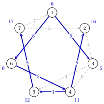
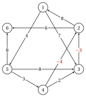
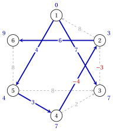
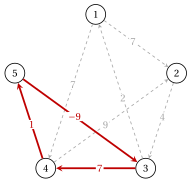
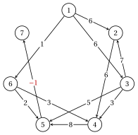
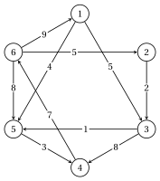
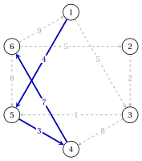

# Esercizi · Cammini minimi

**Esercizi · Capitolo 3** · ogni soluzione si apre con un clic · [:material-book-open-variant: Capitolo 3: Cammini minimi](../alberi-e-cammini/shortest-paths/index.md) · [:material-file-pdf-box: Eserciziario, volume 2 (PDF)](../pdf/esercizi-2-alberi-e-cammini.pdf)

!!! formula "Regole utilizzate in questi esercizi"

    Le definizioni e gli algoritmi del capitolo [«Percorsi più brevi»](../alberi-e-cammini/shortest-paths/index.md), per una grafo $G=(N,A)$ con lunghezze $d_{ij}$, $n=|N|$, $m=|A|$ e sorgente $s=1$.

    - **(S1)** <strong>Dijkstra</strong> ($d_{ij} \ge 0$). Il nodo temporaneo con l'etichetta più piccola diventa permanente (indice più basso sui pareggi); per ogni arco $(i,j)$ con $j$ temporaneo, se $d(i)+d_{ij}<d(j)$ allora $d(j):=d(i)+d_{ij}$ e $\mathit{pred}(j):=i$.

    - **(S2)** <strong>Bellman–Ford.</strong> Passa $k$ calcola

        $$
        d^k(j)=\min\Big\{ d^{k-1}(j),\ \min_{(i,j) \in A} \big(d^{k-1}(i)+d_{ij}\big)\Big\};
        $$

        il predecessore cambia solo se l'etichetta diminuisce strettamente (il più piccolo $i$ nelle legature di valore). Arresta quando $d^k=d^{k-1}$; un cambio passaggio $n$ significa ciclo negativo raggiungibile da $s$.

    - **(S3)** <strong>Ciclo negativo.</strong> Se $d^n(j)<d^{n-1}(j)$, i predecessori leggono all'indietro da $j$, una riga per passare dalla riga $n$, eseguire una passeggiata con archi $n$ che contengono un ciclo negativo.

    - **(S4)** <strong>Grafi aciclici.</strong> Ordine topologico rimuovendo un nodo senza inserire archi (indice più piccolo); i nodi vengono elaborati in questo ordine, ognuno rilassando i propri archi uscenti. Le lunghezze $-d_{ij}$ danno i percorsi più lunghi.

    - **(S5)** <strong>Potenziali.</strong> $\bar{c}_{ij}=d_{ij}-\pi_i+\pi_j$; dalle etichette si ottiene $\pi_i=-d(i)$. Potenziali ammissibili, per cui $\bar{c}_{ij} \ge 0$, e un percorso da $s$ a $t$ formato da archi con costo ridotto nullo certificano che il percorso è minimo, con lunghezza $\pi_s-\pi_t$. Il duale di $\mathrm{SP}(s,t)$ è $\max\{\pi_s-\pi_t : \pi_i-\pi_j \le d_{ij}\}$.

!!! esercizio "Esercizio 3.1: Algoritmo di Dijkstra"

    !!! esercizio "Esercizio"

        Consideriamo il grafo diretto $G=(N,A)$ con $N=\{1,2,\dots,7\}$, gli archi $11$ e le lunghezze $d_{ij}$ della tabella, disegnata sotto; la fonte è $s=1$.

        
<table>
        <tr>
        <th>arco</th>
        <th>\((1,3)\)</th>
        <th>\((1,6)\)</th>
        <th>\((2,3)\)</th>
        <th>\((3,4)\)</th>
        <th>\((3,5)\)</th>
        <th>\((4,2)\)</th>
        <th>\((4,5)\)</th>
        <th>\((5,7)\)</th>
        <th>\((6,4)\)</th>
        <th>\((7,1)\)</th>
        <th>\((7,2)\)</th>
        </tr>
        <tr>
        <td>\(d_{ij}\)</td>
        <td>\(5\)</td>
        <td>\(8\)</td>
        <td>\(4\)</td>
        <td>\(8\)</td>
        <td>\(9\)</td>
        <td>\(5\)</td>
        <td>\(1\)</td>
        <td>\(5\)</td>
        <td>\(3\)</td>
        <td>\(7\)</td>
        <td>\(2\)</td>
        </tr>
        </table>

        { .fig loading=lazy  }

    **Domande**

    1. Esegui l'algoritmo di Dijkstra da $s=1$: fornisci le etichette dopo ogni iterazione e l'ordine in cui i nodi diventano permanenti.

    2. Disegna l'albero del percorso più breve e fornisci un percorso più breve da $1$ a $7$ con la sua lunghezza.

    3. Con i potenziali $\pi_i=-\tilde{d}(i)$, calcolare i costi ridotti ed elencare gli archi stretti.

??? soluzione "Soluzione"

    Usiamo le regole (S1)–(S5) del riquadro all'inizio di questi esercizi.

    1. Ogni riga è un'iterazione; etichette permanenti in grassetto, etichetta che è diminuita con il nuovo predecessore tra parentesi:

        
<table>
        <tr>
        <th>esso.</th>
        <th>\(i\)</th>
        <th>\(d(1)\)</th>
        <th>\(d(2)\)</th>
        <th>\(d(3)\)</th>
        <th>\(d(4)\)</th>
        <th>\(d(5)\)</th>
        <th>\(d(6)\)</th>
        <th>\(d(7)\)</th>
        </tr>
        <tr>
        <td>\(1\) e \(1\) e \(\mathbf{0}\) e \(\infty\) e \(5\) (\(1\)) e \(\infty\) e \(\infty\) e \(8\) (\(1\))</td>
        <td>\(\infty\)</td>
        </tr>
        <tr>
        <td>\(2\)</td>
        <td>\(3\)</td>
        <td>\(\mathbf{0}\)</td>
        <td>\(\infty\)</td>
        <td>\(\mathbf{5}\)</td>
        <td>\(13\) (\(3\))</td>
        <td>\(14\) (\(3\))</td>
        <td>\(8\)</td>
        <td>\(\infty\)</td>
        </tr>
        <tr>
        <td>\(3\)</td>
        <td>\(6\)</td>
        <td>\(\mathbf{0}\)</td>
        <td>\(\infty\)</td>
        <td>\(\mathbf{5}\)</td>
        <td>\(11\) (\(6\))</td>
        <td>\(14\)</td>
        <td>\(\mathbf{8}\)</td>
        <td>\(\infty\)</td>
        </tr>
        <tr>
        <td>\(4\)</td>
        <td>\(4\)</td>
        <td>\(\mathbf{0}\)</td>
        <td>\(16\) (\(4\))</td>
        <td>\(\mathbf{5}\)</td>
        <td>\(\mathbf{11}\)</td>
        <td>\(12\) (\(4\))</td>
        <td>\(\mathbf{8}\)</td>
        <td>\(\infty\)</td>
        </tr>
        <tr>
        <td>\(5\) e \(5\) e \(\mathbf{0}\) e \(16\) e \(\mathbf{5}\) e \(\mathbf{11}\) e \(\mathbf{12}\) e \(\mathbf{8}\) e \(17\) (\(5\))</td>
        </tr>
        <tr>
        <td>\(6\)</td>
        <td>\(2\)</td>
        <td>\(\mathbf{0}\)</td>
        <td>\(\mathbf{16}\)</td>
        <td>\(\mathbf{5}\)</td>
        <td>\(\mathbf{11}\)</td>
        <td>\(\mathbf{12}\)</td>
        <td>\(\mathbf{8}\)</td>
        <td>\(17\)</td>
        </tr>
        <tr>
        <td>\(7\)</td>
        <td>\(7\)</td>
        <td>\(\mathbf{0}\)</td>
        <td>\(\mathbf{16}\)</td>
        <td>\(\mathbf{5}\)</td>
        <td>\(\mathbf{11}\)</td>
        <td>\(\mathbf{12}\)</td>
        <td>\(\mathbf{8}\)</td>
        <td>\(\mathbf{17}\)</td>
        </tr>
        </table>

        I nodi diventano permanenti nell'ordine $1,3,6,4,5,2,7$ e $\tilde{\vet{d}}=(0,\,16,\,5,\,11,\,12,\,8,\,17)$.

    2. Gli archi $(\mathit{pred}(j),j)$ sono $(4,2)$, $(1,3)$, $(6,4)$, $(4,5)$, $(1,6)$, $(5,7)$ (blu); accanto ad ogni nodo la sua distanza:

        { .fig loading=lazy  }

        Il percorso più breve da $1$ a $7$ è $1,6,4,5,7$, di lunghezza $8+3+1+5=17$.

    3. I potenziali sono $\vet{\pi}=(0,\,-16,\,-5,\,-11,\,-12,\,-8,\,-17)$ e $\bar{c}_{ij}=d_{ij}-\pi_i+\pi_j$:

        
<table>
        <tr>
        <th>arco</th>
        <th>\((1,3)\)</th>
        <th>\((1,6)\)</th>
        <th>\((2,3)\)</th>
        <th>\((3,4)\)</th>
        <th>\((3,5)\)</th>
        <th>\((4,2)\)</th>
        <th>\((4,5)\)</th>
        <th>\((5,7)\)</th>
        <th>\((6,4)\)</th>
        <th>\((7,1)\)</th>
        <th>\((7,2)\)</th>
        </tr>
        <tr>
        <td>\(d_{ij}\)</td>
        <td>\(5\)</td>
        <td>\(8\)</td>
        <td>\(4\)</td>
        <td>\(8\)</td>
        <td>\(9\)</td>
        <td>\(5\)</td>
        <td>\(1\)</td>
        <td>\(5\)</td>
        <td>\(3\)</td>
        <td>\(7\)</td>
        <td>\(2\)</td>
        </tr>
        <tr>
        <td>\(\bar{c}_{ij}\)</td>
        <td>\(0\)</td>
        <td>\(0\)</td>
        <td>\(15\)</td>
        <td>\(2\)</td>
        <td>\(2\)</td>
        <td>\(0\)</td>
        <td>\(0\)</td>
        <td>\(0\)</td>
        <td>\(0\)</td>
        <td>\(24\)</td>
        <td>\(3\)</td>
        </tr>
        </table>

        Tutti i costi ridotti sono non negativi e gli archi stretti sono $(1,3)$, $(1,6)$, $(4,2)$, $(4,5)$, $(5,7)$, $(6,4)$: esattamente gli archi dell'albero del percorso più breve.

    !!! chiave ""

        L'algoritmo di Dijkstra dà $\tilde{\vet{d}}=(0,\,16,\,5,\,11,\,12,\,8,\,17)$; i potenziali $\pi_i=-\tilde{d}(i)$ sono ammissibili, e i loro archi stretti formano l'albero dei cammini più brevi.

!!! esercizio "Esercizio 3.2: Bellman--Ford con archi negativi"

    !!! esercizio "Esercizio"

        Consideriamo il grafo diretto $G=(N,A)$ con $N=\{1,2,\dots,6\}$, gli archi $10$ e le lunghezze $d_{ij}$ della tabella, disegnata sotto; la fonte è $s=1$.

        
<table>
        <tr>
        <th>arco</th>
        <th>\((1,3)\)</th>
        <th>\((1,5)\)</th>
        <th>\((2,1)\)</th>
        <th>\((2,6)\)</th>
        <th>\((3,2)\)</th>
        <th>\((4,2)\)</th>
        <th>\((4,3)\)</th>
        <th>\((5,3)\)</th>
        <th>\((5,4)\)</th>
        <th>\((5,6)\)</th>
        </tr>
        <tr>
        <td>\(d_{ij}\)</td>
        <td>\(7\)</td>
        <td>\(4\)</td>
        <td>\(8\)</td>
        <td>\(6\)</td>
        <td>\(-3\)</td>
        <td>\(-4\)</td>
        <td>\(2\)</td>
        <td>\(8\)</td>
        <td>\(3\)</td>
        <td>\(8\)</td>
        </tr>
        </table>

        { .fig loading=lazy  }

    **Domande**

    1. Eseguire l'algoritmo Bellman–Ford da $s=1$: fornire le etichette $d^k$ di ogni passaggio e il numero di passaggi.

    2. Disegna l'albero del percorso più breve e fornisci un percorso più breve da $1$ a $6$.

    3. Esegui l'algoritmo di Dijkstra sulle stesse lunghezze: quali etichette sono sbagliate e perché?

??? soluzione "Soluzione"

    Usiamo le regole (S1)–(S5) del riquadro all'inizio di questi esercizi.

    1. Ogni riga è un passaggio; accanto ad un'etichetta diminuita, il nuovo predecessore tra parentesi:

        $$
        \begin{array}{c|cccccc}
        \hline {k} & {d^k(1)} & {d^k(2)} & {d^k(3)} & {d^k(4)} & {d^k(5)} & {d^k(6)} \\
        \hline {0} & {0} & {\infty} & {\infty} & {\infty} & {\infty} & {\infty} \\
        {1} & {0} & {\infty} & {7} ({1}) & {\infty} & {4} ({1}) & {\infty} \\
        {2}\text{ e }{0}\text{ e }{4} ({3}\text{) e }{7}\text{ e }{7} ({5}\text{) e }{4}\text{ e }{12} ({5}) \\
        {3} & {0} & {3} ({4}) & {7} & {7} & {4} & {10} ({2}) \\
        {4} & {0} & {3} & {7} & {7} & {4} & {9} ({2}) \\
        {5} & {0} & {3} & {7} & {7} & {4} & {9} \\
        \hline
        \end{array}
        $$

        Passaggio $5$ ripete le etichette del passaggio $4$: l'algoritmo si interrompe dopo che $5$ passa con $\tilde{\vet{d}}=(0,\,3,\,7,\,7,\,4,\,9)$.

    2. Gli ultimi predecessori danno gli archi $(4,2)$, $(1,3)$, $(5,4)$, $(1,5)$, $(2,6)$ (blu):

        { .fig loading=lazy  }

        Il percorso più breve da $1$ a $6$ è $1,5,4,2,6$, di lunghezza $9$.

    3. L'algoritmo di Dijkstra rende permanenti i nodi nell'ordine $1,5,3,2,4,6$ e restituisce $(0,\,4,\,7,\,7,\,4,\,10)$: le etichette dei nodi $2,6$ sono sbagliate. L'arco negativo $(4,2)$ termina con un nodo che è già permanente quando viene selezionata la sua coda, quindi (S1) non lo usa mai, sebbene $\tilde{d}(4)+d_{42}=7-4=3<4$.

    !!! chiave ""

        Con archi negativi e nessun ciclo negativo, l'algoritmo Bellman–Ford si arresta dopo che $5$ passa con $\tilde{\vet{d}}=(0,\,3,\,7,\,7,\,4,\,9)$, mentre l'algoritmo di Dijkstra fallisce.

!!! esercizio "Esercizio 3.3: Rilevamento di un ciclo negativo"

    !!! esercizio "Esercizio"

        Consideriamo il grafo diretto $G=(N,A)$ con $N=\{1,2,\dots,5\}$, gli archi $8$ e le lunghezze $d_{ij}$ della tabella, disegnata sotto; la fonte è $s=1$.

        
<table>
        <tr>
        <th>arco</th>
        <th>\((1,2)\)</th>
        <th>\((1,4)\)</th>
        <th>\((2,3)\)</th>
        <th>\((3,1)\)</th>
        <th>\((3,4)\)</th>
        <th>\((4,2)\)</th>
        <th>\((4,5)\)</th>
        <th>\((5,3)\)</th>
        </tr>
        <tr>
        <td>\(d_{ij}\)</td>
        <td>\(7\)</td>
        <td>\(7\)</td>
        <td>\(4\)</td>
        <td>\(2\)</td>
        <td>\(7\)</td>
        <td>\(9\)</td>
        <td>\(1\)</td>
        <td>\(-9\)</td>
        </tr>
        </table>

        { .fig loading=lazy  }

    **Domande**

    1. Eseguire l'algoritmo Bellman–Ford da $s=1$ per i passaggi $5$. $G$ ha un ciclo negativo raggiungibile da $1$?

    2. Trova un ciclo negativo leggendo i predecessori all'indietro e indica la sua lunghezza.

    3. Qual è il valore ottimale del modello LP a sorgente singola $\mathrm{SP}(1)$?

??? soluzione "Soluzione"

    Usiamo le regole (S1)–(S5) del riquadro all'inizio di questi esercizi.

    1. Ogni riga è un passaggio; accanto ad un'etichetta diminuita, il nuovo predecessore tra parentesi:

        $$
        \begin{array}{c|ccccc}
        \hline {k} & {d^k(1)} & {d^k(2)} & {d^k(3)} & {d^k(4)} & {d^k(5)} \\
        \hline {0} & {0} & {\infty} & {\infty} & {\infty} & {\infty} \\
        {1} & {0} & {7} ({1}) & {\infty} & {\mathbf{7}} ({\mathbf{1}}) & {\infty} \\
        {2} & {0} & {7} & {11} ({2}) & {7} & {\mathbf{8}} ({\mathbf{4}}) \\
        {3} & {0} & {7} & {\mathbf{-1}} ({\mathbf{5}}) & {7} & {8} \\
        {4} & {0} & {7} & {-1} & {\mathbf{6}} ({\mathbf{3}}) & {8} \\
        {5} & {0} & {7} & {-1} & {6} & {\mathbf{7}} ({\mathbf{4}}) \\
        \hline
        \end{array}
        $$

        Nel passaggio $n=5$ l'etichetta del nodo $5$ diminuisce da $8$ a $7$: $d^5 \neq d^4$ e un ciclo negativo è raggiungibile da $1$.

    2. Lettura all'indietro dal nodo $5$ (voci in grassetto): la riga $5$ dà $4$, la riga $4$ dà $3$, la riga $3$ dà $5$, la riga $2$ dà $4$, la riga $1$ restituisce $1$. La passeggiata è

        $$
        1,4,5,3,4,5, \qquad \text{di lunghezza } 7=d^5(5),
        $$

        e il suo primo nodo ripetuto chiude il ciclo $4,5,3,4$, di lunghezza $1-9+7=-1$ (rosso):

        { .fig loading=lazy  }

    3. Il modello è fattibile, poiché ogni nodo è raggiungibile da $1$, e $G$ ha un ciclo negativo: aggiungendo $\lambda$ unità di flusso attorno ad esso mantiene gli equilibri e abbassa il valore di $\lambda$. Il modello $\mathrm{SP}(1)$ è illimitato (lo conferma Gurobi).

    !!! chiave ""

        Una modifica nel passaggio $n=5$ rivela un ciclo negativo: il cammino letto all'indietro nella tabella contiene il ciclo $4,5,3,4$ di lunghezza $-1$ e il modello LP è illimitato.

!!! esercizio "Esercizio 3.4: Cammini minimi in un grafo aciclico"

    !!! esercizio "Esercizio"

        Consideriamo il grafo diretto $G=(N,A)$ con $N=\{1,2,\dots,7\}$, gli archi $11$ e le lunghezze $d_{ij}$ della tabella, disegnata sotto; la fonte è $s=1$.

        
<table>
        <tr>
        <th>arco</th>
        <th>\((1,2)\)</th>
        <th>\((1,3)\)</th>
        <th>\((1,6)\)</th>
        <th>\((2,4)\)</th>
        <th>\((3,2)\)</th>
        <th>\((3,4)\)</th>
        <th>\((3,5)\)</th>
        <th>\((4,5)\)</th>
        <th>\((5,7)\)</th>
        <th>\((6,4)\)</th>
        <th>\((6,5)\)</th>
        </tr>
        <tr>
        <td>\(d_{ij}\)</td>
        <td>\(6\)</td>
        <td>\(6\)</td>
        <td>\(1\)</td>
        <td>\(6\)</td>
        <td>\(7\)</td>
        <td>\(3\)</td>
        <td>\(5\)</td>
        <td>\(8\)</td>
        <td>\(-1\)</td>
        <td>\(3\)</td>
        <td>\(2\)</td>
        </tr>
        </table>

        { .fig loading=lazy  }

    **Domande**

    1. Mostrare che $G$ è aciclico trovandone l'ordine topologico con (S4).

    2. Calcola i percorsi più brevi da $s=1$ con l'algoritmo per grafi aciclici e disegna l'albero dei percorsi più brevi.

    3. Calcola il percorso più lungo da $1$ a $7$ e la sua lunghezza.

??? soluzione "Soluzione"

    Usiamo le regole (S1)–(S5) del riquadro all'inizio di questi esercizi.

    1. Togliendo ogni volta il nodo senza inserire archi di indice minore si ottiene l'ordine $1,3,2,6,4,5,7$. Ogni arco avanza in questo ordine, quindi $G$ non ha un ciclo diretto.

    2. Ogni riga elabora un nodo e mostra le etichette successive:

        
<table>
        <tr>
        <th>gradino e nodo \(i\)</th>
        <th>\(d(1)\)</th>
        <th>\(d(2)\)</th>
        <th>\(d(3)\)</th>
        <th>\(d(4)\)</th>
        <th>\(d(5)\)</th>
        <th>\(d(6)\)</th>
        <th>\(d(7)\)</th>
        </tr>
        <tr>
        <td>\(1\)</td>
        <td>\(1\)</td>
        <td>\(0\)</td>
        <td>\(6\)</td>
        <td>\(6\)</td>
        <td>\(\infty\)</td>
        <td>\(\infty\)</td>
        <td>\(1\)</td>
        <td>\(\infty\)</td>
        </tr>
        <tr>
        <td>\(2\)</td>
        <td>\(3\)</td>
        <td>\(0\)</td>
        <td>\(6\)</td>
        <td>\(6\)</td>
        <td>\(9\)</td>
        <td>\(11\)</td>
        <td>\(1\)</td>
        <td>\(\infty\)</td>
        </tr>
        <tr>
        <td>\(3\)</td>
        <td>\(2\)</td>
        <td>\(0\)</td>
        <td>\(6\)</td>
        <td>\(6\)</td>
        <td>\(9\)</td>
        <td>\(11\)</td>
        <td>\(1\)</td>
        <td>\(\infty\)</td>
        </tr>
        <tr>
        <td>\(4\)</td>
        <td>\(6\)</td>
        <td>\(0\)</td>
        <td>\(6\)</td>
        <td>\(6\)</td>
        <td>\(4\)</td>
        <td>\(3\)</td>
        <td>\(1\)</td>
        <td>\(\infty\)</td>
        </tr>
        <tr>
        <td>\(5\)</td>
        <td>\(4\)</td>
        <td>\(0\)</td>
        <td>\(6\)</td>
        <td>\(6\)</td>
        <td>\(4\)</td>
        <td>\(3\)</td>
        <td>\(1\)</td>
        <td>\(\infty\)</td>
        </tr>
        <tr>
        <td>\(6\)</td>
        <td>\(5\)</td>
        <td>\(0\)</td>
        <td>\(6\)</td>
        <td>\(6\)</td>
        <td>\(4\)</td>
        <td>\(3\)</td>
        <td>\(1\)</td>
        <td>\(2\)</td>
        </tr>
        <tr>
        <td>\(7\)</td>
        <td>\(7\)</td>
        <td>\(0\)</td>
        <td>\(6\)</td>
        <td>\(6\)</td>
        <td>\(4\)</td>
        <td>\(3\)</td>
        <td>\(1\)</td>
        <td>\(2\)</td>
        </tr>
        </table>

        Quindi $\tilde{\vet{d}}=(0,\,6,\,6,\,4,\,3,\,1,\,2)$; i predecessori danno gli archi $(1,2)$, $(1,3)$, $(6,4)$, $(6,5)$, $(1,6)$, $(5,7)$ (blu):

        { .fig loading=lazy  }

        Il percorso più breve da $1$ a $7$ è $1,6,5,7$, di lunghezza $2$.

    3. Con le lunghezze $-d_{ij}$ lo stesso algoritmo fornisce le lunghezze del percorso più lunghe

        $$
        (0,\,13,\,6,\,19,\,27,\,1,\,26).
        $$

        Il percorso più lungo da $1$ a $7$ è $1,3,2,4,5,7$, di lunghezza $26$.

    !!! chiave ""

        Nell'ordine topologico $1,3,2,6,4,5,7$ ogni etichetta è definitiva quando il suo nodo viene elaborato: percorso più breve verso $7$ di lunghezza $2$, percorso più lungo di lunghezza $26$.

!!! esercizio "Esercizio 3.5: Potenziali come certificato di ottimalità"

    !!! esercizio "Esercizio"

        Consideriamo il grafo diretto $G=(N,A)$ con $N=\{1,2,\dots,6\}$, gli archi $10$ e le lunghezze $d_{ij}$ della tabella, disegnata sotto; la fonte è $s=1$.

        
<table>
        <tr>
        <th>arco</th>
        <th>\((1,3)\)</th>
        <th>\((1,5)\)</th>
        <th>\((2,3)\)</th>
        <th>\((3,4)\)</th>
        <th>\((3,5)\)</th>
        <th>\((4,6)\)</th>
        <th>\((5,4)\)</th>
        <th>\((6,1)\)</th>
        <th>\((6,2)\)</th>
        <th>\((6,5)\)</th>
        </tr>
        <tr>
        <td>\(d_{ij}\)</td>
        <td>\(5\)</td>
        <td>\(4\)</td>
        <td>\(2\)</td>
        <td>\(8\)</td>
        <td>\(1\)</td>
        <td>\(7\)</td>
        <td>\(3\)</td>
        <td>\(9\)</td>
        <td>\(5\)</td>
        <td>\(8\)</td>
        </tr>
        </table>

        { .fig loading=lazy  }

        L'albero $\bar{T}$ con gli archi $(6,2)$, $(1,3)$, $(3,4)$, $(1,5)$, $(4,6)$ fornisce le etichette $\bar{\vet{d}}=(0,\,25,\,5,\,13,\,4,\,20)$, le lunghezze dei suoi percorsi da $1$.

    **Domande**

    1. Scrivere il modello duale $D(\mathrm{SP}(1,6))$ del modello LP del percorso più breve da $1$ a $6$.

    2. Calcola i costi ridotti dei potenziali $\bar{\pi}_i=-\bar{d}(i)$. Il percorso di $\bar{T}$ da $1$ a $6$ è il percorso più breve?

    3. Vengono forniti i potenziali $\tilde{\vet{\pi}}=(0,\,-19,\,-5,\,-7,\,-4,\,-14)$. Dimostrare che sono fattibili e trovare un percorso da $1$ a $6$ che certificano come il più breve.

    4. Quali sono i valori ottimali di $\mathrm{SP}(1,6)$ e del suo duale?

??? soluzione "Soluzione"

    Usiamo le regole (S1)–(S5) del riquadro all'inizio di questi esercizi.

    1. Esiste una variabile libera $\pi_i$ per nodo e un vincolo $\pi_i-\pi_j \le d_{ij}$ per arco:

        $$
        \begin{array}{rll}
        \max & \pi_1-\pi_{6} & \\
        \text{subject to} & \pi_{1}-\pi_{3} \le 5 & \text{arc }(1,3) \\
        & \pi_{1}-\pi_{5} \le 4 & \text{arc }(1,5) \\
        & \pi_{2}-\pi_{3} \le 2 & \text{arc }(2,3) \\
        & \pi_{3}-\pi_{4} \le 8 & \text{arc }(3,4) \\
        & \pi_{3}-\pi_{5} \le 1 & \text{arc }(3,5) \\
        & \pi_{4}-\pi_{6} \le 7 & \text{arc }(4,6) \\
        & \pi_{5}-\pi_{4} \le 3 & \text{arc }(5,4) \\
        & \pi_{6}-\pi_{1} \le 9 & \text{arc }(6,1) \\
        & \pi_{6}-\pi_{2} \le 5 & \text{arc }(6,2) \\
        & \pi_{6}-\pi_{5} \le 8 & \text{arc }(6,5) \\
        & \pi_i \in \R, & i \in \{1,\dots,6\}.
        \end{array}
        $$

    2. Con $\bar{\vet{\pi}}=(0,\,-25,\,-5,\,-13,\,-4,\,-20)$ i costi ridotti sono:

        
<table>
        <tr>
        <th>arco</th>
        <th>\((1,3)\)</th>
        <th>\((1,5)\)</th>
        <th>\((2,3)\)</th>
        <th>\((3,4)\)</th>
        <th>\((3,5)\)</th>
        <th>\((4,6)\)</th>
        <th>\((5,4)\)</th>
        <th>\((6,1)\)</th>
        <th>\((6,2)\)</th>
        <th>\((6,5)\)</th>
        </tr>
        <tr>
        <td>\(d_{ij}\)</td>
        <td>\(5\)</td>
        <td>\(4\)</td>
        <td>\(2\)</td>
        <td>\(8\)</td>
        <td>\(1\)</td>
        <td>\(7\)</td>
        <td>\(3\)</td>
        <td>\(9\)</td>
        <td>\(5\)</td>
        <td>\(8\)</td>
        </tr>
        <tr>
        <td>\(\bar{c}_{ij}\)</td>
        <td>\(0\)</td>
        <td>\(0\)</td>
        <td>\(22\)</td>
        <td>\(0\)</td>
        <td>\(2\)</td>
        <td>\(0\)</td>
        <td>\(-6\)</td>
        <td>\(29\)</td>
        <td>\(0\)</td>
        <td>\(24\)</td>
        </tr>
        </table>

        L'arco $(5,4)$ ha $\bar{c}_{54}=3-(-4)+(-13)=-6<0$: i potenziali non sono realizzabili, e inserendo il nodo $4$ attraverso $(5,4)$ si ottiene un percorso di lunghezza $7<13=\bar{d}(4)$. Il percorso $1,3,4,6$ di $\bar{T}$ ha lunghezza $20$, maggiore della distanza $14$: non è il più breve.

    3. I costi ridotti di $\tilde{\vet{\pi}}$ sono tutti non negativi:

        
<table>
        <tr>
        <th>arco</th>
        <th>\((1,3)\)</th>
        <th>\((1,5)\)</th>
        <th>\((2,3)\)</th>
        <th>\((3,4)\)</th>
        <th>\((3,5)\)</th>
        <th>\((4,6)\)</th>
        <th>\((5,4)\)</th>
        <th>\((6,1)\)</th>
        <th>\((6,2)\)</th>
        <th>\((6,5)\)</th>
        </tr>
        <tr>
        <td>\(d_{ij}\)</td>
        <td>\(5\)</td>
        <td>\(4\)</td>
        <td>\(2\)</td>
        <td>\(8\)</td>
        <td>\(1\)</td>
        <td>\(7\)</td>
        <td>\(3\)</td>
        <td>\(9\)</td>
        <td>\(5\)</td>
        <td>\(8\)</td>
        </tr>
        <tr>
        <td>\(\bar{c}_{ij}\)</td>
        <td>\(0\)</td>
        <td>\(0\)</td>
        <td>\(16\)</td>
        <td>\(6\)</td>
        <td>\(2\)</td>
        <td>\(0\)</td>
        <td>\(0\)</td>
        <td>\(23\)</td>
        <td>\(0\)</td>
        <td>\(18\)</td>
        </tr>
        </table>

        Il percorso $1,5,4,6$ utilizza solo archi stretti, quindi per (S5) è il percorso più breve, di lunghezza $\tilde{\pi}_1-\tilde{\pi}_{6}=14$.

        { .fig loading=lazy  }

    4. Per dualità debole il vettore di incidenza di $1,5,4,6$, di valore $14$, e $\tilde{\vet{\pi}}$, di valore $\tilde{\pi}_1-\tilde{\pi}_{6}=14$, sono entrambi ottimali: $z(\mathrm{SP}(1,6))=z(D(\mathrm{SP}(1,6)))=14$ (Gurobi lo conferma).

    !!! chiave ""

        I potenziali con un costo ridotto negativo indicano un percorso più breve; potenziali realizzabili con percorso stretto lo certificano: la distanza da $1$ a $6$ è $14$.
