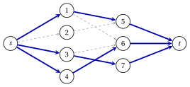

# 5.7 Applicazioni

**Parte 3 · Flussi · Capitolo 5** · [:material-book-open-variant: Capitolo 5: Flusso massimo](index.md) · [:material-file-pdf-box: Dispensa, volume 3 (PDF)](../../pdf/dispensa-3-flussi.pdf) · [:material-presentation: Slide](../../pdf/slide-maximum-flow.pdf) · [:material-pencil: Esercizi: Flusso massimo](../../esercizi/maximum-flow.md) · [:material-gesture-tap: App: Flusso massimo: Ford–Fulkerson ed Edmonds–Karp](../../laboratorio/flusso-massimo-ford-fulkerson-edmonds-karp.md)

### 5.7.1 Accoppiamento massimo in un grafo bipartito

!!! definizione "Definizione 5.16: grafo bipartito e accoppiamento"

    Un grafo non orientato $H=(V_1 \cup V_2,E)$ è <strong>bipartito</strong> se $V_1$ e $V_2$ sono disgiunti e ogni spigolo ha un estremo in $V_1$ e uno in $V_2$; scriviamo gli spigoli come $\{i,j\}$ con $i \in V_1$ e $j \in V_2$.

    - Un <strong>accoppiamento</strong> (<em>matching</em>) è un insieme $M \subseteq E$ di spigoli a due a due senza estremi in comune.

    - Il <strong>problema dell'accoppiamento massimo</strong> chiede un accoppiamento con il maggior numero di spigoli.

    La <strong>rete di $H$</strong> ha i nodi $\{s\} \cup V_1 \cup V_2 \cup \{t\}$, gli archi $(s,i)$ per $i \in V_1$, $(i,j)$ per ogni spigolo $\{i,j\} \in E$, $(j,t)$ per $j \in V_2$, e tutte le capacità uguali a $1$.

- Se $V_1$ è un insieme di lavoratori, $V_2$ un insieme di lavori, e uno spigolo indica che un lavoratore può svolgere un lavoro, un accoppiamento assegna lavori a lavoratori, al più un lavoro per lavoratore e un lavoratore per lavoro.

- Nell'ordine dei nodi, $s$ viene per primo e $t$ per ultimo; gli altri nodi mantengono i loro indici.

!!! teorema "Proposizione 5.17: accoppiamenti e flussi"

    Il numero massimo di spigoli di un accoppiamento di $H$ è uguale al valore massimo $\tilde{v}$ di un flusso nella rete di $H$. Se $\tilde{\vet{x}}$ è un flusso massimo intero, allora $M=\{\{i,j\} \in E : \tilde{x}_{ij}=1\}$ è un accoppiamento massimo.

??? dimostrazione "Dimostrazione"

    1. <em>Dagli accoppiamenti ai flussi.</em> Dato un accoppiamento $M$, poniamo $x=1$ sugli archi $(s,i)$, $(i,j)$, $(j,t)$ di ogni spigolo $\{i,j\} \in M$, e $x=0$ altrove. Ogni nodo di $V_1 \cup V_2$ è estremo di al più uno spigolo di $M$, quindi il flusso è ammissibile, e il suo valore è $|M|$.

    2. <em>Dai flussi interi agli accoppiamenti.</em> Sia $\vet{x}$ un flusso ammissibile intero, quindi $x_{ij} \in \{0,1\}$. Un nodo $i \in V_1$ ha il solo arco entrante $(s,i)$, quindi al più un arco $(i,j)$ porta flusso; un nodo $j \in V_2$ ha il solo arco uscente $(j,t)$, quindi al più un arco $(i,j)$ porta flusso. Ne segue che $M=\{\{i,j\} : x_{ij}=1\}$ è un accoppiamento. Per $S=\{s\} \cup V_1$, gli archi in avanti sono gli archi $(i,j)$ e non ci sono archi all'indietro: per il [Lemma 5.3](tagli.md#box-4-mf-lem-cut), $v=|M|$.

    3. Per il [Corollario 5.10](l-algoritmo-di-fordfulkerson.md#box-15-mf-cor-integral) esiste un flusso massimo intero $\tilde{\vet{x}}$. Per il punto 1, nessun accoppiamento ha più di $\tilde{v}$ spigoli, e per il punto 2 l'accoppiamento di $\tilde{\vet{x}}$ ha $\tilde{v}$ spigoli. □

!!! esempio "Esempio 5.9: lavoratori e lavori"

    Quattro lavoratori $V_1=\{1,2,3,4\}$ e tre lavori $V_2=\{5,6,7\}$ hanno gli spigoli

    $$
    E=\big\{\{1,5\},\{1,6\},\{2,5\},\{3,6\},\{3,7\},\{4,6\}\big\}.
    $$

    L'algoritmo di Edmonds–Karp sulla rete di $H$, con i nodi nell'ordine $s,1,2,\dots,7,t$, dà:

    
<table>
    <tr>
    <th>iterazione</th>
    <th>cammino aumentante</th>
    <th>\(r_{ij}\) su \(P\)</th>
    <th>archi all'indietro</th>
    <th>\(\delta\)</th>
    <th>\(v\)</th>
    </tr>
    <tr>
    <td>\(1\)</td>
    <td>\(s,1,5,t\)</td>
    <td>\(1,1,1\)</td>
    <td>–</td>
    <td>\(1\)</td>
    <td>\(1\)</td>
    </tr>
    <tr>
    <td>\(2\)</td>
    <td>\(s,3,6,t\)</td>
    <td>\(1,1,1\)</td>
    <td>–</td>
    <td>\(1\)</td>
    <td>\(2\)</td>
    </tr>
    <tr>
    <td>\(3\)</td>
    <td>\(s,4,6,3,7,t\)</td>
    <td>\(1,1,1,1,1\)</td>
    <td>\((6,3)\)</td>
    <td>\(1\)</td>
    <td>\(3\)</td>
    </tr>
    </table>

    - L'iterazione $3$ usa l'arco all'indietro $(6,3)$: il lavoratore $3$ lascia il lavoro $6$ per il lavoro $7$, e il lavoratore $4$ prende il lavoro $6$.

    - L'accoppiamento massimo è $M=\{\{1,5\},\{3,7\},\{4,6\}\}$, con $3$ spigoli; il lavoratore $2$ resta senza lavoro. Nella figura gli archi con flusso $1$ sono blu.

    - All'arresto la visita etichetta $S=\{s,1,2,4,5,6\}$; gli archi in avanti del taglio sono $(s,3)$, $(5,t)$, $(6,t)$, con capacità $3=|M|$.

    { .fig loading=lazy  }

### 5.7.2 Cammini arco-disgiunti

- Due cammini orientati sono <strong>arco-disgiunti</strong> se non hanno archi in comune; possono avere nodi in comune.

!!! teorema "Teorema 5.18: Menger, versione per archi"

    Siano $G=(N,A)$ un grafo orientato e $s \neq t$ due nodi. Il numero massimo di cammini orientati da $s$ a $t$ a due a due arco-disgiunti è uguale al numero minimo di archi la cui rimozione non lascia alcun cammino orientato da $s$ a $t$.

??? dimostrazione "Dimostrazione"

    Diamo a ogni arco capacità $1$, e sia $\tilde{v}$ il valore massimo di un flusso.

    1. <em>I cammini danno flussi.</em> La somma dei vettori di incidenza di $k$ cammini arco-disgiunti da $s$ a $t$ è un flusso ammissibile di valore $k$: ogni arco porta al più $1$, e ogni cammino entra nei suoi nodi interni e ne esce. Quindi $k \le \tilde{v}$.

    2. <em>I flussi danno cammini.</em> Per il [Corollario 5.10](l-algoritmo-di-fordfulkerson.md#box-15-mf-cor-integral) esiste un flusso $\vet{x}$ con $x_{ij} \in \{0,1\}$ e valore $\tilde{v}$. Se $\tilde{v} \ge 1$, camminiamo da $s$ lungo archi con $x_{ij}=1$, ciascuno usato al più una volta, finché non raggiungiamo $t$:

        - in un nodo $i \notin \{s,t\}$ la passeggiata ha usato un arco entrante in più degli archi uscenti, e la conservazione dà un arco uscente non ancora usato con flusso;

        - in $s$ la passeggiata ha usato tanti archi uscenti quanti entranti, mentre gli archi con flusso che escono da $s$ sono $\tilde{v} \ge 1$ in più di quelli che entrano: ne esiste uno non ancora usato.

        La passeggiata termina, in $t$, e contiene un cammino $P$ da $s$ a $t$ ([Capitolo 1, Lemma «ogni passeggiata contiene un cammino»](../../grafi/graphs/grafi-non-orientati-e-orientati.md)). Ponendo $x_{ij}=0$ su $P$ resta un flusso $0/1$ di valore $\tilde{v}-1$; ripetendo si ottengono $\tilde{v}$ cammini arco-disgiunti.

    3. <em>Rimozione di archi.</em> Se la rimozione di un insieme $F$ di archi non lascia cammini da $s$ a $t$, l'insieme $S$ dei nodi ancora raggiungibili da $s$ ha $t \notin S$ e $\delta^+(S) \subseteq F$, quindi $|F| \ge u(S,N \setminus S) \ge \tilde{v}$. Viceversa, ogni cammino da $s$ a $t$ esce da $S$ attraverso un arco di $\delta^+(S)$: rimuovendo i $\tilde{v}$ archi in avanti di un taglio minimo ([Teorema 5.8](il-teorema-flusso-massimo-taglio-minimo.md#box-12-mf-th-mfmc)) non resta alcun cammino. □

!!! esempio "Esempio 5.10: cammini arco-disgiunti nel grafo di riferimento"

    Sul grafo di riferimento con tutte le capacità uguali a $1$, $s=1$ e $t=6$, l'algoritmo di Edmonds–Karp trova i cammini $1,2,4,6$ e $1,3,5,6$, e $\tilde{v}=2$. Questi due cammini sono arco-disgiunti, e rimuovendo i due archi $(1,2)$, $(1,3)$ che escono dal nodo $1$ non resta alcun cammino da $1$ a $6$: entrambi i numeri del [Teorema 5.18](#box-27-mf-th-menger) valgono $2$.

!!! chiave ""

    Un accoppiamento massimo di un grafo bipartito è un flusso massimo intero in una rete con capacità unitarie, e lo stesso vale per i cammini arco-disgiunti da $s$ a $t$; il taglio minimo certifica entrambi.

## 5.8 Errori tipici

!!! attenzione "Attenzione"

    - <strong>Contare gli archi all'indietro di un taglio.</strong> La capacità $u(S,N \setminus S)$ somma solo gli archi da $S$ a $N \setminus S$.

    - <strong>Dimenticare gli archi all'indietro della rete residua.</strong> Con i soli archi in avanti, il metodo può fermarsi a un flusso non massimo, come al valore $5$ sulla rete di riferimento.

    - <strong>Dare a un arco all'indietro la capacità $u_{ij}$.</strong> L'arco all'indietro $(j,i)$ ha $r_{ji}=x_{ij}$: si può rimandare indietro solo il flusso già inviato.

    - <strong>Prendere il collo di bottiglia dalle capacità.</strong> Il collo di bottiglia è la più piccola capacità residua $r_{ij}$ sul cammino, non la più piccola $u_{ij}$.

    - <strong>Aggiungere $\delta$ su un arco all'indietro.</strong> Lungo un arco all'indietro $(j,i)$ il flusso $x_{ij}$ diminuisce di $\delta$.

    - <strong>Leggere il taglio dagli archi saturi.</strong> Il taglio minimo è dato dai nodi raggiungibili da $s$ nella rete residua all'arresto; gli archi saturi non formano necessariamente un taglio.

    - <strong>Chiamare polinomiale Ford–Fulkerson.</strong> Il suo numero di aumenti può crescere con le capacità, come i $2M$ dell'[Esempio 5.7](l-algoritmo-di-fordfulkerson.md#box-18-mf-ex-bad); Edmonds–Karp ne esegue al più $n\,m$.

## 5.9 In sintesi

!!! chiave "In sintesi"

    - Un flusso ammissibile rispetta le capacità e si conserva nei nodi diversi da $s$ e $t$; il suo valore è il deflusso netto di $s$, ed è uguale al flusso netto attraverso ogni taglio $s$–$t$.

    - Dualità debole: $v \le u(S,N \setminus S)$ per ogni flusso e ogni taglio.

    - La rete residua ha archi in avanti con $r_{ij}=u_{ij}-x_{ij}$ e archi all'indietro con $r_{ji}=x_{ij}$; un cammino aumentante aumenta il valore del suo collo di bottiglia $\delta$.

    - Flusso massimo-taglio minimo: un flusso è massimo se e solo se non esistono cammini aumentanti, e $\tilde{v}$ è uguale alla capacità minima di un taglio; con capacità intere esiste un flusso massimo intero.

    - Ford–Fulkerson (visita in profondità): con capacità intere al più $\tilde{v}$ aumenti, pseudopolinomiale. Edmonds–Karp (visita in ampiezza): al più $n\,m$ aumenti, tempo $O(n\,m^2)$.

    - Gli accoppiamenti massimi nei grafi bipartiti e i cammini arco-disgiunti sono flussi massimi interi.

    <strong>La rete di riferimento in sintesi.</strong>

    
<table>
    <tr>
    <td>capacità, \(s=1\), \(t=6\)</td>
    <td>\(\vet{u}=(5,4,3,2,4,2,4,2,3)\)</td>
    </tr>
    <tr>
    <td>flusso massimo (unico)</td>
    <td>\(\tilde{\vet{x}}=(3,4,3,0,4,0,4,1,3)\), \(\tilde{v}=7\)</td>
    </tr>
    <tr>
    <td>tagli minimi, capacità \(7\)</td>
    <td>\(S=\{1,2\}\), \(\{1,2,3\}\), \(\{1,2,3,4,5\}\)</td>
    </tr>
    <tr>
    <td>Ford–Fulkerson (DFS)</td>
    <td>\(5\) aumenti, \(\delta=2,1,2,1,1\)</td>
    </tr>
    <tr>
    <td>Edmonds–Karp (BFS)</td>
    <td>\(3\) aumenti, \(\delta=3,3,1\)</td>
    </tr>
    <tr>
    <td>tutte le capacità \(1\)</td>
    <td>cammini arco-disgiunti \(1,2,4,6\) e \(1,3,5,6\)</td>
    </tr>
    </table>

---

**Esercizi su questo capitolo:** [:material-pencil: Flusso massimo](../../esercizi/maximum-flow.md)

