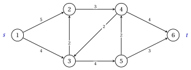

# 5.1 Il problema del flusso massimo { #sez-sec-mf-problem }

**Parte 3 · Flussi · Capitolo 5** · [:material-book-open-variant: Capitolo 5: Flusso massimo](index.md) · [:material-file-pdf-box: Dispensa, volume 3 (PDF)](../../pdf/dispensa-3-flussi.pdf) · [:material-presentation: Slide](../../pdf/slide-maximum-flow.pdf) · [:material-pencil: Esercizi: Flusso massimo](../../esercizi/maximum-flow.md) · [:material-gesture-tap: App: Flusso massimo: Ford–Fulkerson ed Edmonds–Karp](../../laboratorio/flusso-massimo-ford-fulkerson-edmonds-karp.md)

!!! definizione "Definizione 5.1: problema del flusso massimo"

    Sia $G=(N,A)$ un grafo orientato con $n=|N|$ nodi e $m=|A|$ archi, con due nodi distinti $s$, la <strong>sorgente</strong>, e $t$, il <strong>pozzo</strong>, e una <strong>capacità</strong> $u_{ij} \ge 0$ per ogni arco $(i,j) \in A$.

    - Un <strong>flusso ammissibile</strong> è un vettore $\vet{x} \in \R^m$ con $0 \le x_{ij} \le u_{ij}$ per ogni arco $(i,j) \in A$ e la conservazione del flusso in ogni nodo diverso da $s$ e $t$:

        $$
        \sum_{(i,j) \in \delta^+(i)} x_{ij} \;-\; \sum_{(j,i) \in \delta^-(i)} x_{ji}=0, \quad \forall i \in N \setminus
        \{s,t\}.
        $$

    - Il <strong>valore</strong> del flusso è il deflusso netto della sorgente:

        $$
        v=\sum_{(s,j) \in \delta^+(s)} x_{sj} \;-\; \sum_{(j,s) \in \delta^-(s)} x_{js} .
        $$

    - Il <strong>problema del flusso massimo</strong> chiede un flusso ammissibile di valore massimo, un <strong>flusso massimo</strong>. Il suo valore si indica con $\tilde{v}$.

- Le capacità sono finite, e il flusso $\vet{x}=\vet{0}$, di valore $0$, è sempre ammissibile.

- I nodi diversi da $s$ e $t$ trasmettono tutto ciò che ricevono: il flusso lascia $s$ e attraversa la rete verso $t$.

- Come nel [Capitolo 4 «Modelli di flusso su reti»](../network-flow-models/index.md), $\delta^+(i)$ e $\delta^-(i)$ sono gli archi che escono dal nodo $i$ e che vi entrano, e gli archi sono numerati $a_1,a_2,\dots,a_m$ in ordine lessicografico.

!!! esempio "Esempio 5.1: la rete di riferimento"

    Diamo le capacità al grafo di riferimento del [Capitolo 1 «Grafi»](../../grafi/graphs/index.md), con sorgente $s=1$ e pozzo $t=6$:

    
<table>
    <tr>
    <th>arco</th>
    <th>\((1,2)\)</th>
    <th>\((1,3)\)</th>
    <th>\((2,4)\)</th>
    <th>\((3,2)\)</th>
    <th>\((3,5)\)</th>
    <th>\((4,3)\)</th>
    <th>\((4,6)\)</th>
    <th>\((5,4)\)</th>
    <th>\((5,6)\)</th>
    </tr>
    <tr>
    <td>\(u_{ij}\)</td>
    <td>\(5\)</td>
    <td>\(4\)</td>
    <td>\(3\)</td>
    <td>\(2\)</td>
    <td>\(4\)</td>
    <td>\(2\)</td>
    <td>\(4\)</td>
    <td>\(2\)</td>
    <td>\(3\)</td>
    </tr>
    <tr>
    <td>\(\bar{x}_{ij}\)</td>
    <td>\(3\)</td>
    <td>\(0\)</td>
    <td>\(3\)</td>
    <td>\(0\)</td>
    <td>\(2\)</td>
    <td>\(2\)</td>
    <td>\(1\)</td>
    <td>\(0\)</td>
    <td>\(2\)</td>
    </tr>
    </table>

    Nella figura ogni arco porta la sua capacità $u_{ij}$.

    { .fig loading=lazy  }

    Il flusso $\bar{\vet{x}}$ della tabella è ammissibile. Per esempio, nel nodo $4$ l'afflusso è $\bar{x}_{24}+\bar{x}_{54}=3+0=3$ e il deflusso è $\bar{x}_{43}+\bar{x}_{46}=2+1=3$. Il suo valore è

    $$
    v=\bar{x}_{12}+\bar{x}_{13}=3+0=3 ,
    $$

    e il nodo $6$ riceve $\bar{x}_{46}+\bar{x}_{56}=1+2=3$ unità. Nella figura ogni arco porta $\bar{x}_{ij}/u_{ij}$: gli archi con $0<\bar{x}_{ij}<u_{ij}$ sono blu, gli archi saturi ($\bar{x}_{ij}=u_{ij}$) rossi e gli archi vuoti grigi e tratteggiati.

    { .fig loading=lazy  }

## 5.1.1 Il modello LP

- Usiamo una variabile continua $x_{ij}$ per ogni arco $(i,j) \in A$, il flusso sull'arco, e una variabile $v$, il valore del flusso.

!!! chiave ""

    Con queste variabili, un modello LP per il problema del flusso massimo è il seguente:

    

    \begin{align*}
    &&   \max \;\; v                                                                                \label{mf:obj}  \tag{5.1a}\\[1ex]
    && \text{soggetto a} \quad  \sum_{(s,j) \in \delta^+(s)} x_{sj} - \sum_{(j,s) \in \delta^-(s)} x_{js}
    &= v, &                                                                                    \label{mf:cons-s}  \tag{5.1b}\\[1ex]
    && \sum_{(i,j) \in \delta^+(i)} x_{ij} - \sum_{(j,i) \in \delta^-(i)} x_{ji}
    &= 0, & \forall i \in N \setminus \{s,t\},                                                 \label{mf:cons}  \tag{5.1c}\\[1ex]
    && \sum_{(t,j) \in \delta^+(t)} x_{tj} - \sum_{(j,t) \in \delta^-(t)} x_{jt}
    &= -v, &                                                                                   \label{mf:cons-t}  \tag{5.1d}\\[1ex]
    && x_{ij} &\le u_{ij}, & \forall (i,j) \in A,                                             \label{mf:cap}  \tag{5.1e}\\[1ex]
    && x_{ij} &\ge 0, & \forall (i,j) \in A,                                                  \label{mf:dom}  \tag{5.1f}\\[1ex]
    && v &\in \R. &                                                                           \label{mf:domv} \tag{5.1g}
    \end{align*}

    Questo modello LP si chiama modello $\mathrm{MF}$.

- Descrizione della funzione obiettivo e dei vincoli del modello $\mathrm{MF}$:

    - la funzione obiettivo $\eqref{mf:obj}$ massimizza il valore del flusso;

    - il vincolo $\eqref{mf:cons-s}$ afferma che il deflusso netto di $s$ è $v$, e il vincolo $\eqref{mf:cons-t}$ che l'afflusso netto di $t$ è $v$;

    - i vincoli $\eqref{mf:cons}$ sono i vincoli di conservazione del flusso degli altri nodi;

    - i vincoli $\eqref{mf:cap}$ impongono le capacità, e i vincoli $\eqref{mf:dom}$ e $\eqref{mf:domv}$ definiscono le variabili del modello LP.

- Ogni arco contribuisce con $+x_{ij}$ alla riga della sua coda e con $-x_{ij}$ alla riga della sua testa, quindi i membri sinistri di $\eqref{mf:cons-s}$–$\eqref{mf:cons-t}$ sommano a zero: il vincolo $\eqref{mf:cons-t}$ segue dagli altri.

- Nella [sezione «Casi speciali» del Capitolo 4](../network-flow-models/casi-speciali.md) il problema del flusso massimo è un modello di flusso di costo minimo: bilanci nulli e costi nulli, più l'arco $(t,s)$ con capacità $+\infty$ e costo $-1$. Chiamando $v$ il flusso $x_{ts}$ su questo arco, $\eqref{mf:cons-s}$–$\eqref{mf:cons-t}$ sono i suoi vincoli di conservazione, e $\min\,(-x_{ts})$ è $\max\, v$.

!!! chiave ""

    Un flusso ammissibile rispetta le capacità e si conserva in ogni nodo diverso da $s$ e $t$; il suo valore $v$ è il deflusso netto di $s$. Il problema del flusso massimo è il modello LP $\mathrm{MF}$: massimizzare $v$ rispettando la conservazione e le capacità.

---

**Avanti:** [5.2 Tagli](tagli.md)
