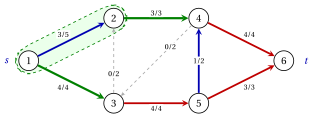

# 5.4 Il teorema del taglio minimo del flusso massimo { #sez-sec-mf-theorem }

**Parte 3 · Flussi · Capitolo 5** · [:material-book-open-variant: Capitolo 5: Flusso massimo](index.md) · [:material-file-pdf-box: Dispensa, volume 3 (PDF)](../../pdf/dispensa-3-flussi.pdf) · [:material-pencil: Esercizi: Flusso massimo](../../esercizi/maximum-flow.md) · [:material-gesture-tap: App: Flusso massimo: Ford–Fulkerson ed Edmonds–Karp](../../laboratorio/flusso-massimo-ford-fulkerson-edmonds-karp.md)

!!! teorema "Teorema 5.8: taglio minimo flusso massimo"

    Sia $\vet{x}$ un flusso ammissibile di valore $v$. Le seguenti affermazioni sono equivalenti:

    - **(a)** $\vet{x}$ è un flusso massimo;

    - **(b)** la rete residua $G(\vet{x})$ non ha percorso aumentante;

    - **(c)** $v=u(S,N \setminus S)$ per alcuni $s$–$t$ taglia $(S,N \setminus S)$.

    Inoltre, esiste un flusso massimo e il valore massimo di un flusso è uguale alla capacità minima di un taglio $s$–$t$:

    $$
    \tilde{v}=\min \big\{\, u(S,N \setminus S) \;:\; S \subseteq N,~ s \in S,~ t \notin S \,\big\}.
    $$

??? dimostrazione "Dimostrazione"

    <em>(a) implica (b).</em> Un cammino aumentante darebbe, per [Lemma 5.7](la-rete-residua.md#box-9-mf-lem-aug), un flusso ammissibile di valore $v+\delta>v$.

    <em>(b) implica (c).</em> Sia $S$ l'insieme dei nodi raggiungibili da $s$ in $G(\vet{x})$; poi $s \in S$ e, di (b), $t \notin S$.

    1. Se un arco $(i,j) \in \delta^+(S)$ avesse $x_{ij}<u_{ij}$, l'arco in avanti $(i,j)$ sarebbe in $G(\vet{x})$ e $j$ sarebbe raggiungibile: quindi $x_{ij}=u_{ij}$.

    2. Se un arco $(i,j) \in \delta^-(S)$ avesse $x_{ij}>0$, l'arco all'indietro $(j,i)$, con $j \in S$, sarebbe in $G(\vet{x})$ e $i$ sarebbero raggiungibili: quindi $x_{ij}=0$.

    3. Di [Corollario 5.4](tagli.md#box-5-mf-cor-weak), $v=u(S,N \setminus S)$.

    <em>(c) implica (a).</em> Di [Corollario 5.4](tagli.md#box-5-mf-cor-weak).

    <em>Esistenza e uguaglianza.</em> La regione ammissibile del modello $\mathrm{MF}$ non è vuota ($\vet{x}=\vet{0}$, $v=0$) e limitato ($0 \le x_{ij} \le u_{ij}$ e $|v| \le \sum_{(i,j) \in A} u_{ij}$), quindi il modello ha un valore ottimale soluzione ([Capitolo 15 «La geometria di Programmazione lineare»](https://fabiofurini.github.io/programmazione-lineare/metodi-avanzati/15-geometria/)). Per un flusso massimo, (a) implica (c): qualche taglio ha capacità $\tilde{v}$, e da [Corollario 5.4](tagli.md#box-5-mf-cor-weak) nessun taglio ha una capacità inferiore. □

- La dimostrazione di (b) implica che (c) è costruttiva: al flusso massimo, i nodi raggiungibili da $s$ nel residuo la rete forma un taglio minimo.

- Un flusso e un taglio con $v=u(S,N \setminus S)$ si certificano a vicenda: il taglio dimostra che nessun flusso è migliore, e il flusso dimostra che nessun taglio è più piccolo.

!!! esempio "Esempio 5.5: il flusso massimo della rete di riferimento"

    Sulla rete di riferimento di [Esempio 5.1](il-problema-del-flusso-massimo.md#box-2-mf-ex-ref) il flusso

    
<table>
    <tr>
    <th>arco</th>
    <th>\((1,2)\)</th>
    <th>\((1,3)\)</th>
    <th>\((2,4)\)</th>
    <th>\((3,2)\)</th>
    <th>\((3,5)\)</th>
    <th>\((4,3)\)</th>
    <th>\((4,6)\)</th>
    <th>\((5,4)\)</th>
    <th>\((5,6)\)</th>
    </tr>
    <tr>
    <td>\(\tilde{x}_{ij}\)</td>
    <td>\(3\)</td>
    <td>\(4\)</td>
    <td>\(3\)</td>
    <td>\(0\)</td>
    <td>\(4\)</td>
    <td>\(0\)</td>
    <td>\(4\)</td>
    <td>\(1\)</td>
    <td>\(3\)</td>
    </tr>
    <tr>
    <td>\(u_{ij}\)</td>
    <td>\(5\)</td>
    <td>\(4\)</td>
    <td>\(3\)</td>
    <td>\(2\)</td>
    <td>\(4\)</td>
    <td>\(2\)</td>
    <td>\(4\)</td>
    <td>\(2\)</td>
    <td>\(3\)</td>
    </tr>
    </table>

    è fattibile, con valore $\tilde{x}_{12}+\tilde{x}_{13}=7$. Per $S=\{1,2\}$ gli archi in avanti $(1,3)$, $(2,4)$ sono saturato e l'arco all'indietro $(3,2)$ è vuoto, quindi

    $$
    u(S,N \setminus S)=u_{13}+u_{24}=4+3=7=v .
    $$

    Per [Teorema 5.8](#box-12-mf-th-mfmc), $\tilde{\vet{x}}$ è un flusso massimo, $\tilde{v}=7$, e $(\{1,2\},\{3,4,5,6\})$ è un taglio minimo. In $G(\tilde{\vet{x}})$ i nodi raggiungibili da $1$ sono esattamente $1$ e $2$. Nella figura, $S$ è ombreggiato e gli archi anteriori del taglio sono verdi.

    { .fig loading=lazy  }

- <strong>Unicità.</strong> Per [Corollario 5.4](tagli.md#box-5-mf-cor-weak), ogni flusso massimo satura la direzione archi e svuota gli archi all'indietro di ciascuno dei tre tagli minimi di [Esempio 5.2](tagli.md#box-6-mf-ex-cuts):

    $$
    \begin{aligned}
    S=\{1,2\}: &\quad x_{13}=4,~ x_{24}=3,~ x_{32}=0,\\
    S=\{1,2,3\}: &\quad x_{35}=4,~ x_{43}=0,\\
    S=\{1,2,3,4,5\}: &\quad x_{46}=4,~ x_{56}=3.
    \end{aligned}
    $$

    La conservazione ai nodi $1$ e $4$ dà quindi $x_{12}=7-x_{13}=3$ e $x_{54}=x_{43}+x_{46}-x_{24}=1$: $\tilde{\vet{x}}$ è l'unico flusso massimo, mentre il taglio minimo non è unico.

!!! attenzione "Archi e tagli saturati"

    Gli archi saturi di flusso massimo non formano in generale un taglio. Sotto $\tilde{\vet{x}}$ gli archi saturati sono $(1,3)$, $(2,4)$, $(3,5)$, $(4,6)$, $(5,6)$, con capacità totale $18$. Viene letto un taglio minimo dai nodi raggiungibili da $s$ nella rete residua.

!!! chiave ""

    Un flusso è massimo se e solo se la sua rete residua non ha cammini aumentanti, se e solo se il suo valore è uguale a capacità di un taglio. Il valore massimo equivale alla capacità di taglio minima e i nodi raggiungibili da $s$ nella la rete residua di portata massima forma un taglio minimo.

---

**Avanti:** [5.5 L'algoritmo Ford-Fulkerson](l-algoritmo-ford-fulkerson.md)
