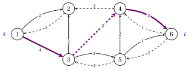

# 5.3 La rete residua { #sez-sec-mf-residual }

**Parte 3 · Flussi · Capitolo 5** · [:material-book-open-variant: Capitolo 5: Flusso massimo](index.md) · [:material-file-pdf-box: Dispensa, volume 3 (PDF)](../../pdf/dispensa-3-flussi.pdf) · [:material-presentation: Slide](../../pdf/slide-maximum-flow.pdf) · [:material-pencil: Esercizi: Flusso massimo](../../esercizi/maximum-flow.md) · [:material-gesture-tap: App: Flusso massimo: Ford–Fulkerson ed Edmonds–Karp](../../laboratorio/flusso-massimo-ford-fulkerson-edmonds-karp.md)

- Nel resto del capitolo $G$ non ha coppie di archi opposti $(i,j)$ e $(j,i)$, come il grafo di riferimento. Un arco $(j,i)$ opposto a $(i,j)$ si può sostituire con gli archi $(j,k)$ e $(k,i)$ attraverso un nuovo nodo $k$, entrambi con capacità $u_{ji}$: la conservazione in $k$ dà $x_{jk}=x_{ki}$, e i flussi delle due reti si corrispondono, con lo stesso valore.

!!! definizione "Definizione 5.5: rete residua"

    Sia $\vet{x}$ un flusso ammissibile. La <strong>rete residua</strong> $G(\vet{x})=(N,A(\vet{x}))$ ha, per ogni arco $(i,j) \in A$:

    - l'<strong>arco in avanti</strong> $(i,j)$, con <strong>capacità residua</strong> $r_{ij}=u_{ij}-x_{ij}$, se $x_{ij}<u_{ij}$;

    - l'<strong>arco all'indietro</strong> $(j,i)$, con capacità residua $r_{ji}=x_{ij}$, se $x_{ij}>0$.

- La capacità residua $r_{ij}$ è quanto flusso si può ancora inviare da $i$ a $j$: aumentando $x_{ij}$ su un arco in avanti, o diminuendo $x_{ji}$ su un arco all'indietro.

- Un arco vuoto dà solo il suo arco in avanti, un arco saturo solo il suo arco all'indietro, e un arco con $0<x_{ij}<u_{ij}$ entrambi. Quindi $G(\vet{x})$ ha al più $2m$ archi, tutti con capacità residua positiva.

- Senza archi opposti in $G$, ogni coppia ordinata di nodi porta al più un arco residuo.

!!! definizione "Definizione 5.6: cammino aumentante"

    Sia $\vet{x}$ un flusso ammissibile. Un <strong>cammino aumentante</strong> è un cammino orientato $P$ da $s$ a $t$ in $G(\vet{x})$. Il suo <strong>collo di bottiglia</strong> è

    $$
    \delta=\min_{(i,j) \in P} r_{ij}>0 .
    $$

    <strong>Aumentare</strong> $\vet{x}$ lungo $P$ significa inviare $\delta$ unità lungo $P$: per ogni arco di $P$,

    - se è un arco in avanti $(i,j)$, allora $x_{ij}:=x_{ij}+\delta$;

    - se è un arco all'indietro $(j,i)$, con $(i,j) \in A$, allora $x_{ij}:=x_{ij}-\delta$.

!!! teorema "Lemma 5.7: aumento"

    Aumentando un flusso ammissibile $\vet{x}$ di valore $v$ lungo un cammino aumentante $P$ con collo di bottiglia $\delta$ si ottiene un flusso ammissibile $\vet{x}'$ di valore $v+\delta$.

??? dimostrazione "Dimostrazione"

    I nodi di $P$ sono distinti e $G$ non ha archi opposti, quindi ogni arco di $A$ cambia al più una volta.

    1. <em>Limiti.</em> Su un arco in avanti, $x_{ij}+\delta \le x_{ij}+r_{ij}=u_{ij}$; su un arco all'indietro, $x_{ij}-\delta \ge x_{ij}-r_{ji}=0$.

    2. <em>Conservazione.</em> Sia $k \notin \{s,t\}$ un nodo di $P$. L'arco di $P$ che entra in $k$ aumenta l'afflusso netto di $k$ di $\delta$: un arco in avanti $(h,k)$ aumenta $x_{hk}$, un arco all'indietro $(h,k)$ diminuisce $x_{kh}$. Allo stesso modo, l'arco di $P$ che esce da $k$ aumenta il deflusso netto di $k$ di $\delta$. Le due variazioni si compensano, e i nodi fuori da $P$ non sono toccati.

    3. <em>Valore.</em> Il cammino $P$ lascia $s$ una volta e non vi rientra più, quindi il deflusso netto di $s$ cresce di $\delta$. □

!!! esempio "Esempio 5.3: la rete residua di $\bar{\vet{x}}$"

    Per il flusso $\bar{\vet{x}}$ dell'[Esempio 5.1](il-problema-del-flusso-massimo.md#box-2-mf-ex-ref), di valore $3$, la rete residua $G(\bar{\vet{x}})$ ha $13$ archi. I sei archi all'indietro, tratteggiati nella figura, sono $(2,1)$, $(3,4)$, $(4,2)$, $(5,3)$, $(6,4)$, $(6,5)$.

    - L'arco $(2,4)$ è saturo, quindi dà solo l'arco all'indietro $(4,2)$, con $r_{42}=\bar{x}_{24}=3$.

    - L'arco $(1,2)$ ha $0<\bar{x}_{12}=3<5$, quindi dà l'arco in avanti $(1,2)$, con $r_{12}=2$, e l'arco all'indietro $(2,1)$, con $r_{21}=3$.

    { .fig loading=lazy  }

    La visita in profondità del Capitolo 1 dal nodo $1$, con gli archi residui di ogni nodo esaminati per indice crescente della testa, etichetta i nodi $1,2,3,4,6$: da $2$ l'unico arco residuo torna a $1$, da $3$ la visita prende l'arco all'indietro $(3,4)$ ($2$ è già etichettato), e da $4$ l'arco $(4,6)$. Il cammino aumentante è $P=1,3,4,6$ (viola), con collo di bottiglia

    $$
    \delta=\min\{r_{13},\,r_{34},\,r_{46}\}=\min\{4,\,2,\,3\}=2 .
    $$

    L'aumento dà $x_{13}=0+2=2$, $x_{43}=2-2=0$ (arco all'indietro) e $x_{46}=1+2=3$, con valore $3+2=5$. Le due unità che andavano da $4$ a $3$ ora vanno da $4$ a $6$, e il nodo $3$ riceve due nuove unità da $1$, che proseguono lungo $3,5,6$.

!!! esempio "Esempio 5.4: perché servono gli archi all'indietro"

    Supponiamo di usare, a partire da $\bar{\vet{x}}$, solo gli archi in avanti della rete residua, così che i flussi possano solo crescere.

    - La visita in profondità sugli archi in avanti trova il cammino $1,3,5,4,6$, con $\delta=\min\{4,2,2,3\}=2$, e il valore diventa $5$ con il flusso $\vet{x}=(3,2,3,0,4,2,3,2,2)$.

    - Ora gli archi in avanti $(2,4)$ e $(3,5)$ che escono da $\{1,2,3\}$ sono saturi: la visita etichetta solo $1,2,3$, e il metodo si ferma con valore $5$.

    - Il valore non è massimo: per $S=\{1,2,3\}$, il [Lemma 5.3](tagli.md#box-4-mf-lem-cut) dà $v=x(\delta^+(S))-x(\delta^-(S))=7-2=5$. Le due unità sull'arco all'indietro $(4,3)$ del taglio, mandate lì dalle prime scelte, tornano in $S$.

    Solo l'arco all'indietro $(3,4)$ della rete residua può annullarle: da questo flusso, i cammini aumentanti $1,3,4,5,6$ (con gli archi all'indietro $(3,4)$ e $(4,5)$) e $1,3,4,6$, con $\delta=1$ ciascuno, raggiungono il valore $7$.

!!! chiave ""

    La rete residua ha un arco in avanti dove il flusso può crescere e un arco all'indietro dove può diminuire. Inviare il collo di bottiglia $\delta$ lungo un cammino da $s$ a $t$ della rete residua mantiene il flusso ammissibile e ne aumenta il valore di $\delta$; gli archi all'indietro annullano le scelte precedenti.

---

**Avanti:** [5.4 Il teorema flusso massimo-taglio minimo](il-teorema-flusso-massimo-taglio-minimo.md)
