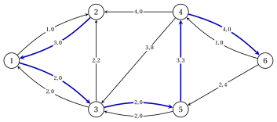

# 6.7 L'algoritmo del percorso più breve successivo

**Parte 3 · Flussi · Capitolo 6** · [:material-book-open-variant: Capitolo 6: Flusso di costo minimo](index.md) · [:material-file-pdf-box: Dispensa, volume 3 (PDF)](../../pdf/dispensa-3-flussi.pdf) · [:material-pencil: Esercizi: Flusso di costo minimo](../../esercizi/min-cost-flow.md)

!!! definizione "Definizione 6.15: pseudoflusso e squilibri"

    Un <strong>pseudoflusso</strong> è un vettore $\vet{x}$ con $\vet{l} \le \vet{x} \le \vet{u}$, che potrebbe violare il flusso conservazione. Lo <strong>squilibrio</strong> del nodo $i$ è

    $$
    e_i=b_i-\Big(\sum_{(i,j) \in \delta^+(i)} x_{ij}-\sum_{(j,i) \in \delta^-(i)} x_{ji}\Big):
    $$

    l'offerta che $i$ deve ancora inviare se $e_i>0$ (un <strong>nodo in eccesso</strong>), la domanda che deve ancora ricevere se $e_i<0$ (un <strong>nodo in deficit</strong>).

- Uno pseudoflusso è un flusso ammissibile esattamente quando $\vet{e}=\vet{0}$. La somma degli squilibri ammonta a zero, poiché il i saldi lo fanno e ogni arco aggiunge $x_{ij}$ alla coda e lo sottrae alla testa.

- La rete residua $G(\vet{x})$ di uno pseudoflusso è definita come in [Definizione 6.1](la-rete-residua-con-i-costi.md#box-1-mc-def-residual). Ampliamento di $\vet{x}$ lungo un percorso $P$ di $G(\vet{x})$ da $s$ a $t$ tramite $\delta \le r(P)=\min_{(i,j) \in P}r_{ij}$ è definito come per i cicli: i limiti rimangono validi, $e_s$ diminuisce di $\delta$, $e_t$ aumenta di $\delta$ e il il costo aumenta di $\delta\, c(P)$, dove $c(P)=\sum_{(i,j) \in P} c^x_{ij}$.

- L'idea è di mantenere i potenziali con costi ridotti non negativi su $G(\vet{x})$, la condizione di [Teorema 6.9](condizioni-di-ottimalita-con-potenziali.md#box-12-mc-th-potentials), mentre gli squilibri vanno a zero. Con $\vet{x}=\vet{0}$, $\vet{\pi}= \vet{0}$ and costs $c_{ij} \ge 0$ la condizione vale all'inizio.

!!! teorema "Lemma 6.16: i percorsi più brevi mantengono i costi ridotti non negativi"

    Sia $\vet{x}$ uno pseudoflusso e i potenziali $\vet{\pi}$ con $\bar{c}^{\pi}_{ij}=c^x_{ij}-\pi_i+\pi_j \ge 0$ su ogni arco di $G(\vet{x})$. Sia $d(i)$ la distanza da un nodo $s$ in $G(\vet{x})$ con lunghezze $\bar{c}^{\pi}$ ($d(i)=+\infty$ se $i$ non è raggiungibile), $t$ un nodo con $d(t)<+\infty$, $P$ un percorso più breve da $s$ a $t$ e

    $$
    \pi'_i=\pi_i-\min\{d(i),d(t)\}, \qquad \forall i \in N .
    $$

    - **(a)** $c^x_{ij}-\pi'_i+\pi'_j \ge 0$ su ogni arco di $G(\vet{x})$.

    - **(b)** $c^x_{ij}-\pi'_i+\pi'_j=0$ su ogni arco di $P$.

    - **(c)** Se $\vet{x}'$ è $\vet{x}$ aumentato lungo $P$ da $\delta \le r(P)$, allora $c^{x'}_{ij}-\pi'_i+\pi'_j \ge 0$ su ogni arco di $G(\vet{x}')$.

??? dimostrazione "Dimostrazione"

    Lascia che $\hat{d}(i)=\min\{d(i),d(t)\}$. Il costo ridotto di $(i,j)$ con $\vet{\pi}'$ è $\bar{c}^{\pi}_{ij}+\hat{d}(i)- \hat{d}(j)$.

    - **(a)** Sia $(i,j)$ un arco di $G(\vet{x})$. Se $d(i)<+\infty$, un percorso più breve verso $i$ seguito da $(i,j)$ dà $d(j) \le d(i)+\bar{c}^{\pi}_{ij}$, quindi $\hat{d}(j) \le \min\{d(i)+\bar{c}^{\pi}_{ij},\,d(t)\} \le \hat{d}(i)+ \bar{c}^{\pi}_{ij}$, poiché $\bar{c}^{\pi}_{ij} \ge 0$. Se $d(i)=+\infty$, allora $\hat{d}(i)=d(t) \ge \hat{d}(j)$. Dentro in entrambi i casi il nuovo costo ridotto è non negativo.

    - **(b)** I sottopercorsi di $P$ sono i più brevi (Lemma «ottimalità dei sottopercorsi» del Capitolo 3), quindi $d(j)=d(i)+ \bar{c}^{\pi}_{ij}$ on every arc of $P$, and $d(i) \le d(t)$ along $P$ poiché le lunghezze non sono negative. Quindi $\hat{d}=d$ su $P$ e il nuovo costo ridotto è $0$.

    - **(c)** Aumentando lungo $P$ cambia $G(\vet{x})$ solo sugli archi di $P$: un arco $(i,j)$ di $P$ potrebbe scomparire, e potrebbe apparire l'arco inverso $(j,i)$. L'inverso di un arco residuo ha il costo opposto, quindi per (b) costo ridotto $0$; gli altri archi mantengono i costi ridotti, non negativi per (a).

    
□

- Per ogni percorso $P$ da $s$ a $t$ il telescopio dei potenziali: $\sum_{(i,j) \in P}\bar{c}^{\pi}_{ij}=c(P)-\pi_s+ \pi_t$. A shortest path for the reduced costs is a minimum cost path of $G(\vet{x})$: il flusso viaggia lungo la direzione più economica percorsi, da cui il nome dell'algoritmo.

!!! algoritmo "Algoritmo: Algoritmo del percorso più breve successivo"

    

<strong>Input:</strong> una rete bilanciata con \(\vet{l}=\vet{0}\), intero \(b_i\) e \(u_{ij}\), costa \(c_{ij} \ge 0\)

<strong>Output:</strong> un flusso ottimale \(\vet{x}\) con il suo certificato \(\vet{\pi}\), ovvero «irammissibile»

1<strong>Passaggio 0 (inizializzazione).</strong> Imposta \(\vet{x}:=\vet{0}\), \(\vet{\pi}:=\vet{0}\) e \(\vet{e}:=\vet{b}\).

2<strong>Passaggio 1 (selezione).</strong> Se \(\vet{e}=\vet{0}\), <code>STOP</code>: \(\vet{x}\) è ottimale, con \(\vet{\pi}\).

3  Altrimenti sia \(s\) il nodo di indice più piccolo con \(e_s>0\).

4<strong>Passaggio 2 (percorsi più brevi).</strong> Esegui Dijkstra da \(s\) su \(G(\vet{x})\), lunghezze \(c^x_{ij}-\pi_i+\pi_j\).

5  Se nessun nodo con \(e_t<0\) è raggiungibile, <code>STOP</code>: impossibile.

6  Altrimenti \(t\) è il nodo raggiungibile con \(e_t<0\) e il più piccolo \(d(t)\), e \(P\) il suo percorso.

7<strong>Passaggio 3 (aumento).</strong> Imposta \(\pi_i:=\pi_i-\min\{d(i),d(t)\}\) per ogni \(i \in N\).

8  Potenzia \(\vet{x}\) insieme a \(P\) di \(\delta:=\min\{e_s,-e_t,r(P)\}\) e aggiorna \(e_s\), \(e_t\).

9  Vai al passaggio 1.

- <strong>Regole di questo capitolo.</strong> L'algoritmo di Dijkstra rompe i pareggi in base all'indice più piccolo, come nel Capitolo 3; tra i nodi deficitari alla stessa distanza, $t$ è quello di indice più piccolo.

!!! teorema "Teorema 6.17: correttezza dell'algoritmo del percorso più breve successivo"

    Con l'input dell'algoritmo, all'inizio di ogni iterazione $\vet{x}$ è uno pseudoflusso intero e $c^x_{ij}-\pi_i+\pi_j \ge 0$ su ogni arco di $G(\vet{x})$. L'algoritmo si ferma al massimo dopo $D=\sum_{i: b_i>0}b_i$ iterazioni. Se si ferma al passaggio 1, $\vet{x}$ è un flusso ottimale; se si ferma al passaggio 2, la rete non è fattibile flusso.

??? dimostrazione "Dimostrazione"

    Dimostriamo l'invariante, poi il limite e i due arresti.

    1. <em>Invariante.</em> All'inizio $G(\vet{0})$ ha solo gli archi in avanti, con costi $c_{ij} \ge 0$, e $\vet{\pi}=\vet{0}$. Si applica l'algoritmo di Dijkstra, le lunghezze non sono negative e [Lemma 6.16](#box-22-mc-lem-ssp)(c) mantiene i costi ridotti non negativi. L'importo $\delta$ è positivo intero, poiché $e_s$, $-e_t$ e le capacità residue sono numeri interi positivi (o $+\infty$), quindi $\vet{x}$ rimane intero.

    2. <em>Bound.</em> Se $e_s>0$, qualche nodo ha $e_t<0$, poiché gli squilibri si sommano a zero. Ogni iterazione si abbassa $\sum_{i: e_i>0}e_i$ da $\delta \ge 1$ e nessuno squilibrio cambia segno, poiché $\delta \le e_s$ e $\delta \le -e_t$. La somma inizia da $D$.

    3. <em>Arresta al passaggio 1.</em> $\vet{e}=\vet{0}$, quindi $\vet{x}$ è un flusso ammissibile, ottimo per l'invariante e [Teorema 6.9](condizioni-di-ottimalita-con-potenziali.md#box-12-mc-th-potentials).

    4. <em>Interrompi al passaggio 2.</em> Sia $S$ l'insieme dei nodi raggiungibili da $s$. Nessun arco di $G(\vet{x})$ lascia $S$, quindi $x_{ij}=u_{ij}$ su $\delta^+(S)$ e $x_{ij}=0$ su $\delta^-(S)$. Lo pseudoflusso soddisfa la conservazione con il bilancia $b_i-e_i$, quindi per il Lemma «flusso attraverso un taglio» del Capitolo 4

        $$
        \sum_{i \in S} b_i=x(\delta^+(S))-x(\delta^-(S))+\sum_{i \in S} e_i=u(\delta^+(S))+\sum_{i \in S}e_i>u(\delta^+(S)),
        $$

        perché $e_s>0$ e nessun nodo di $S$ ha $e_i<0$. La condizione di taglio del Capitolo 4 fallisce per $S$: non è possibile flusso.

    
□

- <strong>Tempo di esecuzione.</strong> Ogni iterazione esegue l'algoritmo di Dijkstra nel tempo $O(n^2)$: $O(D\,n^2)$ in totale, a limite pseudo-polinomiale.

- <strong>Costi negativi.</strong> Se alcuni archi con capacità finita hanno $c_{ij}<0$, iniziare da $x_{ij}=u_{ij}$ su di essi e $x_{ij}=0$ altrove, con $\vet{e}=\vet{b}-\mat{B}\vet{x}$: tale arco fornisce solo il suo arco all'indietro, di costo $-c_{ij}>0$ e $\vet{\pi}=\vet{0}$ funzionano di nuovo.

### 6.7.1 Percorsi più brevi successivi sulla rete di riferimento

!!! esempio "Esempio 6.7: percorsi più brevi successivi"

    Partiamo da $\vet{x}=\vet{0}$, $\vet{\pi}=\vet{0}$ e $\vet{e}=\vet{b}=(5,2,0,-3,0,-4)$. Nella prima tabella ciascuno riga è un'iterazione, con il nodo $s$, le distanze dell'algoritmo di Dijkstra e il nodo $t$; la seconda tabella dà il percorso $P$, il suo costo ridotto $d(t)$ e il suo costo $c(P)$, l'importo $\delta$ e il costo del nuovo flusso.

    
<table>
    <tr>
    <th>esso.</th>
    <th>\(s\)</th>
    <th>\(d(1)\)</th>
    <th>\(d(2)\)</th>
    <th>\(d(3)\)</th>
    <th>\(d(4)\)</th>
    <th>\(d(5)\)</th>
    <th>\(d(6)\)</th>
    <th>\(t\)</th>
    </tr>
    <tr>
    <td>\(1\)</td>
    <td>\(1\)</td>
    <td>\(0\)</td>
    <td>\(2\)</td>
    <td>\(2\)</td>
    <td>\(7\)</td>
    <td>\(5\)</td>
    <td>\(8\)</td>
    <td>\(4\)</td>
    </tr>
    <tr>
    <td>\(2\)</td>
    <td>\(1\)</td>
    <td>\(0\)</td>
    <td>\(0\)</td>
    <td>\(0\)</td>
    <td>\(0\)</td>
    <td>\(0\)</td>
    <td>\(1\)</td>
    <td>\(6\)</td>
    </tr>
    <tr>
    <td>\(3\)</td>
    <td>\(2\)</td>
    <td>\(0\)</td>
    <td>\(0\)</td>
    <td>\(0\)</td>
    <td>\(0\)</td>
    <td>\(0\)</td>
    <td>\(4\)</td>
    <td>\(6\)</td>
    </tr>
    <tr>
    <td>\(4\)</td>
    <td>\(2\)</td>
    <td>\(0\)</td>
    <td>\(0\)</td>
    <td>\(0\)</td>
    <td>\(3\)</td>
    <td>\(0\)</td>
    <td>\(3\)</td>
    <td>\(6\)</td>
    </tr>
    </table>

    
<table>
    <tr>
    <th>esso.</th>
    <th>\(P\)</th>
    <th>\(d(t)\)</th>
    <th>\(c(P)\)</th>
    <th>\(\delta\)</th>
    <th>costo</th>
    </tr>
    <tr>
    <td>\(1\)</td>
    <td>\(1,2,4\)</td>
    <td>\(7\)</td>
    <td>\(7\)</td>
    <td>\(3\)</td>
    <td>\(21\)</td>
    </tr>
    <tr>
    <td>\(2\)</td>
    <td>\(1,3,5,6\)</td>
    <td>\(1\)</td>
    <td>\(8\)</td>
    <td>\(2\)</td>
    <td>\(37\)</td>
    </tr>
    <tr>
    <td>\(3\)</td>
    <td>\(2,4,6\)</td>
    <td>\(4\)</td>
    <td>\(10\)</td>
    <td>\(1\)</td>
    <td>\(47\)</td>
    </tr>
    <tr>
    <td>\(4\)</td>
    <td>\(2,1,3,5,4,6\)</td>
    <td>\(3\)</td>
    <td>\(13\)</td>
    <td>\(1\)</td>
    <td>\(60\)</td>
    </tr>
    </table>

    La terza tabella riporta, dopo ogni iterazione, i potenziali, gli squilibri e il flusso.

    
<table>
    <tr>
    <th>esso.</th>
    <th>\(\vet{\pi}\)</th>
    <th>\(\vet{e}\)</th>
    <th>\(\vet{x}\)</th>
    </tr>
    <tr>
    <td>\(0\)</td>
    <td>\((0,0,0,0,0,0)\)</td>
    <td>\((5,2,0,-3,0,-4)\)</td>
    <td>\((0,0,0,0,0,0,0,0,0)\)</td>
    </tr>
    <tr>
    <td>\(1\)</td>
    <td>\((0,-2,-2,-7,-5,-7)\)</td>
    <td>\((2,2,0,0,0,-4)\)</td>
    <td>\((3,0,3,0,0,0,0,0,0)\)</td>
    </tr>
    <tr>
    <td>\(2\)</td>
    <td>\((0,-2,-2,-7,-5,-8)\)</td>
    <td>\((0,2,0,0,0,-2)\)</td>
    <td>\((3,2,3,0,2,0,0,0,2)\)</td>
    </tr>
    <tr>
    <td>\(3\)</td>
    <td>\((0,-2,-2,-7,-5,-12)\)</td>
    <td>\((0,1,0,0,0,-1)\)</td>
    <td>\((3,2,4,0,2,0,1,0,2)\)</td>
    </tr>
    <tr>
    <td>\(4\)</td>
    <td>\((0,-2,-2,-10,-5,-15)\)</td>
    <td>\((0,0,0,0,0,0)\)</td>
    <td>\((2,3,4,0,3,0,2,1,2)\)</td>
    </tr>
    </table>

    I costi ridotti $\bar{c}_{ij}=c_{ij}-\pi_i+\pi_j$ degli archi di $A$, prima di ogni iterazione, sono (l'arco in avanti ha $\bar{c}_{ij}$ se $x_{ij}<u_{ij}$, l'arco all'indietro $-\bar{c}_{ij}$ se $x_{ij}>0$):

    
<table>
    <tr>
    <th>esso.</th>
    <th>\((1,2)\)</th>
    <th>\((1,3)\)</th>
    <th>\((2,4)\)</th>
    <th>\((3,2)\)</th>
    <th>\((3,5)\)</th>
    <th>\((4,3)\)</th>
    <th>\((4,6)\)</th>
    <th>\((5,4)\)</th>
    <th>\((5,6)\)</th>
    </tr>
    <tr>
    <td>\(1\)</td>
    <td>\(2\)</td>
    <td>\(2\)</td>
    <td>\(5\)</td>
    <td>\(2\)</td>
    <td>\(3\)</td>
    <td>\(3\)</td>
    <td>\(5\)</td>
    <td>\(5\)</td>
    <td>\(3\)</td>
    </tr>
    <tr>
    <td>\(2\)</td>
    <td>\(0\)</td>
    <td>\(0\)</td>
    <td>\(0\)</td>
    <td>\(2\)</td>
    <td>\(0\)</td>
    <td>\(8\)</td>
    <td>\(5\)</td>
    <td>\(3\)</td>
    <td>\(1\)</td>
    </tr>
    <tr>
    <td>\(3\)</td>
    <td>\(0\)</td>
    <td>\(0\)</td>
    <td>\(0\)</td>
    <td>\(2\)</td>
    <td>\(0\)</td>
    <td>\(8\)</td>
    <td>\(4\)</td>
    <td>\(3\)</td>
    <td>\(0\)</td>
    </tr>
    <tr>
    <td>\(4\)</td>
    <td>\(0\)</td>
    <td>\(0\)</td>
    <td>\(0\)</td>
    <td>\(2\)</td>
    <td>\(0\)</td>
    <td>\(8\)</td>
    <td>\(0\)</td>
    <td>\(3\)</td>
    <td>\(-4\)</td>
    </tr>
    </table>

    - <em>Iterazione $1$.</em> I costi ridotti sono i costi. I nodi deficit $4$ e $6$ sono alla distanza $7$ e $8$: $t=4$ e $\delta=\min\{5,3,4,4\}=3$. Il nodo $6$ è più lontano di $t$ e il suo potenziale diminuisce di $7$, non di $8$.

    - <em>Iterazione $2$.</em> Gli archi $(1,2)$, $(2,4)$ del primo percorso ora hanno un costo ridotto $0$, così come i loro archi all'indietro. Il percorso $1,3,5,6$ ha costo ridotto $1$ e costo $8$; $\delta=\min\{2,4,4,4,2\}=2$ è impostato da $e_1$ e da $u_{56}$.

    - <em>Iterazione $3$.</em> $s=2$ e $d(1)=0$ attraverso l'arco all'indietro $(2,1)$. Il percorso $2,4,6$ utilizza l'ultima unità di $(2,4)$.

    - <em>Iterazione $4$.</em> Il percorso $2,1,3,5,4,6$ utilizza l'arco all'indietro $(2,1)$: un'unità che è andata da $1$ a $2$ viene reindirizzato da $1$ a $3$, $5$ e $4$. La figura mostra $G(\vet{x})$ con $r_{ij}$ e il costo ridotto ogni arco e il percorso in blu.

    { .fig loading=lazy  }

    Dopo l'iterazione $4$ gli squilibri sono pari a zero e $\vet{x}=\tilde{\vet{x}}$, di costo $60$. Spostato da $15$, il i potenziali diventano $(15,13,13,5,10,0)$: i potenziali del Capitolo 4.

- Qui i costi $7,8,10,13$ dei percorsi crescono da un'iterazione all'altra: le unità successive percorrono più percorsi costosi e il costo totale è $3 \cdot 7+2 \cdot 8+10+13=60$.

- Qui sono sufficienti quattro iterazioni, mentre il limite di [Teorema 6.17](#box-23-mc-th-ssp) è $D=7$.

!!! attenzione "Dijkstra ha bisogno di costi ridotti"

    Nell'iterazione $4$ gli archi $(2,1)$, $(3,1)$, $(4,2)$, $(5,3)$, $(6,4)$, $(6,5)$ di $G(\vet{x})$ sono archi all'indietro con costi negativi $c^x_{ij}$ e l'algoritmo di Dijkstra con lunghezze negative può fallire ([Capitolo 3](../../alberi-e-cammini/shortest-paths/algoritmo-di-dijkstra.md)). I potenziali rendono tutte le lunghezze non negative senza modificare i percorsi più brevi.

!!! chiave ""

    L'algoritmo del percorso minimo successivo invia il flusso da un nodo in eccesso a un nodo in deficit lungo un percorso minimo di $G(\vet{x})$, trovato dall'algoritmo di Dijkstra sui costi ridotti. L'aggiornamento $\pi_i:=\pi_i-\min\{d(i),d(t)\}$ continua i costi ridotti non sono negativi, quindi il flusso finale è ottimale e i potenziali lo certificano.

## 6.8 Errori tipici

!!! attenzione "Attenzione"

    - <strong>Dando all'arco all'indietro il costo $+c_{ij}$.</strong> Un arco all'indietro diminuisce $x_{ij}$, quindi risparmia $c_{ij}$ per unità: il suo costo è $-c_{ij}$ e la sua capacità residua è $x_{ij}-l_{ij}$.

    - <strong>Aumentando di più di $r(W)$.</strong> Alcuni archi del ciclo lascerebbero i suoi limiti; $\theta=r(W)$ è il passo più grande.

    - <strong>Esecuzione di Bellman–Ford da un singolo nodo.</strong> Un ciclo negativo che non è raggiungibile da quel nodo è mancato; le etichette iniziano da $0$ su ogni nodo.

    - <strong>Fare la passeggiata per il ciclo.</strong> La passeggiata con archi $n$ letta dalla tabella contiene un ciclo negativo, ma non è un ciclo in sé: il ciclo è il pezzo tra due occorrenze dello stesso nodo.

    - <strong>Eseguendo l'algoritmo di Dijkstra sui costi $c^x_{ij}$.</strong> Gli archi all'indietro possono avere costi negativi; il i pesi degli archi sono i costi ridotti $c^x_{ij}-\pi_i+\pi_j$.

    - <strong>Aggiornamento dei potenziali con segno sbagliato.</strong> Con $\bar{c}_{ij}=c_{ij}-\pi_i+\pi_j$ l'aggiornamento è $\pi_i:=\pi_i-\min\{d(i),d(t)\}$; i nodi più lontani da $t$ diminuiscono solo di $d(t)$.

    - <strong>Prendendo come ottimale il flusso massimo dello Step 0.</strong> La rete ausiliaria non ha costi: il suo flusso massimo è fattibile e ottimale solo per caso.

## 6.9 In sintesi

!!! chiave "In sintesi"

    - La rete residua $G(\vet{x})$ ha un arco in avanti $(i,j)$ con $r_{ij}=u_{ij}-x_{ij}$ e costo $c_{ij}$, e un arco rovescio $(j,i)$ con $r_{ji}=x_{ij}-l_{ij}$ e costo $-c_{ij}$; l'aumento lungo un ciclo $W$ modifica il costo di $\theta\,c(W)$.

    - Una circolazione si scompone in cicli; la differenza tra due flussi realizzabili è una circolazione su $G(\vet{x})$.

    - Un flusso ammissibile è ottimo se e solo se $G(\vet{x})$ non ha ciclo negativo, se e solo se alcuni potenziali danno costi ridotti non negativi su $G(\vet{x})$; sugli archi di $A$: $\bar{c}_{ij}>0 \Rightarrow x_{ij}=l_{ij}$, $\bar{c}_{ij}<0 \Rightarrow x_{ij}=u_{ij}$.

    - Un flusso massimo da una super sorgente a un super sink trova un flusso ammissibile o dimostra che non ce n'è.

    - Annullamento ciclo: Bellman–Ford dalle etichette $0$ trova un ciclo negativo, l'aumento di $r(W)$ lo annulla; al massimo Iterazioni $\vet{c}'\vet{x}^0-z(\mathrm{MCF})$ con dati interi.

    - Percorsi minimi successivi: Dijkstra sui costi ridotti da un nodo in eccesso al nodo in deficit più vicino, $\pi_i:=\pi_i-\min\{d(i),d(t)\}$; al massimo le iterazioni $D$.

    <strong>La rete di riferimento in sintesi.</strong>

    
<table>
    <tr>
    <td>flusso più costoso</td>
    <td>\(\vet{x}^0=(1,4,4,1,4,1,3,3,1)\), costo \(80\)</td>
    </tr>
    <tr>
    <td>annullamento ciclo da \(\vet{x}^0\) e cicli \(4,5,3,4\); \(6,4,5,6\); \(3,1,2,3\): costa \(80,69,62,60\)</td>
    </tr>
    <tr>
    <td>percorsi e percorsi più brevi successivi \(1,2,4\); \(1,3,5,6\); \(2,4,6\); \(2,1,3,5,4,6\): costa \(21,37,47,60\)</td>
    </tr>
    <tr>
    <td>prima portata ammissibile e portata massima di valore \(7\); su \(A\) è \(\tilde{\vet{x}}\)</td>
    </tr>
    <tr>
    <td>flusso ottimale</td>
    <td>\(\tilde{\vet{x}}=(2,3,4,0,3,0,2,1,2)\), \(z(\mathrm{MCF})=60\)</td>
    </tr>
    <tr>
    <td>potenziali (\(\pi_6=0\))</td>
    <td>\(\vet{\pi}=(15,13,13,5,10,0)\)</td>
    </tr>
    </table>

---

**Esercizi su questo capitolo:** [:material-pencil: Flusso di costo minimo](../../esercizi/min-cost-flow.md)
