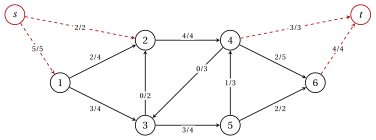

# 6.5 Un primo flusso fattibile { #sez-sec-mc-feasible }

**Parte 3 · Flussi · Capitolo 6** · [:material-book-open-variant: Capitolo 6: Flusso di costo minimo](index.md) · [:material-file-pdf-box: Dispensa, volume 3 (PDF)](../../pdf/dispensa-3-flussi.pdf) · [:material-pencil: Esercizi: Flusso di costo minimo](../../esercizi/min-cost-flow.md)

- Un algoritmo che migliora un flusso fattibile necessita di un flusso fattibile da cui partire. Con la sostituzione di [Capitolo 4](../network-flow-models/rimozione-dei-limiti-inferiori.md) possiamo assumere $\vet{l}=\vet{0}$.

!!! definizione "Definizione 6.11: rete ausiliaria"

    Supponiamo che $G=(N,A)$ sia una rete bilanciata con $\vet{l}=\vet{0}$ e $D=\sum_{i \in N: b_i>0} b_i$ la sua offerta totale. Il <strong>rete ausiliaria</strong> aggiunge a $G$ un <strong>super source</strong> $s$ e un <strong>super sink</strong> $t$, un arco $(s,i)$ con capacità $b_i$ per ogni nodo di fornitura $i$, e un arco $(i,t)$ con capacità $-b_i$ per ogni nodo di domanda $i$; gli archi di $A$ mantengono le loro capacità.

!!! teorema "Proposizione 6.12: un flusso fattibile da un flusso massimo"

    La rete $G$ ha una portata ammissibile se e solo se la portata massima $s$–$t$ della rete ausiliaria ha valore $D$. In tal caso, un flusso massimo limitato agli archi di $A$ è un flusso ammissibile di $G$.

??? dimostrazione "Dimostrazione"

    Il valore di un flusso $s$–$t$ è il flusso in uscita da $s$, al massimo la capacità totale $D$ degli archi $(s,i)$.

    1. <em>Solo se.</em> Sia $\vet{x}$ ammissibile, e poniamo $x_{si}=b_i$ sugli archi $(s,i)$ e $x_{it}=-b_i$ sugli archi archi $(i,t)$. In un nodo di offerta il deflusso meno l'afflusso diventa $b_i-x_{si}=0$, in un nodo di domanda $b_i+x_{it}=0$ e i nodi di traslato non cambiano: si tratta di un flusso $s$–$t$ di valore $D$, quindi massimo.

    2. <em>Se.</em> Lascia che un flusso massimo abbia valore $D$. Quindi tutti gli archi $(s,i)$ sono saturati. Il valore è anche il flusso entrante in $t$ e gli archi $(i,t)$ hanno capacità totale $\sum_{i: b_i<0}(-b_i)=D$, poiché la rete è bilanciata: anch'essi sono saturi.

    3. La conservazione in $i \in N$ dà quindi, lungo gli archi di $A$, deflusso meno afflusso pari a $x_{si}-x_{it}=b_i$, e le capacità reggono: la limitazione a $A$ è un flusso fattibile. □

- Calcoliamo il flusso massimo con l'algoritmo Edmonds–Karp di [Capitolo 5](../maximum-flow/l-algoritmo-edmondskarp.md): una ricerca in ampiezza da $s$ nella rete residua, scandendo gli archi che lasciano un nodo aumentando l'indice di la testa ($s$ prima del nodo $1$, $t$ dopo il nodo $n$).

- La portata massima ignora i costi: fornisce una portata fattibile, solitamente lontana dall'ottimale.

!!! esempio "Esempio 6.5: un flusso fattibile della rete di riferimento"

    La rete di riferimento ha $D=5+2=7$. La rete ausiliaria aggiunge gli archi $(s,1)$, $(s,2)$ con capacità $5$, $2$, e $(4,t)$, $(6,t)$ con capacità $3$, $4$ (rosso e tratteggiato nella figura). I cammini aumentanti del L'algoritmo di Edmonds–Karp è:

    
<table>
    <tr>
    <th>percorso</th>
    <th>nodi</th>
    <th>unità</th>
    </tr>
    <tr>
    <td>\(1\)</td>
    <td>\(s,2,4,t\)</td>
    <td>\(2\)</td>
    </tr>
    <tr>
    <td>\(2\)</td>
    <td>\(s,1,2,4,t\)</td>
    <td>\(1\)</td>
    </tr>
    <tr>
    <td>\(3\)</td>
    <td>\(s,1,2,4,6,t\)</td>
    <td>\(1\)</td>
    </tr>
    <tr>
    <td>\(4\)</td>
    <td>\(s,1,3,5,6,t\)</td>
    <td>\(2\)</td>
    </tr>
    <tr>
    <td>\(5\)</td>
    <td>\(s,1,3,5,4,6,t\)</td>
    <td>\(1\)</td>
    </tr>
    </table>

    Il valore è $7=D$, quindi la rete ha un flusso fattibile. Ciascun arco trasporta $x_{ij}/u_{ij}$:

    { .fig loading=lazy  }

    La restrizione a $A$ è $(2,3,4,0,3,0,2,1,2)$: su questa istanza è il flusso ottimale $\tilde{\vet{x}}$ di Capitolo 4. Questa è una coincidenza, poiché la ricerca non prende mai in considerazione i costi.

!!! chiave ""

    Una super fonte che alimenta i nodi di offerta e un super sink alimentato dai nodi di domanda trasformano la fattibilità in un flusso massimo problema: la rete ha un flusso ammissibile se e solo se il flusso massimo satura tutti i nuovi archi.

---

**Avanti:** [6.6 L'algoritmo di annullamento del ciclo](l-algoritmo-di-annullamento-del-ciclo.md)
