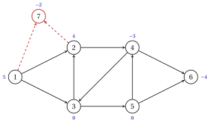

# 4.5 Istanze non bilanciate { #sez-sec-nf-dummy }

**Parte 3 · Flussi · Capitolo 4** · [:material-book-open-variant: Capitolo 4: Modelli di flusso](index.md) · [:material-file-pdf-box: Dispensa, volume 3 (PDF)](../../pdf/dispensa-3-flussi.pdf) · [:material-pencil: Esercizi: Modelli di flusso](../../esercizi/network-flow-models.md)

!!! definizione "Definizione 4.10: istanza non bilanciata"

    Un'istanza con $\sum_{i \in N} b_i>0$ è <strong>non bilanciata</strong>: l'offerta totale supera la domanda totale. Ogni la domanda deve essere soddisfatta e ogni nodo di fornitura $i$ invia <em>al massimo</em> unità $b_i$:

    $$
    \sum_{(i,j) \in \delta^+(i)} x_{ij} - \sum_{(j,i) \in \delta^-(i)} x_{ji} \;\le\; b_i \quad \forall i \in N:\, b_i>0,
    \qquad\quad = b_i \quad \forall i \in N:\, b_i \le 0,
    $$

    con i limiti $l_{ij} \le x_{ij} \le u_{ij}$ e l'obiettivo $\min \sum_{(i,j) \in A} c_{ij}\,x_{ij}$.

!!! definizione "Definizione 4.11: nodo fittizio"

    Sia $P=\{i \in N : b_i>0\}$ i nodi di fornitura e $e=\sum_{i \in N} b_i>0$ l'eccesso. <strong>equilibrato rete</strong> aggiunge un <strong>nodo fittizio</strong> $d$ con bilanciamento $b_d=-e$ e un arco $(i,d)$ per ogni $i \in P$ con $l_{id}=0$, $u_{id}=+\infty$ e $c_{id}=0$.

!!! teorema "Proposizione 4.12: il nodo fittizio"

    Le soluzioni ammissibili dell'istanza sbilanciata ed i flussi ammissibili della rete equilibrata corrispondono, con l' stesso costo: per l’istanza sbilanciata è fattibile un flusso della rete bilanciata limitato a $A$, e una soluzione di l'istanza sbilanciata diventa un flusso fattibile con $x_{id}=b_i-(\text{outflow}-\text{inflow of } i)$.

??? dimostrazione "Dimostrazione"

    Per un vettore $\vet{x}$ su $A$, sia $s_i(\vet{x})$ il deflusso meno l'afflusso del nodo $i$ lungo gli archi di $A$.

    1. Lascia che $(\vet{x},(x_{id})_{i \in P})$ sia fattibile per la rete bilanciata. In $i \in P$ si legge conservazione $s_i(\vet{x})+x_{id}=b_i$ con $x_{id} \ge 0$, quindi $s_i(\vet{x}) \le b_i$; negli altri nodi di $N$ si legge $s_i(\vet{x})=b_i$.

    2. Al contrario, lascia che $\vet{x}$ sia fattibile per l'istanza non bilanciata e imposta $x_{id}=b_i-s_i(\vet{x}) \ge 0$ per $i \in P$. La conservazione vale in ogni nodo di $N$ e in $d$ l'afflusso è

        $$
        \sum_{i \in P} x_{id}=\sum_{i \in P} b_i-\sum_{i \in N} s_i(\vet{x})+\sum_{i \notin P} s_i(\vet{x})
        =\sum_{i \in P} b_i - 0+\sum_{i \notin P} b_i=e,
        $$

        poiché i valori $s_i(\vet{x})$ si sommano a zero: ogni arco di $A$ contribuisce con $+x_{ij}$ alla sua coda e $-x_{ij}$ alla testa. Pertanto $d$ riceve esattamente unità $-b_d=e$.

    Gli archi fittizi costano zero, quindi i due costi coincidono. □

- Il flusso su $(i,d)$ è la parte della fornitura di $i$ che non viene utilizzata.

- Se la domanda totale supera l'offerta totale e le richieste sono limiti superiori, un nodo fittizio $d$ con saldo $b_d=-\sum_{i \in N} b_i$ e gli archi $(d,j)$ ai nodi di domanda bilanciano la rete allo stesso modo.

!!! esempio "Esempio 4.5: un nodo fittizio sulla rete di riferimento"

    Nella rete di [Esempio 4.1](reti-e-flussi.md#box-3-nf-ex-ref) aumentiamo l'offerta del nodo $2$ a $b_2=4$. L'offerta totale è $9$, la domanda totale è $7$ e l'eccesso è $e=2$.

    - La rete bilanciata aggiunge il nodo $7$ con $b_7=-2$ e gli archi $(1,7)$ e $(2,7)$ con costo $0$ e capacità $+\infty$ (tratteggiata in figura).

    - Il suo flusso ottimale, calcolato con Gurobi, spedisce tutte le unità $4$ del nodo $2$ e solo le unità $3$ del nodo $1$: $x_{17}=2$, $x_{27}=0$, con valore ottimale $56$.

    { .fig loading=lazy  }

!!! chiave ""

    Un'istanza sbilanciata diventa una rete bilanciata con un nodo fittizio che assorbe l'eccesso attraverso archi a costo zero; il flusso su un arco fittizio è la riserva inutilizzata della sua coda.

---

**Avanti:** [4.6 Totale unimodularità e integralità](totale-unimodularita-e-integralita.md)
