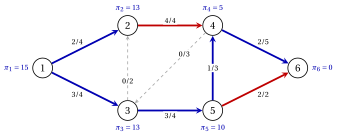

# 4.9 Un'istanza di traslato

**Parte 3 · Flussi · Capitolo 4** · [:material-book-open-variant: Capitolo 4: Modelli di flusso](index.md) · [:material-file-pdf-box: Dispensa, volume 3 (PDF)](../../pdf/dispensa-3-flussi.pdf) · [:material-pencil: Esercizi: Modelli di flusso](../../esercizi/network-flow-models.md)

- Risolviamo il modello $\mathrm{MCF}$ di [Esempio 4.2](il-modello-di-flusso-di-costo-minimo.md#box-6-nf-ex-model): la rete di riferimento, con due nodi di alimentazione, due nodi di domanda e due nodi di traslato. La soluzione ottima viene calcolata con Gurobi (gurobipy), e poi certificato a mano con [Corollario 4.20](il-modello-duale-e-i-costi-ridotti.md#box-27-nf-cor-certificate).

!!! esempio "Esempio 4.9: il flusso ottimale"

    Il flusso ottimale $\tilde{\vet{x}}$ e il suo valore ottimale sono

    
<table>
    <tr>
    <th>arco</th>
    <th>\((1,2)\)</th>
    <th>\((1,3)\)</th>
    <th>\((2,4)\)</th>
    <th>\((3,2)\)</th>
    <th>\((3,5)\)</th>
    <th>\((4,3)\)</th>
    <th>\((4,6)\)</th>
    <th>\((5,4)\)</th>
    <th>\((5,6)\)</th>
    </tr>
    <tr>
    <td>\(\tilde{x}_{ij}\)</td>
    <td>\(2\)</td>
    <td>\(3\)</td>
    <td>\(4\)</td>
    <td>\(0\)</td>
    <td>\(3\)</td>
    <td>\(0\)</td>
    <td>\(2\)</td>
    <td>\(1\)</td>
    <td>\(2\)</td>
    </tr>
    <tr>
    <td>\(u_{ij}\)</td>
    <td>\(4\)</td>
    <td>\(4\)</td>
    <td>\(4\)</td>
    <td>\(2\)</td>
    <td>\(4\)</td>
    <td>\(3\)</td>
    <td>\(5\)</td>
    <td>\(3\)</td>
    <td>\(2\)</td>
    </tr>
    </table>

    $z(\mathrm{MCF})=60$.

    Nella figura ogni arco porta $\tilde{x}_{ij}/u_{ij}$: gli archi strettamente compresi tra i loro limiti sono blu, gli archi a capacità rossa, gli archi vuoti grigi e tratteggiati. Accanto ad ogni nodo, il suo potenziale.

    { .fig loading=lazy  }

    Il flusso è intero, come garantisce [Corollario 4.16](totale-unimodularita-e-integralita.md#box-22-nf-cor-integral).

### 4.9.1 Il certificato di ottimalità

1. I cinque archi blu $(1,2)$, $(1,3)$, $(3,5)$, $(4,6)$, $(5,4)$ formano uno albero ricoprente. Chiediamo costi ridotti zero su di essi, $\pi_i-\pi_j=c_{ij}$ e normalizza con $\pi_6=0$.

2. Andando indietro dal nodo $6$: $\pi_4=\pi_6+c_{46}=5$, $\pi_5=\pi_4+c_{54}=10$, $\pi_3=\pi_5+c_{35}=13$, $\pi_1=\pi_3+c_{13}=15$ e $\pi_2=\pi_1-c_{12}=13$.

3. Il potenziale $\pi_i$ è il costo del percorso dell'albero da $i$ a $6$: ad esempio, $\pi_1=c_{13}+c_{35}+c_{54}+ c_{46}=2+3+5+5=15$.

!!! esempio "Esempio 4.10: costi ridotti e ottimalità"

    I costi ridotti $\bar{c}_{ij}=c_{ij}-\pi_i+\pi_j$ sono:

    
<table>
    <tr>
    <th>arco</th>
    <th>\((1,2)\)</th>
    <th>\((1,3)\)</th>
    <th>\((2,4)\)</th>
    <th>\((3,2)\)</th>
    <th>\((3,5)\)</th>
    <th>\((4,3)\)</th>
    <th>\((4,6)\)</th>
    <th>\((5,4)\)</th>
    <th>\((5,6)\)</th>
    </tr>
    <tr>
    <td>\(\bar{c}_{ij}\)</td>
    <td>\(0\)</td>
    <td>\(0\)</td>
    <td>\(-3\)</td>
    <td>\(2\)</td>
    <td>\(0\)</td>
    <td>\(11\)</td>
    <td>\(0\)</td>
    <td>\(0\)</td>
    <td>\(-7\)</td>
    </tr>
    <tr>
    <td>\(\alpha_{ij}\)</td>
    <td>\(0\)</td>
    <td>\(0\)</td>
    <td>\(3\)</td>
    <td>\(0\)</td>
    <td>\(0\)</td>
    <td>\(0\)</td>
    <td>\(0\)</td>
    <td>\(0\)</td>
    <td>\(7\)</td>
    </tr>
    </table>

    - Gli archi con $\bar{c}_{ij}>0$, $(3,2)$ e $(4,3)$, sono vuoti; gli archi con $\bar{c}_{ij}<0$, $(2,4)$ e $(5,6)$, sono al completo. Per [Corollario 4.20](il-modello-duale-e-i-costi-ridotti.md#box-27-nf-cor-certificate), $\tilde{\vet{x}}$ è ottimale.

    - Il doppio valore è $\sum_{i \in N} b_i\pi_i-\sum_{(i,j) \in A} u_{ij}\alpha_{ij}=86-26=60$, pari al costo di $\tilde{\vet{x}}$. I potenziali coincidono con i valori duali restituiti da Gurobi, spostati in modo che $\pi_6=0$.

- <strong>Unicità.</strong> Ogni flusso ottimale ha gap zero con $(\vet{\pi},\vet{\alpha})$, quindi per [Teorema 4.19](il-modello-duale-e-i-costi-ridotti.md#box-26-nf-th-gap) ha $x_{32}=x_{43}=0$, $x_{24}=4$ e $x_{56}=2$. Il flusso sui cinque gli archi degli alberi viene quindi fissato per conservazione, poiché le loro colonne sono linearmente indipendenti: $\tilde{\vet{x}}$ è il flusso ottimale unico.

- <strong>Il flusso $\bar{\vet{x}}$.</strong> Il flusso realizzabile $\bar{\vet{x}}$ di [Esempio 4.1](reti-e-flussi.md#box-3-nf-ex-ref) costi $63$, e il suo divario con la stessa doppia soluzione è $63-60=3=\alpha_{24}(u_{24}-\bar{x}_{24})=3 \cdot (4-3)$: l'arco $(2,4)$ non è utilizzato abbastanza.

!!! chiave ""

    Sulla rete di riferimento il flusso ottimale costa $60$. Le potenzialità del suo albero ricoprente danno costi ridotti positivo solo su archi vuoti e negativo solo su archi saturi: certificano l'ottimalità senza solutore.

## 4.10 Errori tipici

!!! attenzione "Attenzione"

    - <strong>Scambio di flusso in uscita e in entrata.</strong> Il vincolo di conservazione è il flusso in uscita meno l'afflusso pari a $b_i$, con $b_i>0$ in corrispondenza di un nodo di fornitura: i segni seguono la matrice di incidenza, $+1$ in coda.

    - <strong>Prendere $\sum_i b_i=0$ come sufficiente.</strong> Una rete bilanciata non può avere un flusso fattibile: un taglio potrebbe essere troppo piccolo per portare la scorta al suo interno.

    - <strong>Sbagliare i segni di sostituzione.</strong> Con $\vet{x}=\vet{l}+\vet{x}'$ la coda di $(i,j)$ perde $l_{ij}$ unità di equilibrio e la testa ne guadagna; al valore deve essere aggiunta nuovamente la costante $\vet{c}'\vet{l}$.

    - <strong>Dimenticando il nodo fittizio.</strong> Un'istanza con più offerta che domanda non ha un flusso fattibile con uguaglianze; gli archi fittizi devono costare zero, altrimenti la fornitura inutilizzata viene addebitata.

    - <strong>Rivendicare l'integralità per qualsiasi matrice.</strong> I vertici interi necessitano di una matrice TU e di un intero $\vet{b}$, $\vet{l}$, $\vet{u}$; i costi possono essere frazionari.

    - <strong>Scrivere il costo ridotto con i segni sbagliati.</strong> In questo modulo $\bar{c}_{ij}=c_{ij}-\pi_i+\pi_j$, con $-\pi$ della coda e $+\pi$ della testa.

    - <strong>Attesi potenziali unici.</strong> I potenziali sono definiti fino a una costante additiva; sono fissati da a normalizzazione come $\pi_n=0$.

## 4.11 In sintesi

!!! chiave "In sintesi"

    - Una rete ha saldi $b_i$, limiti inferiori $l_{ij}$, capacità $u_{ij}$ e costi $c_{ij}$; il costo minimo il problema del flusso è l'LP $\min\{\vet{c}'\vet{x} : \mat{B}\vet{x}=\vet{b},~\vet{l} \le \vet{x} \le \vet{u}\}$.

    - Attraverso ogni taglio il deflusso netto è uguale al saldo interno; una rete realizzabile è equilibrata e soddisfa i condizione di taglio.

    - I limiti inferiori vengono rimossi con $\vet{x}=\vet{l}+\vet{x}'$; un eccesso di offerta passa attraverso un nodo fittizio archi a costo zero.

    - La matrice di incidenza è totalmente unimodulare, quindi con l'intero $\vet{b}$, $\vet{l}$, $\vet{u}$ ogni vertice è intero e il modello $\mathrm{MCF}$ ha una soluzione ottima intera.

    - Il duale ha potenzialità $\pi_i$; con $\bar{c}_{ij}=c_{ij}-\pi_i+\pi_j$, un flusso con archi vuoti a costo positivo e gli archi saturati a costo negativo sono ottimali.

    - Percorso più breve, flusso massimo, trasporto e assegnazione sono i modelli $\mathrm{MCF}$.

    <strong>La rete di riferimento in sintesi.</strong>

    
<table>
    <tr>
    <td>saldi</td>
    <td>\(\vet{b}=(5,2,0,-3,0,-4)\)</td>
    </tr>
    <tr>
    <td>flusso ottimale</td>
    <td>\(\tilde{\vet{x}}=(2,3,4,0,3,0,2,1,2)\), \(z(\mathrm{MCF})=60\)</td>
    </tr>
    <tr>
    <td>potenziali (\(\pi_6=0\))</td>
    <td>\(\vet{\pi}=(15,13,13,5,10,0)\)</td>
    </tr>
    <tr>
    <td>Archi vuoti/saturi</td>
    <td>\((3,2)\), \((4,3)\) / \((2,4)\), \((5,6)\)</td>
    </tr>
    <tr>
    <td>con \(l_{32}=1\)</td>
    <td>\(\vet{b}'=(5,3,-1,-3,0,-4)\), valore ottimale \(62\)</td>
    </tr>
    <tr>
    <td>con \(b_2=4\) (nodo fittizio \(7\)) e \(x_{17}=2\), valore ottimale \(56\)</td>
    </tr>
    </table>

---

**Esercizi su questo capitolo:** [:material-pencil: Modelli di flusso](../../esercizi/network-flow-models.md)
