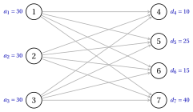
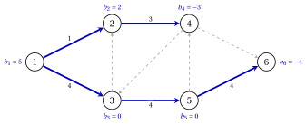

# 7.1 Il problema dei trasporti { #sez-ta-sec-transport }

**Parte 3 · Flussi · Capitolo 7** · [:material-book-open-variant: Capitolo 7: Trasporto e assegnamento](index.md) · [:material-file-pdf-box: Dispensa, volume 3 (PDF)](../../pdf/dispensa-3-flussi.pdf) · [:material-pencil: Esercizi: Trasporto e assegnamento](../../esercizi/transportation-and-assignment.md)

!!! definizione "Definizione 7.1: problema di trasporto"

    Esistono $m$ <strong>origini</strong> e $n$ <strong>destinazioni</strong>. Numeriamo le origini $1,2,\dots,m$ e le destinazioni $m+1,m+2,\dots,m+n$ e scriviamo

    $$
    P=\{1,2,\dots,m\}, \qquad D=\{m+1,m+2,\dots,m+n\}.
    $$

    - Ogni origine $i \in P$ ha un <strong>supply</strong> $a_i>0$, ogni destinazione $j \in D$ ha un <strong>demand</strong> $d_j>0$ e $c_{ij} \in \R$ è il costo di spedizione di un'unità da $i$ a $j$.

    - L'istanza è <strong>bilanciata</strong> se $\sum_{i \in P} a_i=\sum_{j \in D} d_j$.

    Il <strong>problema di trasporto</strong> richiede gli importi $x_{ij} \ge 0$ da spedire da ogni origine $i$ a ogni destinazione $j$, in modo che ogni origine spedisca l'intera fornitura e ogni destinazione riceva almeno la sua domanda costo totale.

- In questo capitolo $m$ e $n$ sono i numeri di origine e destinazione. La rete sottostante ha nodi $m+n$ e un arco $(i,j)$ per ogni $i \in P$ e $j \in D$, cioè archi $m\,n$: è l'arco <strong>bipartito completo rete</strong> di $P$ e $D$, poiché ogni arco va da $P$ a $D$.

- Numerare le destinazioni dopo le origini dà ad ogni nodo il proprio numero, e successivamente le proprie potenzialità.

- Usiamo una variabile continua $x_{ij}$ per ogni coppia $i \in P$, $j \in D$: l'importo spedito da $i$ a $j$.

!!! chiave ""

    Utilizzando queste variabili, un modello LP per il problema dei trasporti è il seguente:

    

    \begin{align*}
    &&   \min \;\;{\sum_{i \in P} \sum_{j \in D} c_{ij} \, x_{ij}}                                \label{ta:obj}  \tag{7.1a}\\[1ex]
    && \text{subject to} \quad  \sum_{j \in D} x_{ij} &= a_i, & \forall i \in P,              \label{ta:supply}  \tag{7.1b}\\[1ex]
    && \sum_{i \in P} x_{ij} &= d_j, & \forall j \in D,                                      \label{ta:demand}  \tag{7.1c}\\[1ex]
    && x_{ij} &\ge 0, & \forall i \in P,~\forall j \in D.                                     \label{ta:dom} \tag{7.1d}
    \end{align*}

    Questo modello LP è denominato modello $\mathrm{TP}$.

- Descrizione della funzione obiettivo e dei vincoli del modello $\mathrm{TP}$:

    - la funzione obiettivo $\eqref{ta:obj}$ riduce al minimo il costo totale di spedizione;

    - Vincoli  $\eqref{ta:supply}$, uno per ogni origine, spedisce l'intera fornitura dell'origine;

    - Vincoli  $\eqref{ta:demand}$, uno per ogni destinazione, soddisfa l'intera domanda della destinazione;

    - infine, i vincoli $\eqref{ta:dom}$ definiscono le variabili del modello LP.

- Moltiplicando i vincoli $\eqref{ta:demand}$ per $-1$ si ottengono i vincoli di conservazione del flusso dell'intero rete bipartita, con saldi $b_i=a_i$ per $i \in P$, $b_j=-d_j$ per $j \in D$ e nessuna capacità. Il $\mathrm{TP}$ il modello è il modello $\mathrm{MCF}$ della riga «Trasporti» della tabella «Casi speciali» di [Capitolo 4 «Modelli di flusso di rete»](../network-flow-models/casi-speciali.md).

!!! teorema "Proposizione 7.2: fattibilità e integralità"

    Un esempio del problema dei trasporti ha una soluzione ammissibile se e solo se è bilanciata. Un'istanza equilibrata ha una soluzione ottima e se le forniture $a_i$ e le richieste $d_j$ sono intere, ha un ottimo intero soluzione.

??? dimostrazione "Dimostrazione"

    Lascia che $S=\sum_{i \in P} a_i$.

    1. <em>L'equilibrio è necessario.</em> Se $\vet{x}$ è fattibile, sommando i vincoli $\eqref{ta:supply}$ e il vincoli $\eqref{ta:demand}$ fornisce la stessa somma di tutte le variabili: $\sum_{i \in P} a_i=\sum_{i \in P}\sum_{j \in D} x_{ij}=\sum_{j \in D} d_j$.

    2. <em>Il saldo è sufficiente.</em> Se $S=\sum_{j \in D} d_j$, gli importi $x_{ij}=a_i\,d_j/S \ge 0$ sono fattibili: la riga $i$ si somma a $a_i\sum_{j \in D} d_j/S=a_i$ e la colonna $j$ a $d_j\sum_{i \in P} a_i/S=d_j$.

    3. <em>Soluzione ottimale.</em> Ogni soluzione ammissibile ha $0 \le x_{ij} \le a_i$, quindi la regione ammissibile è poliedro limitato non vuoto e una funzione lineare raggiunge il suo minimo su di esso in un vertice ([Capitolo 15 «La geometria di Programmazione lineare»](https://fabiofurini.github.io/programmazione-lineare/metodi-avanzati/15-geometria/) del modulo Programmazione lineare).

    4. <em>Integralità.</em> Con bilanci interi e senza capacità, ogni vertice è intero per il Teorema «intero vertici» di [Capitolo 4](../network-flow-models/totale-unimodularita-e-integralita.md). □

## 7.1.1 Il quadro dei trasporti

- <strong>tableau di trasporto</strong> è una tabella $m \times n$ con una riga per ogni origine e una colonna per ogni destinazione. La cella $(i,j)$ contiene il costo $c_{ij}$, o successivamente l'importo $x_{ij}$; l'ultima colonna contiene il fornisce $a_i$ e l'ultima riga richiede $d_j$.

- Un vettore $\vet{x} \ge \vet{0}$ scritto nel tableau è fattibile se e solo se ogni riga si somma alla sua offerta e ogni colonna alla sua richiesta.

!!! esempio "Esempio 7.1: tre magazzini e quattro negozi"

    Un'azienda ha tre magazzini, le origini $1,2,3$, con unità $30$ ciascuno, e quattro negozi, le destinazioni $4,5,6,7$, con richieste $10$, $25$, $15$ e $40$. I costi unitari sono nel tableau:

    $$
    \begin{array}{c|cccc|c}
    \hline {c_{ij}} & {4} & {5} & {6} & {7} & {a_i} \\
    \hline {1} & {1} & {9} & {2} & {3} & {30} \\
    {2} & {3} & {4} & {2} & {2} & {30} \\
    {3} & {9} & {1} & {4} & {6} & {30} \\
    \hline {d_j} & {10} & {25} & {15} & {40} & {90} \\
    \hline
    \end{array}
    $$

    L'istanza è bilanciata: l'offerta totale e la domanda totale sono entrambe $90$. Nella completa rete bipartita ogni origine è unita ad ogni destinazione, con archi $3 \cdot 4=12$; accanto a ciascun nodo, la sua offerta o la sua domanda.

    { .fig loading=lazy  }

    Gli importi proporzionali $x_{ij}=a_i\,d_j/90$ di [Proposizione 7.2](#box-2-ta-prop-exist) sono fattibili, per esempio $x_{14}=30 \cdot 10/90=\frac{10}{3}$, ma frazionario; i vertici della regione ammissibile sono interi.

## 7.1.2 Istanze non bilanciate

- Se l'offerta totale supera la domanda totale e ogni origine spedisce <em>al massimo</em> la propria offerta, aggiungiamo un <strong>destinazione fittizia</strong> con domanda $\sum_{i \in P} a_i-\sum_{j \in D} d_j$ e costo $0$ da ogni origine. Il l'importo spedito ad esso è la fornitura inutilizzata dell'origine: questo è il nodo fittizio di [Capitolo 4](../network-flow-models/istanze-non-bilanciate.md), come colonna del quadro.

- Se la domanda totale supera l'offerta totale e una destinazione potrebbe ricevere meno della sua domanda, aggiungiamo un <strong>origine fittizia</strong> con fornitura $\sum_{j \in D} d_j-\sum_{i \in P} a_i$. Il costo della sua cella $(\cdot,j)$ è il penalità per ogni unità di domanda non soddisfatta di $j$ o $0$ se non ce n'è.

!!! esempio "Esempio 7.2: una destinazione fittizia"

    In [Esempio 7.1](#box-3-ta-ex-tp) la fornitura del magazzino $1$ cresce fino a $a_1=40$: la fornitura totale è $100$ e la domanda totale $90$.

    - Aggiungiamo la destinazione fittizia $8$ con richiesta $d_8=100-90=10$ e le celle $(1,8)$, $(2,8)$, $(3,8)$ con costo $0$: il tableau ha una quinta colonna.

    - La soluzione ottimale, calcolata con Gurobi, è unica:

        $$
        \tilde{x}_{14}=10,~ \tilde{x}_{16}=15,~ \tilde{x}_{17}=10,~ \tilde{x}_{18}=5,~ \tilde{x}_{27}=30,~ \tilde{x}_{35}=25,~
        \tilde{x}_{38}=5,
        $$

        con costo $155$. I magazzini $1$ e $3$ conservano ciascuno le unità $5$ e il magazzino $2$ spedisce tutta la sua fornitura.

## 7.1.3 Trasbordo come problema di trasporto

- In un'istanza di traslato le unità possono passare attraverso nodi intermedi. Quando gli archi non hanno capacità, ogni unità può percorrere il percorso più breve e contano solo le distanze tra i nodi di domanda e di offerta.

!!! teorema "Proposizione 7.3: traslato come trasporto"

    Sia $G=(N,A)$ una rete con saldi $b_i$, zero limiti inferiori, nessuna capacità e costi $c_{ij} \ge 0$. Lasciamo $P=\{i \in N : b_i>0\}$ e $D=\{j \in N : b_j<0\}$ e supponiamo che ogni $j \in D$ sia raggiungibile da ogni $i \in P$, with distance $\tilde{d}(i,j)$ for the lengths $c_{ij}$. Allora il costo minimo di un flusso realizzabile è uguale a valore ottimale dell'istanza di trasporto con origini $P$, forniture $a_i=b_i$, destinazioni $D$, richieste $d_j=-b_j$ e costa $\tilde{d}(i,j)$.

??? dimostrazione "Dimostrazione"

    Confrontiamo i due valori ottimali.

    1. <em>Dalle spedizioni ai flussi.</em> Lascia che $\vet{y}$ sia fattibile per l'istanza di trasporto. Invio di unità $y_{ij}$ lungo un percorso più breve da $i$ a $j$, per ogni coppia, dà un flusso $\vet{x} \ge \vet{0}$: il nodo $i \in P$ invia Unità $\sum_{j \in D} y_{ij}=b_i$, il nodo $j \in D$ riceve $-b_j$, gli altri nodi trasmettono ciò che ricevono. Il suo costo è $\sum_{i,j} \tilde{d}(i,j)\,y_{ij}$, quindi il costo di flusso minimo è al massimo il trasporto ottimale.

    2. <em>Dai flussi alle spedizioni.</em> Mostriamo per induzione sul numero di archi con $x_{ij}>0$ più il numero di nodi con $b_i \neq 0$ che ogni flusso fattibile $\vet{x}$ costa almeno $\sum_{i,j} \tilde{d}(i,j)\,y_{ij}$ per alcuni realizzabile $\vet{y}$. Se $\vet{b}=\vet{0}$, prendi $\vet{y}=\vet{0}$.

    3. Altrimenti inizia da un nodo $i_0$ con $b_{i_0}>0$: il suo deflusso è positivo, quindi ha un arco uscente con positivo flusso. Un nodo $v$ con $b_v \ge 0$ raggiunto lungo tale arco ha un afflusso positivo, quindi un deflusso positivo. Segui questi archi fino a quando un nodo si ripete o viene raggiunto un nodo $j_0$ con $b_{j_0}<0$.

    4. Se un nodo si ripete, gli archi formano un ciclo diretto $C$ con flussi positivi. Sottraendo il loro minimo $\varepsilon$ insieme a $C$ mantiene fattibile il flusso, non aumenta il costo, poiché $c \ge 0$, e svuota un arco: il si applica l’induzione.

    5. Altrimenti abbiamo un percorso $Q$ da $i_0$ a $j_0$. Sia $\varepsilon>0$ il minimo di $b_{i_0}$, $-b_{j_0}$ e i flussi su $Q$. Sottraendo $\varepsilon$ lungo $Q$ e da $b_{i_0}$ e $-b_{j_0}$ si ottiene un flusso ammissibile $\vet{x}'$ per i nuovi saldi, con meno archi positivi o saldi diversi da zero e

        $$
        \vet{c}'\vet{x}=\vet{c}'\vet{x}'+\varepsilon\, c(Q) \ge \vet{c}'\vet{x}'+\varepsilon\,\tilde{d}(i_0,j_0).
        $$

        Per induzione $\vet{c}'\vet{x}' \ge \sum \tilde{d}(i,j)\,y'_{ij}$; aggiungendo $\varepsilon$ a $y'_{i_0j_0}$ si ottiene il richiesto $\vet{y}$.

    
□

!!! esempio "Esempio 7.3: l'istanza di traslato del capitolo 4 senza capacità"

    Prendiamo la rete di riferimento di [Capitolo 4](../network-flow-models/un-istanza-di-traslato.md), con lo stesso bilancia $\vet{b}=(5,2,0,-3,0,-4)$ e costi e rimuove le capacità. Le origini sono i nodi di alimentazione $1,2$ e le destinazioni i nodi di domanda $4,6$; manteniamo i nomi della rete.

    - Le distanze sono $\tilde{d}(1,4)=7$ lungo $1,2,4$, $\tilde{d}(1,6)=8$ lungo $1,3,5,6$, $\tilde{d}(2,4)=5$ lungo $2,4$ e $\tilde{d}(2,6)=10$ lungo $2,4,6$.

    - L'istanza di trasporto $2 \times 2$ ha $a_1=5$, $a_2=2$, $d_4=3$, $d_6=4$. Con $y_{24}=t \in [0,2]$ il gli altri importi sono $y_{14}=3-t$, $y_{16}=2+t$, $y_{26}=2-t$ e il costo è

        $$
        7(3-t)+8(2+t)+5t+10(2-t)=57-4t,
        $$

        minimo per $t=2$: $y_{14}=1$, $y_{16}=4$, $y_{24}=2$, $y_{26}=0$, con costo $49$.

    - Lungo i percorsi più brevi si ottiene il flusso $x_{12}=1$, $x_{13}=4$, $x_{24}=3$, $x_{35}=4$, $x_{56}=4$ (blu), del costo $49$, l'ottimo calcolato da Gurobi. Con le capacità del Capitolo 4 questo flusso non è fattibile, poiché il l'arco $(5,6)$ ha la capacità $2$ e l'ottimale è $60$.

    { .fig loading=lazy  }

!!! chiave ""

    Il problema del trasporto spedisce le forniture dalle origini $m$ alle richieste delle destinazioni $n$ a un costo minimo. Lo è un modello di flusso di costo minimo sull'intera rete bipartita; è fattibile esattamente quando è equilibrato, e a l'origine o la destinazione fittizia lo bilancia.

---

**Avanti:** [7.2 Soluzioni di base](soluzioni-di-base.md)
