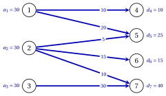

# 7.3 Soluzioni ammissibili di base iniziali { #sez-ta-sec-initial }

**Parte 3 · Flussi · Capitolo 7** · [:material-book-open-variant: Capitolo 7: Trasporto e assegnamento](index.md) · [:material-file-pdf-box: Dispensa, volume 3 (PDF)](../../pdf/dispensa-3-flussi.pdf) · [:material-presentation: Slide](../../pdf/slide-transportation-and-assignment.pdf) · [:material-pencil: Esercizi: Trasporto e assegnamento](../../esercizi/transportation-and-assignment.md) · [:material-gesture-tap: App: Trasporto: soluzione iniziale e metodo dei potenziali](../../laboratorio/trasporto-metodo-dei-potenziali.md) · [:material-gesture-tap: App: Assegnamento: l'algoritmo ungherese](../../laboratorio/assegnamento-algoritmo-ungherese.md)

- Una soluzione ammissibile di base si costruisce riempiendo la tabella una cella alla volta. Una riga o una colonna è <strong>attiva</strong> finché non viene barrata; l'offerta residua $\bar{a}_i$ e la domanda residua $\bar{d}_j$ sono ciò che resta da spedire e da ricevere.

- Le due regole che seguono differiscono solo nella scelta della cella successiva.

!!! algoritmo "Algoritmo: Soluzione ammissibile di base iniziale"

    

<strong>Input:</strong> un'istanza bilanciata con offerte \(a_i\), domande \(d_j\) e costi \(c_{ij}\)

<strong>Output:</strong> una base \(T\) e la sua soluzione ammissibile di base \(\bar{\vet{x}}\)

1<strong>Passo 0 (inizializzazione).</strong> Tutte le righe e le colonne sono attive; \(\bar{a}_i:=a_i\), \(\bar{d}_j:=d_j\), \(T:=\emptyset\).

2<strong>Passo 1 (scelta della cella).</strong> Scegliere una cella \((i,j)\) con riga e colonna attive:

3  <em>regola dell'angolo nord-ovest</em>: la cella con \(i\) più piccolo e \(j\) più piccolo;

4  <em>regola del costo minimo</em>: la cella con \(c_{ij}\) più piccolo (a parità, \(i\) più piccolo, poi \(j\)).

5<strong>Passo 2 (quantità).</strong> Porre \(\bar{x}_{ij}:=\min\{\bar{a}_i,\bar{d}_j\}\), aggiungere \((i,j)\) a \(T\), e sottrarre
    \(\bar{x}_{ij}\) da \(\bar{a}_i\) e da \(\bar{d}_j\).

6<strong>Passo 3 (barratura).</strong> Se \(\bar{a}_i=0\) e un'altra riga è attiva, barrare la riga \(i\); altrimenti barrare la
    colonna \(j\).

7  Se nessuna colonna è attiva, <code>STOP</code>; altrimenti andare al Passo 1.

- Quando $\bar{a}_i=\bar{d}_j=0$ nello stesso momento, viene barrata solo la riga: la colonna resta attiva con domanda residua $0$, e una cella successiva di quella colonna riceve la quantità $0$. Questa cella di base con valore $0$ mantiene $T$ un albero ricoprente, e la soluzione è degenere.

!!! teorema "Teorema 7.8: la soluzione iniziale è di base"

    Con entrambe le regole, l'algoritmo «Soluzione ammissibile di base iniziale» si ferma dopo $m+n-1$ passi, e $T$ è una base con soluzione ammissibile di base $\bar{\vet{x}}$.

??? dimostrazione "Dimostrazione"

    1. <em>Invariante.</em> Le offerte residue delle righe attive e le domande residue delle colonne attive hanno somme uguali: vale all'inizio, e il Passo 2 sottrae la stessa quantità dalle due parti.

    2. <em>Una linea barrata ha residuo $0$.</em> Una riga barrata ha $\bar{a}_i=0$. Una colonna viene barrata quando $\bar{a}_i>0$, e allora $\bar{x}_{ij}=\bar{d}_j$ e $\bar{d}_j=0$, oppure quando la riga $i$ è l'unica riga attiva con $\bar{a}_i=0$, e allora ogni colonna attiva ha residuo $0$ per l'invariante.

    3. <em>Conteggio.</em> Una riga viene barrata solo se un'altra riga è attiva, quindi una riga $r$ non viene mai barrata, e l'algoritmo si ferma quando le $n$ colonne sono barrate. All'arresto le righe attive hanno residuo $0$ per l'invariante, e una riga che arriva a $0$ senza essere barrata è l'unica riga attiva. Quindi i passi sono $(m-1)+n=m+n-1$, una cella ciascuno, tutte diverse, perché una cella si sceglie in due linee attive e una delle due viene poi barrata.

    4. <em>Ammissibilità.</em> All'arresto ogni riga e ogni colonna ha residuo $0$, quindi $\bar{\vet{x}} \ge \vet{0}$ soddisfa tutti i vincoli.

    5. <em>Albero.</em> Sia $L_t$ la linea barrata al passo $t$: nessuna cella successiva sta in $L_t$. Procedendo all'indietro dall'ultimo passo, le celle dei passi $t,t+1,\dots$ formano un albero: la cella del passo $t$ collega il nuovo nodo $L_t$ alla sua altra linea, ancora attiva, quindi un nodo delle celle successive o la riga $r$. Per $t=1$ l'albero ricopre tutti gli $m+n$ nodi. □

## 7.3.1 La regola dell'angolo nord-ovest

!!! esempio "Esempio 7.5: la regola dell'angolo nord-ovest"

    Sull'[Esempio 7.1](il-problema-di-trasporto.md#box-3-ta-ex-tp) la regola dell'angolo nord-ovest parte dalla cella $(1,4)$ e si sposta a destra o in basso. I suoi passi sono:

    
<table>
    <tr>
    <th>passo</th>
    <th>cella</th>
    <th>quantità</th>
    <th>barrata</th>
    </tr>
    <tr>
    <td>\(1\)</td>
    <td>\((1,4)\)</td>
    <td>\(10\)</td>
    <td>colonna \(4\)</td>
    </tr>
    <tr>
    <td>\(2\)</td>
    <td>\((1,5)\)</td>
    <td>\(20\)</td>
    <td>riga \(1\)</td>
    </tr>
    <tr>
    <td>\(3\)</td>
    <td>\((2,5)\)</td>
    <td>\(5\)</td>
    <td>colonna \(5\)</td>
    </tr>
    <tr>
    <td>\(4\)</td>
    <td>\((2,6)\)</td>
    <td>\(15\)</td>
    <td>colonna \(6\)</td>
    </tr>
    <tr>
    <td>\(5\)</td>
    <td>\((2,7)\)</td>
    <td>\(10\)</td>
    <td>riga \(2\)</td>
    </tr>
    <tr>
    <td>\(6\)</td>
    <td>\((3,7)\)</td>
    <td>\(30\)</td>
    <td>riga \(3\), colonna \(7\)</td>
    </tr>
    </table>

    La soluzione ammissibile di base, con le celle di base in blu, è

    
<table>
    <tr>
    <th>\(\bar{x}_{ij}\)</th>
    <th>\(4\)</th>
    <th>\(5\)</th>
    <th>\(6\)</th>
    <th>\(7\)</th>
    <th>\(a_i\)</th>
    </tr>
    <tr>
    <td>\(1\)</td>
    <td class="cella-blu">\(10\)</td>
    <td class="cella-blu">\(20\)</td>
    <td></td>
    <td></td>
    <td>\(30\)</td>
    </tr>
    <tr>
    <td>\(2\)</td>
    <td></td>
    <td class="cella-blu">\(5\)</td>
    <td class="cella-blu">\(15\)</td>
    <td class="cella-blu">\(10\)</td>
    <td>\(30\)</td>
    </tr>
    <tr>
    <td>\(3\)</td>
    <td></td>
    <td></td>
    <td></td>
    <td class="cella-blu">\(30\)</td>
    <td>\(30\)</td>
    </tr>
    <tr>
    <td>\(d_j\)</td>
    <td>\(10\)</td>
    <td>\(25\)</td>
    <td>\(15\)</td>
    <td>\(40\)</td>
    <td></td>
    </tr>
    </table>

    Il suo costo è

    $$
    1 \cdot 10+9 \cdot 20+4 \cdot 5+2 \cdot 15+2 \cdot 10+6 \cdot 30=440 .
    $$

    Le sei celle di base formano l'albero ricoprente qui sotto, con le quantità sugli archi.

    { .fig loading=lazy  }

- La regola dell'angolo nord-ovest ignora i costi: su questa istanza spedisce $20$ unità sulla cella $(1,5)$, di costo $9$, e $30$ unità su $(3,7)$, di costo $6$.

## 7.3.2 La regola del costo minimo

!!! esempio "Esempio 7.6: la regola del costo minimo"

    Sull'[Esempio 7.1](il-problema-di-trasporto.md#box-3-ta-ex-tp) la regola del costo minimo sceglie, a ogni passo, la cella più economica fra le righe e le colonne attive:

    
<table>
    <tr>
    <th>passo</th>
    <th>cella</th>
    <th>quantità</th>
    <th>barrata</th>
    </tr>
    <tr>
    <td>\(1\)</td>
    <td>\((1,4)\)</td>
    <td>\(10\)</td>
    <td>colonna \(4\)</td>
    </tr>
    <tr>
    <td>\(2\)</td>
    <td>\((3,5)\)</td>
    <td>\(25\)</td>
    <td>colonna \(5\)</td>
    </tr>
    <tr>
    <td>\(3\)</td>
    <td>\((1,6)\)</td>
    <td>\(15\)</td>
    <td>colonna \(6\)</td>
    </tr>
    <tr>
    <td>\(4\)</td>
    <td>\((2,7)\)</td>
    <td>\(30\)</td>
    <td>riga \(2\)</td>
    </tr>
    <tr>
    <td>\(5\)</td>
    <td>\((1,7)\)</td>
    <td>\(5\)</td>
    <td>riga \(1\)</td>
    </tr>
    <tr>
    <td>\(6\)</td>
    <td>\((3,7)\)</td>
    <td>\(5\)</td>
    <td>riga \(3\), colonna \(7\)</td>
    </tr>
    </table>

    - Al passo $1$ le celle $(1,4)$ e $(3,5)$ costano entrambe $1$, e $(1,4)$ viene prima, perché la sua riga è più piccola. Al passo $3$ le celle $(1,6)$, $(2,6)$, $(2,7)$ costano $2$, e $(1,6)$ viene prima.

    - Al passo $4$ è attiva solo la colonna $7$: prende tutta l'offerta della riga $2$, poi $5$ unità dalla riga $1$ e $5$ dalla riga $3$.

    La soluzione ammissibile di base è

    
<table>
    <tr>
    <th>\(\bar{x}_{ij}\)</th>
    <th>\(4\)</th>
    <th>\(5\)</th>
    <th>\(6\)</th>
    <th>\(7\)</th>
    <th>\(a_i\)</th>
    </tr>
    <tr>
    <td>\(1\)</td>
    <td class="cella-blu">\(10\)</td>
    <td></td>
    <td class="cella-blu">\(15\)</td>
    <td class="cella-blu">\(5\)</td>
    <td>\(30\)</td>
    </tr>
    <tr>
    <td>\(2\)</td>
    <td></td>
    <td></td>
    <td></td>
    <td class="cella-blu">\(30\)</td>
    <td>\(30\)</td>
    </tr>
    <tr>
    <td>\(3\)</td>
    <td></td>
    <td class="cella-blu">\(25\)</td>
    <td></td>
    <td class="cella-blu">\(5\)</td>
    <td>\(30\)</td>
    </tr>
    <tr>
    <td>\(d_j\)</td>
    <td>\(10\)</td>
    <td>\(25\)</td>
    <td>\(15\)</td>
    <td>\(40\)</td>
    <td></td>
    </tr>
    </table>

    con costo

    $$
    1 \cdot 10+2 \cdot 15+3 \cdot 5+2 \cdot 30+1 \cdot 25+6 \cdot 5=170 .
    $$

!!! chiave ""

    Riempiendo una cella per passo e barrando una linea per passo si ottiene una soluzione ammissibile di base con $m+n-1$ celle di base. La regola dell'angolo nord-ovest ignora i costi; la regola del costo minimo di solito parte molto più vicino all'ottimo ($170$ invece di $440$ nell'esempio).

---

**Avanti:** [7.4 Il metodo dei potenziali](il-metodo-dei-potenziali.md)
