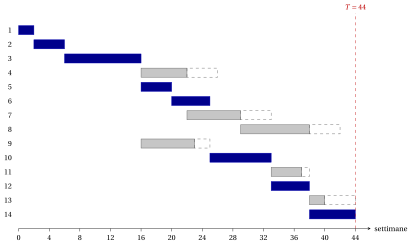

# 9.6 Il metodo del cammino critico { #sez-pm-sec-cpm }

**Parte 5 · Gestione dei progetti · Capitolo 9** · [:material-book-open-variant: Capitolo 9: Gestione dei progetti](index.md) · [:material-file-pdf-box: Dispensa, volume 5 (PDF)](../../pdf/dispensa-5-gestione-dei-progetti.pdf) · [:material-presentation: Slide](../../pdf/slide-project-management.pdf) · [:material-pencil: Esercizi: Gestione dei progetti](../../esercizi/project-management.md) · [:material-gesture-tap: App: Il metodo del cammino critico (CPM)](../../laboratorio/cammino-critico-cpm.md)

!!! algoritmo "Algoritmo: Metodo del cammino critico (CPM)"

    

<strong>Input:</strong> un progetto con attività \(1,2,\dots,n\), durate \(d_j>0\) e precedenze

<strong>Output:</strong> i tempi \(\mathit{ES}_j\), \(\mathit{EF}_j\), \(\mathit{LS}_j\), \(\mathit{LF}_j\), le scorte, la durata minima del progetto \(T\) e gli archi stretti

1<strong>Passo 0 (rete).</strong> Costruire la rete delle attività \(G=(N,A)\) e un ordine topologico: togliere ripetutamente
    un nodo senza archi entranti (quello di indice minimo, se sono più di uno).

2  Se restano nodi e hanno tutti archi entranti, <code>STOP</code>: le precedenze contengono un ciclo.

3<strong>Passo 1 (passata in avanti).</strong> Porre \(\mathit{ES}_0:=0\). Per ogni nodo \(j \neq 0\) in ordine topologico, porre
    \(\mathit{ES}_j:=\max_{(i,j) \in \delta^-(j)} \mathit{EF}_i\); porre \(\mathit{EF}_j:=\mathit{ES}_j+d_j\) per ogni \(j\), e \(T:=\mathit{ES}_{n+1}\).

4<strong>Passo 2 (passata all'indietro).</strong> Porre \(\mathit{LF}_{n+1}:=T\). Per ogni nodo \(j \neq n+1\) in ordine topologico
    inverso, porre \(\mathit{LF}_j:=\min_{(j,k) \in \delta^+(j)} \mathit{LS}_k\); porre \(\mathit{LS}_j:=\mathit{LF}_j-d_j\) per ogni \(j\).

5<strong>Passo 3 (scorte).</strong> Per ogni attività \(j\), porre \(\mathit{TS}_j:=\mathit{LS}_j-\mathit{ES}_j\) e \(\mathit{FS}_j:=\min_{(j,k) \in \delta^+(j)} \mathit{ES}_k-\mathit{EF}_j\); segnare gli archi stretti, \(\mathit{ES}_j=\mathit{EF}_i\). I cammini critici sono i cammini di archi stretti da START a
    FINISH.

6<code>STOP</code>.

!!! teorema "Teorema 9.16: tempo di esecuzione del metodo del cammino critico"

    Il metodo del cammino critico richiede tempo $O(n+m)$, dove $m=|A|$.

??? dimostrazione "Dimostrazione"

    1. Il Passo 0 costruisce gli archi dalle liste dei predecessori immediati, più al massimo $2n$ archi di START e FINISH. L'ordine topologico richiede tempo $O(n+m)$, con un contatore degli archi entranti di ogni nodo, come nel [Capitolo 3](../../alberi-e-cammini/shortest-paths/cammini-minimi-nei-grafi-aciclici.md).

    2. Il Passo 1 esamina ogni arco una volta, come arco entrante nella sua testa; il Passo 2 esamina ogni arco una volta, come arco uscente dalla sua coda.

    3. Il Passo 3 esamina ancora una volta gli archi uscenti da ogni attività, e segna gli archi stretti con un confronto per arco. □

- Il risultato fornisce il sottografo degli archi stretti, e i suoi cammini da START a FINISH sono i cammini critici ([Teorema 9.15](scorte-e-attivita-critiche.md#box-19-pm-th-tight)). Elencarli uno per uno può richiedere più tempo, quando sono molti.

## 9.6.1 Il diagramma di Gantt

!!! definizione "Definizione 9.17: diagramma di Gantt"

    Il <strong>diagramma di Gantt</strong> di un calendario $\vet{t}$ ha un asse dei tempi e una riga per ogni attività: la riga dell'attività $j$ ha una barra da $t_j$ a $t_j+d_j$.

- Il diagramma mostra a colpo d'occhio quali attività sono in corso in ogni istante. Disegniamo il calendario al più presto $\mathit{ES}$, con le barre delle attività critiche in blu e, per ogni attività non critica, un riquadro tratteggiato da $\mathit{EF}_j$ a $\mathit{LF}_j$ che ne mostra la scorta totale.

!!! esempio "Esempio 9.6: il diagramma di Gantt del caso di studio"

    Il diagramma di Gantt del calendario al più presto del caso di studio, in settimane:

    { .fig loading=lazy  }

    - Le barre blu delle attività critiche si susseguono senza interruzioni dalla settimana $0$ alla settimana $44$: un ritardo su una qualsiasi di esse ritarda il progetto.

    - Alla settimana $16$ le attività $4$, $5$ e $9$ iniziano insieme: per (H2), tre squadre lavorano in parallelo.

    - I riquadri tratteggiati della catena $4,7,8,13$ sono tutti lunghi $4$ settimane, ma le barre della catena si susseguono: le $4$ settimane di scorta sono condivise.

!!! chiave ""

    Il metodo del cammino critico costruisce la rete e un ordine topologico, esegue la passata in avanti e quella all'indietro e calcola le scorte, in tempo $O(n+m)$. Il diagramma di Gantt del calendario al più presto mostra le attività in corso in ogni istante, il cammino critico e le scorte.

---

**Avanti:** [9.7 Il modello di programmazione lineare](il-modello-di-programmazione-lineare.md)
