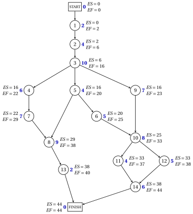

# 9.3 La passata in avanti: i tempi al più presto { #sez-pm-sec-forward }

**Parte 5 · Gestione dei progetti · Capitolo 9** · [:material-book-open-variant: Capitolo 9: Gestione dei progetti](index.md) · [:material-file-pdf-box: Dispensa, volume 5 (PDF)](../../pdf/dispensa-5-gestione-dei-progetti.pdf) · [:material-presentation: Slide](../../pdf/slide-project-management.pdf) · [:material-pencil: Esercizi: Gestione dei progetti](../../esercizi/project-management.md) · [:material-gesture-tap: App: Il metodo del cammino critico (CPM)](../../laboratorio/cammino-critico-cpm.md)

- Supponiamo dapprima che non ci siano ritardi: ogni attività dura quanto stimato e inizia appena tutti i suoi predecessori immediati sono terminati.

!!! definizione "Definizione 9.7: tempi di inizio e di fine al più presto"

    Sia $v_0,v_1,\dots,v_{n+1}$ un ordine topologico della rete delle attività. L'<strong>inizio al più presto</strong> $\mathit{ES}_j$ e la <strong>fine al più presto</strong> $\mathit{EF}_j$ dei nodi si calcolano in quest'ordine con la <strong>passata in avanti</strong>:

    $$
    \mathit{ES}_0=0, \qquad \mathit{ES}_j=\max_{(i,j) \in \delta^-(j)} \mathit{EF}_i, \quad \forall j \in N \setminus \{0\}, \qquad
    \mathit{EF}_j=\mathit{ES}_j+d_j, \quad \forall j \in N .
    $$

- È la <strong>regola dell'inizio al più presto</strong>: l'inizio al più presto di un'attività è la massima fine al più presto dei suoi predecessori immediati. Quando si elabora il nodo $j$, i suoi predecessori lo precedono nell'ordine topologico, quindi le loro fini al più presto sono note.

- Come nel [Capitolo 3](../../alberi-e-cammini/shortest-paths/cammini-minimi-nei-grafi-aciclici.md), l'ordine topologico toglie, a ogni passo, il nodo senza archi entranti di <strong>indice minimo</strong>. Il nodo $0$ è tolto per primo.

!!! teorema "Teorema 9.8: tempi al più presto"

    Per ogni nodo $j \in N$, $\mathit{ES}_j$ è la lunghezza di un cammino massimo da START a $j$. Inoltre $\mathit{ES}$ è un calendario, e ogni calendario $\vet{t}$ soddisfa $t_j \ge \mathit{ES}_j$ per ogni $j \in N$.

??? dimostrazione "Dimostrazione"

    Dimostriamo la prima e l'ultima affermazione per induzione lungo l'ordine topologico.

    1. <em>Nodo $0$.</em> In START non entra nessun arco: l'unico cammino da START a $0$ non ha archi e ha lunghezza $0=\mathit{ES}_0$, e ogni calendario ha $t_0=0=\mathit{ES}_0$.

    2. <em>Cammini massimi.</em> Sia $j \neq 0$. Ogni cammino da START a $j$ è un cammino da START a un nodo $i$ seguito da un arco $(i,j) \in \delta^-(j)$ di lunghezza $d_i$, e $i$ precede $j$. Per induzione la sua lunghezza massima è

        $$
        \max_{(i,j) \in \delta^-(j)} \big(\mathit{ES}_i+d_i\big)=\max_{(i,j) \in \delta^-(j)} \mathit{EF}_i=\mathit{ES}_j .
        $$

    3. <em>Limite inferiore.</em> Per ogni arco $(i,j) \in \delta^-(j)$, per induzione $t_j \ge t_i+d_i \ge \mathit{ES}_i+d_i=\mathit{EF}_i$; quindi $t_j \ge \mathit{ES}_j$.

    4. <em>$\mathit{ES}$ è un calendario.</em> $\mathit{ES}_0=0$, e $\mathit{ES}_j \ge \mathit{EF}_i=\mathit{ES}_i+d_i$ per ogni arco $(i,j) \in A$, per il massimo nella definizione. □

!!! teorema "Teorema 9.9: durata minima del progetto"

    Sotto le ipotesi (H1) e (H2), la durata minima del progetto è $T=\mathit{ES}_{n+1}$, la lunghezza di un cammino critico, e il calendario $\mathit{ES}$ la raggiunge.

??? dimostrazione "Dimostrazione"

    Per il [Teorema 9.8](#box-10-pm-th-earliest), $\mathit{ES}$ è un calendario di durata $\mathit{ES}_{n+1}$, e ogni calendario ha $t_{n+1} \ge \mathit{ES}_{n+1}$: quindi $T=\mathit{ES}_{n+1}$. Per lo stesso teorema, $\mathit{ES}_{n+1}$ è la lunghezza di un cammino massimo da START a FINISH, cioè di un cammino critico. □

- Usiamo entrambe le ipotesi: (H1) rende le lunghezze dei cammini numeri fissati, e (H2) rende le precedenze gli unici vincoli di un calendario.

- La passata in avanti è l'algoritmo per i grafi aciclici del [Capitolo 3 «Cammini minimi»](../../alberi-e-cammini/shortest-paths/cammini-minimi-nei-grafi-aciclici.md), con il massimo al posto del minimo: con le lunghezze degli archi $-d_i$, quell'algoritmo calcola le etichette $d(j)=-\mathit{ES}_j$. Un cammino massimo è facile da trovare perché la rete è aciclica.

!!! esempio "Esempio 9.3: la passata in avanti sul caso di studio"

    Nel caso di studio ogni attività ha predecessori immediati di indice minore, quindi l'ordine topologico è $0,1,2,\dots,15$. Ogni riga elabora un nodo: le fini al più presto dei suoi predecessori immediati (il massimo in grassetto), poi $\mathit{ES}_j$ ed $\mathit{EF}_j$.

    
<table>
    <tr>
    <th>nodo \(j\)</th>
    <th>\(d_j\)</th>
    <th>\(\mathit{EF}_i\) dei predecessori (\(i\))</th>
    <th>\(\mathit{ES}_j\)</th>
    <th>\(\mathit{EF}_j\)</th>
    </tr>
    <tr>
    <td>\(0\)</td>
    <td>\(0\)</td>
    <td>—</td>
    <td>\(0\)</td>
    <td>\(0\)</td>
    </tr>
    <tr>
    <td>\(1\)</td>
    <td>\(2\)</td>
    <td>\(\mathbf{0}\) (\(0\))</td>
    <td>\(0\)</td>
    <td>\(2\)</td>
    </tr>
    <tr>
    <td>\(2\)</td>
    <td>\(4\)</td>
    <td>\(\mathbf{2}\) (\(1\))</td>
    <td>\(2\)</td>
    <td>\(6\)</td>
    </tr>
    <tr>
    <td>\(3\)</td>
    <td>\(10\)</td>
    <td>\(\mathbf{6}\) (\(2\))</td>
    <td>\(6\)</td>
    <td>\(16\)</td>
    </tr>
    <tr>
    <td>\(4\)</td>
    <td>\(6\)</td>
    <td>\(\mathbf{16}\) (\(3\))</td>
    <td>\(16\)</td>
    <td>\(22\)</td>
    </tr>
    <tr>
    <td>\(5\)</td>
    <td>\(4\)</td>
    <td>\(\mathbf{16}\) (\(3\))</td>
    <td>\(16\)</td>
    <td>\(20\)</td>
    </tr>
    <tr>
    <td>\(6\)</td>
    <td>\(5\)</td>
    <td>\(\mathbf{20}\) (\(5\))</td>
    <td>\(20\)</td>
    <td>\(25\)</td>
    </tr>
    <tr>
    <td>\(7\)</td>
    <td>\(7\)</td>
    <td>\(\mathbf{22}\) (\(4\))</td>
    <td>\(22\)</td>
    <td>\(29\)</td>
    </tr>
    <tr>
    <td>\(8\)</td>
    <td>\(9\)</td>
    <td>\(20\) (\(5\)), \(\mathbf{29}\) (\(7\))</td>
    <td>\(29\)</td>
    <td>\(38\)</td>
    </tr>
    <tr>
    <td>\(9\)</td>
    <td>\(7\)</td>
    <td>\(\mathbf{16}\) (\(3\))</td>
    <td>\(16\)</td>
    <td>\(23\)</td>
    </tr>
    <tr>
    <td>\(10\)</td>
    <td>\(8\)</td>
    <td>\(\mathbf{25}\) (\(6\)), \(23\) (\(9\))</td>
    <td>\(25\)</td>
    <td>\(33\)</td>
    </tr>
    <tr>
    <td>\(11\)</td>
    <td>\(4\)</td>
    <td>\(\mathbf{33}\) (\(10\))</td>
    <td>\(33\)</td>
    <td>\(37\)</td>
    </tr>
    <tr>
    <td>\(12\)</td>
    <td>\(5\)</td>
    <td>\(\mathbf{33}\) (\(10\))</td>
    <td>\(33\)</td>
    <td>\(38\)</td>
    </tr>
    <tr>
    <td>\(13\)</td>
    <td>\(2\)</td>
    <td>\(\mathbf{38}\) (\(8\))</td>
    <td>\(38\)</td>
    <td>\(40\)</td>
    </tr>
    <tr>
    <td>\(14\)</td>
    <td>\(6\)</td>
    <td>\(37\) (\(11\)), \(\mathbf{38}\) (\(12\))</td>
    <td>\(38\)</td>
    <td>\(44\)</td>
    </tr>
    <tr>
    <td>\(15\)</td>
    <td>\(0\)</td>
    <td>\(40\) (\(13\)), \(\mathbf{44}\) (\(14\))</td>
    <td>\(44\)</td>
    <td>\(44\)</td>
    </tr>
    </table>

    Il nodo FINISH dà $T=\mathit{ES}_{15}=44$: se tutto procede secondo i piani, il progetto si completa in $44$ settimane. Nella figura, accanto a ogni nodo, la sua durata (in blu) e i suoi tempi al più presto.

    { .fig loading=lazy  }

!!! chiave ""

    La passata in avanti calcola, in ordine topologico, $\mathit{ES}_j=\max \mathit{EF}_i$ sui predecessori immediati ed $\mathit{EF}_j=\mathit{ES}_j+d_j$. $\mathit{ES}_j$ è la lunghezza di un cammino massimo da START a $j$, e $T=\mathit{ES}_{n+1}$ è la lunghezza di un cammino critico.

---

**Avanti:** [9.4 La passata all'indietro: i tempi al più tardi](la-passata-all-indietro-i-tempi-al-piu-tardi.md)
