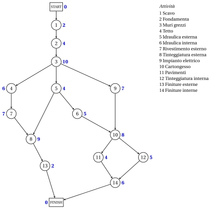

# 9.1 Progetti e reti di progetto { #sez-pm-sec-networks }

**Parte 5 · Gestione dei progetti · Capitolo 9** · [:material-book-open-variant: Capitolo 9: Gestione dei progetti](index.md) · [:material-file-pdf-box: Dispensa, volume 5 (PDF)](../../pdf/dispensa-5-gestione-dei-progetti.pdf) · [:material-pencil: Esercizi: Gestione dei progetti](../../esercizi/project-management.md)

!!! definizione "Definizione 9.1: progetto"

    Un <strong>progetto</strong> è un insieme di $n$ <strong>attività</strong>, numerate $1,2,\dots,n$, con i seguenti dati.

    - Ogni attività $j$ ha una <strong>durata</strong> $d_j \in \Q_{>0}$.

    - Alcune coppie $(i,j)$ di attività sono <strong>precedenze</strong>: l'attività $i$ è un <strong>immediato predecessore</strong> di attività $j$ e $j$ possono iniziare solo al termine di $i$. Un'attività con diversi predecessori immediati può iniziare solo quando tutti saranno finiti.

- Per descrivere un progetto abbiamo bisogno di tre tipi di informazioni: le <strong>attività</strong>, al livello desiderato di dettaglio; le <strong>precedences</strong>, ovvero gli immediati predecessori di ciascuna attività; le <strong>durate</strong>, quello è una stima del tempo impiegato da ciascuna attività.

- In tutto il capitolo facciamo due ipotesi:

    - **(H1)** le durate sono <strong>deterministico</strong>: ogni attività dura esattamente la sua durata stimata $d_j$, senza interruzioni;

    - **(H2)** le risorse sono <strong>illimitate</strong>: possono essere svolte attività non legate da precedenze allo stesso tempo.

- Il metodo di questo capitolo è il <strong>metodo del percorso critico</strong> (CPM). È stato sviluppato alla fine degli anni '50 indipendentemente dalla tecnica di valutazione e revisione del programma (PERT), e i due nomi sono spesso combinati PERT/CPM.

!!! definizione "Definizione 9.2: rete del progetto"

    La <strong>rete di progetto</strong> di un progetto con attività $n$ è il grafo diretto $G=(N,A)$ con $N=\{0,1,\dots,n+1\}$ e i seguenti nodi e archi.

    - Il nodo $j \in \{1,2,\dots,n\}$ è l'attività $j$. Il nodo $0$ è il nodo <strong>START</strong> e il nodo $n+1$ è il Nodo <strong>FINISH</strong>, con durate $d_0=d_{n+1}=0$.

    - $A$ contiene l'arco $(i,j)$ per ogni precedenza, l'arco $(0,j)$ per ogni attività $j$ senza immediato predecessori e l'arco $(j,n+1)$ per ogni attività $j$ che non sia un immediato predecessore di alcuna attività.

- Questa è la rete <strong>activity-on-node</strong> (AON): le attività sono i nodi e gli archi mostrano solo precedenze. Nella rete <strong>activity-on-arc</strong> (AOA) ogni attività è un arco e un nodo separa un'attività dai suoi immediati predecessori.

- La rete AON è più facile da costruire, più facile da leggere per gli utenti senza esperienza e più facile da rivedere quando il progetto cambia: lo usiamo sempre, e lo chiamiamo semplicemente rete del progetto.

- In pratica la rete di progetto viene costruita dal software di gestione del progetto a partire dall'elenco delle attività.

!!! esempio "Esempio 9.1: il caso di studio"

    Un'impresa edile deve programmare le squadre che svolgono le attività $14$ di un progetto di costruzione. Il la tabella riporta, per ogni attività, quelle immediatamente precedenti e la sua durata stimata.

    
<table>
    <tr>
    <th>attività \(j\)</th>
    <th>descrizione</th>
    <th>immediati predecessori</th>
    <th>\(d_j\)</th>
    </tr>
    <tr>
    <td>\(1\)</td>
    <td>Scava</td>
    <td>—</td>
    <td>\(2\) settimane</td>
    </tr>
    <tr>
    <td>\(2\)</td>
    <td>Gettare le fondamenta</td>
    <td>\(1\)</td>
    <td>\(4\) settimane</td>
    </tr>
    <tr>
    <td>\(3\)</td>
    <td>Costruisci il muro grezzo</td>
    <td>\(2\)</td>
    <td>\(10\) settimane</td>
    </tr>
    <tr>
    <td>\(4\)</td>
    <td>Montare il tetto</td>
    <td>\(3\)</td>
    <td>\(6\) settimane</td>
    </tr>
    <tr>
    <td>\(5\)</td>
    <td>Installazione dell'impianto idraulico esterno</td>
    <td>\(3\)</td>
    <td>\(4\) settimane</td>
    </tr>
    <tr>
    <td>\(6\)</td>
    <td>Installa l'impianto idraulico interno</td>
    <td>\(5\)</td>
    <td>\(5\) settimane</td>
    </tr>
    <tr>
    <td>\(7\)</td>
    <td>Montare il rivestimento esterno</td>
    <td>\(4\)</td>
    <td>\(7\) settimane</td>
    </tr>
    <tr>
    <td>\(8\)</td>
    <td>Fai la verniciatura esterna</td>
    <td>\(5\), \(7\)</td>
    <td>\(9\) settimane</td>
    </tr>
    <tr>
    <td>\(9\)</td>
    <td>Esegui i lavori elettrici</td>
    <td>\(3\)</td>
    <td>\(7\) settimane</td>
    </tr>
    <tr>
    <td>\(10\)</td>
    <td>Monta il wallboard</td>
    <td>\(6\), \(9\)</td>
    <td>\(8\) settimane</td>
    </tr>
    <tr>
    <td>\(11\)</td>
    <td>Installa il pavimento</td>
    <td>\(10\)</td>
    <td>\(4\) settimane</td>
    </tr>
    <tr>
    <td>\(12\)</td>
    <td>Tinteggiatura degli interni</td>
    <td>\(10\)</td>
    <td>\(5\) settimane</td>
    </tr>
    <tr>
    <td>\(13\)</td>
    <td>Installazione degli infissi esterni</td>
    <td>\(8\)</td>
    <td>\(2\) settimane</td>
    </tr>
    <tr>
    <td>\(14\)</td>
    <td>Installazione degli infissi interni</td>
    <td>\(11\), \(12\)</td>
    <td>\(6\) settimane</td>
    </tr>
    </table>

    Sommando le durate si ottiene un totale di $79$ settimane. È possibile svolgere più attività contemporaneamente, il che possono ridurre sostanzialmente la durata del progetto. La rete di progetto ha i nodi $16$ archi $0,1,\dots,15$ e $19$; accanto ad ogni nodo, in blu, la sua durata.

    { .fig loading=lazy  }

    L'attività $1$ è l'unica attività senza predecessori immediati, quindi START ha il singolo arco $(0,1)$; attività $13$ e $14$ non sono predecessori immediati di alcuna attività, quindi entrano in FINISH.

## 9.1.1 Pianificazioni e reti acicliche

!!! definizione "Definizione 9.3: pianificazione"

    Una <strong>pianificazione</strong> di un progetto è un vettore $\vet{t}=(t_0,t_1,\dots,t_{n+1})$ dei tempi di inizio, con $t_0=0$, che soddisfa

    $$
    t_j \ge t_i+d_i, \quad \forall (i,j) \in A .
    $$

    Il nodo $j$ inizia a $t_j$ e termina a $t_j+d_j$. La <strong>durata</strong> della pianificazione è $t_{n+1}$ e la <strong>durata minima del progetto</strong> $T$ è la durata minima di una pianificazione.

- Il vincolo dell'arco $(i,j)$ dice che $j$ inizia dopo che $i$ è finito. Per (H1) e (H2), il le precedenze sono gli unici vincoli di una pianificazione.

- Gli archi $(j,n+1)$ fanno iniziare FINISH al termine di ogni attività: $t_{n+1}$ è il tempo di completamento del progetto.

!!! teorema "Proposizione 9.4: una pianificazione necessita di una rete aciclica"

    Un progetto ha una pianificazione se e solo se la sua rete di progetti è aciclica.

??? dimostrazione "Dimostrazione"

    Nessun arco entra nel nodo $0$ e nessun arco esce dal nodo $n+1$, quindi ogni ciclo diretto di $G$ è costituito da attività.

    1. Sia $i_0,i_1,\dots,i_k=i_0$ un ciclo diretto e $\vet{t}$ una pianificazione. Sommando i vincoli del suo archi, il telescopio dei tempi di inizio:

        $$
        0=t_{i_k}-t_{i_0} \ge \sum_{s=0}^{k-1} d_{i_s} >0,
        $$

        una contraddizione, poiché le durate delle attività sono positive.

    2. Sia $G$ aciclico e sia $v_0,v_1,\dots,v_{n+1}$ un ordine topologico ([Capitolo 3, Proposizione «ordini topologici»](../../alberi-e-cammini/shortest-paths/percorsi-piu-brevi-nei-grafici-aciclici.md)) con $v_0=0$: il nodo $0$ non ha arco entrante e può essere rimosso per primo. Lascia che $D$ sia il più grande durata e $t_{v_a}=a\,D$ per ogni $a$.

    3. Quindi $t_0=0$, e ogni arco $(v_a,v_b)$ va avanti, $a<b$, quindi $t_{v_b}-t_{v_a}=(b-a)\,D \ge D \ge d_{v_a}$: $\vet{t}$ è una pianificazione. □

- Da ora in poi la rete del progetto è aciclica. Allora ogni attività giace su un percorso dall'INIZIO alla FINE: andare a ritroso lungo gli archi si raggiunge un nodo senza immediati predecessori, che è legato a START, e andando avanti raggiungiamo un nodo senza successori, che è legato a FINISH.

- Un ciclo nelle precedenti è un errore di progettazione: un'attività dovrebbe terminare prima di iniziare.

!!! chiave ""

    Un progetto è un insieme di attività con durate e precedenze. La sua rete di progetti ha un nodo per ogni attività, più INIZIO e FINE, e un arco per ogni precedenza; un programma esiste se e solo se la rete è aciclica.

---

**Avanti:** [9.2 Percorsi e percorsi critici](percorsi-e-percorsi-critici.md)
