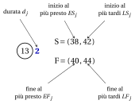

# 9.5 Scorte e attività critiche { #sez-pm-sec-slacks }

**Parte 5 · Gestione dei progetti · Capitolo 9** · [:material-book-open-variant: Capitolo 9: Gestione dei progetti](index.md) · [:material-file-pdf-box: Dispensa, volume 5 (PDF)](../../pdf/dispensa-5-gestione-dei-progetti.pdf) · [:material-presentation: Slide](../../pdf/slide-project-management.pdf) · [:material-pencil: Esercizi: Gestione dei progetti](../../esercizi/project-management.md) · [:material-gesture-tap: App: Il metodo del cammino critico (CPM)](../../laboratorio/cammino-critico-cpm.md)

!!! definizione "Definizione 9.12: scorte e archi stretti"

    Per ogni attività $j \in \{1,2,\dots,n\}$:

    - la <strong>scorta totale</strong> è $\mathit{TS}_j=\mathit{LS}_j-\mathit{ES}_j=\mathit{LF}_j-\mathit{EF}_j$;

    - la <strong>scorta libera</strong> è $\mathit{FS}_j=\min_{(j,k) \in \delta^+(j)} \mathit{ES}_k-\mathit{EF}_j$.

    Un arco $(i,j) \in A$ è <strong>stretto</strong> se $\mathit{ES}_j=\mathit{EF}_i$.

- Le due differenze in $\mathit{TS}_j$ coincidono, perché in entrambe le coppie i due tempi differiscono di $d_j$.

- La scorta totale è il ritardo dell'attività $j$ che non ritarda il progetto; la scorta libera è il ritardo che non sposta l'inizio al più presto di nessun'altra attività. I due risultati che seguono lo rendono preciso.

!!! teorema "Teorema 9.13: scorta totale e attività critiche"

    Per ogni attività $j$, sia $L_j$ la lunghezza massima di un cammino da START a FINISH che passa per $j$. Allora:

    - **(a)** $\mathit{TS}_j=T-L_j \ge 0$, quindi $\mathit{TS}_j=0$ se e solo se $j$ è critica;

    - **(b)** per ogni $\delta$ con $0 \le \delta \le \mathit{TS}_j$ esiste un calendario di durata $T$ con $t_j=\mathit{ES}_j+\delta$, e nessun calendario di durata $T$ ha $t_j>\mathit{ES}_j+\mathit{TS}_j$.

??? dimostrazione "Dimostrazione"

    1. Un cammino da START a FINISH che passa per $j$ è un cammino da START a $j$ seguito da un cammino da $j$ a FINISH, e la sua lunghezza è la somma delle due lunghezze. Prendendo i più lunghi, per il [Teorema 9.8](la-passata-in-avanti-i-tempi-al-piu-presto.md#box-10-pm-th-earliest) e il [Teorema 9.11](la-passata-all-indietro-i-tempi-al-piu-tardi.md#box-14-pm-th-latest),

        $$
        L_j=\mathit{ES}_j+\big(T-\mathit{LS}_j\big)=T-\mathit{TS}_j .
        $$

    2. Ogni cammino da START a FINISH ha lunghezza al più $T$, quindi $\mathit{TS}_j \ge 0$, con l'uguaglianza se e solo se un cammino che passa per $j$ ha lunghezza $T$, cioè se $j$ è critica.

    3. Se $\mathit{TS}_j>0$, sia $\lambda=\delta/\mathit{TS}_j \in [0,1]$. $\mathit{ES}$ e $\mathit{LS}$ sono calendari di durata $T$, e i vincoli di un calendario sono lineari, quindi $(1-\lambda)\mathit{ES}+\lambda\mathit{LS}$ è un calendario di durata $T$, con $t_j=\mathit{ES}_j+\lambda\,\mathit{TS}_j=\mathit{ES}_j+\delta$. Se $\mathit{TS}_j=0$, allora $\delta=0$ e basta $\mathit{ES}$.

    4. Per il [Teorema 9.11](la-passata-all-indietro-i-tempi-al-piu-tardi.md#box-14-pm-th-latest), ogni calendario di durata $T$ ha $t_j \le \mathit{LS}_j=\mathit{ES}_j+\mathit{TS}_j$. □

!!! teorema "Proposizione 9.14: scorta libera"

    Per ogni attività $j$, $0 \le \mathit{FS}_j \le \mathit{TS}_j$. Inoltre, per ogni $\delta$ con $0 \le \delta \le \mathit{FS}_j$, i tempi di inizio $\mathit{ES}$ con $\mathit{ES}_j+\delta$ al posto di $\mathit{ES}_j$ formano un calendario di durata $T$: l'attività $j$ è ritardata di $\delta$, e ogni altro nodo mantiene il suo inizio al più presto.

??? dimostrazione "Dimostrazione"

    1. Per la passata in avanti, $\mathit{ES}_k \ge \mathit{EF}_j$ per ogni arco $(j,k)$, quindi $\mathit{FS}_j \ge 0$. Inoltre $\mathit{ES}_k \le \mathit{LS}_k$ per ogni nodo $k$: per le attività vale per il [Teorema 9.13](#box-17-pm-th-total), e $\mathit{ES}_{n+1}=\mathit{LS}_{n+1}=T$. Quindi

        $$
        \mathit{FS}_j=\min_{(j,k) \in \delta^+(j)} \mathit{ES}_k-\mathit{EF}_j \le \min_{(j,k) \in \delta^+(j)} \mathit{LS}_k-\mathit{EF}_j=\mathit{LF}_j-\mathit{EF}_j=\mathit{TS}_j .
        $$

    2. Cambiano solo i vincoli degli archi di $j$. Per $(i,j) \in \delta^-(j)$: $\mathit{ES}_j+\delta \ge \mathit{ES}_j \ge \mathit{EF}_i$. Per $(j,k) \in \delta^+(j)$: $\mathit{ES}_k \ge \mathit{EF}_j+\mathit{FS}_j \ge (\mathit{ES}_j+\delta)+d_j$.

    3. La durata è ancora $\mathit{ES}_{n+1}=T$, perché $j \neq n+1$. □

!!! teorema "Teorema 9.15: i cammini critici sono cammini di archi stretti"

    Un cammino $P$ da START a FINISH è critico se e solo se tutti i suoi archi sono stretti.

??? dimostrazione "Dimostrazione"

    Sia $P=i_0,i_1,\dots,i_k$ con $i_0=0$ e $i_k=n+1$. Ogni arco ha $\mathit{ES}_{i_{s+1}}-\mathit{EF}_{i_s} \ge 0$. Sommando sugli archi di $P$, gli inizi al più presto si elidono a catena:

    $$
    \sum_{s=0}^{k-1} \big(\mathit{ES}_{i_{s+1}}-\mathit{EF}_{i_s}\big)=\mathit{ES}_{n+1}-\mathit{ES}_0-\sum_{s=0}^{k-1} d_{i_s}=T-L(P).
    $$

    Una somma di termini non negativi è nulla se e solo se ogni termine è nullo: $L(P)=T$ se e solo se ogni arco di $P$ è stretto. □

- I cammini critici sono i cammini da START a FINISH che usano solo archi stretti: per elencarli tutti, si seguono gli archi stretti a partire da START.

- Ogni attività di un cammino critico ha scorta totale nulla. Un cammino fatto di attività critiche, invece, è critico solo se i suoi archi sono stretti.

!!! esempio "Esempio 9.5: scorte e cammino critico del caso di studio"

    Per mostrare tutti i tempi insieme, scriviamo accanto a ogni nodo la coppia $\mathrm{S}=(\mathit{ES}_j,\mathit{LS}_j)$ dei suoi tempi di inizio e la coppia $\mathrm{F}=(\mathit{EF}_j,\mathit{LF}_j)$ dei suoi tempi di fine, come nella figura per l'attività $13$:

    { .fig loading=lazy  }

    La tabella raccoglie i tempi e le scorte delle attività dell'[Esempio 9.3](la-passata-in-avanti-i-tempi-al-piu-presto.md#box-12-pm-ex-forward) e dell'[Esempio 9.4](la-passata-all-indietro-i-tempi-al-piu-tardi.md#box-15-pm-ex-backward).

    
<table>
    <tr>
    <th>\(j\)</th>
    <th>\(d_j\)</th>
    <th>\(\mathit{ES}_j\)</th>
    <th>\(\mathit{EF}_j\)</th>
    <th>\(\mathit{LS}_j\)</th>
    <th>\(\mathit{LF}_j\)</th>
    <th>\(\mathit{TS}_j\)</th>
    <th>\(\mathit{FS}_j\)</th>
    <th>critica</th>
    </tr>
    <tr>
    <td>\(1\)</td>
    <td>\(2\)</td>
    <td>\(0\)</td>
    <td>\(2\)</td>
    <td>\(0\)</td>
    <td>\(2\)</td>
    <td>\(0\)</td>
    <td>\(0\)</td>
    <td>sì</td>
    </tr>
    <tr>
    <td>\(2\)</td>
    <td>\(4\)</td>
    <td>\(2\)</td>
    <td>\(6\)</td>
    <td>\(2\)</td>
    <td>\(6\)</td>
    <td>\(0\)</td>
    <td>\(0\)</td>
    <td>sì</td>
    </tr>
    <tr>
    <td>\(3\)</td>
    <td>\(10\)</td>
    <td>\(6\)</td>
    <td>\(16\)</td>
    <td>\(6\)</td>
    <td>\(16\)</td>
    <td>\(0\)</td>
    <td>\(0\)</td>
    <td>sì</td>
    </tr>
    <tr>
    <td>\(4\)</td>
    <td>\(6\)</td>
    <td>\(16\)</td>
    <td>\(22\)</td>
    <td>\(20\)</td>
    <td>\(26\)</td>
    <td>\(4\)</td>
    <td>\(0\)</td>
    <td></td>
    </tr>
    <tr>
    <td>\(5\)</td>
    <td>\(4\)</td>
    <td>\(16\)</td>
    <td>\(20\)</td>
    <td>\(16\)</td>
    <td>\(20\)</td>
    <td>\(0\)</td>
    <td>\(0\)</td>
    <td>sì</td>
    </tr>
    <tr>
    <td>\(6\)</td>
    <td>\(5\)</td>
    <td>\(20\)</td>
    <td>\(25\)</td>
    <td>\(20\)</td>
    <td>\(25\)</td>
    <td>\(0\)</td>
    <td>\(0\)</td>
    <td>sì</td>
    </tr>
    <tr>
    <td>\(7\)</td>
    <td>\(7\)</td>
    <td>\(22\)</td>
    <td>\(29\)</td>
    <td>\(26\)</td>
    <td>\(33\)</td>
    <td>\(4\)</td>
    <td>\(0\)</td>
    <td></td>
    </tr>
    <tr>
    <td>\(8\)</td>
    <td>\(9\)</td>
    <td>\(29\)</td>
    <td>\(38\)</td>
    <td>\(33\)</td>
    <td>\(42\)</td>
    <td>\(4\)</td>
    <td>\(0\)</td>
    <td></td>
    </tr>
    <tr>
    <td>\(9\)</td>
    <td>\(7\)</td>
    <td>\(16\)</td>
    <td>\(23\)</td>
    <td>\(18\)</td>
    <td>\(25\)</td>
    <td>\(2\)</td>
    <td>\(2\)</td>
    <td></td>
    </tr>
    <tr>
    <td>\(10\)</td>
    <td>\(8\)</td>
    <td>\(25\)</td>
    <td>\(33\)</td>
    <td>\(25\)</td>
    <td>\(33\)</td>
    <td>\(0\)</td>
    <td>\(0\)</td>
    <td>sì</td>
    </tr>
    <tr>
    <td>\(11\)</td>
    <td>\(4\)</td>
    <td>\(33\)</td>
    <td>\(37\)</td>
    <td>\(34\)</td>
    <td>\(38\)</td>
    <td>\(1\)</td>
    <td>\(1\)</td>
    <td></td>
    </tr>
    <tr>
    <td>\(12\)</td>
    <td>\(5\)</td>
    <td>\(33\)</td>
    <td>\(38\)</td>
    <td>\(33\)</td>
    <td>\(38\)</td>
    <td>\(0\)</td>
    <td>\(0\)</td>
    <td>sì</td>
    </tr>
    <tr>
    <td>\(13\)</td>
    <td>\(2\)</td>
    <td>\(38\)</td>
    <td>\(40\)</td>
    <td>\(42\)</td>
    <td>\(44\)</td>
    <td>\(4\)</td>
    <td>\(4\)</td>
    <td></td>
    </tr>
    <tr>
    <td>\(14\)</td>
    <td>\(6\)</td>
    <td>\(38\)</td>
    <td>\(44\)</td>
    <td>\(38\)</td>
    <td>\(44\)</td>
    <td>\(0\)</td>
    <td>\(0\)</td>
    <td>sì</td>
    </tr>
    </table>

    - Le attività critiche sono $1,2,3,5,6,10,12,14$. Gli archi stretti a partire da START arrivano a FINISH solo lungo START$,1,2,3,5,6,10,12,14,$FINISH: il cammino critico è unico, e la sua lunghezza è $T=44$ (in blu nella figura).

    - Le attività $4,7,8,13$ formano una catena con $\mathit{TS}_{4}=\mathit{TS}_{7}=\mathit{TS}_{8}=\mathit{TS}_{13}=4$, ma solo l'ultima ha scorta libera, $\mathit{FS}_{13}=4$. Se l'attività $4$ inizia con $4$ settimane di ritardo, anche le attività $7$, $8$, $13$ devono iniziare con $4$ settimane di ritardo, e il progetto termina comunque alla settimana $44$.

    - Le attività $9$ e $11$ hanno scorta totale uguale alla scorta libera, rispettivamente $2$ settimane e $1$ settimana.

    { .fig loading=lazy  }

!!! attenzione "Le scorte totali sono condivise"

    La scorta totale di un'attività è condivisa con le altre attività dei suoi cammini: le quattro scorte totali della catena $4,7,8,13$ sono le stesse $4$ settimane. Se l'attività $4$ dura $3$ settimane in più e l'attività $8$ dura $2$ settimane in più, il cammino che passa per entrambe si allunga di $5>4$ settimane, e il progetto termina alla settimana $45$.

!!! chiave ""

    La scorta totale $\mathit{TS}_j=\mathit{LS}_j-\mathit{ES}_j$ è il ritardo di $j$ che non ritarda il progetto; la scorta libera $\mathit{FS}_j \le \mathit{TS}_j$ è il ritardo che non sposta nessun'altra attività. Le attività critiche hanno $\mathit{TS}_j=0$, e i cammini critici sono i cammini da START a FINISH fatti di archi stretti.

---

**Avanti:** [9.6 Il metodo del cammino critico](il-metodo-del-cammino-critico.md)
