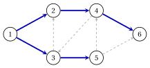

# 1.4 Alberi e foreste { #sez-sec-gr-trees }

**Parte 1 · Grafi · Capitolo 1** · [:material-book-open-variant: Capitolo 1: Grafi](index.md) · [:material-file-pdf-box: Dispensa, volume 1 (PDF)](../../pdf/dispensa-1-grafi.pdf) · [:material-pencil: Esercizi: Grafi](../../esercizi/graphs.md) · [:material-gesture-tap: App: Ricerca su grafo: BFS e DFS](../../laboratorio/ricerca-bfs-dfs.md)

!!! definizione "Definizione 1.13: albero, foresta e albero ricoprente"

    Sia $G=(V,E)$ un grafo non orientato.

    - $G$ è un <strong>foresta</strong> se è aciclico e un <strong>albero</strong> se è connesso e aciclico. Un vertice di grado $1$ è un <strong>foglia</strong>.

    - Un <strong>albero ricoprente</strong> di un grafo connesso $G$ è un albero $T=(V,F)$ con $F \subseteq E$; un <strong>spanning forest</strong> di $G$ è una foresta $(V,F)$, $F \subseteq E$, con gli stessi componenti connessi di $G$.

    Per un grafo orientato $G=(N,A)$ le nozioni si applicano al grafo non orientato sottostante: un sottoinsieme di archi $F \subseteq A$ è un albero (una foresta) se gli lati corrispondenti formano un albero (una foresta).

!!! teorema "Lemma 1.14: foglie"

    Ogni albero con vertici $n \ge 2$ ha almeno due foglie.

??? dimostrazione "Dimostrazione"

    L'albero è connesso con i vertici $n \ge 2$, quindi ha un lato. Sia $v_0,v_1,\dots,v_k$ il percorso massimo lunghezza, con $k \ge 1$. Un vicino $u \neq v_1$ di $v_0$ si troverebbe sul percorso, chiudendo un ciclo, o si estenderebbe il percorso, contro la sua massimalità. Quindi $\deg(v_0)=1$ e allo stesso modo $\deg(v_k)=1$. □

!!! teorema "Lemma 1.15: aggiunta di un lato"

    Lascia che $G=(V,E)$ abbia componenti collegati $k$ e lascia che $e=\{u,v\} \notin E$ con $u,v \in V$.

    1. Se $u$ e $v$ si trovano in componenti diversi di $G$, il grafo $(V,E \cup \{e\})$ ha componenti $k-1$ e nessuno scorrere $e$.

    2. Se $u$ e $v$ si trovano nello stesso componente di $G$, il grafo $(V,E \cup \{e\})$ ha componenti $k$ e un scorrere $e$.

??? dimostrazione "Dimostrazione"

    1. Il lato $e$ unisce i componenti di $u$ e $v$ in uno solo e lascia invariati gli altri componenti. attraverso $e$ darebbe, senza $e$, un percorso da $u$ a $v$ in $G$: impossibile.

    2. I componenti non cambiano. Un percorso $u=v_0,v_1,\dots,v_k=v$ di $G$ ha $k \ge 2$, poiché $\{u,v\} \notin E$; con $e$ chiude il ciclo $v_0,v_1,\dots,v_k,v_0$. □

!!! teorema "Corollario 1.16: lati e componenti"

    Un grafo con vertici $n$, lati $m$ e componenti connessi $k$ soddisfa $k \ge n-m$, con uguaglianza se e solo se il grafo è aciclico.

??? dimostrazione "Dimostrazione"

    Iniziare da $(V,\emptyset)$, che dispone di componenti $n$, e inserire i lati $m$ uno alla volta. Di [Lemma 1.15](#box-21-gr-lem-add), ogni inserimento diminuisce il numero di componenti di uno, oppure lascia rimane invariato e chiude un ciclo. Quindi $k \ge n-m$.

    - Se il grafo ha un ciclo $C$, l'ultimo lato di $C$ da inserire unisce due vertici già collegati dal resto di $C$: lascia il numero invariato e $k > n-m$.

    - Se il grafo è aciclico nessun inserimento chiude un ciclo, perché un ciclo di un grafo intermedio è un ciclo di il grafo finale: $k=n-m$.

    
□

!!! teorema "Teorema 1.17: caratterizzazioni di un albero"

    Sia $G=(V,E)$ un grafo non orientato con vertici $n$ e archi $m$. Le seguenti affermazioni sono equivalenti:

    - **(a)** $G$ è un albero (connesso e aciclico);

    - **(b)** $G$ è collegato e $m=n-1$;

    - **(c)** $G$ è aciclico e $m=n-1$;

    - **(d)** per ogni due vertici $u$ e $v$ esiste esattamente un percorso da $u$ a $v$;

    - **(e)** $G$ è collegato e la rimozione di qualsiasi lato lo disconnette.

??? dimostrazione "Dimostrazione"

    Sia $k$ il numero di componenti collegati; $G$ è connesso se e solo se $k=1$.

    - <strong>(a)$\Rightarrow$(b),(c).</strong> $G$ è aciclico con $k=1$, quindi $m=n-k=n-1$ di [Corollario 1.16](#box-22-gr-cor-count).

    - <strong>(b)$\Rightarrow$(a).</strong> Qui $k=1=n-m$: l'uguaglianza vale e $G$ è aciclico per lo stesso corollario.

    - <strong>(c)$\Rightarrow$(a).</strong> $G$ è aciclico, quindi $k=n-m=1$ con lo stesso corollario: $G$ è connesso.

    Per (a)$\Leftrightarrow$(d), connesso significa almeno un percorso tra ogni due vertici; lo mostriamo aciclico significa al massimo uno.

    - Se $G$ ha un ciclo $v_0,v_1,\dots,v_{k-1},v_0$, i vertici $v_0$ e $v_1$ sono uniti da due percorsi: il lato $\{v_0,v_1\}$ e $v_0,v_{k-1},\dots,v_2,v_1$.

    - Lascia che $P \neq Q$ siano due percorsi da $u$ a $v$. Sia $w$ l'ultimo vertice della loro parte iniziale comune, e $x$ il primo vertice dopo $w$ su $P$ che si trova anche su $Q$ ($v$ è un candidato). I pezzi di $P$ e di $Q$ di $w$ a $x$ condividono solo $w$ e $x$ e non sono entrambi costituiti dal lato singolo $\{w,x\}$, poiché $P$ e $Q$ lasciano $w$ lungo lati diversi. Insieme formano un ciclo.

    Per (a)$\Leftrightarrow$(e), collegare $G$ e $e=\{u,v\} \in E$. Applicazione [Lemma 1.15](#box-21-gr-lem-add) a $(V,E \setminus \{e\})$ e $e$: il lato $e$ giace su un ciclo di $G$ se e solo se $u$ e $v$ sono collegati in $(V,E \setminus \{e\})$, cioè se e solo se rimuovendo $e$ si lascia il grafo collegato. Quindi ogni rimozione disconnette $G$ se e solo se su un ciclo non si trova alcun lato. □

!!! teorema "Corollario 1.18: foreste che si estendono"

    Ogni grafo con vertici $n$ e componenti connessi $k$ ha una foresta estesa, con lati $n-k$. In particolare, ogni grafo connesso ha un albero coprente, con archi $n-1$.

??? dimostrazione "Dimostrazione"

    Mentre il grafo ha un ciclo, rimuovi un lato $e=\{u,v\}$ di un ciclo. Il resto del ciclo collega ancora $u$ e $v$, quindi aggiungere nuovamente $e$ non modifica i componenti ([Lemma 1.15](#box-21-gr-lem-add), parte 2): rimozione non li cambia neanche. Il grafo finale è aciclico con gli stessi componenti $k$, quindi è unche si estende sulla foresta e ha lati $n-k$ di [Corollario 1.16](#box-22-gr-cor-count). □

## 1.4.1 Cicli fondamentali

!!! teorema "Proposizione 1.19: ciclo fondamentale"

    Sia $T=(V,F)$ uno albero ricoprente di un grafo connesso $G=(V,E)$ e sia $e=\{u,v\} \in E \setminus F$. Il grafo $(V,F \cup \{e\})$ contiene esattamente un ciclo, il <strong>ciclo fondamentale</strong> $C(T,e)$, formato da $e$ e dal percorso unico da $u$ a $v$ in $T$.

??? dimostrazione "Dimostrazione"

    I vertici $u$ e $v$ sono collegati in $T$, quindi il lato $e$ e il percorso da $u$ a $v$ in $T$ formano un ciclo ([Lemma 1.15](#box-21-gr-lem-add), parte 2). Ogni ciclo di $(V,F \cup \{e\})$ contiene $e$, poiché $T$ è aciclico; la rimozione di $e$ da esso lascia un percorso da $u$ a $v$ in $T$, che è unico per [Teorema 1.17](#box-23-gr-th-tree)(d). □

- Un grafo connesso con un albero ricoprente $T$ ha cicli fondamentali $m-n+1$, uno per ogni arco esterno a $T$.

- In un grafo orientato il ciclo fondamentale di un arco $(i,j) \notin F$ viene percorso nella direzione di $(i,j)$: gli archi di $T$ percorsi dalla coda alla testa sono in avanti, gli altri all'indietro.

!!! esempio "Esempio 1.7: un albero ricoprente del grafo di riferimento"

    Gli archi $F=\{(1,2),(1,3),(2,4),(3,5),(4,6)\}$ formano uno albero ricoprente $T$ del grafo di riferimento (blu in figura): sono archi $5=n-1$ e i loro lati formano un grafo connesso.

    { .fig loading=lazy  }

    Gli archi $m-n+1=4$ esterni a $T$ (tratteggiati) danno i cicli fondamentali, scritti dalla coda dell'arco:

    
<table>
    <tr>
    <th>arco</th>
    <th>ciclo fondamentale</th>
    <th>archi rovesci</th>
    </tr>
    <tr>
    <td>\((3,2)\)</td>
    <td>\(3,2,1,3\)</td>
    <td>\((1,2)\)</td>
    </tr>
    <tr>
    <td>\((4,3)\)</td>
    <td>\(4,3,1,2,4\)</td>
    <td>\((1,3)\)</td>
    </tr>
    <tr>
    <td>\((5,4)\)</td>
    <td>\(5,4,2,1,3,5\)</td>
    <td>\((2,4),~(1,2)\)</td>
    </tr>
    <tr>
    <td>\((5,6)\)</td>
    <td>\(5,6,4,2,1,3,5\)</td>
    <td>\((4,6),~(2,4),~(1,2)\)</td>
    </tr>
    </table>

    Ad esempio, il ciclo di $(3,2)$ utilizza $(3,2)$ in avanti, $(1,2)$ all'indietro (da $2$ a $1$) e $(1,3)$ in avanti.

!!! chiave ""

    Un albero è connesso e aciclico; due qualsiasi delle proprietà “connesso”, “aciclico”, “$n-1$ lati” implicano la terzo. Aggiungendo ad un albero di copertura un arco esterno si crea esattamente un ciclo, il ciclo fondamentale.

---

**Avanti:** [1.5 Il rango della matrice di incidenza](il-rango-della-matrice-di-incidenza.md)
