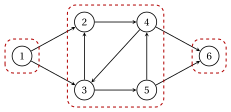

# 1.3 Connettività { #sez-sec-gr-connectivity }

**Parte 1 · Grafi · Capitolo 1** · [:material-book-open-variant: Capitolo 1: Grafi](index.md) · [:material-file-pdf-box: Dispensa, volume 1 (PDF)](../../pdf/dispensa-1-grafi.pdf) · [:material-presentation: Slide](../../pdf/slide-graphs.pdf) · [:material-pencil: Esercizi: Grafi](../../esercizi/graphs.md) · [:material-gesture-tap: App: Ricerca su grafo: BFS e DFS](../../laboratorio/ricerca-bfs-dfs.md)

!!! definizione "Definizione 1.10: grafo connesso e componenti connesse"

    Sia $G=(V,E)$ un grafo non orientato.

    - Due vertici $u$ e $v$ sono <strong>connessi</strong> se $G$ ha un cammino da $u$ a $v$; il grafo $G$ è <strong>connesso</strong> se ogni coppia di vertici è connessa.

    - Una <strong>componente connessa</strong> di $G$ è un sottoinsieme massimale $U \subseteq V$ di vertici a due a due connessi.

    Un grafo orientato è <strong>debolmente connesso</strong> se il suo grafo non orientato sottostante è connesso, e le sue componenti connesse sono quelle del grafo non orientato sottostante.

!!! definizione "Definizione 1.11: raggiungibilità e componenti fortemente connesse"

    Sia $G=(N,A)$ un grafo orientato.

    - Un nodo $j$ è <strong>raggiungibile</strong> da $i$ se $G$ ha un cammino orientato da $i$ a $j$; l'insieme dei nodi raggiungibili da $i$, $i$ compreso, si indica con $R(i)$.

    - I nodi $i$ e $j$ sono <strong>fortemente connessi</strong> se $j \in R(i)$ e $i \in R(j)$; il grafo è <strong>fortemente connesso</strong> se ogni coppia di nodi è fortemente connessa.

    - Una <strong>componente fortemente connessa</strong> di $G$ è un sottoinsieme massimale $S \subseteq N$ di nodi a due a due fortemente connessi.

!!! teorema "Proposizione 1.12: le componenti sono classi di equivalenza"

    Essere connessi è una relazione di equivalenza su $V$, ed essere fortemente connessi è una relazione di equivalenza su $N$. Quindi le componenti connesse formano una partizione di $V$ e le componenti fortemente connesse una partizione di $N$.

??? dimostrazione "Dimostrazione"

    Dimostriamo le tre proprietà per la connessione forte; il caso non orientato è uguale, con i cammini al posto dei cammini orientati.

    1. <em>Riflessiva</em>: il cammino $i$ di lunghezza $0$ mostra che $i \in R(i)$.

    2. <em>Simmetrica</em>: la definizione è simmetrica in $i$ e $j$.

    3. <em>Transitiva</em>: un cammino orientato da $i$ a $j$ seguito da uno da $j$ a $h$ è una passeggiata orientata da $i$ a $h$, che contiene un cammino orientato per il [Lemma 1.6](grafi-non-orientati-e-orientati.md#box-9-gr-lem-walk). Lo stesso vale da $h$ a $i$.

    Le classi di equivalenza sono i sottoinsiemi massimali di elementi a due a due in relazione, cioè le componenti. □

- Il <strong>grafo invertito</strong> $G'=(N,A')$ ha l'arco $(j,i)$ per ogni arco $(i,j) \in A$. Il nodo $i$ è raggiungibile da $j$ in $G$ se e solo se $j$ è raggiungibile da $i$ in $G'$; indichiamo con $R'(i)$ l'insieme dei nodi raggiungibili da $i$ in $G'$.

- Per la [Definizione 1.11](#box-16-gr-def-strong), la componente fortemente connessa che contiene $i$ è

    $$
    S(i)=R(i) \cap R'(i).
    $$

!!! esempio "Esempio 1.6: componenti del grafo di riferimento"

    Nel grafo di riferimento:

    $$
    R(1)=\{1,2,3,4,5,6\}, \qquad R(2)=\{2,3,4,5,6\}, \qquad R(6)=\{6\}.
    $$

    Nel grafo invertito $R'(3)=\{1,2,3,4,5\}$, e $R(3)=\{2,3,4,5,6\}$, quindi $S(3)=\{2,3,4,5\}$. Le componenti fortemente connesse sono

    $$
    \{1\}, \qquad \{2,3,4,5\}, \qquad \{6\}.
    $$

    { .fig loading=lazy  }

    Il grafo è debolmente connesso, con una sola componente connessa, ma non è fortemente connesso: nessun nodo è raggiungibile dal nodo $6$.

!!! chiave ""

    Le componenti connesse e le componenti fortemente connesse sono le classi di due relazioni di equivalenza. La componente fortemente connessa di $i$ è $R(i) \cap R'(i)$: i nodi raggiungibili da $i$ che possono anche raggiungere $i$.

---

**Avanti:** [1.4 Alberi e foreste](alberi-e-foreste.md)
