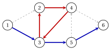

# 1.1 Grafi non orientati e orientati { #sez-sec-gr-graphs }

**Parte 1 · Grafi · Capitolo 1** · [:material-book-open-variant: Capitolo 1: Grafi](index.md) · [:material-file-pdf-box: Dispensa, volume 1 (PDF)](../../pdf/dispensa-1-grafi.pdf) · [:material-pencil: Esercizi: Grafi](../../esercizi/graphs.md) · [:material-gesture-tap: App: Ricerca su grafo: BFS e DFS](../../laboratorio/ricerca-bfs-dfs.md)

!!! definizione "Definizione 1.1: grafo non orientato"

    Un <strong>grafo non orientato</strong> $G=(V,E)$ è formato da un insieme finito $V$ di <strong>vertici</strong> e da un insieme $E$ di <strong>lati</strong>, ciascuno dei quali è un sottoinsieme di $V$ con due elementi:

    $$
    E \subseteq \big\{\, \{u,v\} : u,v \in V,~ u \neq v \,\big\}.
    $$

    Scriviamo $n=|V|$ e $m=|E|$ e i vertici sono etichettati $1,2,\dots,n$.

    - I vertici $u$ e $v$ sono gli <strong>estremi</strong> del lato $\{u,v\}$. Il lato è <strong>incidente</strong> a $u$ e a $v$; di conseguenza, $u$ e $v$ sono <strong>adiacenti</strong>.

    - L'<strong>intorno</strong> di $v$ è $N(v)=\{\, u \in V : \{u,v\} \in E \,\}$; l'insieme dei lati incidenti a $v$ è $\delta(v)=\{\, \{u,v\} \in E : u \in V \,\}$ e il <strong>grado</strong> di $v$ è $\deg(v)=|\delta(v)|$.

!!! esempio "Esempio 1.1: un grafo non orientato"

    Consideriamo il grafo $G=(V,E)$ con $n=6$ vertici e $m=9$ lati:

    $$
    V=\{1,2,3,4,5,6\}, \qquad
    E=\big\{\{1,2\},\{1,3\},\{2,3\},\{2,4\},\{3,4\},\{3,5\},\{4,5\},\{4,6\},\{5,6\}\big\}.
    $$

    { .fig loading=lazy  }

    L'intorno del vertice $3$ è $N(3)=\{1,2,4,5\}$, quindi $\deg(3)=4$. I gradi dei sei vertici sono

    $$
    \deg(1)=2,\quad \deg(2)=3,\quad \deg(3)=4,\quad \deg(4)=4,\quad \deg(5)=3,\quad \deg(6)=2.
    $$

!!! teorema "Proposizione 1.2: lemma della stretta di mano"

    Per ogni grafo non orientato $G=(V,E)$ abbiamo

    $$
    \sum_{v \in V} \deg(v) = 2\,m .
    $$

??? dimostrazione "Dimostrazione"

    La somma conta le coppie $(v,e)$ con $v \in V$, $e \in \delta(v)$. Ogni lato $e=\{u,v\}$ appare esattamente in due coppie, $(u,e)$ e $(v,e)$, quindi il numero di coppie è $2m$. □

- In [Esempio 1.1](#box-2-gr-ex-undirected) la somma dei gradi dà $2+3+4+4+3+2=18=2\cdot 9$.

!!! definizione "Definizione 1.3: grafo diretto"

    Un <strong>grafo orientato</strong> $G=(N,A)$ è dato da un insieme finito $N$ di <strong>nodi</strong> e un insieme $A$ di <strong>archi</strong>, ogni arco essendo una coppia ordinata di nodi distinti:

    $$
    A \subseteq \big\{\, (i,j) : i,j \in N,~ i \neq j \,\big\}.
    $$

    Scriviamo $n=|N|$ e $m=|A|$ e i nodi sono etichettati $1,2,\dots,n$.

    - L'arco $(i,j)$ va dalla sua <strong>coda</strong> $i$ alla sua <strong>testa</strong> $j$; $j$ è un <strong>successore</strong> di $i$ e $i$ è un <strong>predecessore</strong> di $j$.

    - La <strong>stella uscente</strong> $\delta^+(i)=\{\,(i,j) \in A\,\}$ contiene gli archi uscenti da $i$; la <strong>stella entrante</strong> $\delta^-(i)=\{\,(j,i) \in A\,\}$ contiene gli archi entranti in $i$.

    - Il <strong>grado uscente</strong> di $i$ è $\deg^+(i)=|\delta^+(i)|$ e il <strong>grado entrante</strong> è $\deg^-(i)=|\delta^-(i)|$.

- Gli archi $(i,j)$ e $(j,i)$ sono diversi: si chiamano <strong>antiparallelo</strong> e possono appartenere entrambi a $A$.

- Il <strong>grafo non orientato sottostante</strong> di $G=(N,A)$ ha il lato $\{i,j\}$ per ogni arco $(i,j)$ o $(j,i)$ di $A$: si ottiene ignorando l'orientamento degli archi.

!!! esempio "Esempio 1.2: il grafo di riferimento"

    Consideriamo il grafo diretto $G=(N,A)$ con nodi $n=6$ e archi $m=9$:

    $$
    N=\{1,2,3,4,5,6\}, \qquad
    A=\big\{(1,2),(1,3),(2,4),(3,2),(3,5),(4,3),(4,6),(5,4),(5,6)\big\}.
    $$

    Gli archi sono numerati $a_1,a_2,\dots,a_9$ in questo ordine (lessicografo), come in figura.

    { .fig loading=lazy  }

    I gradi uscenti e quelli entranti sono:

    
<table>
    <tr>
    <th>nodo \(i\)</th>
    <th>\(1\)</th>
    <th>\(2\)</th>
    <th>\(3\)</th>
    <th>\(4\)</th>
    <th>\(5\)</th>
    <th>\(6\)</th>
    </tr>
    <tr>
    <td>\(\deg^+(i)\)</td>
    <td>\(2\)</td>
    <td>\(1\)</td>
    <td>\(2\)</td>
    <td>\(2\)</td>
    <td>\(2\)</td>
    <td>\(0\)</td>
    </tr>
    <tr>
    <td>\(\deg^-(i)\)</td>
    <td>\(0\)</td>
    <td>\(2\)</td>
    <td>\(2\)</td>
    <td>\(2\)</td>
    <td>\(1\)</td>
    <td>\(2\)</td>
    </tr>
    </table>

    Il grafo non orientato sottostante è il grafo di [Esempio 1.1](#box-2-gr-ex-undirected). Chiameremo questo grafo il <strong>grafo di riferimento</strong>: tutti gli esempi del capitolo lo utilizzano.

- Ogni arco ha una coda e una testa, quindi $\sum_{i \in N} \deg^+(i) = \sum_{i \in N} \deg^-(i) = m$. Nel grafo di riferimento entrambe le somme sono $9$.

## 1.1.1 Passeggiate, percorsi e cicli

!!! definizione "Definizione 1.4: passeggiata, cammino e ciclo"

    Sia $G=(V,E)$ un grafo non orientato.

    - Una <strong>passeggiata</strong> da $v_0$ a $v_k$ è una sequenza $v_0, e_1, v_1, e_2, \dots, e_k, v_k$ di vertici e lati con $e_t=\{v_{t-1},v_t\} \in E$ per tutti i $t \in \{1,2,\dots,k\}$; la sua <strong>lunghezza</strong> è $k$.

    - La passeggiata è <strong>chiusa</strong> se $v_0=v_k$. È un <strong>cammino semplice</strong> se i vertici $v_0,v_1,\dots,v_k$ sono distinti.

    - Un <strong>ciclo</strong> è una passeggiata chiusa con $k \ge 3$ i cui vertici $v_0,v_1,\dots,v_{k-1}$ sono distinti.

    Un grafo senza cicli è <strong>aciclico</strong>. In un grafo semplice una passeggiata è identificata dai suoi vertici $v_0,v_1,\dots,v_k$.

!!! definizione "Definizione 1.5: passeggiata, cammino e ciclo diretto"

    Sia $G=(N,A)$ un grafo diretto.

    - Una <strong>passeggiata diretta</strong> da $i_0$ a $i_k$ è una sequenza di nodi $i_0,i_1,\dots,i_k$ con $(i_{t-1},i_t) \in A$ per tutti gli $t \in \{1,2,\dots,k\}$: ogni arco viene percorso dalla coda alla testa.

    - È un <strong>cammino semplice diretto</strong> se i suoi nodi sono distinti, e un <strong>ciclo diretto</strong> se $k \ge 2$, $i_0=i_k$ e i nodi $i_0,i_1,\dots,i_{k-1}$ sono distinti.

    - Una passeggiata, un cammino semplice o un ciclo del grafo non orientato sottostante è rispettivamente una passeggiata, un cammino semplice o un ciclo di $G$: gli archi possono essere attraversati in entrambe le direzioni. Un arco è percorso <strong>in avanti</strong> se si va dalla coda alla testa e <strong>all'indietro</strong> altrimenti.

!!! esempio "Esempio 1.3: passeggiate, percorsi e cicli nel grafo di riferimento"

    Nel grafo di riferimento:

    - $1,3,2,4,3,5$ è una passeggiata diretta di lunghezza $5$; non è un cammino semplice perché il nodo $3$ compare due volte;

    - $1,3,5,6$ è un cammino semplice diretto di lunghezza $3$ (in blu nella figura);

    - $2,4,3,2$ è un ciclo diretto di lunghezza $3$ (rosso in figura);

    - $1,2,3$ è un cammino semplice del grafo sottostante, ma non un cammino diretto: l'arco $(1,2)$ è percorso in avanti e $(3,2)$ all'indietro.

    { .fig loading=lazy  }

!!! teorema "Lemma 1.6: ogni passeggiata contiene un cammino semplice"

    Se in un grafo esiste una passeggiata (diretta) da $u$ a $v$, allora esiste anche un cammino semplice (diretto) da $u$ a $v$, i cui vertici appartengono alla passeggiata.

??? dimostrazione "Dimostrazione"

    Tra i cammini da $u$ a $v$ che utilizzano solo i vertici del cammino dato, sia $v_0,v_1,\dots,v_k$ uno dei minimi lunghezza. Se due gli indici $s<t$ avevano $v_s=v_t$, l'eliminazione di $v_{s+1},\dots,v_t$ darebbe la cammino $v_0,\dots,v_s,v_{t+1},\dots,v_k$ da Da $u$ a $v$, più corto di $t-s \ge 1$. Quindi i vertici sono distinti e la passeggiata è un percorso. Vale lo stesso argomento per passeggiate guidate, poiché la cancellazione mantiene ogni arco percorso dalla coda alla testa. □

- In [Esempio 1.3](#box-8-gr-ex-walks), eliminando il pezzo chiuso $3,2,4,3$ dalla passeggiata $1,3,2,4,3,5$ esce il percorso diretto $1,3,5$.

## 1.1.2 Grafi semplici e multigrafi

- Un grafo è <strong>semplice</strong> se non ha <strong>cappi</strong> (lati $\{v,v\}$ o archi $(i,i)$) né <strong>lati o archi paralleli</strong> (due copie della stessa coppia). I grafi di Definizioni [1.1](#box-1-gr-def-graph) e [Definizione 1.3](#box-4-gr-def-digraph) sono semplici, perché $E$ e $A$ sono insiemi di coppie di elementi distinti.

- Un <strong>multigrafo</strong> ammette cappi e lati o archi paralleli. In questo modulo tutti i grafi sono semplici e ogni arco è identificato dalla coppia $(i,j)$ formata dalla sua coda e dalla sua testa.

!!! chiave ""

    Un grafo non orientato $G=(V,E)$ ha lati $\{u,v\}$; un grafo diretto $G=(N,A)$ ha archi $(i,j)$ dalla coda $i$ a la testa $j$. Un percorso ha vertici distinti e ogni passeggiata contiene un percorso con gli stessi punti finali.

---

**Avanti:** [1.2 Rappresentazioni di un grafo](rappresentazioni-di-un-grafo.md)
