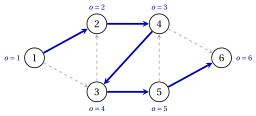

# 1.6 Visita di un grafo

**Parte 1 · Grafi · Capitolo 1** · [:material-book-open-variant: Capitolo 1: Grafi](index.md) · [:material-file-pdf-box: Dispensa, volume 1 (PDF)](../../pdf/dispensa-1-grafi.pdf) · [:material-presentation: Slide](../../pdf/slide-graphs.pdf) · [:material-pencil: Esercizi: Grafi](../../esercizi/graphs.md) · [:material-gesture-tap: App: Ricerca su grafo: BFS e DFS](../../laboratorio/ricerca-bfs-dfs.md)

!!! definizione "Definizione 1.24: visita di un grafo"

    Dati un grafo orientato $G=(N,A)$ e un nodo $s \in N$, la <strong>sorgente</strong>, una <strong>visita di un grafo</strong> trova l'insieme $R(s)$ dei nodi raggiungibili da $s$. Durante la visita:

    - un nodo è <strong>etichettato</strong> quando la visita lo raggiunge, e resta etichettato;

    - ogni nodo etichettato $j \neq s$ registra il suo <strong>predecessore</strong> $\mathit{pred}(j)$, il nodo da cui è stato raggiunto;

    - i nodi etichettati ancora da elaborare sono tenuti in una lista, $\mathit{LIST}$;

    - un arco $(i,j)$ è <strong>ammissibile</strong> se $i$ è etichettato e $j$ no.

!!! algoritmo "Algoritmo: Visita generica di un grafo"

    

<strong>Input:</strong> un grafo orientato \(G=(N,A)\) dato dalle sue liste di adiacenza, una sorgente \(s \in N\)

<strong>Output:</strong> i nodi etichettati, uguali a \(R(s)\), e i predecessori \(\mathit{pred}(j)\)

1<strong>Passo 0 (inizializzazione).</strong> Etichettare \(s\) e porre \(\mathit{LIST}:=\{s\}\); tutti gli altri nodi non sono etichettati.

2<strong>Passo 1 (selezione).</strong> Se \(\mathit{LIST}=\emptyset\), <code>STOP</code>. Altrimenti selezionare un nodo \(i \in \mathit{LIST}\):

3  il <em>primo</em> nodo di \(\mathit{LIST}\) nella visita in ampiezza (BFS),

4  l'<em>ultimo</em> nodo di \(\mathit{LIST}\) nella visita in profondità (DFS).

5<strong>Passo 2 (etichettatura).</strong> Se \(i\) ha un arco ammissibile \((i,j)\), prendere il primo in \(L(i)\):

6  etichettare \(j\), porre \(\mathit{pred}(j):=i\) e aggiungere \(j\) in fondo a \(\mathit{LIST}\).

7  Altrimenti rimuovere \(i\) da \(\mathit{LIST}\). Andare al Passo 1.

- Nella BFS la lista $\mathit{LIST}$ è una <strong>coda</strong> (first in, first out): i nodi sono elaborati nell'ordine in cui sono etichettati.

- Nella DFS la lista $\mathit{LIST}$ è una <strong>pila</strong> (last in, first out): la visita riparte sempre dal nodo etichettato più di recente ancora in $\mathit{LIST}$, e torna indietro solo quando quel nodo non ha archi ammissibili.

- L'ordine delle liste di adiacenza decide quale arco ammissibile si prende per primo; con le liste ordinate per indice crescente, come in questo modulo, il risultato è unico.

### 1.6.1 L'albero dei predecessori

!!! teorema "Proposizione 1.25: albero dei predecessori"

    A ogni iterazione, gli archi $(\mathit{pred}(j),j)$, per i nodi etichettati $j \neq s$, formano un albero sui nodi etichettati, l'<strong>albero dei predecessori</strong>. Per ogni nodo etichettato $j$ esso contiene un cammino orientato da $s$ a $j$.

??? dimostrazione "Dimostrazione"

    Sia $r$ il numero di nodi etichettati.

    1. Ogni nodo etichettato $j \neq s$ ha un predecessore, etichettato prima di $j$. Partendo da $j$ e passando al predecessore, i nodi sono etichettati sempre prima, quindi la sequenza termina in $s$.

    2. Letta all'indietro, è un cammino orientato da $s$ a $j$ lungo gli archi $(\mathit{pred}(h),h)$.

    3. Quindi gli $r-1$ archi connettono gli $r$ nodi etichettati, e formano un albero per il [Teorema 1.17](alberi-e-foreste.md#box-23-gr-th-tree)(b). □

!!! teorema "Teorema 1.26: correttezza della visita"

    Al termine della visita generica, BFS e DFS comprese, i nodi etichettati sono esattamente i nodi di $R(s)$.

??? dimostrazione "Dimostrazione"

    Ogni nodo etichettato è raggiungibile da $s$, per la [Proposizione 1.25](#box-33-gr-prop-predtree). Viceversa, sia $j \in R(s)$ e sia $s=i_0,i_1,\dots,i_k=j$ un cammino orientato; supponiamo per assurdo che $j$ non sia etichettato.

    1. Sia $i_t$ il primo nodo non etichettato del cammino; $t \ge 1$, perché $s$ è etichettato.

    2. Il nodo $i_{t-1}$ è etichettato, quindi è entrato in $\mathit{LIST}$, e alla fine ne è uscito.

    3. Un nodo esce da $\mathit{LIST}$ solo quando non ha archi ammissibili. Ma $(i_{t-1},i_t)$ resta ammissibile fino alla fine, perché le etichette non si tolgono mai: una contraddizione. □

!!! teorema "Teorema 1.27: tempo di esecuzione della visita"

    Con le liste di adiacenza, la visita generica richiede tempo $O(|N|+|A|)$.

??? dimostrazione "Dimostrazione"

    Ogni nodo mantiene un puntatore alla posizione corrente nella sua lista $L(i)$; il puntatore avanza oltre i successori etichettati e non torna mai indietro, perché le etichette non si tolgono mai.

    - Ogni iterazione etichetta un nodo o rimuove un nodo da $\mathit{LIST}$. Ogni nodo è etichettato al più una volta e rimosso al più una volta, quindi ci sono al più $2n$ iterazioni, ciascuna con lavoro $O(1)$ oltre al puntatore.

    - Il puntatore del nodo $i$ avanza in tutto al più $\deg^+(i)$ volte, e $\sum_{i \in N} \deg^+(i)=m$.

    Il tempo totale è $O(n+m)=O(|N|+|A|)$. □

- Con la matrice di adiacenza i successori di un nodo si trovano scorrendo una riga di lunghezza $n$, e la visita richiede tempo $O(n^2)$.

### 1.6.2 La visita in ampiezza sul grafo di riferimento

!!! esempio "Esempio 1.9: BFS dal nodo $1$"

    Eseguiamo la BFS sul grafo di riferimento da $s=1$, con le liste di adiacenza dell'[Esempio 1.5](rappresentazioni-di-un-grafo.md#box-14-gr-ex-lists). Ogni riga è un'iterazione, e $\mathit{LIST}$ è riportata dopo di essa:

    
<table>
    <tr>
    <th>iterazione</th>
    <th>\(i\) selezionato</th>
    <th>azione</th>
    <th>\(\mathit{LIST}\)</th>
    </tr>
    <tr>
    <td>\(1\)</td>
    <td>\(1\)</td>
    <td>etichetta \(2\), \(\mathit{pred}(2)=1\)</td>
    <td>\(1,2\)</td>
    </tr>
    <tr>
    <td>\(2\)</td>
    <td>\(1\)</td>
    <td>etichetta \(3\), \(\mathit{pred}(3)=1\)</td>
    <td>\(1,2,3\)</td>
    </tr>
    <tr>
    <td>\(3\)</td>
    <td>\(1\)</td>
    <td>rimuovi \(1\)</td>
    <td>\(2,3\)</td>
    </tr>
    <tr>
    <td>\(4\)</td>
    <td>\(2\)</td>
    <td>etichetta \(4\), \(\mathit{pred}(4)=2\)</td>
    <td>\(2,3,4\)</td>
    </tr>
    <tr>
    <td>\(5\)</td>
    <td>\(2\)</td>
    <td>rimuovi \(2\)</td>
    <td>\(3,4\)</td>
    </tr>
    <tr>
    <td>\(6\)</td>
    <td>\(3\)</td>
    <td>etichetta \(5\), \(\mathit{pred}(5)=3\) (\(2\) è etichettato)</td>
    <td>\(3,4,5\)</td>
    </tr>
    <tr>
    <td>\(7\)</td>
    <td>\(3\)</td>
    <td>rimuovi \(3\)</td>
    <td>\(4,5\)</td>
    </tr>
    <tr>
    <td>\(8\)</td>
    <td>\(4\)</td>
    <td>etichetta \(6\), \(\mathit{pred}(6)=4\) (\(3\) è etichettato)</td>
    <td>\(4,5,6\)</td>
    </tr>
    <tr>
    <td>\(9\)</td>
    <td>\(4\)</td>
    <td>rimuovi \(4\)</td>
    <td>\(5,6\)</td>
    </tr>
    <tr>
    <td>\(10\)</td>
    <td>\(5\)</td>
    <td>rimuovi \(5\) (\(4\) e \(6\) sono etichettati)</td>
    <td>\(6\)</td>
    </tr>
    <tr>
    <td>\(11\)</td>
    <td>\(6\)</td>
    <td>rimuovi \(6\)</td>
    <td>(vuota)</td>
    </tr>
    </table>

    L'ordine di etichettatura è $1,2,3,4,5,6$: ogni nodo è raggiungibile da $1$. L'albero dei predecessori ha gli archi $(1,2)$, $(1,3)$, $(2,4)$, $(3,5)$, $(4,6)$; è l'albero ricoprente dell'[Esempio 1.7](alberi-e-foreste.md#box-26-gr-ex-tree). Accanto a ogni nodo, la figura riporta il numero $d(j)$ di archi del cammino dell'albero da $1$ a $j$.

    { .fig loading=lazy  }

!!! teorema "Proposizione 1.28: la BFS trova i cammini più corti in numero di archi"

    Nell'albero dei predecessori della BFS, siano $d(s)=0$ e $d(j)=d(\mathit{pred}(j))+1$ per ogni nodo etichettato $j \neq s$. Allora, per ogni $j \in R(s)$, $d(j)$ è il numero minimo di archi di un cammino orientato da $s$ a $j$.

??? dimostrazione "Dimostrazione"

    Dimostriamo tre fatti.

    1. <em>Se $\mathit{LIST}=u_1,u_2,\dots,u_r$, allora $d(u_1) \le d(u_2) \le \dots \le d(u_r) \le d(u_1)+1$.</em> Vale al Passo 0. Un nuovo nodo $j$ è etichettato da $u_1$ e aggiunto con $d(j)=d(u_1)+1$; rimuovere $u_1$ mantiene la proprietà, perché $d(u_r) \le d(u_1)+1 \le d(u_2)+1$.

    2. <em>I nodi sono etichettati in ordine non decrescente di $d$.</em> Ogni nuovo nodo ha $d(j)=d(u_1)+1 \ge d(u_r)$, e $u_r$ è l'ultimo nodo etichettato prima di $j$.

    3. <em>Per ogni arco $(i,j)$ con $i$ etichettato, $d(j) \le d(i)+1$.</em> Se $j$ è etichettato dopo $i$, allora $j$ è etichettato prima che $i$ esca da $\mathit{LIST}$, da un nodo $u$ in testa a $\mathit{LIST}$, etichettato non dopo $i$: $d(j)=d(u)+1 \le d(i)+1$. Se $j$ è etichettato prima di $i$, allora $d(j) \le d(i)$ per il fatto 2.

    Sia $s=i_0,i_1,\dots,i_k=j$ un cammino orientato con il numero minimo $k$ di archi. I suoi nodi sono etichettati ([Teorema 1.26](#box-34-gr-th-search)), e per il fatto 3 $d(j) \le d(i_{k-1})+1 \le \dots \le d(s)+k=k$. Il cammino dell'albero da $s$ a $j$ è un cammino orientato con $d(j)$ archi, quindi $d(j) \ge k$. □

- Nell'[Esempio 1.9](#box-36-gr-ex-bfs), i valori $d=(0,1,1,2,2,3)$ sono i numeri minimi di archi dal nodo $1$: per esempio, i cammini orientati più corti verso il nodo $6$ hanno $3$ archi, come $1,2,4,6$.

### 1.6.3 La visita in profondità sul grafo di riferimento

!!! esempio "Esempio 1.10: DFS dal nodo $1$"

    Eseguiamo la DFS sul grafo di riferimento da $s=1$: il nodo selezionato è sempre l'ultimo di $\mathit{LIST}$.

    
<table>
    <tr>
    <th>iterazione</th>
    <th>\(i\) selezionato</th>
    <th>azione</th>
    <th>\(\mathit{LIST}\)</th>
    </tr>
    <tr>
    <td>\(1\)</td>
    <td>\(1\)</td>
    <td>etichetta \(2\), \(\mathit{pred}(2)=1\)</td>
    <td>\(1,2\)</td>
    </tr>
    <tr>
    <td>\(2\)</td>
    <td>\(2\)</td>
    <td>etichetta \(4\), \(\mathit{pred}(4)=2\)</td>
    <td>\(1,2,4\)</td>
    </tr>
    <tr>
    <td>\(3\)</td>
    <td>\(4\)</td>
    <td>etichetta \(3\), \(\mathit{pred}(3)=4\)</td>
    <td>\(1,2,4,3\)</td>
    </tr>
    <tr>
    <td>\(4\)</td>
    <td>\(3\)</td>
    <td>etichetta \(5\), \(\mathit{pred}(5)=3\) (\(2\) è etichettato)</td>
    <td>\(1,2,4,3,5\)</td>
    </tr>
    <tr>
    <td>\(5\)</td>
    <td>\(5\)</td>
    <td>etichetta \(6\), \(\mathit{pred}(6)=5\) (\(4\) è etichettato)</td>
    <td>\(1,2,4,3,5,6\)</td>
    </tr>
    <tr>
    <td>\(6\)</td>
    <td>\(6\)</td>
    <td>rimuovi \(6\)</td>
    <td>\(1,2,4,3,5\)</td>
    </tr>
    <tr>
    <td>\(7\)</td>
    <td>\(5\)</td>
    <td>rimuovi \(5\)</td>
    <td>\(1,2,4,3\)</td>
    </tr>
    <tr>
    <td>\(8\)</td>
    <td>\(3\)</td>
    <td>rimuovi \(3\)</td>
    <td>\(1,2,4\)</td>
    </tr>
    <tr>
    <td>\(9\)</td>
    <td>\(4\)</td>
    <td>rimuovi \(4\) (\(3\) e \(6\) sono etichettati)</td>
    <td>\(1,2\)</td>
    </tr>
    <tr>
    <td>\(10\)</td>
    <td>\(2\)</td>
    <td>rimuovi \(2\)</td>
    <td>\(1\)</td>
    </tr>
    <tr>
    <td>\(11\)</td>
    <td>\(1\)</td>
    <td>rimuovi \(1\) (\(2\) e \(3\) sono etichettati)</td>
    <td>(vuota)</td>
    </tr>
    </table>

    L'ordine di etichettatura è $1,2,4,3,5,6$, e l'albero dei predecessori ha gli archi $(1,2)$, $(2,4)$, $(4,3)$, $(3,5)$, $(5,6)$: un unico cammino orientato. Accanto a ogni nodo, la figura riporta la sua posizione $o(j)$ nell'ordine di etichettatura.

    { .fig loading=lazy  }

- Entrambe le visite etichettano tutti i nodi, come garantisce il [Teorema 1.26](#box-34-gr-th-search), ma i loro alberi sono diversi. L'albero della DFS raggiunge il nodo $6$ con $5$ archi, quello della BFS con $3$.

### 1.6.4 Usare la visita

- <strong>Componenti connesse.</strong> In un grafo non orientato, una visita da un vertice non etichettato etichetta tutta la sua componente; ripeterla da ogni vertice ancora non etichettato trova tutte le componenti in tempo $O(n+m)$.

- <strong>Componenti fortemente connesse.</strong> Una visita in $G$ e una nel grafo invertito $G'$ danno $R(i)$ e $R'(i)$, quindi $S(i)=R(i) \cap R'(i)$; ripeterle per un nodo di ogni componente ancora sconosciuta richiede tempo $O(n(n+m))$.

- <strong>Alberi ricoprenti.</strong> Su un grafo non orientato connesso, l'albero dei predecessori di una visita da un vertice qualsiasi è un albero ricoprente.

!!! chiave ""

    Una visita di un grafo etichetta esattamente i nodi raggiungibili dalla sorgente, in tempo $O(|N|+|A|)$, e i suoi predecessori formano un albero. La BFS (una coda) dà cammini con il numero minimo di archi; la DFS (una pila) va prima in profondità.

## 1.7 Errori tipici

!!! attenzione "Attenzione"

    - <strong>Scambiare i segni della matrice di incidenza.</strong> L'elemento è $+1$ nella coda e $-1$ nella testa: la colonna di $(4,3)$ ha $+1$ nella riga $4$.

    - <strong>Chiamare cammino una passeggiata.</strong> Un cammino ha vertici distinti; una passeggiata può ripeterli, e contiene sempre un cammino con gli stessi estremi.

    - <strong>Confondere connessione debole e forte.</strong> Il grafo di riferimento è debolmente connesso, ma ha tre componenti fortemente connesse.

    - <strong>Contare solo gli spigoli.</strong> Un grafo con $n-1$ spigoli non è necessariamente un albero: deve anche essere connesso, oppure aciclico.

    - <strong>Credere che la matrice di incidenza abbia rango pieno per righe.</strong> Il suo rango è $|N|-k$: in un grafo connesso una riga è sempre ridondante.

    - <strong>Aspettarsi cammini più corti dalla DFS.</strong> Solo l'albero della BFS dà il numero minimo di archi, e solo quando ogni arco conta uno.

    - <strong>Dimenticare l'ordine delle liste.</strong> L'ordine di etichettatura e l'albero dei predecessori dipendono dall'ordine in cui si scorrono i successori.

## 1.8 In sintesi

!!! chiave "In sintesi"

    - Un grafo non orientato $G=(V,E)$ ha spigoli $\{u,v\}$, un grafo orientato $G=(N,A)$ ha archi $(i,j)$; la somma dei gradi è $2m$, quella dei gradi uscenti e quella dei gradi entranti è $m$.

    - Le liste di adiacenza richiedono spazio $n+m$; la matrice di incidenza nodo–arco ha $+1$ nella coda e $-1$ nella testa, e la riga $i$ di $\mat{B}\vet{x}$ è il flusso uscente meno il flusso entrante nel nodo $i$.

    - Le componenti connesse e le componenti fortemente connesse sono classi di equivalenza; $S(i)=R(i) \cap R'(i)$.

    - Un albero è connesso e aciclico, con $n-1$ spigoli e un unico cammino fra ogni coppia di vertici; uno spigolo esterno a un albero ricoprente chiude un ciclo fondamentale.

    - $\rank(\mat{B})=|N|-k$, e in un grafo connesso le basi di $\mat{B}$ sono gli alberi ricoprenti.

    - La visita generica trova $R(s)$ in tempo $O(|N|+|A|)$; la BFS dà il numero minimo di archi.

    <strong>Il grafo di riferimento in sintesi.</strong>

    
<table>
    <tr>
    <td>nodi e archi</td>
    <td>\(n=6\), \(m=9\)</td>
    </tr>
    <tr>
    <td>componenti connesse</td>
    <td>\(1\)</td>
    </tr>
    <tr>
    <td>componenti fortemente connesse</td>
    <td>\(\{1\}\), \(\{2,3,4,5\}\), \(\{6\}\)</td>
    </tr>
    <tr>
    <td>\(\rank(\mat{B})\)</td>
    <td>\(5\)</td>
    </tr>
    <tr>
    <td>BFS da \(1\)</td>
    <td>ordine \(1,2,3,4,5,6\); \(d=(0,1,1,2,2,3)\)</td>
    </tr>
    <tr>
    <td>DFS da \(1\)</td>
    <td>ordine \(1,2,4,3,5,6\)</td>
    </tr>
    </table>

---

**Esercizi su questo capitolo:** [:material-pencil: Grafi](../../esercizi/graphs.md)

