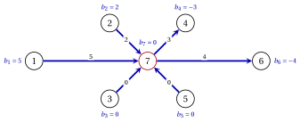

# 8.9 L'albero iniziale: la Fase 0

**Parte 4 · Il simplesso su reti · Capitolo 8** · [:material-book-open-variant: Capitolo 8: Simplesso su reti](index.md) · [:material-file-pdf-box: Dispensa, volume 4 (PDF)](../../pdf/dispensa-4-simplesso-su-reti.pdf) · [:material-presentation: Slide](../../pdf/slide-network-simplex.pdf) · [:material-pencil: Esercizi: Simplesso su reti](../../esercizi/network-simplex.md) · [:material-gesture-tap: App: Il simplesso su reti, pivot per pivot](../../laboratorio/simplesso-su-reti.md)

!!! definizione "Definizione 8.20: rete ausiliaria"

    Sia $G=(N,A)$ una rete con $\sum_{i \in N}b_i=0$. La <strong>rete ausiliaria</strong> $G^0$ aggiunge a $G$ il <strong>nodo artificiale</strong> $r=n+1$, con $b_r=0$, e un <strong>arco artificiale</strong> per ogni nodo $i \in N$:

    $$
    (i,r) \ \text{ se } b_i \ge 0, \qquad\qquad (r,i) \ \text{ se } b_i<0,
    $$

    con capacità $+\infty$. I costi della Fase 0 sono $c^0_{ij}=1$ sugli archi artificiali e $c^0_{ij}=0$ sugli archi di $A$. La <strong>Fase 0</strong> applica l'algoritmo del simplesso su reti a $G^0$ con i costi $c^0_{ij}$, partendo dall'albero degli archi artificiali, con $L=A$ e $U=\emptyset$; la radice è l'ultimo nodo, $r$.

- Il valore della Fase 0 è il flusso totale sugli archi artificiali: misura quanto il flusso è lontano dall'essere un flusso di $G$. È il problema ausiliario del [Capitolo 8 «Fase 0 dell'algoritmo del simplesso»](https://fabiofurini.github.io/programmazione-lineare/simplesso/08-fase-zero/), scritto sulla rete.

!!! teorema "Proposizione 8.21: l'albero iniziale della Fase 0"

    Gli archi artificiali formano un albero ricoprente di $G^0$. La sua soluzione ad albero ha $x_{ir}=b_i$ se $b_i \ge 0$, $x_{ri}=-b_i$ se $b_i<0$, e $x_{ij}=0$ su $A$; il suo costo è $\sum_{i \in N}|b_i|$, e la struttura ad albero è fortemente ammissibile.

??? dimostrazione "Dimostrazione"

    Gli $n$ archi artificiali collegano ogni nodo di $N$ a $r$: formano un grafo connesso con $n+1$ nodi e $n$ archi, cioè un albero ricoprente.

    - In un nodo $i \in N$ l'unico arco con flusso è il suo arco artificiale, quindi la conservazione vale. In $r$ il flusso uscente meno il flusso entrante è $\sum_{i:\,b_i<0}(-b_i)-\sum_{i:\,b_i \ge 0}b_i=-\sum_{i \in N}b_i=0=b_r$.

    - Gli archi dell'albero con flusso nullo sono gli archi $(i,r)$ con $b_i=0$: la loro coda è $i$, quindi puntano verso la radice. Nessun arco dell'albero è alla sua capacità, che è $+\infty$.

    
□

!!! teorema "Teorema 8.22: Fase 0"

    La Fase 0 si ferma dopo un numero finito di pivot con un valore ottimo $z_0 \ge 0$. La rete $G$ ha un flusso ammissibile se e solo se $z_0=0$, e in tal caso il flusso finale della Fase 0, ristretto ad $A$, è un flusso ammissibile di $G$.

??? dimostrazione "Dimostrazione"

    Tutte le capacità di $G^0$ sono positive e la struttura ad albero iniziale è fortemente ammissibile ([Proposizione 8.21](#box-28-ns-prop-initial)), quindi la Fase 0 si ferma per il [Teorema 8.19](degenerazione-e-alberi-fortemente-ammissibili.md#box-25-ns-th-finite).

    1. Non può fermarsi nel Passo 3: i costi $c^0_{ij}$ sono non negativi, quindi nessun ciclo ha costo negativo ([Proposizione 8.14](il-pivot.md#box-17-ns-prop-unbounded)). Si ferma nel Passo 1 con un flusso ottimo, di valore $z_0 \ge 0$.

    2. Se $G$ ha un flusso ammissibile, lo stesso flusso con zero sugli archi artificiali è ammissibile per $G^0$ con costo $0$, quindi $z_0=0$.

    3. Se $z_0=0$, ogni arco artificiale ha flusso nullo, quindi i vincoli di conservazione dei nodi di $N$ coinvolgono solo archi di $A$: la restrizione ad $A$ è un flusso ammissibile di $G$. □

- Quando $z_0=0$ l'albero finale della Fase 0 contiene ancora almeno un arco artificiale, perché la radice $r$ deve essere collegata agli altri nodi. La proposizione seguente mostra come proseguire da questo albero.

!!! teorema "Proposizione 8.23: dalla Fase 0 al simplesso su reti"

    Sia la Fase 0 terminata con $z_0=0$, con flusso $\tilde{\vet{x}}^0$, struttura ad albero $(T,L,U)$ e costi ridotti $\bar{c}^0_{ij}$. Applichiamo l'algoritmo del simplesso su reti a $G^0$ a partire da $(T,L,U)$, con i costi $c_{ij}$ su $A$ e $0$ sugli archi artificiali, facendo entrare solo gli archi con $\bar{c}^0_{ij}=0$. Allora ogni flusso incontrato ha flusso nullo sugli archi artificiali, e l'algoritmo termina con un flusso ottimo di $G$, oppure dimostra che il modello $\mathrm{MCF}$ è illimitato.

??? dimostrazione "Dimostrazione"

    Chiamiamo <em>fissati</em> gli archi con $\bar{c}^0_{ij} \neq 0$. Non sono in $T$ e, per l'ottimalità della Fase 0, quelli con $\bar{c}^0_{ij}>0$ sono in $L$, con flusso $0$, e quelli con $\bar{c}^0_{ij}<0$ sono in $U$, con flusso $u_{ij}$.

    1. <em>Un'identità chiave.</em> Sia $\vet{y}$ un flusso di $G^0$ che soddisfa la conservazione e i limiti. Per il [Lemma «costo e costo ridotto» del Capitolo 4](../../flussi/network-flow-models/il-modello-duale-e-i-costi-ridotti.md), e poiché il costo di $\tilde{\vet{x}}^0$ è $z_0=0$,

        $$
        \sum_{a}c^0_ay_a=\sum_{a}\bar{c}^0_a\,(y_a-\tilde{x}^0_a) .
        $$

        Ogni termine vale $\bar{c}^0_ay_a \ge 0$ sugli archi fissati di $L$, $\bar{c}^0_a(y_a-u_a) \ge 0$ sugli archi fissati di $U$, e $0$ altrove.

    2. <em>Nessun flusso artificiale.</em> Gli archi fissati non entrano mai nell'albero, quindi ogni flusso incontrato ne mantiene i valori, e ogni termine dell'identità è $0$. Quindi il flusso artificiale totale $\sum_{a}c^0_ay_a$ è $0$, e ogni arco artificiale ha flusso nullo.

    3. <em>I flussi ammissibili di $G$ mantengono i valori fissati.</em> Un flusso ammissibile $\vet{y}$ di $G$, con zero sugli archi artificiali, ha $\sum_{a}c^0_ay_a=0$: ogni termine dell'identità si annulla, quindi $y_a=0$ sugli archi fissati di $L$ e $y_a=u_a$ su quelli di $U$.

    4. <em>Ottimalità.</em> Sia $\vet{x}$ il flusso e $\vet{\pi}$ i potenziali con cui l'algoritmo si ferma. Come nel [Teorema 8.10](potenziali-e-ottimalita.md#box-12-ns-th-optimality), $\vet{c}'\vet{y}-\vet{c}'\vet{x}=\sum_{a}\bar{c}_a(y_a-x_a)$. Gli archi fissati danno $0$ per il punto 3, gli archi dell'albero danno $0$, e gli altri archi di $L$ e $U$ soddisfano le condizioni di arresto e danno un termine non negativo. Quindi $\vet{c}'\vet{y} \ge \vet{c}'\vet{x}$.

    5. <em>Illimitatezza.</em> Se l'algoritmo si ferma nel Passo 3, i flussi $\vet{x}+t\vet{x}^C$ della [Proposizione 8.14](il-pivot.md#box-17-ns-prop-unbounded) mantengono i valori fissati: per l'identità del punto 1 hanno flusso artificiale nullo, quindi sono flussi di $G$ con costo che tende a $-\infty$.

    Le strutture incontrate restano fortemente ammissibili, e l'algoritmo si ferma, per il [Teorema 8.19](degenerazione-e-alberi-fortemente-ammissibili.md#box-25-ns-th-finite). □

!!! esempio "Esempio 8.8: la Fase 0 sulla rete di riferimento"

    Per la rete di riferimento con capacità, la rete ausiliaria ha il nodo artificiale $7$ e gli archi artificiali $(1,7)$, $(2,7)$, $(3,7)$, $(5,7)$, perché $b_1,b_2,b_3,b_5 \ge 0$, e $(7,4)$, $(7,6)$. L'albero iniziale (blu) porta $5$, $2$, $0$, $0$, $3$, $4$ unità su questi archi, tutti gli archi di $A$ sono vuoti (non sono disegnati), e $z_0=14$. I potenziali iniziali sono $\pi_i=1$ per i nodi con un arco $(i,7)$ e $\pi_i=-1$ per quelli con un arco $(7,i)$.

    { .fig loading=lazy  }

    La Fase 0 esegue sei pivot; ogni arco entrante ha $\bar{c}^0_{ij}=-2$, e ogni apice è la radice $7$.

    
<table>
    <tr>
    <th>pivot</th>
    <th>entrante</th>
    <th>\(\bar{c}^0_{ij}\)</th>
    <th>apice</th>
    <th>\(\theta\)</th>
    <th>archi bloccanti</th>
    <th>uscente</th>
    <th>\(z_0\) dopo</th>
    </tr>
    <tr>
    <td>\(1\)</td>
    <td>\((2,4)\)</td>
    <td>\(-2\)</td>
    <td>\(7\)</td>
    <td>\(2\)</td>
    <td>\((2,7)\)</td>
    <td>\((2,7)\)</td>
    <td>\(10\)</td>
    </tr>
    <tr>
    <td>\(2\)</td>
    <td>\((1,2)\)</td>
    <td>\(-2\)</td>
    <td>\(7\)</td>
    <td>\(1\)</td>
    <td>\((7,4)\)</td>
    <td>\((7,4)\)</td>
    <td>\(8\)</td>
    </tr>
    <tr>
    <td>\(3\)</td>
    <td>\((4,6)\)</td>
    <td>\(-2\)</td>
    <td>\(7\)</td>
    <td>\(1\)</td>
    <td>\((2,4)\)</td>
    <td>\((2,4)\)</td>
    <td>\(6\)</td>
    </tr>
    <tr>
    <td>\(4\)</td>
    <td>\((5,4)\)</td>
    <td>\(-2\)</td>
    <td>\(7\)</td>
    <td>\(0\)</td>
    <td>\((5,7)\)</td>
    <td>\((5,7)\)</td>
    <td>\(6\)</td>
    </tr>
    <tr>
    <td>\(5\)</td>
    <td>\((3,5)\)</td>
    <td>\(-2\)</td>
    <td>\(7\)</td>
    <td>\(0\)</td>
    <td>\((3,7)\)</td>
    <td>\((3,7)\)</td>
    <td>\(6\)</td>
    </tr>
    <tr>
    <td>\(6\)</td>
    <td>\((1,3)\)</td>
    <td>\(-2\)</td>
    <td>\(7\)</td>
    <td>\(3\)</td>
    <td>\((1,7)\), \((5,4)\), \((7,6)\)</td>
    <td>\((7,6)\)</td>
    <td>\(0\)</td>
    </tr>
    </table>

    - I pivot $4$ e $5$ sono degeneri. Nel pivot $3$ l'arco $(2,4)$ raggiunge la sua capacità e va in $U$.

    - Nel pivot $6$ il ciclo è $7,1,3,5,4,6,7$, con tre archi bloccanti. La regola sceglie $(7,6)$, l'ultimo a partire dall'apice. Con $(1,7)$ l'albero conterrebbe $(5,4)$ saturo che punta verso la radice e $(7,6)$ vuoto che punta in senso opposto alla radice; con $(5,4)$, l'arco vuoto $(7,6)$ che punta in senso opposto: nessuno dei due alberi sarebbe fortemente ammissibile.

    - La Fase 0 termina con $z_0=0$, l'albero $(1,2)$, $(1,3)$, $(1,7)$, $(3,5)$, $(4,6)$, $(5,4)$ e $U=\{(2,4)\}$. Tutti i potenziali di $N$ valgono $1$, quindi $\bar{c}^0_{ij}=0$ su ogni arco tranne $(7,4)$ e $(7,6)$, che hanno $\bar{c}^0_{ij}=2$ e sono fissati.

    Con i costi $c_{ij}$ la soluzione ad albero costa $74$. Gli archi $(7,4)$ e $(7,6)$ hanno costi ridotti $-10$ e $-15$, ma sono fissati: l'unico arco che può entrare è $(5,6)$, con $\bar{c}_{56}=-7$. La sua capacità residua $u_{56}=2$ è la minima lungo il suo ciclo, quindi $(5,6)$ stesso è l'arco uscente e passa in $U$, e il costo diventa $74-2 \cdot 7=60$: l'ottimo dell'[Esempio 8.7](un-esempio-con-capacita-e-un-pivot-degenere.md#box-26-ns-ex-b). Se $(7,6)$ potesse entrare, $3$ unità viaggerebbero da $1$ a $6$ attraverso il nodo artificiale, a costo $29$: non sarebbe un flusso di $G$.

!!! chiave ""

    La Fase 0 parte dalla stella fortemente ammissibile degli archi artificiali e minimizza il flusso artificiale: $z_0>0$ dimostra che non esiste un flusso ammissibile. Se $z_0=0$, il simplesso su reti prosegue dall'albero finale, con i costi originali, e possono entrare solo gli archi con costo ridotto nullo nella Fase 0.

## 8.10 Errori tipici

!!! attenzione "Attenzione"

    - <strong>Chiamare di base gli archi con flusso positivo.</strong> La base è l'albero $T$: un arco di $U$ ha flusso positivo ma è fuori base, e un arco dell'albero può avere flusso $0$ o $u_{ij}$.

    - <strong>Usare il test dei segni di un problema di massimo.</strong> Nel modello $\mathrm{MCF}$, che è di minimo, un arco di $L$ è ammissibile per l'ingresso se $\bar{c}_{ij}<0$ e un arco di $U$ se $\bar{c}_{ij}>0$.

    - <strong>Orientare il ciclo come l'arco entrante quando questo è in $U$.</strong> Il suo flusso deve diminuire, quindi il ciclo va contro di esso, e l'arco entrante è all'indietro.

    - <strong>Dimenticare l'arco entrante nel test dei rapporti.</strong> La sua capacità residua è $u_{kl}$; se è l'unico arco bloccante, l'albero non cambia e l'arco passa da $L$ a $U$ o viceversa.

    - <strong>Aggiornare tutti i potenziali.</strong> Cambiano solo i potenziali del sottoalbero staccato dall'arco uscente, tutti di $\bar{c}_{kl}$ o di $-\bar{c}_{kl}$.

    - <strong>Scegliere un arco bloccante qualsiasi.</strong> L'ultimo arco bloccante a partire dall'apice mantiene l'albero fortemente ammissibile; un'altra scelta può far perdere questa proprietà e la garanzia contro il ciclaggio.

    - <strong>Far entrare gli archi fissati dopo la Fase 0.</strong> Un arco con $\bar{c}^0_{ij} \neq 0$ può mettere flusso sugli archi artificiali; possono entrare solo gli archi con $\bar{c}^0_{ij}=0$.

## 8.11 In sintesi

!!! chiave "In sintesi"

    - In una rete connessa l'equazione del nodo $n$ è ridondante, e le basi del modello $\mathrm{MCF}$ sono gli alberi ricoprenti; le loro matrici sono triangolari con determinante $\pm 1$.

    - Una struttura ad albero $(T,L,U)$ fissa gli archi fuori base a $0$ o alla loro capacità; la soluzione ad albero si ottiene dalle foglie, e i potenziali dalla radice, con $\pi_n=0$.

    - Il costo ridotto di un arco fuori base è il costo del suo ciclo fondamentale; $\bar{c} \ge 0$ su $L$ e $\bar{c} \le 0$ su $U$ certificano l'ottimalità.

    - Un pivot invia $\theta$ unità lungo il ciclo dell'arco entrante e riduce il costo di $\theta|\bar{c}_{kl}|$; l'arco uscente è l'ultimo arco bloccante a partire dall'apice, e cambiano solo i potenziali di un sottoalbero.

    - Gli alberi fortemente ammissibili e questa regola dell'arco uscente impediscono il ciclaggio. La Fase 0 sulla rete ausiliaria dà un albero iniziale fortemente ammissibile, oppure dimostra che non esiste un flusso ammissibile.

    <strong>La rete di riferimento in breve.</strong>

    
<table>
    <tr>
    <td>senza capacità</td>
    <td>costi \(80\), \(52\), \(49\); albero ottimo \((1,2),(1,3),(2,4),(3,5),(5,6)\)</td>
    </tr>
    <tr>
    <td>con capacità, da \(\bar{\vet{x}}\)</td>
    <td>costi \(63\), \(63\) (degenere), \(60\); \(U=\{(2,4),(5,6)\}\)</td>
    </tr>
    <tr>
    <td>potenziali ottimi (\(\pi_6=0\))</td>
    <td>\((8,6,6,1,3,0)\) senza capacità, \((15,13,13,5,10,0)\) con</td>
    </tr>
    <tr>
    <td>Fase 0</td>
    <td>\(z_0\) da \(14\) a \(0\) in sei pivot, poi un pivot da \(74\) a \(60\)</td>
    </tr>
    </table>

---

**Esercizi su questo capitolo:** [:material-pencil: Simplesso su reti](../../esercizi/network-simplex.md)

