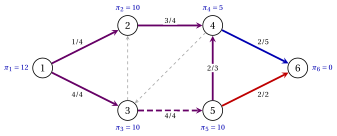
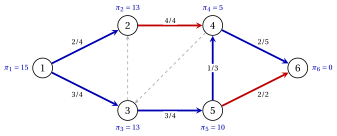

# 8.8 Un esempio con capacità e un pivot degenere { #sez-sec-ns-example-b }

**Parte 4 · Il simplesso su reti · Capitolo 8** · [:material-book-open-variant: Capitolo 8: Simplesso su reti](index.md) · [:material-file-pdf-box: Dispensa, volume 4 (PDF)](../../pdf/dispensa-4-simplesso-su-reti.pdf) · [:material-presentation: Slide](../../pdf/slide-network-simplex.pdf) · [:material-pencil: Esercizi: Simplesso su reti](../../esercizi/network-simplex.md) · [:material-gesture-tap: App: Il simplesso su reti, pivot per pivot](../../laboratorio/simplesso-su-reti.md)

- Risolviamo l'istanza di trasbordo del [Capitolo 4](../../flussi/network-flow-models/un-istanza-di-trasbordo.md), la rete di riferimento con capacità, a partire dal flusso $\bar{\vet{x}}$ di costo $63$ con la struttura ad albero fortemente ammissibile dell'[Esempio 8.2](basi-e-alberi-ricoprenti.md#box-8-ns-ex-tree):

    $$
    T=\{(1,2),(2,4),(3,2),(4,6),(5,4)\}, \qquad L=\{(4,3)\}, \qquad U=\{(1,3),(3,5),(5,6)\} .
    $$

!!! esempio "Esempio 8.7: il simplesso su reti con capacità"

    <strong>Iterazione 1</strong>  I potenziali sono $\vet{\pi}=(12,10,12,5,10,0)$ e il costo è $63$.

    
<table>
    <tr>
    <th>arco</th>
    <th>\((1,2)\)</th>
    <th>\((1,3)\)</th>
    <th>\((2,4)\)</th>
    <th>\((3,2)\)</th>
    <th>\((3,5)\)</th>
    <th>\((4,3)\)</th>
    <th>\((4,6)\)</th>
    <th>\((5,4)\)</th>
    <th>\((5,6)\)</th>
    </tr>
    <tr>
    <td>stato</td>
    <td>\(\mathrm{T}\)</td>
    <td>\(\mathrm{U}\)</td>
    <td>\(\mathrm{T}\)</td>
    <td>\(\mathrm{T}\)</td>
    <td>\(\mathrm{U}\)</td>
    <td>\(\mathrm{L}\)</td>
    <td>\(\mathrm{T}\)</td>
    <td>\(\mathrm{T}\)</td>
    <td>\(\mathrm{U}\)</td>
    </tr>
    <tr>
    <td>\(x_{ij}\)</td>
    <td>\(1\)</td>
    <td>\(4\)</td>
    <td>\(3\)</td>
    <td>\(0\)</td>
    <td>\(4\)</td>
    <td>\(0\)</td>
    <td>\(2\)</td>
    <td>\(2\)</td>
    <td>\(2\)</td>
    </tr>
    <tr>
    <td>\(\bar{c}_{ij}\)</td>
    <td>\(0\)</td>
    <td>\(2\)</td>
    <td>\(0\)</td>
    <td>\(0\)</td>
    <td>\(1\)</td>
    <td>\(10\)</td>
    <td>\(0\)</td>
    <td>\(0\)</td>
    <td>\(-7\)</td>
    </tr>
    </table>

    - È il pivot dell'[Esempio 8.4](il-pivot.md#box-18-ns-ex-pivot): $e=(1,3) \in U$, apice $w=2$, $C=2,3,1,2$, capacità residue $0$, $4$, $3$.

    - $\theta=0$: il pivot è degenere. L'arco $(3,2)$ esce dall'albero e va in $L$, e $(1,3)$ vi entra alla sua capacità. Il costo resta $63$, e $\pi_3$ scende da $12$ a $10$.

    <strong>Iterazione 2</strong>  I potenziali sono $\vet{\pi}=(12,10,10,5,10,0)$ e il costo è $63$.

    
<table>
    <tr>
    <th>arco</th>
    <th>\((1,2)\)</th>
    <th>\((1,3)\)</th>
    <th>\((2,4)\)</th>
    <th>\((3,2)\)</th>
    <th>\((3,5)\)</th>
    <th>\((4,3)\)</th>
    <th>\((4,6)\)</th>
    <th>\((5,4)\)</th>
    <th>\((5,6)\)</th>
    </tr>
    <tr>
    <td>stato</td>
    <td>\(\mathrm{T}\)</td>
    <td>\(\mathrm{T}\)</td>
    <td>\(\mathrm{T}\)</td>
    <td>\(\mathrm{L}\)</td>
    <td>\(\mathrm{U}\)</td>
    <td>\(\mathrm{L}\)</td>
    <td>\(\mathrm{T}\)</td>
    <td>\(\mathrm{T}\)</td>
    <td>\(\mathrm{U}\)</td>
    </tr>
    <tr>
    <td>\(x_{ij}\)</td>
    <td>\(1\)</td>
    <td>\(4\)</td>
    <td>\(3\)</td>
    <td>\(0\)</td>
    <td>\(4\)</td>
    <td>\(0\)</td>
    <td>\(2\)</td>
    <td>\(2\)</td>
    <td>\(2\)</td>
    </tr>
    <tr>
    <td>\(\bar{c}_{ij}\)</td>
    <td>\(0\)</td>
    <td>\(0\)</td>
    <td>\(0\)</td>
    <td>\(2\)</td>
    <td>\(3\)</td>
    <td>\(8\)</td>
    <td>\(0\)</td>
    <td>\(0\)</td>
    <td>\(-7\)</td>
    </tr>
    </table>

    - L'unico arco ammissibile per l'ingresso è $e=(3,5) \in U$, con $\bar{c}_{35}=3$: $C$ è percorso contro di esso, con $p=5$ e $q=3$.

    - I cammini nell'albero fino alla radice sono $3,1,2,4,6$ e $5,4,6$: l'apice è $w=4$, e $C$ è $4,5,3,1,2,4$.

        
<table>
        <tr>
        <td>arco di \(C\)</td>
        <td>\((5,4)\)</td>
        <td>\((3,5)\)</td>
        <td>\((1,3)\)</td>
        <td>\((1,2)\)</td>
        <td>\((2,4)\)</td>
        </tr>
        <tr>
        <td>direzione</td>
        <td>\(-\)</td>
        <td>\(-\)</td>
        <td>\(-\)</td>
        <td>\(+\)</td>
        <td>\(+\)</td>
        </tr>
        <tr>
        <td>residuo</td>
        <td>\(2\)</td>
        <td>\(4\)</td>
        <td>\(4\)</td>
        <td>\(3\)</td>
        <td>\(1\)</td>
        </tr>
        </table>

    - $\theta=1$, e l'arco bloccante $(2,4)$, in avanti, esce dall'albero e va in $U$. Un'unità passa dal cammino $1,3,5,4$ al cammino $1,2,4$, e il costo diventa $63-1 \cdot 3=60$.

    - Togliendo $(2,4)$ si stacca $S=\{1,2,3\}$, che contiene $k=3$: questi potenziali cambiano di $\bar{c}_{35}=3$.

    { .fig loading=lazy  }

    <strong>Iterazione 3</strong>  I potenziali sono $\vet{\pi}=(15,13,13,5,10,0)$ e il costo è $60$.

    
<table>
    <tr>
    <th>arco</th>
    <th>\((1,2)\)</th>
    <th>\((1,3)\)</th>
    <th>\((2,4)\)</th>
    <th>\((3,2)\)</th>
    <th>\((3,5)\)</th>
    <th>\((4,3)\)</th>
    <th>\((4,6)\)</th>
    <th>\((5,4)\)</th>
    <th>\((5,6)\)</th>
    </tr>
    <tr>
    <td>stato</td>
    <td>\(\mathrm{T}\)</td>
    <td>\(\mathrm{T}\)</td>
    <td>\(\mathrm{U}\)</td>
    <td>\(\mathrm{L}\)</td>
    <td>\(\mathrm{T}\)</td>
    <td>\(\mathrm{L}\)</td>
    <td>\(\mathrm{T}\)</td>
    <td>\(\mathrm{T}\)</td>
    <td>\(\mathrm{U}\)</td>
    </tr>
    <tr>
    <td>\(x_{ij}\)</td>
    <td>\(2\)</td>
    <td>\(3\)</td>
    <td>\(4\)</td>
    <td>\(0\)</td>
    <td>\(3\)</td>
    <td>\(0\)</td>
    <td>\(2\)</td>
    <td>\(1\)</td>
    <td>\(2\)</td>
    </tr>
    <tr>
    <td>\(\bar{c}_{ij}\)</td>
    <td>\(0\)</td>
    <td>\(0\)</td>
    <td>\(-3\)</td>
    <td>\(2\)</td>
    <td>\(0\)</td>
    <td>\(11\)</td>
    <td>\(0\)</td>
    <td>\(0\)</td>
    <td>\(-7\)</td>
    </tr>
    </table>

    Gli archi di $L$ hanno $\bar{c}_{32}=2>0$ e $\bar{c}_{43}=11>0$, gli archi di $U$ hanno $\bar{c}_{24}=-3<0$ e $\bar{c}_{56}=-7<0$: <code>STOP</code>. Il flusso è l'unico flusso ottimo del Capitolo 4, con valore $60$, e i potenziali sono quelli del suo certificato.

    { .fig loading=lazy  }

- Le tre strutture ad albero sono fortemente ammissibili. Nella seconda l'arco di base $(1,3)$ è alla sua capacità e punta in senso opposto alla radice, come richiede la definizione.

- Il pivot degenere non riduce il costo: sostituisce soltanto $(3,2)$ con $(1,3)$ nella base. Viene per primo perché la regola di ingresso preferisce $|\bar{c}_{13}|=2$ a $|\bar{c}_{35}|=1$.

- Gurobi conferma il valore ottimo $60$, e l'enumerazione delle strutture ad albero ammissibili dà lo stesso ottimo unico.

!!! chiave ""

    Con le capacità, gli archi di $U$ entrano diminuendo il loro flusso, e un arco saturo può uscire dall'albero verso $U$. Dal flusso $\bar{\vet{x}}$ un pivot degenere e un pivot con $\theta=1$ raggiungono il flusso ottimo del Capitolo 4, di valore $60$.

---

**Avanti:** [8.9 L'albero iniziale: la Fase 0](l-albero-iniziale-la-fase-0.md)
