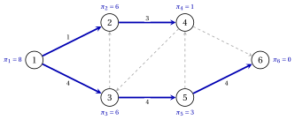

# 8.6 Un esempio senza capacità { #sez-sec-ns-example-a }

**Parte 4 · Il simplesso su reti · Capitolo 8** · [:material-book-open-variant: Capitolo 8: Simplesso su reti](index.md) · [:material-file-pdf-box: Dispensa, volume 4 (PDF)](../../pdf/dispensa-4-simplesso-su-reti.pdf) · [:material-presentation: Slide](../../pdf/slide-network-simplex.pdf) · [:material-pencil: Esercizi: Simplesso su reti](../../esercizi/network-simplex.md) · [:material-gesture-tap: App: Il simplesso su reti, pivot per pivot](../../laboratorio/simplesso-su-reti.md)

- Usiamo la rete di riferimento con i bilanci $\vet{b}=(5,2,0,-3,0,-4)$ e i costi dell'[Esempio 8.2](basi-e-alberi-ricoprenti.md#box-8-ns-ex-tree), ma senza capacità: $u_{ij}=+\infty$ per ogni arco, quindi $U=\emptyset$.

- La struttura ad albero iniziale invia le $5$ unità del nodo $1$ lungo il cammino $1,3,5,4$ e le $2$ unità del nodo $2$ lungo $(2,4)$; il nodo $4$ trattiene $3$ unità e ne inoltra $4$ al nodo $6$:

    $$
    T=\{(1,3),(2,4),(3,5),(4,6),(5,4)\}, \qquad L=\{(1,2),(3,2),(4,3),(5,6)\}, \qquad U=\emptyset .
    $$

- Ogni soluzione ad albero dell'esempio è non degenere. Ogni tabella dà lo stato degli archi (T, L, U), i flussi e i costi ridotti; ogni tabella del ciclo elenca gli archi di $C$ a partire dall'apice.

!!! esempio "Esempio 8.5: il simplesso su reti senza capacità"

    <strong>Iterazione 1</strong>  I potenziali sono $\vet{\pi}=(15,10,13,5,10,0)$ e il costo è $80$.

    
<table>
    <tr>
    <th>arco</th>
    <th>\((1,2)\)</th>
    <th>\((1,3)\)</th>
    <th>\((2,4)\)</th>
    <th>\((3,2)\)</th>
    <th>\((3,5)\)</th>
    <th>\((4,3)\)</th>
    <th>\((4,6)\)</th>
    <th>\((5,4)\)</th>
    <th>\((5,6)\)</th>
    </tr>
    <tr>
    <td>stato</td>
    <td>\(\mathrm{L}\)</td>
    <td>\(\mathrm{T}\)</td>
    <td>\(\mathrm{T}\)</td>
    <td>\(\mathrm{L}\)</td>
    <td>\(\mathrm{T}\)</td>
    <td>\(\mathrm{L}\)</td>
    <td>\(\mathrm{T}\)</td>
    <td>\(\mathrm{T}\)</td>
    <td>\(\mathrm{L}\)</td>
    </tr>
    <tr>
    <td>\(x_{ij}\)</td>
    <td>\(0\)</td>
    <td>\(5\)</td>
    <td>\(2\)</td>
    <td>\(0\)</td>
    <td>\(5\)</td>
    <td>\(0\)</td>
    <td>\(4\)</td>
    <td>\(5\)</td>
    <td>\(0\)</td>
    </tr>
    <tr>
    <td>\(\bar{c}_{ij}\)</td>
    <td>\(-3\)</td>
    <td>\(0\)</td>
    <td>\(0\)</td>
    <td>\(-1\)</td>
    <td>\(0\)</td>
    <td>\(11\)</td>
    <td>\(0\)</td>
    <td>\(0\)</td>
    <td>\(-7\)</td>
    </tr>
    </table>

    - Gli archi ammissibili per l'ingresso sono $(1,2)$, $(3,2)$ e $(5,6)$; l'arco entrante è $e=(5,6)$, con $\bar{c}_{56}=-7$. È in $L$, quindi $C$ segue $(5,6)$.

    - I cammini nell'albero fino alla radice sono $5,4,6$ e $6$: l'apice è $w=6$, e $C$ è $6,4,5,6$.

        
<table>
        <tr>
        <td>arco di \(C\)</td>
        <td>\((4,6)\)</td>
        <td>\((5,4)\)</td>
        <td>\((5,6)\)</td>
        </tr>
        <tr>
        <td>direzione</td>
        <td>\(-\)</td>
        <td>\(-\)</td>
        <td>\(+\)</td>
        </tr>
        <tr>
        <td>residuo</td>
        <td>\(4\)</td>
        <td>\(5\)</td>
        <td>\(+\infty\)</td>
        </tr>
        </table>

    - $\theta=4$, e $(4,6)$ esce dall'albero e va in $L$. Le $4$ unità per il nodo $6$ viaggiano ora su $(5,6)$ invece che lungo $5,4,6$, e il costo diventa $80-4 \cdot 7=52$.

    - Togliendo $(4,6)$ si stacca $S=\{1,2,3,4,5\}$, che contiene $k=5$: questi potenziali cambiano di $\bar{c}_{56}=-7$.

    { .fig loading=lazy  }

    <strong>Iterazione 2</strong>  I potenziali sono $\vet{\pi}=(8,3,6,-2,3,0)$ e il costo è $52$.

    
<table>
    <tr>
    <th>arco</th>
    <th>\((1,2)\)</th>
    <th>\((1,3)\)</th>
    <th>\((2,4)\)</th>
    <th>\((3,2)\)</th>
    <th>\((3,5)\)</th>
    <th>\((4,3)\)</th>
    <th>\((4,6)\)</th>
    <th>\((5,4)\)</th>
    <th>\((5,6)\)</th>
    </tr>
    <tr>
    <td>stato</td>
    <td>\(\mathrm{L}\)</td>
    <td>\(\mathrm{T}\)</td>
    <td>\(\mathrm{T}\)</td>
    <td>\(\mathrm{L}\)</td>
    <td>\(\mathrm{T}\)</td>
    <td>\(\mathrm{L}\)</td>
    <td>\(\mathrm{L}\)</td>
    <td>\(\mathrm{T}\)</td>
    <td>\(\mathrm{T}\)</td>
    </tr>
    <tr>
    <td>\(x_{ij}\)</td>
    <td>\(0\)</td>
    <td>\(5\)</td>
    <td>\(2\)</td>
    <td>\(0\)</td>
    <td>\(5\)</td>
    <td>\(0\)</td>
    <td>\(0\)</td>
    <td>\(1\)</td>
    <td>\(4\)</td>
    </tr>
    <tr>
    <td>\(\bar{c}_{ij}\)</td>
    <td>\(-3\)</td>
    <td>\(0\)</td>
    <td>\(0\)</td>
    <td>\(-1\)</td>
    <td>\(0\)</td>
    <td>\(11\)</td>
    <td>\(7\)</td>
    <td>\(0\)</td>
    <td>\(0\)</td>
    </tr>
    </table>

    - Gli archi ammissibili per l'ingresso sono $(1,2)$ e $(3,2)$; l'arco entrante è $e=(1,2)$, con $\bar{c}_{12}=-3$, in $L$.

    - I cammini nell'albero fino alla radice sono $1,3,5,6$ e $2,4,5,6$: l'apice è $w=5$, e $C$ è $5,3,1,2,4,5$.

        
<table>
        <tr>
        <td>arco di \(C\)</td>
        <td>\((3,5)\)</td>
        <td>\((1,3)\)</td>
        <td>\((1,2)\)</td>
        <td>\((2,4)\)</td>
        <td>\((5,4)\)</td>
        </tr>
        <tr>
        <td>direzione</td>
        <td>\(-\)</td>
        <td>\(-\)</td>
        <td>\(+\)</td>
        <td>\(+\)</td>
        <td>\(-\)</td>
        </tr>
        <tr>
        <td>residuo</td>
        <td>\(5\)</td>
        <td>\(5\)</td>
        <td>\(+\infty\)</td>
        <td>\(+\infty\)</td>
        <td>\(1\)</td>
        </tr>
        </table>

    - $\theta=1$, e $(5,4)$ esce dall'albero e va in $L$. L'unità per il nodo $4$ che viaggiava lungo $1,3,5,4$, a costo $10$, viaggia ora lungo $1,2,4$, a costo $7$: il costo diventa $52-1 \cdot 3=49$.

    - Togliendo $(5,4)$ si stacca $S=\{2,4\}$, che contiene $l=2$: questi potenziali cambiano di $-\bar{c}_{12}=3$.

    { .fig loading=lazy  }

    <strong>Iterazione 3</strong>  I potenziali sono $\vet{\pi}=(8,6,6,1,3,0)$ e il costo è $49$.

    
<table>
    <tr>
    <th>arco</th>
    <th>\((1,2)\)</th>
    <th>\((1,3)\)</th>
    <th>\((2,4)\)</th>
    <th>\((3,2)\)</th>
    <th>\((3,5)\)</th>
    <th>\((4,3)\)</th>
    <th>\((4,6)\)</th>
    <th>\((5,4)\)</th>
    <th>\((5,6)\)</th>
    </tr>
    <tr>
    <td>stato</td>
    <td>\(\mathrm{T}\)</td>
    <td>\(\mathrm{T}\)</td>
    <td>\(\mathrm{T}\)</td>
    <td>\(\mathrm{L}\)</td>
    <td>\(\mathrm{T}\)</td>
    <td>\(\mathrm{L}\)</td>
    <td>\(\mathrm{L}\)</td>
    <td>\(\mathrm{L}\)</td>
    <td>\(\mathrm{T}\)</td>
    </tr>
    <tr>
    <td>\(x_{ij}\)</td>
    <td>\(1\)</td>
    <td>\(4\)</td>
    <td>\(3\)</td>
    <td>\(0\)</td>
    <td>\(4\)</td>
    <td>\(0\)</td>
    <td>\(0\)</td>
    <td>\(0\)</td>
    <td>\(4\)</td>
    </tr>
    <tr>
    <td>\(\bar{c}_{ij}\)</td>
    <td>\(0\)</td>
    <td>\(0\)</td>
    <td>\(0\)</td>
    <td>\(2\)</td>
    <td>\(0\)</td>
    <td>\(8\)</td>
    <td>\(4\)</td>
    <td>\(3\)</td>
    <td>\(0\)</td>
    </tr>
    </table>

    Tutti gli archi di $L$ hanno $\bar{c}_{ij}>0$: <code>STOP</code>. Per il [Teorema 8.10](potenziali-e-ottimalita.md#box-12-ns-th-optimality) il flusso $x_{12}=1$, $x_{13}=4$, $x_{24}=3$, $x_{35}=4$, $x_{56}=4$ è l'unico flusso ottimo, con valore

    $$
    2 \cdot 1+2 \cdot 4+5 \cdot 3+3 \cdot 4+3 \cdot 4=49 .
    $$

    { .fig loading=lazy  }

- Gurobi (gurobipy) conferma il valore ottimo $49$ e il flusso ottimo; l'enumerazione di tutte le strutture ad albero ammissibili dà lo stesso ottimo unico.

- Il flusso ottimo invia $4$ unità su $(5,6)$, la cui capacità nel Capitolo 4 è $u_{56}=2$: con le capacità questo flusso non è ammissibile, e il valore ottimo sale da $49$ a $60$.

!!! chiave ""

    Senza capacità $U$ è vuoto e solo gli archi all'indietro possono bloccare. Sulla rete di riferimento due pivot riducono il costo da $80$ a $52$ e poi a $49$; i costi ridotti dell'ultimo albero sono positivi su tutti gli archi fuori base.

---

**Avanti:** [8.7 Degenerazione e alberi fortemente ammissibili](degenerazione-e-alberi-fortemente-ammissibili.md)
